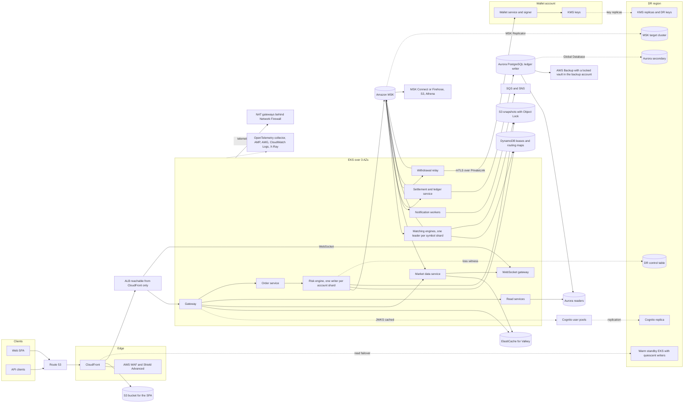
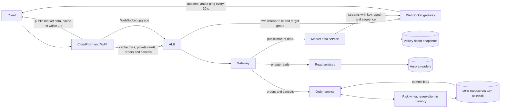
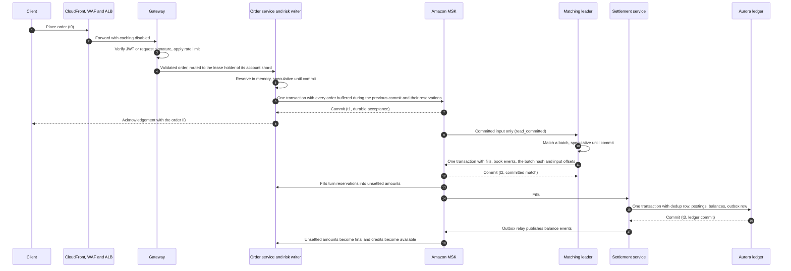

# Problem 1: a trading platform on AWS

This design runs a spot exchange on AWS for 500 requests per second with a p99 response time under 100 ms. Each decision has an ID from AD-P1-01 to AD-P1-21, names the requirements and Well-Architected principles it serves, and links to an architecture decision record in [`docs/adr/`](docs/adr/README.md), and the traceability section at the end traces each one. Prices come from the AWS price list for ap-southeast-1, read on 2026-11-04, and on 2026-11-05 for the GuardDuty, Security Hub, AWS Config, CloudTrail and Cognito offer files, the Verified Access prices and every price or page that [`evidence/`](evidence/README.md) dates 2026-11-05. The arithmetic sits in the same folder.

## The answer in brief

| Question from the task | Answer | Section |
|---|---|---|
| Which Binance features, and why that subset | Spot trading on a small set of pairs with limit and market orders and cancel, order book and trades over REST and WebSocket, a double-entry ledger, and Bitcoin and Ethereum deposits and withdrawals. The subset holds the hard properties of an exchange: one order sequence per symbol, balances that never go negative, and custody of customer funds | 2.1 |
| Which services, and the role of each | An overview diagram with a role table, and one path per request class | 3.1, 3.2 |
| Why each service, and which alternatives lost | One row per need with the alternatives and why they lost, and a decision record for every real trade-off | 5, [`docs/adr/`](docs/adr/README.md) |
| How it stays available and resilient | Every trading tier runs over 3 AZs with static capacity for an AZ loss. Every risk writer and matching leader has a hot standby in another AZ behind a fenced lease, and an order is acknowledged only once every in-sync replica holds it, which is at least 2 of the 3 AZs (`min.insync.replicas=2`). A warm standby region takes over trading after a region loss, on a person's decision | 3.4, 4, 6, 9 |
| How it serves 500 rps with a p99 under 100 ms | No database call on the order path. The acknowledgement waits for Kafka transactions only, and every hop has an allocation | 3.2, 7 |
| How it scales once the product outgrows this setup | Reads scale out, writes scale by adding shards through move protocols, and each further stage opens on a measured trigger | 9, 10 |
| Whether it is cost-effective | A dated estimate with eligible discounts, a smaller baseline to compare against, and separate columns for the security and DR additions | 8 |

| Figure | Value | Section |
|---|---|---|
| Latency allocated on the order path | 60 ms of the 100 ms p99, 62 ms with Problem 5 SC-04 | 7.1 |
| Order-to-match allocation, t1 to t2 | 48 ms of the 50 ms p99 of REQ-P1-16A, holding three transactional commits of 15 ms each | 7.3 |
| Availability objective | 99.95 % per month, a budget of about 657,000 failed requests or 21.9 min of full outage | 11.1 |
| AZ loss | No acknowledged data lost and trading back within 1 min, on static capacity | 6, 8.1 |
| Region loss | An RPO of 1 min of acknowledged orders and trades, and trading back within 1 h of the start of the outage | 6.1 |
| Monthly cost of the design | 17,931.23 USD on demand and 16,700.91 USD with eligible discounts, against 14,604.23 USD for the smaller baseline, before the Cognito lines that scale with monthly active users | 8.3 |
| Monthly cost of the security and DR columns | 1,166.74 USD and 5,239.65 USD, so 24,337.62 USD on demand with both | 8.3 |

## 1. Requirements

A requirement taken from the challenge text has a plain number. A derived requirement rests on an assumption and ends in `A`.

| ID | Requirement | Source |
|---|---|---|
| REQ-P1-1 | A highly available trading system with features similar to Binance, using a chosen subset of features | Task |
| REQ-P1-2 | Resilient to failures | Task |
| REQ-P1-3 | Scalable | Task |
| REQ-P1-4 | Cost-effective | Task |
| REQ-P1-5 | The approach to high availability and scalability is explained | Task |
| REQ-P1-6 | AWS is the cloud provider | Specification |
| REQ-P1-7 | 500 requests per second | Specification |
| REQ-P1-8 | p99 response time under 100 ms | Specification |
| REQ-P1-9 | Overview diagram of the services and the role each plays | Deliverable |
| REQ-P1-10 | Why each cloud service is used and which alternatives were considered | Deliverable |
| REQ-P1-11 | Plans for scaling once the product outgrows the current setup | Deliverable |
| REQ-P1-12A | 99.95 % availability objective for the trading API in one region over 3 AZs. An integrity halt of the affected shards counts against it | Assumption, section 2.2 |
| REQ-P1-13A | AZ loss: no acknowledged data lost, trading back within 1 min. Region loss: RPO 1 min of acknowledged orders and trades, trading back within 1 h of the start of the outage, promotion decided by a person | Assumption, section 2.2 |
| REQ-P1-14A | Spendable balances never go negative, no trade settles twice, matching is deterministic per symbol | Assumption, section 2.2 |
| REQ-P1-15A | REQ-P1-8 applies per request class, measured from a load generator inside the region through the public hostname, with CloudFront and WAF in the path. It holds at a fixed 500 rps and at a 3x plateau (1500 rps) reached by a 5 min ramp, once autoscaling has converged. During convergence up to 1 % of requests may be shed with 429, for at most 5 min | Assumption, section 2.2 |
| REQ-P1-16A | Order-to-match p99 under 50 ms from durable acceptance to the committed match, and trade-to-settlement p99 under 1 s from the committed match to the ledger commit | Assumption, section 2.2 |

## 2. Scope and assumptions

### 2.1 Features in scope

In scope: signup and login with MFA, spot trading on a small set of pairs (limit and market orders, cancel), order book and trades over REST and WebSocket, balances backed by a double-entry ledger, and crypto deposits and withdrawals for Bitcoin and Ethereum through async workers.

Out of scope: futures and margin, P2P, earn and staking, fiat rails, launchpad, KYC vendor internals (stubbed behind an interface), and mobile apps. [ADR-P1-0001](docs/adr/0001-spot-trading-scope.md) records why this subset exercises every hard property of an exchange: matching, balances and custody.

### 2.2 Derived requirements and their basis

| ID | Value used | Basis |
|---|---|---|
| REQ-P1-12A | 99.95 % availability objective for the trading API in one region over 3 AZs, about 657,000 failed requests or 21.9 min of full outage per month. An integrity halt of the affected shards (section 6) counts against it | Higher targets need multi-region active-active matching, which conflicts with a single order sequence per symbol. Section 11.1 splits the budget across the serial dependencies, CloudFront and MSK included, whose 99.9 % SLAs are service-credit thresholds and not the availability expected of them |
| REQ-P1-13A | AZ loss: no acknowledged data lost, trading back within 1 min. Region loss: RPO 1 min of acknowledged orders and trades, trading back within 1 h of the start of the outage, promotion decided by a person | AZ: MSK with replication factor 3, `acks=all` and `min.insync.replicas=2`, Aurora storage across 3 AZs, and a hot standby for every risk writer and matching leader. Region: MSK Replicator and the Aurora Global Database copy asynchronously and independently, with lag alarms at 30 s, so the RPO holds while both copies lag less than 1 min, and the loss witness that each risk writer writes to `<DR_REGION>` every second reports per shard the acknowledged orders and committed matches that did not replicate. The warm standby needs no capacity to start and the fences of section 6.1 are set from outside ap-southeast-1, so the 1 h covers the decision, the fences, the rebuild and the resume |
| REQ-P1-14A | Spendable balances never go negative, no trade settles twice, matching is deterministic per symbol | Correct balances come before availability on an exchange |
| REQ-P1-15A | Request classes: order placement (acknowledged at durable acceptance), cancel, private reads, public market data. p99 under 100 ms per class, measured from a load generator inside the region through the public hostname. ALB `TargetResponseTime` is a diagnostic only | The platform cannot control last-mile latency, and the security controls in front of the API are part of what users experience |
| REQ-P1-16A | Order-to-match p99 under 50 ms from t1 to t2 and trade-to-settlement p99 under 1 s from t2 to t3, with t0 request sent, t1 durable acceptance (Kafka commit), t2 committed match and t3 ledger commit | Matching and settlement are different operations from the acknowledgement. t1 to t2 can hold three transactional commits of 15 ms each, for another risk shard's open transaction, the leader's in-flight batch and its own commit, plus the fetch and the match, 48 ms in section 7.3. t2 stays at the matching commit, because the book is speculative until then |

### 2.3 Assumptions

Each assumption names the fact that would confirm or replace it.

| ID | Assumption | Confirmed by |
|---|---|---|
| AS-01 | Traffic mix at 500 rps: about 60 % public market data, 25 % private reads, 15 % order placement and cancel, which is about 75 orders per second | Product forecast, then the first month of production traffic |
| AS-02 | 10,000 concurrent WebSocket connections on top of the 500 rps, and bursts of 3x | Product forecast and the load test |
| AS-03 | Users are in Southeast Asia, so ap-southeast-1 is the primary region. The DR region `<DR_REGION>` is chosen with legal for data residency, and it must offer Aurora Global Database, MSK Replicator, Cognito multi-Region replication and KMS multi-Region keys | Legal review, and the Region list of MSK Replicator |
| AS-04 | The 500 rps load is priced around the clock, which makes the request-based lines an upper bound | The cost and usage report of the first month |
| AS-05 | Average REST response of 2 KB, 1 KB per forwarded request, half of the public market data requests served from the CloudFront cache, WebSocket traffic of about 1 KB/s per connection | The load test and CloudFront reports |
| AS-06 | Kafka produce volume of 1 MB/s across all topics before replication | The produce metrics of the load test |
| AS-07 | Instance types: `m8g.xlarge` for stateless pods, `c8g.2xlarge` with CPU pinning for matching and risk, `kafka.m7g.large` brokers, `db.r8g.large` for Aurora, `cache.m7g.large` for Valkey, `m7g.large` for the 2 wallet hosts | The benchmark of AD-P1-20 and the load test of AD-P1-16 |
| AS-08 | A ledger of 200 GB with 300 million Aurora I/O per month, 5 GB of logs per day, 100,000 active metric series | The first month of the cost and usage report |
| AS-09 | The KYC vendor sits behind an interface. Chain data comes from full nodes run by the exchange in the wallet account, as Problem 5 FN-13 assumes | Vendor selection, the custody design |
| AS-10 | The organization has 7 accounts: the management account and the six member accounts of Problem 5 SC-06 (production, wallet, log archive, backup, security tooling, non-production) | The account design of Problem 5 |
| AS-11 | 5 million CloudTrail management events per month across the organization, most of them KMS and STS calls, written as 5 GB of trail files | The first month of CloudTrail |
| AS-12 | 200 GB of VPC Flow Logs per month delivered to S3, and the same volume of flow and DNS logs analysed by GuardDuty | The first month of flow logs |
| AS-13 | GuardDuty Runtime Monitoring covers the 84 vCPUs of the production EKS nodes: 9 `m8g.xlarge` and 6 `c8g.2xlarge` | The node count after the load test |
| AS-14 | 20,000 Security Hub CSPM checks per account per month, with finding ingestion inside the 10,000 free events per account | The first month of Security Hub CSPM |
| AS-15 | 30,000 AWS Config configuration items per month, most of them from Karpenter node churn. The Config rules behind Security Hub CSPM controls are paid as Security Hub checks | The first month of AWS Config |
| AS-16 | Seven customer managed keys: one per data class (the Aurora ledger, MSK, Valkey, S3 snapshots and analytics, logs and audit records, Secrets Manager) and the multi-Region key that Cognito multi-Region replication requires. 3 million requests per month on them, and 100,000 withdrawal signatures per month | The key policy review of Problem 5 SC-09 and the first month of KMS |
| AS-17 | One Verified Access application for the admin tools of Problem 5 SC-05, carrying 10 GB per month | The admin plane design |
| AS-18 | The audit log of balance changes and admin actions adds 400 GB per month to S3 with Object Lock in the log archive account | The first month of the audit log |
| AS-19 | Protocol timing values: a lease TTL of 6 s renewed every 1 s with a 3 s progress bound, a 10 s transaction timeout on risk producers, a signer lease of 60 s renewed every 10 s with a 30 s margin, and a loss witness written every 1 s, counted as stale beyond 2 s at the start of an outage, with an alert beyond 5 s | The paused-writer and partition tests of sections 4.1 and 4.2 and the DR exercise of section 6.1 |
| AS-20 | Normal peak takes about 10.7 vCPU of stateless pods, and a stateless node carries sustained load under a 70 % CPU ceiling | CPU per pod and per node in the k6 run at 500 rps and in the AZ game day |
| AS-21 | Each risk writer, matching leader and standby takes 2 exclusive cores, and a `c8g.2xlarge` leaves about 6 vCPU for pinning after the kubelet, system reservations and DaemonSets | The matching saturation run of section 7.4 and the allocatable CPU of a pinned node |
| AS-22 | Each node has a 50 GB `gp3` root volume, and ECR holds 50 GB of images | Node disk use and the ECR storage metric after the first month |
| AS-23 | A WebSocket gateway pod holds 2,500 connections and opens 100 new ones per second, each with its JWT or signature check, and the tier runs 6 pods, 2 per AZ | The reconnect wave of section 7.2 |
| AS-24 | The ledger changes about 10 GB per day, so 35 days of point-in-time recovery hold about 350 GB above the free allocation. 150 million of the 300 million I/O per month of AS-08 are writes, each replicated at 2.75 KB, the size that the Aurora pricing page uses in its Global Database example | `TotalBackupStorageBilled` and the write I/O metric in the first month, then the replicated write I/O and the inter-region transfer on the first bill |
| AS-25 | The vault holds 35 daily and 12 monthly full copies of the 200 GB ledger, 47 copies, and engine snapshots take 200 GB in S3 over their 7 days | The recovery point list of the vault and S3 Storage Lens on the snapshot bucket |
| AS-26 | The lease table takes 20 writes and 20 reads per second, which cover 8 lease holders renewing every second, 8 standbys reading every second and the map and token reads. In `<DR_REGION>` the control table takes the 4 witness writes per second, the 8 quiescent writers read the epoch every 10 s, and the signer lease is renewed and read every 10 s. Every item is under 1 KB | The consumed capacity metrics of each table |
| AS-27 | The web ACL has 8 rules besides Bot Control, and Bot Control inspects 5 % of requests through a scope-down statement | The web ACL and its request metrics |
| AS-28 | 200 GB per month of internet egress, of which 10.5 GB are witness writes to `<DR_REGION>`, and 300 GB of telemetry, about 152 GB of logs and 148 GB of metrics and traces, cross NAT and Network Firewall. 100 GB cross the interface endpoints, 6,000 GB cross AZs in each direction, and 1 GB crosses the PrivateLink path to the wallet service | NAT, firewall and endpoint metrics, and the data transfer lines of the cost and usage report |
| AS-29 | Metrics are scraped every 30 s, dashboards and alert rules read 50 billion query samples per month, and Managed Grafana has 5 editors and 20 viewers | The query sample metric of the workspace and the Grafana user list |
| AS-30 | The Bitcoin and Ethereum hot wallets use 4 KMS keys in the wallet account | The custody key inventory of Problem 5 section 7.1 |
| AS-31 | `<DR_REGION>` is priced at ap-southeast-1 unit prices, with inter-region transfer at 0.09 USD per GB, the rate from ap-southeast-1 to every Asia Pacific region except Malaysia and Thailand (0.08 USD). The standby's ALB and NLB use no capacity units outside a failover | Rerunning the cost script with the offer files of the region that legal chooses |
| AS-32 | The production account takes Business Support+, the other accounts stay on Basic support, and Business Support+ gives access to the Shield Response Team, which the SRT page and the Shield FAQ tie to a Business or Enterprise Support plan. The discount column takes the fee on the Savings Plan and reservation charges, which the support pricing page counts in the fee base | AWS Support in writing before launch, then the first support bill |
| AS-33 | Each row is charged to the account its Account cell names. GuardDuty, AWS Config, flow log delivery and the customer managed keys count in full against production, an upper bound on the support fee | The cost and usage report by linked account |
| AS-34 | Object Lock in compliance mode keeps CloudTrail trail files and the audit log for 5 years and VPC Flow Logs for 1 year. A lifecycle rule moves flow logs and the audit log to Glacier Deep Archive after 90 days and expires each object when its retention ends, trail files stay in S3 Standard, and flow log and audit log objects average 10 MB | Legal for the retention periods, S3 Storage Lens for object counts and sizes |
| AS-35 | The number of monthly active users is open, so the Cognito rows carry `<MAU>` times their price and the totals leave them out | The product forecast, then the monthly active users of the user pool |
| AS-36 | Users whose only second factor is TOTP, which a Cognito replica does not support, stay below `<TOTP_ONLY_SHARE>` of monthly active users, the share that product and risk accept as unable to sign in during a region loss | The count of users by second factor in the user pool, and the share that product and risk set before launch |

## 3. Architecture

### 3.1 Overview

The diagram shows every service and the main flows between them. Section 3.2 draws the path of each request class, and section 3.3 the order lifecycle.

| Component | Role |
|---|---|
| Route 53, CloudFront, AWS WAF, Shield Advanced | DNS, the SPA from S3, public market data cached for 1 s, request filtering and DDoS response, with the Shield Response Team reached through Business Support+ (AS-32). The ALB accepts traffic from CloudFront only (Problem 5 SC-10). An origin group sends GET, HEAD and OPTIONS to the DR origin when the primary origin fails (section 6.1) |
| Gateway on EKS | An in-house stateless Go service, built by the same pipeline as the other services, that verifies JWTs against cached JWKS with no network call per request, checks request signatures and nonces for API keys (Problem 5 SC-04), applies per-key rate limits in Valkey with a local in-memory fallback, and routes, all in one process. It runs a distroless non-root image signed under Problem 5 SC-12 with a read-only root filesystem, takes ingress only from the ALB, sends egress only to Valkey and the internal services, and holds a Pod Identity role with no data-store access beyond its Valkey keys |
| Cognito user pools | Signup, login and MFA, with a replica user pool in `<DR_REGION>` through multi-Region replication ([ADR-P1-0010](docs/adr/0010-cognito-identity.md)). Feature plan, factors, revocation and step-up follow Problem 5 SC-22 |
| Read services | Private reads such as balances, open orders and history, served from the Aurora readers with caching disabled at the edge |
| Order service and risk engine | The order service validates each order and routes it by the account map to the lease holder of its account shard. Each shard has one risk writer and a hot standby in another AZ, which keep available, reserved and unsettled amounts in memory and group-commit orders into Kafka transactions, protocol in section 4.1 |
| Amazon MSK | The sequencer and event log. The commit of a risk writer's transaction is durable acceptance (t1), the commit of a matching batch is the committed match (t2), and every consumer reads committed records only, except the risk writer's search for its highest sequence and the DR rebuild, which reads the records that MSK Replicator copied without relying on transaction markers (sections 4.1 and 4.3). Three brokers, one per AZ, with replication factor 3 and `min.insync.replicas=2`, topics in section 4.4 |
| DynamoDB | One lease table per region holds a lease with a fencing token for every risk and matching shard, the versioned account and symbol maps, and the recovery epoch (sections 4.1 and 4.2) |
| Matching engines | One single-threaded leader per symbol shard on pinned cores, with a hot standby in another AZ that compares every batch output and hash, protocol in section 4.2 |
| Settlement and ledger service | Double-entry postings on Aurora PostgreSQL, protocol in section 4.3 |
| Market data service and WebSocket gateway | Depth and trade streams from committed matching output, depth snapshots in Valkey for REST cache misses, and WebSocket pods behind their own ALB target group that resume a client from its last sequence or send a snapshot (section 4.5) |
| Withdrawal relay | Reads the withdrawal requests that risk writers commit, calls the wallet service with each one over mTLS through PrivateLink, and publishes withdrawal end states and confirmed deposits to `wallet-results` (section 4.4) |
| Wallet service and signer | Deposits and withdrawals in their own AWS account on 2 hosts in 2 AZs (section 3.4). Production reaches them only through the withdrawal relay, over mTLS through a PrivateLink endpoint service, and no wallet principal is a Kafka client. Custody protocol in Problem 5 section 7 |
| SQS, SNS, MSK Connect or Firehose, S3, Athena | Notifications and analytics off the trading path |
| EKS platform | Karpenter, Argo CD, ECR, Secrets Manager, KMS, interface endpoints for ECR, STS, KMS and Secrets Manager, and gateway endpoints for S3 and DynamoDB on the private route tables of every node pool, so image pulls, secrets, keys, S3 objects and the lease table stay off NAT. Telemetry (CloudWatch Logs, AMP, X-Ray), the loss witness writes to the control table in `<DR_REGION>` and internet egress still cross NAT and Network Firewall |
| Egress | NAT gateways behind Network Firewall endpoints, one per AZ, with the egress allowlist of Problem 5 SC-08, for the traffic that the EKS platform row names |
| Observability | An OpenTelemetry collector feeding Amazon Managed Service for Prometheus, Amazon Managed Grafana, CloudWatch Logs and X-Ray, with SLO dashboards |
| Backups and replay | Section 6.2 sets the horizons: 35 days of point-in-time recovery and replay, 60 s engine snapshots kept 7 days, monthly archival copies kept 12 months |
| DR region | The warm standby of section 6.1 in `<DR_REGION>`: EKS at reduced size with quiescent writers, an MSK target cluster fed by MSK Replicator, an Aurora Global Database secondary, the DR lease and control tables, the Cognito replica, KMS replicas and DR keys, and a quiescent DR signer ([ADR-P1-0017](docs/adr/0017-warm-standby-region.md)) |

### 3.2 Request paths

Each request class has its own path, so the slow parts of one class never sit on the path of another.

| Class | Share at 500 rps | Path | Caching |
|---|---|---|---|
| Public market data | about 60 % | CloudFront, then the market data service and Valkey on a miss | Cache key of path, symbol and depth with a 1 s TTL |
| Private reads | about 25 % | Gateway, read services, Aurora readers | Caching disabled, authorization forwarded |
| Order placement and cancel | about 15 % | Gateway, order service, risk writer, MSK | Caching disabled. No database call on the path (AD-P1-02) |
| WebSocket streams | 10,000 connections outside the 500 rps | CloudFront, then an ALB listener rule and target group of their own, the WebSocket gateway, fed by the market data service from committed matching output | Not cached. Each message carries its stream key, the recovery epoch and a sequence, and a reconnecting client resumes inside the replay window or takes a snapshot (section 4.5) |

### 3.3 Order lifecycle

The client receives its acknowledgement at durable acceptance (t1), when the reservation and the order are committed to Kafka. The risk writer puts the orders that arrive during an in-flight commit into its next transaction and acknowledges each order after the transaction that carries it commits (section 4.1). Matching (t2) and the ledger commit (t3) happen after the response, and REQ-P1-16A bounds both.

### 3.4 Placement

Aurora runs a writer plus two readers in different AZs. MSK runs three brokers, one per AZ. Every risk writer and every matching leader has a hot standby in another AZ on the pinned pool of section 8.2, and every service has topology spread constraints and a disruption budget.

The pinned pool runs on-demand nodes only. Its pods carry `karpenter.sh/do-not-disrupt: "true"`, which keeps their nodes out of Karpenter consolidation, and its NodePool sets `expireAfter: Never` and a disruption budget of zero nodes outside a weekly window. A second NodePool with a lower weight offers `c7g.2xlarge` for capacity errors on `c8g.2xlarge`, since Karpenter falls back to a lower-weight NodePool when the preferred one cannot be used. A pinned pod that stays pending for more than 2 min pages. Node auto repair ignores the annotation, as the Karpenter disruption page states, so a standby in another AZ covers a repaired node as it covers any other node loss.

The wallet account runs its 2 hosts in different AZs. Each host runs the signer and the watchers, which coordinate through conditional writes on the withdrawal records (Problem 5 section 7.2), so one host carries every withdrawal while a replacement for the other starts.

## 4. Protocols

### 4.1 Risk engine

[ADR-P1-0004](docs/adr/0004-risk-engine-single-writer.md) records this protocol.

- An explicit, versioned account map assigns every account to one of the account shards of section 4.4. The account map, the symbol map of section 4.2, the recovery epoch and one lease per risk and matching shard live in one DynamoDB lease table per region. Each lease carries a fencing token that grows with every new holder.
- A lease has a TTL of 6 s. Its holder renews it every 1 s, but only while its last successful transaction commit is younger than 3 s, or, when it has nothing to commit, while its last round trip to its transaction coordinator and to the leaders of its input partitions is. A standby takes a lease with a conditional write once it has seen the lease unchanged for the TTL on its own clock. The holder bounds every `initTransactions` and commit call through `max.block.ms` and `delivery.timeout.ms` so that the call ends before the lease would expire, and on a timeout it closes the producer instead of retrying. Before each re-initialization and before resuming, it confirms with a strongly consistent read that the lease still carries its token, and it stops otherwise.
- Each account shard has one writer and one hot standby in another AZ. The standby tails the shard partition with `read_committed` and applies the committed transitions, because new orders reach the writer by request and not from Kafka. Every takeover runs in this order: take the lease with the next fencing token, call `initTransactions` on the shard's stable `transactional.id`, which fences the old producer and completes or aborts its pending transaction, bring the state to the `read_committed` end of the shard partition, from the latest snapshot when the process holds no state in memory, seek the input consumers to their committed offsets, and only then accept orders. The order service routes each request by the account map to the shard's lease holder.
- A writer whose producer is fenced stops accepting orders and does not acknowledge the ones in flight. If the lease read shows that the lease still carries its token, the fence came from a late request of an older producer, and the writer re-initializes and catches up, so the lease holder always wins. Otherwise it gives up the lease and never re-initializes without taking the lease again.
- Per account and asset the writer keeps three amounts: available, reserved, and unsettled (debits and credits from fills that the ledger has not committed yet).
- Transitions: a ledger-confirmed deposit adds to available. An accepted order moves its amount from available to reserved. A fill consumes the matching part of the reservation into an unsettled debit, and adds an unsettled credit for the received asset net of fees. A ledger commit turns unsettled amounts final, and only then does a credit become available. Cancel, expiry and rejection move the unfilled rest of a reservation back to available. A withdrawal request reserves funds in the same way and is committed to `withdrawal-requests`, the withdrawal relay of section 4.4 carries it to the wallet service, and its end state on `wallet-results` either debits or releases the hold.
- A market buy carries its protection price in the order record: 5 % above the best ask that the writer last saw in the committed book events of matching output. The writer reserves the quantity at that price, or the quote amount when the order is quote-denominated, and matching runs the order immediate-or-cancel capped at it (section 4.2). Each fill consumes its cost from the reservation, and the terminal state releases the rest. The writer rejects a market buy when its view of the book shows no ask.
- The writer consumes matching output, ledger events and wallet results, and produces its transitions in Kafka transactions that also commit the consumed offsets, so a replay applies each input exactly once. Every transition carries the ID of the event that caused it.
- A new order is validated and its reservation is computed in memory. Orders that arrive while a transaction commits are buffered and go into the next transaction together with the pending transitions and their consumed offsets (group commit). That transaction writes the reservation records to the shard partition and the order records to their symbol partitions, and each order is acknowledged after its own transaction commits (t1). A reservation record carries the account, the client order ID, a hash of the payload, the order ID and the input ID. An order record carries the input ID, the routing epoch of section 4.2 and, for a market buy, the protection price.
- Balances and idempotency records stay speculative until the transaction commits, and retries and reads see committed state only. Snapshots hold committed state only, together with the shard offset they cover. The sequence counter never goes back, so an aborted record and a committed one never share an input ID.
- On an abortable error the writer aborts, restores the last committed state except the sequence counter, seeks the matching-output, ledger-event and wallet-result consumers back to their committed offsets, then fails the pending requests with a retryable error or resends them under new sequence numbers. On a fatal error, such as a fenced producer, it follows the fenced-writer rule above. On an ambiguous commit, where the call times out without a result, it stops accepting orders and consuming, answers the pending requests with "outcome unknown, retry with the same client order ID" and never with a rejection, and re-initializes the producer under the same `transactional.id`. It then rebuilds from the latest snapshot plus the shard partition and answers retries from the rebuilt idempotency records. After an ambiguous commit, a crash or a takeover, the writer continues the sequence above the highest one on the shard partition, which it finds by reading the partition with `read_uncommitted` after `initTransactions`, so aborted records count. An input ID therefore names one input even for the DR rebuild, which cannot tell aborted records from committed ones (section 4.3).
- An input ID is (recovery epoch, risk shard ID, sequence) and is written into each input record at durable acceptance, so a replay keeps it. Order, output, trade and outbox event IDs carry the epoch. Each region's lease table holds the epoch that its writers use. Writers read it at startup and refuse to start without it, and the quiescent writers of the DR region wait for it (section 6.1).
- A risk writer's open transaction holds the last stable offset of every symbol partition it has written to. The matching leader reads with `read_committed` and cannot pass that offset, so orders and cancels on those symbols wait for every account until the transaction ends. For a dead or cut-off writer the successor's `initTransactions` aborts it, which the lease rules bring within 10 s of the writer's last contact with the brokers. Risk producers set `transaction.timeout.ms` to 10 s as a backstop, and with the broker's abort sweep, every 10 s by default, a transaction that no successor fences ends within 20 s. Both bounds sit inside the 1 min of REQ-P1-13A. Separate input partitions per risk shard and matching shard would confine the stall to one shard, but the leader would then have to record a merge order for every replay.
- The idempotency key is the account plus the client order ID, kept until the order reaches a terminal state and for 24 h after. A retry with the same payload returns the original result. A retry with a different payload under the same key is rejected.
- Settlement lag rule: above 5 s of settlement lag the writer rejects exposure-increasing orders for the accounts involved, the lag pages at 30 s, and above 90 s new orders halt platform-wide. The halt lifts automatically once lag is back under 5 s. Parked trades (section 4.3) do not count toward the lag.
- Once a second and off the order path, each risk writer writes a loss witness to a control table in `<DR_REGION>`: its highest committed sequence, its recovery epoch and the last event ID it has consumed from each `matching-output` partition. It exports the age of its last successful witness write, and an alert pages when that age passes 5 s on any shard, so a NAT, firewall or table fault on the witness path shows before an outage needs the witness. A region promotion reads the witnesses to report the acknowledged orders and committed matches that did not replicate (section 6.1).
- Accounts move between shards only by handoff. The old shard commits a handoff record in its own transaction and rejects later commands for the account, also on replay. The record carries the available, reserved and unsettled amounts, the reservation of each open order, the pending withdrawal holds, the idempotency keys and the input positions at which the old shard stopped. The new shard's writer reads the record from the old shard's partition with `read_committed` and applies it in a transaction that also commits that consumed offset. It accepts commands for the account only after that transaction commits, and it applies later events for the account only beyond those positions. The account map version changes after that, and a command routed to the old shard fails fast, so the client retries with the same client order ID.
- Section 4.6 sheds the new orders of a shard while its commit is slow and gives cancels their own lane.
- Tests: double-spend, and a crash between reservation and commit. A writer paused past its lease, once between reservation and commit and once before `beginTransaction`, which resumes once before and once after its successor's `initTransactions`: the commit before the fence appears in the successor's state, and the one after it fails as fenced and stays unacknowledged. An abortable error after a reservation, checking that the resent orders take new sequence numbers. A lost commit response on an order transaction and on a fill transaction, each followed by a client retry, checking one order per client order ID, no reservation without an order and no skipped fill. A writer killed between produce and commit, measuring t1 to t2 of the other shards' orders on the shared symbol partition through the takeover path and through the timeout path. A market buy that sweeps past its protection price. An account move with a resting partly filled order, a pending withdrawal and a retried client order ID, with a crash at each step.

### 4.2 Matching engine

[ADR-P1-0005](docs/adr/0005-single-threaded-matching.md) records this protocol.

- Each matching shard has one single-threaded leader and a hot standby in another AZ. The leader holds its lease in the table of section 4.1 under the same rules: it renews every 1 s only while its last batch commit, or when idle its last round trip to its transaction coordinator and to the leader of its symbol partition, is younger than 3 s, it bounds every `initTransactions` and commit call so that the call ends before the lease would expire, and it confirms its token with a strongly consistent read before each re-initialization and before resuming. A leader cut off from the brokers therefore loses its lease within 10 s of its last contact with them, and a late re-initialization of the old leader cannot keep its successor fenced, because the lease holder always wins.
- The leader consumes its symbol partition with `read_committed` and processes input in batches, each inside one Kafka transaction that commits the outputs, the input offsets and the batch hash together.
- Book changes inside a batch are speculative until the transaction commits. On an abortable error the engine aborts, restores the state it had at the last committed batch, and retries. On a fatal error such as a fenced producer it applies the fenced-writer rule of section 4.1. On an ambiguous commit, where the call times out without a result, it stops consuming, re-initializes its producer, which completes or aborts the pending transaction, reads back its committed input offset, and rebuilds the book up to that offset before resuming.
- Every output event ID is the input ID of section 4.1, which carries the recovery epoch, plus a sequence within the input. Reprocessing therefore yields identical events, consumers deduplicate on them, and a symbol moved to another partition with overlapping offsets never reuses an ID. Every output record also carries the leader's fencing token and the rules version that produced it. Partition offsets serve only as consumer positions.
- Every batch transaction commits a state hash over the resting orders and their price-time priority, maintained incrementally as the book changes, and every 10,000 input offsets the leader also commits a full hash as a cross-check. Snapshots store the fencing token, the committed input offset, the rules version and the state hash.
- The standby applies only committed input, computes its own fills and book events, and compares them by event ID with the leader's committed output and with each batch hash. While the leader is alive, a mismatch pages and the standby rebuilds from the newest verified snapshot.
- Promotion: the standby takes the lease with the next fencing token, initializes the shard's stable `transactional.id`, which fences the old leader's producer and completes or aborts its pending transaction, and catches up to the last committed input offset. It resumes only when its outputs and the last batch hash match the committed ones at that offset. Otherwise it rebuilds from the newest verified snapshot and replays, and if the committed outputs still cannot be reproduced the symbol stays in an integrity halt and pages.
- Order rules, each deterministic and emitted as events: a market buy runs immediate-or-cancel, capped at the protection price that its order record carries and, when it is quote-denominated, at its quote amount, and the rest expires and releases its reservation. Self-trade prevention cancels the quantity of an incoming order that would trade against a resting order of the same account. A buy limit more than 10 % above the last trade price, or a sell limit more than 10 % below it, is rejected.
- A matching image carries the old and the new rules, and a rules-version command sequenced in the symbol partition switches leader and standby at the same offset. Snapshots and hash records carry the rules version, and a replay applies each offset range with the version recorded for it, so images keep every rules version still inside the 35-day horizon of section 6.2. A rules rollback is a switch-back command at a later offset, and an image rollback goes only to an image that carries every rules version in use. Matching and risk shards are released one shard at a time.
- Symbol routing is an explicit, versioned map in the lease table from symbol to topic and partition, never a hash, and every order and cancel record carries the symbol's routing epoch. A move publishes a paused epoch. Each risk writer that adopts it stops accepting orders and cancels for the symbol and commits a route-change marker to the old partition after its last write there. The old leader ends the drain and takes the snapshot only after it has read a marker from every risk shard. The new epoch then maps the symbol to the new partition, which resumes under a new fencing token. A later record for the symbol on the old partition with an older epoch is rejected as a deterministic event, the risk writer releases its reservation and the client gets a terminal rejection. The old partition's consumer stays until no writer can hold the old epoch.
- Tests: process kills before producing, after producing and before committing, and after committing. A Toxiproxy partition between the leader and the brokers, asserting that the standby serves within 10 s. A lost commit response. A symbol move onto a partition whose offsets overlap the old one, with a risk writer on a stale map holding an open transaction across the move. A divergence injected into the standby between two hash records, followed by a leader kill, where the standby refuses to resume and the symbol halts. A rules switch with a leader failover inside the window. Self-trade and collar cases. Each test checks that no trade is lost or repeated and that a replayed input keeps its event IDs.

### 4.3 Ledger

[ADR-P1-0007](docs/adr/0007-aurora-ledger-outbox.md) records this protocol.

- One database transaction per trade holds the deduplication row (unique trade ID), the balanced postings, the balance row updates and an outbox row.
- Balanced postings are checked inside the posting function, with a deferred constraint trigger as a backstop. Each balance row carries `CHECK (available >= 0)`.
- Rows are locked in account ID order to avoid deadlocks, under `READ COMMITTED` with row locks.
- Every outbox row carries a ledger commit sequence, drawn from a PostgreSQL sequence with a cache of 1 as the last step of the transaction, after its balance rows are locked. A trade that spends the result of another trade therefore carries a higher sequence. Outbox event IDs carry the recovery epoch of section 4.1. An outbox relay publishes balance events to Kafka at least once, and consumers deduplicate by event ID.
- A trade that fails an invariant is parked: one ledger transaction writes a parked-trade row with the trade ID and the reason and advances the consumed position. The shards of both counterparties enter the integrity halt of section 6, later trades of those accounts are parked in order, and settlement continues for every other account. Parked trades do not count toward the settlement lag rule of section 4.1. The first parked trade pages, and parked trades that involve more than 2 account shards, or more than 10 within 5 min, halt new orders platform-wide. A parked trade is settled in its original order after the fix, or reversed with a compensating posting under two approvals, and the halt lifts only after that and a zero diff.
- Every 60 s the ledger writes a checkpoint row with a checkpoint ID, the consumed positions and last event IDs of every matching-output and wallet-results partition, the parked trade IDs and its commit timestamp, and publishes the same record through the outbox to the `ledger-checkpoints` topic. The topic travels with MSK Replicator and the row with the Aurora Global Database, so the DR region can find the newest checkpoint present in both. Checkpoints are the watermarks for reconciliation (Problem 5 SC-03) and the recovery points for region loss (section 6.1).
- A restore or a region recovery replays every ledger input after its checkpoint: trades, deposit confirmations and withdrawal end states. The replay follows the source commit order where that order is known, from the original cluster's outbox table after a corruption, since the point-in-time restore goes to a new cluster, and from the commit sequence otherwise. Beyond that point only the partition whose next record fails a CHECK pauses while the others continue. A failure left after every partition reaches the present is an integrity error that keeps the halt. Replicated topics are read without relying on transaction markers: per input ID only the outputs of the highest fencing token count, deduplicated by event ID.
- Tests: property-based tests generate random trade sequences and check the invariants after each one. An injected invariant failure checks that only the counterparties' shards halt and that the trade settles once after the fix. An ordered replay after a restore runs one account's dependent trades on two symbols, a purchase on one and the sale of its proceeds on the other, and reaches the present with a zero diff.

### 4.4 Topics and shards

Stage 0 runs 4 account shards and 4 matching shards. The `risk-shard` partition of an account shard is its shard partition, and the `orders` partition of a matching shard is its symbol partition, in the terms of sections 4.1 and 4.2.

| Topic | Key and partitions | Producers | Consumers |
|---|---|---|---|
| `risk-shard` | Account shard, 4 partitions | The shard's risk writer | Its standby, reconciliation, and the writer of a shard that receives an account through the handoff of section 4.1 |
| `orders` | Matching shard through the symbol map, 4 partitions | Every risk writer | The shard's matching leader and standby |
| `matching-output` | Matching shard, 4 partitions | The matching leader | Risk writers, settlement, market data, notifications, analytics, the standby's comparison |
| `ledger-events` | Account shard, 4 partitions | The outbox relay | Risk writers, notifications |
| `ledger-checkpoints` | 1 partition | The outbox relay | Reconciliation, the DR runbook |
| `withdrawal-requests` | Account shard, 4 partitions | Risk writers | The withdrawal relay, and the shard's writer during the integrity rebuild of section 6 |
| `wallet-results` | Account shard, 4 partitions | The withdrawal relay | Risk writers, settlement |

Every topic has replication factor 3 and `min.insync.replicas=2`, and every consumer of a topic written in transactions reads with `read_committed`, apart from the risk writer's search for its highest sequence (section 4.1) and the DR rebuild (section 6.1). Consumers that KEDA scales on lag are capped at their topic's partition count. Matching and risk shards change only through the move protocols of sections 4.1 and 4.2, never through autoscaling.

The withdrawal relay runs on the stateless pool in production. It consumes the withdrawal requests that risk writers commit and calls the wallet service over mTLS, keyed by the durable withdrawal ID, through a PrivateLink endpoint service: a Network Load Balancer in the wallet account over its 2 AZs, and an interface endpoint in production. An endpoint service is available only in the AZs of its load balancer, so the interface endpoint has network interfaces in the same 2 AZs, and pods in the third AZ reach it through its Regional DNS name. The relay pulls withdrawal end states and confirmed deposits over the same API with a cursor, publishes them to `wallet-results` under its own `transactional.id` with the cursor in each record, and serves the list of non-terminal withdrawals that a rebuild needs. Every connection to the wallet account starts in production, and no wallet principal is a Kafka client.

### 4.5 Market data and WebSocket streams

The market data service builds depth and trade streams from committed matching output and keeps depth snapshots in Valkey, which answer public REST market data on a CloudFront cache miss (section 3.2).

- WebSocket connections reach the WebSocket gateway through their own ALB listener rule and target group, never through REST gateway pods. The WebSocket gateway verifies the JWT or the API key signature when the connection opens, as the gateway does for REST requests.
- The WebSocket gateway sends an application ping every 30 s. The smallest idle timeout on the path is the ALB's, 60 s by default, while CloudFront closes a WebSocket only after 10 min without bytes from the origin.
- HPA scales the WebSocket gateway on connections per pod, and section 8.2 sizes the tier for all 10,000 connections reconnecting within 30 s.
- Every stream message carries its stream key, the recovery epoch and a sequence. A reconnecting client resumes from its last sequence inside a replay window held by the market data service, or takes a fresh snapshot, and a new epoch always forces a snapshot.
- Clients reconnect with jittered exponential backoff, and connections above the connection-rate limit get 429 with a jittered Retry-After.

### 4.6 Overload and shedding

[ADR-P1-0011](docs/adr/0011-valkey-rate-limits.md) records this policy, which AD-P1-11 tracks.

- All shedding answers 429 with a jittered Retry-After, in this order: new WebSocket connections and reconnects above the connection rate, public market data misses above the per-IP and per-key limits while CloudFront keeps serving cached responses, private reads, new orders, and cancels last.
- Group commit puts every queued new order into the next transaction, so a new order waits for the in-flight commit and then for its own. The slow-commit rule therefore rejects new orders while a shard's in-flight commit has been open for longer than 68 ms minus the shard's own commit p99 measured over the last minute, where 68 ms is what the 100 ms of REQ-P1-8 leaves after the allocations of the other hops of section 7.1 with Problem 5 SC-04. While the commit p99 stays within its 15 ms budget, the rule fires only on a commit open for more than 53 ms, as in the MSK patching spikes of section 6, so it takes no share of the remainder of section 7.1.
- Cancels have a reserved lane with their own rate bucket, go into the next transaction ahead of queued new orders, and are never rejected by the slow-commit rule.
- A cancel acknowledged at t1 is accepted and takes effect at t2, when matching commits it, so a fill can still happen in between. The client learns the final state from the order stream or the order query.

## 5. Service choices

The rows marked with an ADR carry the decisions with real trade-offs. Vendor limits cited here are listed with their pages in [`evidence/README.md`](evidence/README.md).

| Need | Chosen | Alternatives and why they lost | ADR |
|---|---|---|---|
| DNS | Route 53 | A DNS provider outside AWS has no alias records for CloudFront and adds a second vendor to the failover path | none |
| Edge, SPA and cached market data | CloudFront with an S3 origin | Serving everything from the ALB puts every market data read on the origin, and a cache in Valkey alone still needs an origin round trip per request | [ADR-P1-0009](docs/adr/0009-front-door.md) |
| Request filtering and DDoS response | AWS WAF with Shield Advanced, and Business Support+ on the production account, since the Shield Response Team needs a Business or Enterprise Support plan (AS-32) | Shield Standard alone has no DDoS cost protection and no response team. Section 8.4 gives what Shield Advanced costs net of the WAF fees it removes, with the support fee on that amount | [ADR-P1-0009](docs/adr/0009-front-door.md) |
| API front door | ALB behind CloudFront | API Gateway caps a WebSocket connection at 2 hours, and it bills every REST request and every WebSocket message and connection minute, where the ALB bills capacity units. An NLB has no HTTP routing: its listener rules choose a target group by source IP address type only, so WebSocket upgrades on the same hostname and port could not reach a target group of their own | [ADR-P1-0009](docs/adr/0009-front-door.md) |
| Compute | EKS with Karpenter | ECS on Fargate is simpler but offers no CPU pinning for the matching engine and no shared tooling such as Argo CD, Kyverno and KEDA. ECS on EC2 is the cost comparison column in section 8. Lambda has cold starts on the latency path | [ADR-P1-0008](docs/adr/0008-eks-karpenter.md) |
| Gateway | An in-house stateless Go service on EKS that verifies tokens and request signatures, applies rate limits and routes in one process (section 3.1) | Envoy Gateway on EKS routes and rate-limits, but the request signature and nonce check of Problem 5 SC-04 would run as an external authorization call to another service on every request, a second network hop inside the gateway allocation of section 7.1 | none |
| Sequencer and event log | Amazon MSK provisioned | Kinesis Data Streams is rejected: `PutRecords` processes each record on its own and KCL keeps consumer positions in a DynamoDB table outside the stream, so no write commits outputs on several shards with the consumed positions, and nothing fences an old producer as the stable `transactional.id` does in sections 4.1 and 4.2. Its documented average propagation of 70 ms also exceeds the 50 ms of REQ-P1-16A. SQS FIFO has no replay. MSK Express brokers, and MSK Serverless once an AWS page states transaction support, are measured against provisioned brokers in the benchmark of section 7.4. Aeron Cluster or an in-memory Raft log is faster and is the stage 2 path | [ADR-P1-0006](docs/adr/0006-msk-sequencer.md) |
| Matching and risk leases | DynamoDB, one lease table per region with a fencing token per shard, the versioned account and symbol maps and the recovery epoch | A lease row in Aurora ties matching and risk availability to the ledger database and its writer failover. A self-run etcd or ZooKeeper adds a consensus system to operate | [ADR-P1-0005](docs/adr/0005-single-threaded-matching.md) |
| Ledger | Aurora PostgreSQL | DynamoDB caps a transaction at 100 items and makes reconciliation queries harder. Self-managed PostgreSQL adds failover work | [ADR-P1-0007](docs/adr/0007-aurora-ledger-outbox.md) |
| Cache and rate limits | ElastiCache for Valkey | MemoryDB is durable but has higher write latency and cost, which derived data does not need | [ADR-P1-0011](docs/adr/0011-valkey-rate-limits.md) |
| Identity | Cognito on the Plus plan of Problem 5 SC-22, with the multi-Region replication add-on and a replica user pool in `<DR_REGION>` | Keycloak on EKS on Aurora Global Database would follow the DR region, at the cost of operating an identity system. A regional user pool without the add-on would need every user to enroll again after a region loss, which does not fit the 1 h of REQ-P1-13A | [ADR-P1-0010](docs/adr/0010-cognito-identity.md) |
| Key custody | KMS secp256k1 keys in a separate account behind a signer service | CloudHSM gives single-tenant HSMs with more operations work. A third-party custodian is a business decision listed in Problem 5 | Problem 5 |
| Engine snapshots | S3 with Object Lock | EBS snapshots are regional and can be locked in compliance mode too. S3 wins because a standby in another AZ reads the state record with one GET, while an EBS path needs a volume per engine, a snapshot call every 60 s, a volume created and attached before any read, and a separate lock call after each snapshot, since a snapshot cannot be locked during creation. An S3 default retention locks every object as it is written | [ADR-P1-0012](docs/adr/0012-backups-and-recovery.md) |
| Backups | AWS Backup with a locked vault in the backup account | Snapshots kept only in the production account can be deleted by whoever compromises that account | [ADR-P1-0012](docs/adr/0012-backups-and-recovery.md) |
| Notifications | SQS and SNS | Sending email and push messages from Kafka consumers on the trading path ties a provider outage to trading consumers | none |
| Analytics | MSK Connect or Firehose into S3, queried with Athena | Queries on the Aurora readers put analytics load on the ledger | none |
| Images, secrets, keys | ECR, Secrets Manager, KMS | Public registries pull through NAT and the internet. Kubernetes secrets alone have no rotation | none |
| Private access to AWS APIs | Interface endpoints for ECR, STS, KMS and Secrets Manager, and gateway endpoints for S3 and DynamoDB on the private route tables of every node pool | The NAT and Network Firewall path: Network Firewall waives the NAT charges on its path but bills 0.065 USD per GB against 0.01 USD for an interface endpoint, so an endpoint costs less above the break-even of section 8.4, and gateway endpoints carry no charge. Telemetry (CloudWatch Logs, AMP, X-Ray), the loss witness writes to the control table in `<DR_REGION>` and internet egress stay on that path, and the wallet account's calls to the signer lease in `<DR_REGION>` leave through its own egress (section 8.5) | [ADR-P1-0014](docs/adr/0014-capacity-cost-sustainability.md) |
| Egress | NAT gateways behind Network Firewall endpoints | NAT instances need self-managed failover and patching | Problem 5 |
| Wallet transport | A withdrawal relay in production that calls the wallet service over mTLS through a PrivateLink endpoint service (section 4.4) | Cross-account access to the production MSK cluster would make wallet principals Kafka clients of production topics, against the custody boundary of Problem 5, where every connection starts in production. VPC peering would connect the two VPCs through routes and security groups, a wider path than one endpoint service in front of one Network Load Balancer | Problem 5 |
| Metrics, dashboards, logs, traces | OpenTelemetry collector, AMP, AMG, CloudWatch Logs, X-Ray | Self-managed Prometheus, Grafana and a tracing backend on EKS have no per-sample fee but add storage and high availability to operate | [ADR-P1-0013](docs/adr/0013-slo-observability.md) |
| Delivery | Argo CD and Argo Rollouts | Pushing from CI with cluster credentials gives CI write access to production and no drift correction | [ADR-P1-0016](docs/adr/0016-gitops-operating-model.md) |
| Region recovery | A warm standby in `<DR_REGION>` with quiescent writers, Aurora Global Database, MSK Replicator, Cognito multi-Region replication and KMS multi-Region keys (section 6.1) | A pilot light keeps only the data copies and launches compute after the loss, which puts launches and warm-up inside the 1 h. Restoring backups in another region takes hours and still needs a consistent boundary between the ledger and the log. Active-active regions need two sequences per symbol or cross-region consensus on the order path | [ADR-P1-0017](docs/adr/0017-warm-standby-region.md) |

## 6. Failure modes and recovery

| Failure | Automatic response | Customer impact |
|---|---|---|
| One AZ down | ALB and EKS drop the AZ, and the two other AZs carry 1.5x the normal peak at no more than 70 % CPU without waiting for Karpenter (section 8.1). MSK leaders move, and writes continue on two in-sync replicas. Risk and matching standbys in the other AZs take their leases within 10 s (sections 4.1 and 4.2). A dead risk writer's open transaction holds the symbol partitions it wrote to until its successor fences it, within the same 10 s, or 20 s at worst. If the AZ held the Aurora writer, Aurora promotes a reader as in the Aurora writer failover row. Withdrawals and chain watching continue on the wallet host in the surviving AZ | Orders of the shards that fail over fail fast, and orders and cancels on the symbols a dead writer's transaction touched wait, for up to 10 s, or 20 s at worst. Clients retry with the same client order ID, and no acknowledged order is lost. With the Aurora writer in the lost AZ, the settlement lag rule of section 4.1 rejects exposure-increasing orders above 5 s of lag and halts new orders above 90 s until lag is back under 5 s. Trading is back within 1 min in the sense of REQ-P1-13A when the Aurora failover and the catch-up fit in that minute, which the AZ game day checks: every account can place orders against its settled balances, while proceeds still unsettled become usable when settlement catches up. Every withdrawal reservation stays held until its end state |
| Matching engine leader crash or partition | The standby takes the lease once the leader stops renewing, within 10 s, fences the old producer and resumes only when its outputs and the last batch hash match the committed ones (section 4.2) | Matching pauses for up to 10 s on that shard while orders queue in Kafka. If the committed outputs cannot be reproduced, the symbol stays in an integrity halt and pages |
| Risk engine shard crash or partition | The standby takes the lease, fences the old producer through the shard's `transactional.id`, which aborts its open transaction, reads the shard partition to its end and only then accepts orders (section 4.1). The order service routes to the new holder. Without a successor, the 10 s transaction timeout ends the open transaction within 20 s | Orders for that shard fail fast for up to 10 s, and a pending order gets "outcome unknown, retry with the same client order ID", never a rejection. Orders and cancels on the symbols the open transaction touched wait for every account until the fence, within 10 s, or 20 s at worst |
| Aurora writer failover | Aurora promotes a reader, and service is typically restored in less than 60 s and often less than 30 s, as the Aurora high availability page states. Settlement retries idempotently. The risk engine keeps trading on its own state under the settlement lag rule of section 4.1 | Settled balances and withdrawals lag for the failover time. Above 5 s of lag the accounts involved cannot add exposure, the lag pages at 30 s, and above 90 s new orders halt platform-wide until lag is back under 5 s. If failover plus catch-up exceeds 60 s in the AZ game day, RDS Proxy on the settlement writer connection is the recorded next step, since the same page says it cuts failover time by up to 66 % |
| Valkey primary loss | Replica promoted. Rate limits fall back to per-pod local buckets. The nonce store follows Problem 5 SC-04 | Market data clients resync by sequence number |
| MSK cluster or quorum loss | Writes to a partition with fewer than 2 in-sync replicas fail, as `min.insync.replicas=2` with `acks=all` defines. Orders and cancels on those partitions fail fast and clients retry, and matching and settlement stall where their partitions cannot commit. Beyond 30 min the incident commander may start the procedure of section 6.1, whose steps 3 and 4 also fence a primary that still answers | No acknowledged order is lost. Trading stops on the affected partitions, or everywhere when the cluster is down, while public market data serves the last depth snapshots |
| MSK rolling patching and leader moves | MSK reboots brokers one at a time and Kafka moves leadership to the online brokers, as the MSK patching page states. Clients reconnect to the new leaders. Broker size changes and version upgrades that the team starts run at low volume | The patching page describes p99 spikes of high milliseconds, up to about 2 s, for up to 2 min per broker. That is far above the 15 ms commit budget of section 7.3, so each window burns the order-to-match objective and slows acknowledgements, and the slow-commit rule of section 4.6 rejects new orders while a commit stays open past its threshold. No acknowledged order is lost |
| Integrity breach: ledger, risk engine and chain disagree at the same checkpoint | New orders and withdrawals stop for the affected account shards, and their open orders are cancelled through matching. Once matching has committed those cancels and settlement every fill of those accounts up to them, the rebuild takes the next checkpoint. Reserved is the sum of the holds of every withdrawal without an end state at or before the `wallet-results` positions of that checkpoint, taken from the requests that the shards committed to `withdrawal-requests`, delivered or not, and from the non-terminal withdrawals (requested, risk approved, approved, signed, broadcast) that the withdrawal relay lists from the wallet service, deduplicated by withdrawal ID. Available is the ledger balance at that checkpoint minus those holds, because the ledger debits a withdrawal only at its end state, and the writer resumes its `wallet-results` consumer at those positions. Trading resumes when no open order of the shards remains in any book, the holds equal the wallet records once the relay has delivered every committed request, the ledger agrees with the chain and the next checkpoint diff is zero. Lag without a diff is not a breach | Affected accounts cannot trade or withdraw until verified, and their resting orders are cancelled. An account that comes out negative stays halted for a correction under two approvals. The halt counts against REQ-P1-12A |
| Trade rejected by a ledger invariant | Settlement parks the trade and continues for every other account (section 4.3). The shards of both counterparties enter the integrity halt above, and their later trades are parked in order. The first parked trade pages, and parked trades across more than 2 account shards, or more than 10 within 5 min, halt new orders platform-wide | The counterparties wait until each parked trade is settled in its original order after the fix, or reversed with a compensating posting under two approvals, and the next diff is zero. Parked trades do not count toward the settlement lag rule, so other accounts keep trading |
| Ledger corruption or a bad write | Integrity halt as above, point-in-time restore into a new cluster, ordered replay of every ledger input after the restore point (section 4.3), then the rebuild of the integrity breach row | Withdrawals stop until the restore is verified, and the affected accounts are halted as in the integrity breach row |
| Region down | No automatic promotion. The incident commander and the head of risk declare the loss, and the procedure of section 6.1 fences the client path and withdrawals from outside the region and promotes the warm standby. Public market data and private reads keep working from the DR origin through the CloudFront origin group meanwhile | Trading back within 1 h of the start of the outage, with an objective of at most 1 min of acknowledged orders and trades lost, reported per shard. Withdrawals resume after the chain check of Problem 5 section 7.8 |
| CloudFront misconfiguration | Distribution changes ship from Git through a CloudFront staging distribution that takes a weighted share of production traffic before promotion, and roll back by revert | A bad change reaches at most the staging share, which CloudFront caps at 15 % of traffic by weight, until it is promoted |
| CloudFront unavailable | No automatic response. A second CDN or a direct path to the origin would bypass AWS WAF and Shield Advanced, so the design accepts the dependency, recorded in section 12 | Clients cannot reach the platform while CloudFront is down. Acknowledged orders and balances are not affected |
| Edge or origin failure with WebSockets open | Connections drop. Clients reconnect with jittered exponential backoff and resume from their last sequence inside the replay window, or take a fresh snapshot (section 4.5). Reconnects above the connection rate get 429 with a jittered Retry-After | Streams pause until each client reconnects. A client that resumes inside the replay window misses no update |
| Volatility spike above static capacity | Per-key rate limits, then shedding in the order of section 4.6 with cancels last, while Karpenter adds nodes | Up to 1 % of requests get 429 with a jittered Retry-After for at most 5 min (REQ-P1-15A), new orders before cancels |
| Bad deploy | Stateless services roll out as Argo Rollouts canaries with automatic rollback on SLO burn. Matching and risk shards are released one shard at a time, so the canary unit of a single-writer service is a whole shard. A rules divergence is caught by the output comparison of section 4.2 and by reconciliation, not by SLO burn | Limited to the canary share, or to the one shard being released |
| Gateway compromised | GuardDuty Runtime Monitoring findings and per-account order-rate anomalies page on-call, who roll back to the last signed image, revoke the gateway role and halt order entry | Forged orders and cancels for any account until order entry halts. The 24 h allowlist cooldown of Problem 5 SC-02 delays any withdrawal to a new address, so funds cannot leave through an address added in that window |

### 6.1 Region recovery procedure

[ADR-P1-0017](docs/adr/0017-warm-standby-region.md) records this tier. A warm standby in `<DR_REGION>` runs over three AZs: EKS with every service deployed by the same Argo CD applications at reduced size, 3 `m8g.xlarge` and 3 `c8g.2xlarge` nodes holding one quiescent process per shard, an MSK target cluster of 3 `kafka.m7g.large` brokers with 3 x 1,000 GB fed by MSK Replicator, an Aurora Global Database secondary with one `db.r8g.large`, a Valkey primary and replica, an internal ALB behind a CloudFront VPC origin, the same NAT, Network Firewall and endpoint layout, the DR lease table and a DR control table, 11 KMS keys (replicas of the 4 hot keys and of the Cognito key, DR keys for the other 6 data classes), a quiescent DR signer on 2 wallet hosts with its PrivateLink path, and Cognito multi-Region replication. Its cost is the DR column of section 8.3.

CloudFront sends GET, HEAD and OPTIONS through an origin group whose secondary is the DR origin. Those are the only methods for which CloudFront fails over, so public market data and private reads from the Aurora secondary keep working during a region loss, while write routes use the primary origin only. The primary origin uses fewer connection attempts and a shorter connection timeout than the defaults, which wait up to 30 s before trying the secondary. Identity in the DR region comes from the Cognito replica of ADR-P1-0010, which keeps users signed in through a regional failover.

The objectives for a region loss are an RPO of 1 min of acknowledged orders and trades, and trading back within 1 h of the start of the outage, the decision included. Withdrawals follow after the chain check of Problem 5 section 7.8. An alarm pages when MSK Replicator `ReplicationLatency` or Aurora `AuroraGlobalDBRPOLag` passes 30 s. Promotion needs no answer from ap-southeast-1. Old-region trading writers need no fence of their own: with no client path and no signer, their later writes stay a divergent tail, reconciled when the region returns and never merged automatically, and step 4 stops them when ap-southeast-1 still answers.

1. The incident commander and the head of risk declare the region lost, from regional health signals and the replication lag alarms.
2. Fence the client path. Switch every CloudFront cache behaviour to its DR origin through the CloudFront control plane, which runs in us-east-1 and in neither region, and confirm the deployed configuration and the external probes. Route 53 keeps pointing at CloudFront.
3. Fence withdrawals. A signer may sign only while it holds the signer lease, a DynamoDB item in the wallet account in `<DR_REGION>` with a 60 s TTL renewed every 10 s. Add a deny for the primary signer's role to the resource-based policy of the lease table, a change made in `<DR_REGION>`, so that the primary signer cannot renew even while ap-southeast-1 still reaches `<DR_REGION>`, since an explicit deny overrides any allow. The DR signer takes the lease with a conditional write once it has seen the lease unchanged for the TTL plus 30 s on its own clock.
4. If ap-southeast-1 still answers, as after an MSK cluster loss, scale its risk writers and matching engines, standbys included, its settlement service and its withdrawal relay to zero through a Git change that Argo CD applies, and read back from its EKS API that none runs. Stop MSK Replicator, whose resources run in the target Region, and fail the Aurora Global Database over from the DR region with `--allow-data-loss`. Record the loss witness of every risk shard from the DR control table.
5. Set the recovery epoch in the DR lease table to one more than the highest epoch found in the replicated Aurora cluster and in every replicated topic. The quiescent DR writers start only after it is set.
6. Rebuild. Take the newest checkpoint present in both the replicated Aurora cluster and the replicated `ledger-checkpoints` topic, and find the replay start in each target topic by the event IDs it records, since MSK Replicator can give records different offsets on the target. The DR withdrawal relay publishes to `wallet-results` the end state of every terminal signer record that the replicated topic lacks, deduplicated by withdrawal ID. Replay every ledger input after the checkpoint under the rule of section 4.3. Every order still open in the replicated topics gets a terminal cancelled state in the new epoch, so the DR books start empty. The DR risk shards re-create a hold for every replicated signer record in a non-terminal state and take available from the replayed ledger minus those holds. Every replicated withdrawal request without a signer record ends in the new epoch as failed, the end state that Problem 5 section 7.2 gives a withdrawal that ended before any signing, so it holds no funds, and the DR withdrawal relay never delivers it, since it delivers requests of the new epoch only.
7. Report the loss per shard. A risk shard lost the acknowledged orders and other inputs whose sequences lie above the highest one that replicated, up to the sequence in its witness, and a matching shard lost committed matches when a witness names one of its `matching-output` events that did not replicate. The loss window of a shard runs to the start of the outage from the later of its newest replicated record and the newest witness whose positions for that shard all replicated, so the time after that witness counts as lost in full, and the RPO of 1 min holds when every window is shorter than 1 min. A witness older than 2 s at the start of the outage, its 1 s interval plus a margin, is reported as stale. A client finds a lost order through the order query, which no longer knows its order ID, and support names every account concerned once step 10 reads the divergent tail of ap-southeast-1.
8. Resume trading after a zero diff at the next checkpoint, a check that the holds equal the non-terminal signer records and that every replicated withdrawal request has a signer record or the failed state of step 6, and the approval of the incident commander and the head of risk.
9. Resume withdrawals after the chain check of Problem 5 section 7.8 finds no hot wallet transaction that the replicated records lack. Old signed but unconfirmed transactions are treated as broadcastable. The DR signer never reuses their inputs or nonces, and their funds stay reserved until they confirm or a replacement that spends the same inputs back to the hot wallet confirms.
10. When ap-southeast-1 returns, stop its writers before any link is restored. Reconcile its divergent tail against the DR ledger with compensating postings under two approvals, reading the ledger part from the snapshot that Aurora tries to take of the old volume at the point of failure and the log part from the old MSK cluster. Failback is a later planned switchover that runs step 5 in reverse: before any writer starts in ap-southeast-1, its lease table gets one more than the highest epoch used in either region.

### 6.2 Backups and replay horizons

The operational horizon is 35 days: Aurora point-in-time recovery for 35 days, Kafka retention of 7 days on brokers plus tiered storage up to 35 days, and AWS Backup copies in a vault in the backup account, whose compliance-mode lock is Problem 5 SC-16. The vault holds 35 daily and 12 monthly copies of the ledger, and each one is a full copy, since Aurora stores every cluster snapshot copy in full. The recovery points that the backup plan creates in the production account expire within 35 days. Retention keeps every ledger input after an operational restore point, and the ordered replay of section 4.3 brings the restored ledger to the present. Risk and matching snapshots every 60 s are kept 7 days in S3 with Object Lock, and a rebuild starts from the newest verified snapshot and replays the log after it.

Monthly copies kept 12 months are archival. They serve audit and forensics and restore to their own point in time, never with replay to the present. Tiered topics keep `cleanup.policy=delete`, which MSK tiered storage requires, so no event topic is compacted.

## 7. Latency

### 7.1 Allocation for order placement

Percentiles do not add up, so the table allocates a budget per hop and the requirement is checked end to end.

| Hop | Allocation |
|---|---|
| CloudFront and WAF, edge to in-region origin | 10 ms |
| ALB | 5 ms |
| Gateway: JWT, request signature, rate limit | 5 ms |
| Order service: validation and risk reservation in memory | 5 ms |
| MSK: the wait for the risk writer's in-flight commit, then the order's own transactional commit with `acks=all` across 3 AZs, 2 x 15 ms | 30 ms |
| Response path | 5 ms |
| Allocated in total, against the 100 ms requirement | 60 ms |

No database call sits on the order path. One p99 budget of 15 ms covers every MSK transactional produce and commit, here and in matching (section 7.3): the produce requests, `AddPartitionsToTxn`, the consumed offsets and `EndTxn` with the commit markers it starts, written with `acks=all` across 3 AZs. A risk writer has one open transaction at a time, so an order that arrives during a commit waits for it and then goes into the next transaction with every other order that arrived meanwhile (group commit, section 4.1). The MSK row therefore holds two commits. The unallocated 40 ms shrinks to 38 ms after Problem 5 SC-04, which adds 2 ms at the gateway, and that remainder covers garbage collection pauses and any later security overhead. The slow-commit rule of section 4.6 rejects new orders only once an in-flight commit has been open for longer than the 68 ms that the other hops leave, less one commit p99, so shedding takes no share of that remainder. The load test and the benchmark of section 7.4 report the commit p99 separately for risk-writer transactions and for matching batch transactions, and each one must stay within the 15 ms budget.

### 7.2 Measurement

A k6 test runs from inside the region against the public hostname with every Problem 5 control on, first at a constant 500 rps, then with a 5 min ramp to a 1500 rps plateau. It reports p99 per request class and per route together with error rates and traces.

At 500 rps and on the plateau after autoscaling has converged, a run passes only with 0 dropped iterations and at most 0.005 % errors, and a 429 counts as an error. A month at that rate stays inside the reserve line of the availability budget in section 11.1, which errors in steady state draw on because they belong to no other line of it. During the ramp, shedding is reported separately and passes at up to 1 % of requests for at most 5 min, as REQ-P1-15A allows. Order-to-match (t1 to t2) and settlement (t2 to t3) are measured from the timestamps carried in the events.

The same plan separates the parts of the path and adds the runs that the two rates above do not cover.

- A second load generator inside the VPC sends the same routes to the internal ALB. The difference between its p99 and the public one is the share of CloudFront, WAF and the VPC origin.
- Each run happens once with warm origin connections and once after an idle period longer than the origin keep-alive timeout, so that new connections from CloudFront to the ALB are part of the measurement.
- A soak holds 500 rps for 30 min and passes under the rules of the constant run.
- An overload step raises the load from 500 to 2,500 rps in 30 s while all 10,000 WebSocket connections reconnect. It passes when shedding follows the order of section 4.6, with cancels shed last and none rejected by the slow-commit rule, and every acknowledged order reaches a terminal state.
- Every run reports each hop of section 7.1, including the risk writer's in-flight wait, from an order's arrival at the writer to the start of the transaction that carries it.
- In every run 4 risk writers produce to one symbol partition, so the last-stable-offset wait of section 7.3 is part of what the run measures.

### 7.3 Allocation for order-to-match

REQ-P1-16A bounds order-to-match at a p99 under 50 ms, from the risk writer's commit at t1 to the matching leader's commit at t2. The interval can hold three transactions: an open transaction of another risk shard on the same symbol partition, the leader's in-flight batch and the leader's own commit.

| Hop of t1 to t2 | Allocation |
|---|---|
| Visibility behind the open transactions of other risk shards on the symbol partition | 15 ms |
| Fetch by the matching leader with `read_committed` | 2 ms |
| Wait for the leader's in-flight batch commit | 15 ms |
| Match | 1 ms |
| The leader's own transactional commit, which is t2 | 15 ms |
| Allocated in total, against the 50 ms of REQ-P1-16A | 48 ms |

A `read_committed` consumer stops at the last stable offset, before the first open transaction, so an order committed at t1 behind another shard's open transaction waits until that transaction ends. Each of the three commit rows takes the 15 ms budget of section 7.1, and 2 ms remain under the 50 ms of REQ-P1-16A. The stage 1 triggers of section 10 sit below these values, at a commit p99 above 12 ms for risk-writer or for matching transactions, each measured on its own, or an order-to-match p99 above 40 ms.

Group commit bounds the load that each risk shard puts on MSK. A shard opens a transaction only when the previous one has committed, and that transaction takes every order and every fill, ledger and wallet transition that arrived meanwhile, so the shard never falls more than one commit behind, at any arrival rate. At 3x a shard receives about 56 orders and cancels per second (section 8.2). Even with one transaction per order and a mean commit time equal to the 15 ms budget, its commit loop would be busy 0.84 of each second, below one transaction per mean commit time, and orders that share a commit lower that share. The benchmark of section 7.4 measures the mean commit time and each shard's transaction rate, transitions included, and the 4 account shards of section 4.4 hold while their product stays below 0.5. With one transaction per order, a shard at 56 orders per second passes 0.5 only when the mean commit time exceeds 8.9 ms.

### 7.4 Benchmark of AD-P1-20

AD-P1-20 measures the two parts of the order path that a load test at 500 rps cannot bound, before the choices of ADR-P1-0006 and ADR-P1-0005 are final.

| Part | Options and setup | Reports | Passes when |
|---|---|---|---|
| Sequencer | MSK provisioned on `kafka.m7g.large`, whose IAM access control covers transactional IDs, and MSK Express brokers, whose configuration pages list the transaction settings `transaction.max.timeout.ms` and `transactional.id.expiration.ms`. 4 risk writers produce to one symbol partition at 500 rps and on the 1500 rps plateau, measured at the t1 to t2 boundary | Commit p99 and mean of risk-writer transactions and of matching batch transactions, each reported on its own, the last-stable-offset wait, t1 to t2 p99, and the busy share of each risk shard of section 7.3 | The commit p99 of each of the two producer types within 15 ms, t1 to t2 p99 under 50 ms, and a busy share under 0.5 |
| Matching | A saturation run on one pinned `c8g.2xlarge` core, and the same run unpinned | Single-core matching throughput per symbol, pinned against unpinned t1 to t2 p99, how many pairs the stage 0 pool carries, and whether 2 cores per process suffice (AS-21) | The busiest symbol stays under half of the single-core throughput, and 2 pinned cores per process hold that throughput within the t1 to t2 allocation of section 7.3 |

MSK Serverless joins the sequencer part once an AWS page states that it supports Kafka transactions. The Serverless pages read on 2026-11-05 describe full Kafka compatibility and IAM access control and say nothing about transactions.

Kinesis Data Streams leaves the benchmark. `PutRecords` processes each record on its own and can fail part of a request, and KCL keeps consumer positions in a DynamoDB lease table outside the stream, so no write commits outputs on several shards together with the consumed positions, and nothing takes the part of the stable `transactional.id` that sections 4.1 and 4.2 fence. Its documented average propagation of 70 ms with dedicated-throughput consumers is a second reason, since that average alone exceeds the 50 ms of REQ-P1-16A.

If no sequencer option passes, the stage 2 sequencer path of section 10, Aeron Cluster or an in-memory Raft log, comes forward, or REQ-P1-16A is restated with the measured values as its basis. If the matching part fails, AS-21 changes and the pinned pool of section 8.1 is resized before launch.

## 8. Capacity and cost

### 8.1 Design point

The stateless pool runs under a 70 % CPU ceiling, and after losing one AZ the two remaining AZs carry 1.5x the normal peak without new capacity. Normal peak takes about 10.7 vCPU (AS-20), so 1.5x takes about 16 vCPU, which the 6 `m8g.xlarge` nodes of two AZs carry at 66.9 % of their 24 vCPU. The pool therefore runs 9 nodes, 3 per AZ, at 29.7 % of 36 vCPU at normal peak, and three AZs carry up to 2.4x the normal peak under the ceiling. Bursts beyond that wait for Karpenter, with shedding in the order of section 4.6 during the lead time, which is the convergence window REQ-P1-15A allows.

The pinned pool is sized by processes. The 4 account shards and 4 matching shards of section 4.4 each run a leader and a hot standby in different AZs, 16 processes of 2 exclusive cores (AS-21). A `c8g.2xlarge` leaves about 6 vCPU for pinning, so it holds 3 processes, and 6 nodes, 2 per AZ, give 18 slots. After the loss of any one AZ, 12 slots remain, and the processes on them still include a leader or a standby of every shard, because a leader and its standby never share an AZ.

The sustainability objective follows from this design point: an average `node_cpu_utilization` (Container Insights) of about 30 % on the stateless pool. That is a recorded trade-off against SUS-DP3 (AD-P1-01).

### 8.2 Sizing and expected load

| Component | Expected load at normal peak | Stage 0 capacity |
|---|---|---|
| Gateway, read services, settlement, market data, WebSocket and notification pods | 500 rps, of which about 300 rps public market data before caching, 125 rps private reads, 75 orders and cancels per second, plus 10,000 WebSocket connections, about 10.7 vCPU (AS-20) | Stateless pool of 9 `m8g.xlarge` nodes, 3 per AZ, at 29.7 % CPU at normal peak and 66.9 % at 1.5x on two AZs (section 8.1) |
| WebSocket gateway | 10,000 connections, and a wave of 10,000 reconnections within 30 s, 333 new connections per second | 6 pods, 2 per AZ (AS-23). After the loss of one AZ the 4 pods left hold all 10,000 connections and accept 400 new ones per second. The ALB counts new connections averaged over the hour, so a wave adds about 0.11 LCU, and 10,000 open connections take 3.33 LCU, both below the 39.8 LCU that processed bytes already bill |
| Risk writers | 4 account shards, about 19 orders and cancels per second each, 56 at 3x | A writer and a hot standby per shard, 2 pinned cores each, with group commit (section 7.3) |
| Matching engines | 4 matching shards, fed by every risk writer through the symbol map | A leader and a hot standby per shard, 2 pinned cores each |
| Matching and risk pool | 16 processes of 2 cores | 6 dedicated `c8g.2xlarge` nodes with CPU pinning, 2 per AZ, 3 slots each (AS-21): 18 slots, 12 left after the loss of any one AZ |
| Amazon MSK | 1 MB/s produced across all topics, replication factor 3 | 3 `kafka.m7g.large` brokers, 1,000 GB each, 7 days on brokers and 35 days with tiered storage |
| Aurora PostgreSQL | The trades of about 75 orders per second, private reads on the readers | 1 writer and 2 readers on `db.r8g.large`, a Global Database secondary in `<DR_REGION>` |
| ElastiCache for Valkey | Rate limit counters for every request, depth snapshots | 1 primary and 2 replicas on `cache.m7g.large` across 3 AZs |
| Edge | 1.314 billion requests per month, 2,628 GB of REST and 26,280 GB of WebSocket data out | CloudFront, WAF, Shield Advanced, one ALB at about 40 LCU |
| Network | 200 GB of internet egress and 300 GB of telemetry through NAT and Network Firewall, 100 GB through interface endpoints, 6,000 GB of cross-AZ traffic in each direction (AS-28) | 3 NAT gateways whose charges Network Firewall waives, 3 Network Firewall endpoints, 5 interface endpoints in 3 AZs, gateway endpoints for S3 and DynamoDB on the private route tables of every node pool |
| Wallet account | Withdrawals and chain watching, off the trading path, 1 GB per month over the wallet path (AS-28) | 2 `m7g.large` hosts in 2 AZs and KMS keys. The withdrawal relay reaches the wallet service through a PrivateLink endpoint service: an NLB in the wallet account over its 2 AZs and an interface endpoint in production in the same 2 AZs (section 4.4) |
| DR region | A quiescent standby fed by MSK Replicator and the Aurora Global Database | The inventory of section 6.1, priced in the DR column of section 8.3 |

### 8.3 Monthly estimate

The table comes from [`evidence/cost_estimate.py`](evidence/cost_estimate.py) and its output [`evidence/cost-estimate-2026-11-04.md`](evidence/cost-estimate-2026-11-04.md), which also lists every price with its offer file version and read date, and the rates and rules taken from AWS pages. Each quantity names the assumption of section 2.3 that it rests on, and the Account column names the account each row is charged to (AS-33).

The three base columns price the design of sections 3 to 6. The discount column uses Compute Savings Plans for EC2 and reserved instances or nodes for Aurora and ElastiCache, all for 1 year without upfront payment, because the Savings Plans eligible-services page lists only EC2, Fargate and Lambda for Compute Savings Plans and MSK offers no reservation. The smaller baseline uses ECS on EC2, two Valkey nodes and no Shield Advanced, with everything else unchanged.

The support row is Business Support+ on the production account, which owns the Shield-protected distribution, because the Shield Response Team needs a Business or Enterprise Support plan (AS-32). The plan bills each account on its own charges, so the script computes the row last. Each base column pays the tiered fee on its production-account charges, and the security and DR columns pay the part of the fee that their production-account charges add. The other accounts stay on Basic support.

The security column holds what the controls of Problem 5 add, Problem 5 SC-01, SC-05, SC-09, SC-11 and SC-22, each named in its row. Shield Advanced, AWS WAF, Network Firewall, the interface endpoints and the locked vault are Problem 1 elements that Problem 5 SC-08, SC-10 and SC-16 change, so their cost stays in the base columns.

The DR column holds what the warm standby of section 6.1 adds, at ap-southeast-1 unit prices while `<DR_REGION>` stays open (AS-31). Besides the standby's own resources it carries the MSK Replicator hours and processed GB, the multi-VPC private connectivity that a cross-region Replicator needs on the source cluster, the replicated write I/O of the Aurora Global Database and the inter-region transfer that the MSK and Aurora pricing pages bill. Telemetry, security services and the SPA bucket replica in `<DR_REGION>` are in section 8.5.

No Savings Plan or reservation covers the security and DR columns, so each has one value, and the last two rows add them to each base total.

| Area | Item | Account | Quantity (assumption) | Unit prices, USD (price list date) | On demand USD per month | With eligible discounts | Smaller baseline | Security column | DR column |
|---|---|---|---|---|---|---|---|---|---|
| Compute | EKS control plane | Production | 1 cluster (AS-07) | 0.1 per hour (2026-10-27) | 73.00 | 73.00 | 0.00 | 0.00 | 0.00 |
| Compute | Stateless pool | Production | 9 x m8g.xlarge (4 vCPU, 16 GiB), 3 per AZ (AS-07, AS-20) | 0.2244 per hour (2026-11-03), 0.1671 per hour (2026-11-04) | 1,474.31 | 1,097.85 | 1,474.31 | 0.00 | 0.00 |
| Compute | Matching and risk pool | Production | 6 x c8g.2xlarge (8 vCPU, 16 GiB), CPU pinning, 2 per AZ (AS-07, AS-21) | 0.36656 per hour (2026-11-03), 0.27824 per hour (2026-11-04) | 1,605.53 | 1,218.69 | 1,605.53 | 0.00 | 0.00 |
| Compute | Node root volumes | Production | 15 x 50 GB gp3 (AS-22) | 0.096 per GB-month (2026-11-03) | 72.00 | 72.00 | 72.00 | 0.00 | 0.00 |
| Compute | Image registry | Production | 50 GB in ECR (AS-22) | 0.1 per GB-month (2026-09-11) | 5.00 | 5.00 | 5.00 | 0.00 | 0.00 |
| Event log | MSK brokers | Production | 3 x kafka.m7g.large, one per AZ (AS-07) | 0.255 per broker-hour (2026-11-03) | 558.45 | 558.45 | 558.45 | 0.00 | 0.00 |
| Event log | MSK broker storage | Production | 3 x 1,000 GB for 7 days of 1 MB/s at replication factor 3 (AS-06) | 0.12 per GB-month (2026-11-03) | 360.00 | 360.00 | 360.00 | 0.00 | 0.00 |
| Event log | MSK tiered storage | Production | 35 days of 1 MB/s, 3,024 GB (AS-06) | 0.0652 per GB-month (2026-11-03) | 197.16 | 197.16 | 197.16 | 0.00 | 0.00 |
| Ledger | Aurora PostgreSQL instances | Production | 1 writer and 2 readers, db.r8g.large, Aurora Standard (AS-07) | 0.333 per hour (2026-10-29), 0.2231 per hour (2026-10-29) | 729.27 | 488.59 | 729.27 | 0.00 | 0.00 |
| Ledger | Aurora storage and I/O | Production | 200 GB, 300 million I/O per month (AS-08) | 0.11 per GB-month (2026-10-29), 0.22 per million I/O (2026-10-29) | 88.00 | 88.00 | 88.00 | 0.00 | 0.00 |
| Ledger | Aurora backup above the free allocation | Production | 350 GB for 35 days of point-in-time recovery (AS-24) | 0.023 per GB-month (2026-10-29) | 8.05 | 8.05 | 8.05 | 0.00 | 0.00 |
| Cache | ElastiCache for Valkey | Production | 1 primary and 2 replicas, cache.m7g.large (AS-07) | 0.1576 per node-hour (2026-10-28), 0.1072 per node-hour (2026-10-28) | 345.14 | 234.77 | 230.10 | 0.00 | 0.00 |
| Leases | DynamoDB on demand | Production | 20 lease writes and 20 reads per second (AS-26) | 0.71 per million write units (2026-11-04), 0.1425 per million read units (2026-11-04) | 44.81 | 44.81 | 44.81 | 0.00 | 0.00 |
| Identity | Cognito user pools, Essentials plan | Production | `<MAU>` monthly active users (AS-35) | 0.015 per monthly active user (2026-10-20) | `<MAU>` x 0.015 | `<MAU>` x 0.015 | `<MAU>` x 0.015 | 0.00 | 0.00 |
| Edge | CloudFront requests | Production | 1.314 billion HTTPS requests (AS-04) | 0.012 per 10,000 requests (2026-10-19) | 1,576.80 | 1,576.80 | 1,576.80 | 0.00 | 0.00 |
| Edge | CloudFront data transfer out | Production | 2,628 GB REST and 26,280 GB WebSocket (AS-02, AS-05) | 0.12 per GB (2026-10-19), 0.1 per GB (2026-10-19) | 3,095.60 | 3,095.60 | 3,095.60 | 0.00 | 0.00 |
| Edge | CloudFront to origin | Production | 920 GB of forwarded requests (AS-01, AS-05) | 0.06 per GB (2026-10-19) | 55.19 | 55.19 | 55.19 | 0.00 | 0.00 |
| Edge | AWS WAF with Shield Advanced | Production | web ACL, 8 rules and requests at the Shield-protected rates, Bot Control on 5 % of requests (AS-27) | 0 per million requests (2026-09-14), 10 per rule group-month (2026-09-14), 1 per million requests above 10 million (2026-09-14), 5 per web ACL-month (2026-09-14), 1 per rule-month (2026-09-14), 0.6 per million requests (2026-09-14) | 65.70 | 65.70 | 867.10 | 0.00 | 0.00 |
| Edge | Shield Advanced | Production | subscription and data transfer out of CloudFront (AS-05) | 3000 per month (2026-09-16), 0.025 per GB (2026-09-16) | 3,722.70 | 3,722.70 | 0.00 | 0.00 | 0.00 |
| Edge | Application Load Balancer | Production | 1 ALB, 39.8 LCU from processed bytes (AS-05) | 0.0252 per hour (2026-11-02), 0.008 per LCU-hour (2026-11-02) | 250.71 | 250.71 | 250.71 | 0.00 | 0.00 |
| Network | NAT gateways | Production | 3, one per AZ, 500 GB (AS-28), hour and GB charges waived one for one by Network Firewall on the same path | 0.059 per hour (2026-11-03), 0.059 per GB (2026-11-03) | 0.00 | 0.00 | 0.00 | 0.00 | 0.00 |
| Network | Network Firewall | Production | 3 endpoints, 500 GB inspected (AS-28) | 0.395 per endpoint-hour (2026-09-11), 0.065 per GB (2026-09-11) | 897.55 | 897.55 | 897.55 | 0.00 | 0.00 |
| Network | Internet data transfer out | Production | 189.5 GB, the internet egress without the witness writes (AS-28) | 0.12 per GB, first 10 TB (2026-11-03) | 22.74 | 22.74 | 22.74 | 0.00 | 0.00 |
| Network | Interface endpoints | Production | ECR API, ECR Docker, STS, KMS, Secrets Manager in 3 AZs, 100 GB (AS-28), gateway endpoints for S3 and DynamoDB at no charge | 0.013 per endpoint-hour (2026-11-03), 0.01 per GB (2026-11-03) | 143.35 | 143.35 | 143.35 | 0.00 | 0.00 |
| Network | Cross-AZ traffic | Production | 6,000 GB in each direction (AS-28) | 0.01 per GB in each direction (2026-11-03) | 120.00 | 120.00 | 120.00 | 0.00 | 0.00 |
| Observability | CloudWatch Logs | Production | 5 GB per day ingested, 30 days kept (AS-08) | 0.7 per GB (2026-10-07), 0.03 per GB-month (2026-10-07) | 111.02 | 111.02 | 111.02 | 0.00 | 0.00 |
| Observability | Managed Prometheus | Production | 100,000 active series every 30 s, 8.76 billion samples, 50 billion query samples (AS-08, AS-29) | 0.9 per 10 million samples, 40 million to 2 billion (2026-10-14), 0.35 per 10 million samples, next 250 billion (2026-10-14), 0.1 per billion query samples (2026-10-14) | 418.00 | 418.00 | 418.00 | 0.00 | 0.00 |
| Observability | Managed Grafana | Production | 5 editors, 20 viewers (AS-29) | 9 per editor-month (2026-09-11), 5 per viewer-month (2026-09-11) | 145.00 | 145.00 | 145.00 | 0.00 | 0.00 |
| Backup | Vault locked in compliance mode | Backup | 47 full copies of the 200 GB ledger, 35 daily and 12 monthly (AS-25) | 0.023 per GB-month (2026-10-29) | 216.20 | 216.20 | 216.20 | 0.00 | 0.00 |
| Backup | Engine snapshots in S3 with Object Lock | Production | 200 GB for 7 days of 60 s snapshots (AS-25) | 0.025 per GB-month (2026-10-15) | 5.00 | 5.00 | 5.00 | 0.00 | 0.00 |
| Wallet | Signer and watcher hosts | Wallet | 2 x m7g.large in 2 AZs (AS-07) | 0.102 per hour (2026-11-03), 0.076 per hour (2026-11-04) | 148.92 | 110.96 | 148.92 | 0.00 | 0.00 |
| Wallet | KMS keys | Wallet | 4 hot wallet keys (AS-30) | 1 per key-month (2026-10-26) | 4.00 | 4.00 | 4.00 | 0.00 | 0.00 |
| Wallet | PrivateLink endpoint service | Wallet | 1 NLB over 2 AZs, 1 GB per month, about 1 NLCU-hour (AS-28) | 0.0252 per hour (2026-11-02), 0.006 per NLCU-hour (2026-11-02) | 18.40 | 18.40 | 18.40 | 0.00 | 0.00 |
| Wallet | Interface endpoint to the wallet service | Production | 1 endpoint in the 2 AZs of the NLB, 1 GB (AS-28) | 0.013 per endpoint-hour (2026-11-03), 0.01 per GB (2026-11-03) | 18.99 | 18.99 | 18.99 | 0.00 | 0.00 |
| Security | KMS endpoint in the wallet account (Problem 5 SC-01) | Wallet | 1 interface endpoint in 2 AZs (AS-07) | 0.013 per endpoint-hour (2026-11-03) | 0.00 | 0.00 | 0.00 | 18.98 | 0.00 |
| Security | KMS signing requests (Problem 5 SC-01) | Wallet | 100,000 withdrawal signatures (AS-16) | 0.15 per 10,000 requests (2026-10-26) | 0.00 | 0.00 | 0.00 | 1.50 | 0.00 |
| Security | Verified Access for the admin plane (Problem 5 SC-05) | Production | 1 application, 10 GB (AS-17) | 0.35 per application-hour (2026-11-03), 0.02 per GB (2026-11-03) | 0.00 | 0.00 | 0.00 | 255.70 | 0.00 |
| Security | Customer managed KMS keys (Problem 5 SC-09) | Production | 7 keys: one per data class and the multi-Region Cognito key (AS-16) | 1 per key-month (2026-10-26) | 0.00 | 0.00 | 0.00 | 7.00 | 0.00 |
| Security | KMS requests on customer managed keys (Problem 5 SC-09) | Production | 3 million requests (AS-16) | 0.03 per 10,000 requests (2026-10-26) | 0.00 | 0.00 | 0.00 | 9.00 | 0.00 |
| Security | Organization CloudTrail (Problem 5 SC-11) | Management | first copy of management events in every account (AS-11) | 0 per event, first copy of management events (2026-11-02) | 0.00 | 0.00 | 0.00 | 0.00 | 0.00 |
| Security | GuardDuty CloudTrail analysis (Problem 5 SC-11) | Production | 5 million management events (AS-11, AS-33) | 4.6 per million CloudTrail events (2026-10-30) | 0.00 | 0.00 | 0.00 | 23.00 | 0.00 |
| Security | GuardDuty flow and DNS log analysis (Problem 5 SC-11) | Production | 200 GB (AS-12) | 1.15 per GB, first 500 GB (2026-10-30) | 0.00 | 0.00 | 0.00 | 230.00 | 0.00 |
| Security | GuardDuty Runtime Monitoring for EKS (Problem 5 SC-11) | Production | 84 vCPUs of production EKS nodes (AS-13) | 1.85 per vCPU-month, first 500 vCPU (2026-10-30) | 0.00 | 0.00 | 0.00 | 155.40 | 0.00 |
| Security | Security Hub CSPM (Problem 5 SC-11) | Production | 20,000 checks (AS-14) | 0.001 per check, first 100,000 per account (2026-10-29) | 0.00 | 0.00 | 0.00 | 20.00 | 0.00 |
| Security | Security Hub CSPM (Problem 5 SC-11) | Other 6 accounts | 20,000 checks in each of 6 accounts (AS-10, AS-14) | 0.001 per check, first 100,000 per account (2026-10-29) | 0.00 | 0.00 | 0.00 | 120.00 | 0.00 |
| Security | AWS Config (Problem 5 SC-11) | Production | 30,000 configuration items (AS-15) | 0.003 per configuration item (2026-09-11) | 0.00 | 0.00 | 0.00 | 90.00 | 0.00 |
| Security | VPC Flow Logs delivered to S3 (Problem 5 SC-11) | Production | 200 GB (AS-12) | 0.35 per GB, first 10 TB (2026-10-07) | 0.00 | 0.00 | 0.00 | 70.00 | 0.00 |
| Security | Log storage in S3 Standard with Object Lock (Problem 5 SC-11) | Log archive | 2,120 GB: 5 years of trail files, 3 months of flow logs and audit log, 8 KB per archived object (AS-11, AS-12, AS-18, AS-34) | 0.025 per GB-month (2026-10-15) | 0.00 | 0.00 | 0.00 | 52.99 | 0.00 |
| Security | Log storage in Glacier Deep Archive with Object Lock (Problem 5 SC-11) | Log archive | 24,679 GB: the rest of 1 year of flow logs and 5 years of audit log, 32 KB per archived object (AS-12, AS-18, AS-34) | 0.002 per GB-month (2026-09-11) | 0.00 | 0.00 | 0.00 | 49.36 | 0.00 |
| Security | Lifecycle transitions to Glacier Deep Archive (Problem 5 SC-11) | Log archive | 60,000 objects per month of 10 MB (AS-34) | 0.06 per 1,000 lifecycle transitions (2026-09-11) | 0.00 | 0.00 | 0.00 | 3.60 | 0.00 |
| Security | Cognito Plus over Essentials (Problem 5 SC-22) | Production | `<MAU>` monthly active users (AS-35) | 0.02 per monthly active user (2026-10-20), 0.015 per monthly active user (2026-10-20) | 0.00 | 0.00 | 0.00 | `<MAU>` x 0.005 | 0.00 |
| DR region | EKS control plane in `<DR_REGION>` | Production | 1 cluster (AS-31) | 0.1 per hour (2026-10-27) | 0.00 | 0.00 | 0.00 | 0.00 | 73.00 |
| DR region | Stateless nodes in `<DR_REGION>` | Production | 3 x m8g.xlarge, one per AZ (AS-31) | 0.2244 per hour (2026-11-03) | 0.00 | 0.00 | 0.00 | 0.00 | 491.44 |
| DR region | Pinned nodes in `<DR_REGION>` | Production | 3 x c8g.2xlarge, one quiescent process per shard (AS-21, AS-31) | 0.36656 per hour (2026-11-03) | 0.00 | 0.00 | 0.00 | 0.00 | 802.77 |
| DR region | Node root volumes in `<DR_REGION>` | Production | 6 x 50 GB gp3 (AS-22) | 0.096 per GB-month (2026-11-03) | 0.00 | 0.00 | 0.00 | 0.00 | 28.80 |
| DR region | MSK target cluster in `<DR_REGION>` | Production | 3 x kafka.m7g.large with 3 x 1,000 GB (AS-07, AS-31) | 0.255 per broker-hour (2026-11-03), 0.12 per GB-month (2026-11-03) | 0.00 | 0.00 | 0.00 | 0.00 | 918.45 |
| DR region | MSK Replicator in `<DR_REGION>` | Production | 1 Replicator, 2,628 GB processed (AS-06, AS-31) | 0.36 per Replicator-hour (2026-11-03), 0.1 per GB processed (2026-11-03) | 0.00 | 0.00 | 0.00 | 0.00 | 525.60 |
| DR region | Multi-VPC private connectivity on the source cluster | Production | 1 authentication scheme, 2,628 GB read by the Replicator (AS-06) | 0.0252 per hour per authentication scheme (2026-11-03), 0.006 per GB (2026-11-03) | 0.00 | 0.00 | 0.00 | 0.00 | 34.16 |
| DR region | Aurora Global Database secondary in `<DR_REGION>` | Production | 1 x db.r8g.large, 200 GB, 150 million replicated write I/O (AS-08, AS-24) | 0.333 per hour (2026-10-29), 0.11 per GB-month (2026-10-29), 0.22 per million replicated write I/O (2026-10-29) | 0.00 | 0.00 | 0.00 | 0.00 | 298.09 |
| DR region | ElastiCache for Valkey in `<DR_REGION>` | Production | 1 primary and 1 replica, cache.m7g.large (AS-07) | 0.1576 per node-hour (2026-10-28) | 0.00 | 0.00 | 0.00 | 0.00 | 230.10 |
| DR region | Internal ALB in `<DR_REGION>` | Production | 1 ALB, no capacity units outside a failover (AS-31) | 0.0252 per hour (2026-11-02) | 0.00 | 0.00 | 0.00 | 0.00 | 18.40 |
| DR region | Network Firewall and NAT gateways in `<DR_REGION>` | Production | 3 firewall endpoints, 3 NAT gateways whose hours the firewall waives (AS-31) | 0.395 per endpoint-hour (2026-09-11), 0.059 per hour (2026-11-03) | 0.00 | 0.00 | 0.00 | 0.00 | 865.05 |
| DR region | Interface endpoints in `<DR_REGION>` | Production | 5 endpoints in 3 AZs (AS-31) | 0.013 per endpoint-hour (2026-11-03) | 0.00 | 0.00 | 0.00 | 0.00 | 142.35 |
| DR region | Lease and control tables in `<DR_REGION>` | Production | 4 witness writes per second, epoch reads by 8 quiescent writers every 10 s (AS-26) | 0.71 per million write units (2026-11-04), 0.1425 per million read units (2026-11-04) | 0.00 | 0.00 | 0.00 | 0.00 | 7.76 |
| DR region | Signer lease in `<DR_REGION>` | Wallet | renewed every 10 s from ap-southeast-1 and read every 10 s (AS-26, AS-31) | 0.71 per million write units (2026-11-04), 0.1425 per million read units (2026-11-04), 0.09 per GB (2026-11-03) | 0.00 | 0.00 | 0.00 | 0.00 | 0.25 |
| DR region | KMS keys in `<DR_REGION>` | Production | 7: DR keys for 6 data classes and the Cognito key replica (AS-16, AS-31) | 1 per key-month (2026-10-26) | 0.00 | 0.00 | 0.00 | 0.00 | 7.00 |
| DR region | KMS hot key replicas in `<DR_REGION>` | Wallet | 4 replicas (AS-30) | 1 per key-month (2026-10-26) | 0.00 | 0.00 | 0.00 | 0.00 | 4.00 |
| DR region | Signer and watcher hosts in `<DR_REGION>` | Wallet | 2 x m7g.large in 2 AZs, quiescent signer (AS-07) | 0.102 per hour (2026-11-03) | 0.00 | 0.00 | 0.00 | 0.00 | 148.92 |
| DR region | PrivateLink endpoint service in `<DR_REGION>` | Wallet | 1 NLB over 2 AZs, no capacity units while quiescent (AS-31) | 0.0252 per hour (2026-11-02) | 0.00 | 0.00 | 0.00 | 0.00 | 18.40 |
| DR region | Interface endpoint to the wallet service in `<DR_REGION>` | Production | 1 endpoint in 2 AZs (AS-31) | 0.013 per endpoint-hour (2026-11-03) | 0.00 | 0.00 | 0.00 | 0.00 | 18.98 |
| DR region | Cognito multi-Region replication | Production | `<MAU>` monthly active users (AS-35) | 0.006 per monthly active user (2026-10-20) | 0.00 | 0.00 | 0.00 | 0.00 | `<MAU>` x 0.006 |
| DR region | Inter-region transfer from ap-southeast-1 | Production | 2,628 GB of Replicator traffic, 412.5 GB of Aurora replication, 10.5 GB of witness writes (AS-06, AS-24, AS-26, AS-31) | 0.09 per GB (2026-11-03) | 0.00 | 0.00 | 0.00 | 0.00 | 274.59 |
| Support | Business Support+ | Production | the production charges of each column (AS-32, AS-33) | 9 % to 10,000 USD, 7 % from 10,000 to 80,000 USD of production charges (2026-11-05) | 1,334.64 | 1,256.63 | 1,116.98 | 60.21 | 331.56 |
| Total | | | | | 17,931.23 | 16,700.91 | 14,604.23 | 1,166.74 | 5,239.65 |
| Total with the security column | | | | | 19,097.97 | 17,867.64 | 15,770.97 | | |
| Total with the security and DR columns | | | | | 24,337.62 | 23,107.30 | 21,010.62 | | |

### 8.4 Reading the estimate

| Derived figure | Value |
|---|---|
| Requests per month at 500 requests/s | 1,314,000,000 |
| GB through the ALB per month | 29,039 |
| Stateless CPU at normal peak on 9 nodes | 29.7 % of 36 vCPU |
| Stateless CPU at 1.5x on the nodes of two AZs | 66.9 % of 24 vCPU |
| Burst that three AZs carry under the 70 % ceiling | 2.4x the normal peak |
| Pinned slots of 2 cores, in total and after the loss of one AZ | 18 and 12, for 16 processes of 8 shards |
| Orders and cancels per risk shard per second, at normal peak and at 3x | 19 and 56 |
| Busy share of a risk shard at 3x with one transaction per order and a mean commit time equal to the 15 ms budget | 0.84 |
| Mean commit time under which a risk shard at 3x stays below a busy share of 0.5, ms | 8.9 |
| WebSocket reconnect wave of 10,000 connections in 30 s | 333 new connections per second against 400 on the 4 pods left after the loss of one AZ, which hold 10,000 connections |
| ALB capacity units of that wave, new connections averaged over the hour and open connections | 0.11 and 3.33, against 39.8 from processed bytes |
| Aurora I/O per month above which I/O-Optimized costs less, in millions | 1,121 |
| One interface endpoint in 3 AZs, USD per month | 28.47 |
| Traffic per month above which that endpoint costs less than the NAT and Network Firewall path, GB | 518 |
| Telemetry through NAT and Network Firewall, logs and metrics, GB per month | 152 and 148 |
| Witness writes to `<DR_REGION>`, GB per month | 10.5 |
| Largest line of the on-demand column, USD per month | Shield Advanced, 3,722.70 |
| Data transfer out of CloudFront, billed by CloudFront and by Shield, USD per month | 3,818.30 |
| On-demand total change from 1.0 to 1.1 KB/s of WebSocket traffic per connection, USD per month | 373.99 |
| Share of the on-demand total, Compute | 18.0 % |
| Share of the on-demand total, Event log | 6.2 % |
| Share of the on-demand total, Ledger | 4.6 % |
| Share of the on-demand total, Cache | 1.9 % |
| Share of the on-demand total, Leases | 0.2 % |
| Share of the on-demand total, Edge | 48.9 % |
| Share of the on-demand total, Network | 6.6 % |
| Share of the on-demand total, Observability | 3.8 % |
| Share of the on-demand total, Backup | 1.2 % |
| Share of the on-demand total, Wallet | 1.1 % |
| Share of the on-demand total, Support | 7.4 % |
| Saving from eligible discounts, USD per month | 1,230.32 (6.9 %) |
| Business Support+, USD per month | 1,334.64 on demand, 1,256.63 with discounts, 1,116.98 in the smaller baseline, 60.21 on the security column, 331.56 on the DR column |
| Shield Advanced net of the WAF fees it removes, with the support fee on that amount, USD per month | 3,125.79 (2,921.30 and 204.49 of support) |
| Smaller baseline below the design, USD per month | 3,327.00: Shield Advanced net of WAF 2,921.30, EKS control plane 73.00, third Valkey node 115.05, support 217.65 |
| Observability lines, USD per month | 674.02 (3.8 %) |
| Security column against the on-demand total | 6.5 % |
| Detection lines, USD per month | 814.35, the Problem 5 SC-11 rows |
| DR column against the on-demand total | 29.2 % |

- Shield Advanced is the largest line, at 3,722.70 USD per month. Data transfer out of CloudFront, billed by CloudFront and by Shield, is the largest usage-driven cost at 3,818.30 USD per month, and 26,280 of its 28,908 GB are WebSocket traffic. Running the model at 1.1 instead of 1.0 KB/s per connection raises the on-demand total by 373.99 USD per month, across CloudFront, Shield, the ALB capacity units and the support fee, so the load test measures this traffic before any commitment.
- Commitments save 1,230.32 USD per month, 6.9 % of the on-demand total, because most of the spend is data transfer, requests, MSK, the support fee and fixed fees that no commitment covers.
- Shield Advanced costs 2,921.30 USD per month net of the WAF fees it removes, and 3,125.79 USD with the 204.49 USD of support fee on that amount. It stays, because exchanges are frequent DDoS targets and an outage during volatility costs both revenue and customer trust. The smaller baseline is 3,327.00 USD per month cheaper: Shield Advanced net of the WAF fees, the EKS control plane, the third Valkey node and 217.65 USD of support fee.
- Business Support+ costs 1,334.64 USD per month on demand, 7.4 % of the total, and adds 60.21 USD on the security column and 331.56 USD on the DR column.
- The security column adds 1,166.74 USD per month, 6.5 % of the on-demand total, before the Cognito Plus premium of 0.005 USD per monthly active user. Detection under Problem 5 SC-11 is 814.35 USD of it, and the one Verified Access application of Problem 5 SC-05 is 255.70 USD.
- The DR column adds 5,239.65 USD per month, 29.2 % of the on-demand total, before the Cognito multi-Region replication add-on of 0.006 USD per monthly active user.
- NAT gateways cost nothing on the egress path, since Network Firewall waives their hour and GB charges. One interface endpoint in 3 AZs costs 28.47 USD per month and costs less than the NAT and Network Firewall path above 518 GB per month. About 152 GB of logs and 148 GB of metrics each sit below that, so the `logs` and `aps-workspaces` endpoints are not added, and the first monthly report checks the split. Gateway endpoints for S3 and DynamoDB carry no charge.
- Aurora I/O-Optimized costs less than Aurora Standard above about 1,121 million I/O per month, against the 300 million assumed here.
- The CloudFront flat-rate Premium plan (1,000 USD per month per distribution, 500 million requests and 50 TB included) is below this load of 1.314 billion requests. A quote for a larger allowance is an open question in section 14.

### 8.5 Not priced

| Item | Why it is not in the table |
|---|---|
| Telemetry, security services and the SPA bucket replica in `<DR_REGION>`, the image and secret replicas there, and the NAT and firewall GB that telemetry adds | Usage-based, or sized only once `<DR_REGION>` is chosen |
| Security services in the non-production account | The non-production environment is not sized in this design |
| Support plans for the accounts other than production | They stay on Basic support, which every AWS account has at no charge (AS-32) |
| Cognito user pools on the Essentials plan, the Plus premium and the multi-Region replication add-on | The number of monthly active users is unknown, so these cells carry `<MAU>` (AS-35). The Plus premium is the cost of Problem 5 SC-22 |
| The certificate authority for mTLS on the wallet path | Problem 5 SC-09 names no certificate authority, so its price is `<WALLET_CA_PRICE>` |
| AML onboarding, transaction monitoring and Travel Rule controls | Problem 5 SC-14 needs a vendor outside the AWS price list, `<AML_VENDOR_PRICE>` |
| Prelaunch exercises and the external penetration test | One-off costs of Problem 5 SC-15, not monthly ones |
| Deferred controls | Problem 5 SC-17 to SC-21 add cost only once their reopen triggers fire |
| Route 53, Secrets Manager, SQS, SNS, X-Ray, the analytics pipeline | Usage-based, replaced by the first month of the cost and usage report |
| Full nodes for Bitcoin and Ethereum in the wallet account, and the wallet account's egress, which also carries the calls to the signer lease in `<DR_REGION>` | Node sizes are open (AS-09), so their price is `<CHAIN_NODE_PRICE>` |

## 9. How the design stays available and scales

Availability comes from three mechanisms. Every trading tier spans 3 AZs with enough static capacity that an AZ loss needs no new instance (AD-P1-01). The wallet tier is the exception: it runs 2 hosts in 2 AZs off the trading path, and one host carries every withdrawal while a replacement starts. Every stateful component has a replica in another AZ that takes over without a person: MSK leaders, the Aurora reader, the Valkey replica, the matching standby and the risk standby. And every write that a client was told about is on every in-sync replica, at least 2 of the 3 AZs, before the acknowledgement, so the loss of one AZ loses no acknowledged order (AD-P1-02).

Correctness under failover comes from fencing and idempotency. A successor takes the lease, fences the old producer through the stable `transactional.id`, and only then reads the shard to its end. A commit by the old writer either precedes the fence and is part of the new writer's state, or follows it and fails as fenced, so two writers never commit for one shard. Clients retry with the same client order ID, and consumers deduplicate on event IDs, so a retry or a replay never applies an input twice (sections 4.1 to 4.3).

Scaling separates reads from writes. Reads and stateless work scale horizontally: CloudFront absorbs public market data, HPA and KEDA add pods, Karpenter adds nodes, and Aurora readers and Valkey shards grow. Writes scale by partitioning: accounts into risk shards and symbols into matching shards, each with one writer. Accounts and symbols move only through the handoff and routing-epoch protocols of sections 4.1 and 4.2, so adding a shard needs no distributed lock: the old owner stops at a recorded position and the new one starts after it. Consumers that KEDA scales on lag stop at their topic's partition count (section 4.4). The ledger keeps one settlement writer until a tested cross-shard protocol exists (section 10).

## 10. Scaling plan

| Stage | Trigger, measured | Changes |
|---|---|---|
| 0, 500 rps | Launch | As designed |
| 1, about 10x | Gateway CPU above 60 % sustained, a transactional commit p99 above 12 ms for risk writers or for matching leaders, an order-to-match p99 above 40 ms, or Aurora writer CPU above 60 % | Reads: HPA and KEDA on CPU and Kafka lag, capped at the partition counts of section 4.4, Aurora readers behind RDS Proxy, more Valkey shards. Writes: hot pairs moved to dedicated matching shards with the routing-epoch protocol of section 4.2, more account shards through the handoff of section 4.1, a larger Aurora writer. MSK: a larger broker type through a rolling update, or three more brokers followed by partition reassignment, chosen by broker CPU, network throughput against the instance baseline and request queue time. Broker storage follows the stage 1 volume: about 10 MB/s, ten times AS-06, fills 1,000 GB per broker in about 1.2 days, so 7 days on brokers need about 6,000 GB per broker, or a shorter local retention with tiered storage. Express brokers replace provisioned ones only if the benchmark of section 7.4 puts them within the 15 ms commit budget |
| 2, about 100x | An order-to-match p99 above 40 ms after the stage 1 MSK change, or one symbol above half of the single-core matching throughput measured in section 7.4 | CQRS read models (DynamoDB for per-user order history, ClickHouse or Redshift for analytics), cells that partition users, Aeron Cluster for sequencing, a FIX gateway for market makers, market data edges in more regions. The ledger keeps one authoritative settlement writer until a cross-shard protocol with pending and final postings and durable transfer IDs is designed and tested, and a cross-shard credit becomes spendable only when final |

Each trigger sits below the value it protects: a commit p99 of 12 ms for each producer type against the 15 ms budget of section 7.1, an order-to-match p99 of 40 ms against the 50 ms of REQ-P1-16A, and 60 % gateway CPU against the 70 % ceiling of the stateless pool in section 8.1. [ADR-P1-0015](docs/adr/0015-scaling-stages.md) records why each stage waits for its measured trigger.

## 11. Operations

### 11.1 Service level objectives

| Objective | Target | Measured by |
|---|---|---|
| Trading API availability | 99.95 % per month (REQ-P1-12A), with the budget below | Successful responses at the load balancer and synthetic probes through the public hostname |
| Latency per request class | p99 under 100 ms (REQ-P1-8, REQ-P1-15A) | Traces and the k6 runs of section 7.2 |
| Order-to-match | p99 under 50 ms from t1 to t2 (REQ-P1-16A), allocated in section 7.3 | Event timestamps |
| Trade-to-settlement | p99 under 1 s from t2 to t3 (REQ-P1-16A) | Event timestamps |
| Settlement lag | Under 5 s. Above 5 s the accounts involved cannot add exposure, the lag pages at 30 s, and above 90 s new orders halt platform-wide until lag is back under 5 s (section 4.1) | Lag of the settlement consumer |
| Region loss | RPO 1 min of acknowledged orders and trades, and trading back within 1 h of the start of the outage (REQ-P1-13A) | The DR exercise of section 6.1, the loss witness with the alert that pages when any risk writer's last successful witness write is older than 5 s (section 4.1), and alarms at 30 s on `ReplicationLatency` and `AuroraGlobalDBRPOLag` |

The availability objective allows 0.05 % of the 1.314 billion requests a month to fail, about 657,000 requests, or 21.9 min of full outage on the 730 h month at 30,000 requests per minute. The budget splits that across the serial dependencies and events on the request path. Each line is weighted by the share of requests it fails, so 20 min of an MSK outage that fails only orders and cancels costs as much as 3 min of a full outage. The lines are allocations, like the latency budget of section 7.1, and the monthly SLO review compares each one with its measured consumption.

| Dependency or event | Share of requests it fails | Minutes allocated at that share | Failed requests per month | Minutes of full outage |
|---|---|---|---|---|
| CloudFront and AWS WAF | 100 % | 6 | 180,000 | 6.0 |
| ALB and gateway | 100 % | 4 | 120,000 | 4.0 |
| MSK on the order partitions, or the platform-wide halt above 90 s of settlement lag | 15 %, orders and cancels (AS-01) | 20 | 90,000 | 3.0 |
| AZ loss | About one third, the requests routed to the lost AZ | 6 | 60,000 | 2.0 |
| Integrity halts and risk shard failovers | 3.75 %, the orders and cancels of one of 4 account shards | 40 | 45,000 | 1.5 |
| Aurora writer failover above 5 s of settlement lag | Up to 15 %, the exposure-increasing orders of accounts with unsettled trades | 4 | 18,000 | 0.6 |
| Canary deploys | 10 %, the canary share | 18 | 54,000 | 1.8 |
| Reserve | | | 90,000 | 3.0 |
| Total | | | 657,000 | 21.9 |

CloudFront commits to a monthly uptime of at least 99.9 %, and MSK pays service credits below 99.9 % for Multi-AZ deployments. Those are service-credit thresholds, not the availability the design expects, so the objective stays at 99.95 %. A month in which either service runs at its SLA floor misses it: CloudFront at 99.9 % fails every request for 43.8 min, twice the whole budget, and MSK at 99.9 % fails orders and cancels for 43.8 min, 197,100 requests against the 180,000 of its line and the reserve together. Section 12 records this risk.

Alerts page on the burn rate of each objective's error budget over a short and a long window, so a fast burn pages within minutes and a slow burn opens a ticket. Every alert links its runbook, and the alert rules have unit tests ([ADR-P1-0013](docs/adr/0013-slo-observability.md)). An always-firing watchdog rule in the Managed Prometheus ruler reaches the paging service every minute through the SNS receiver of the alert manager, and the paging service pages on a separate path when that heartbeat stops for 5 min. A broken ruler, alert manager or route therefore cannot silence every page at once, and the alert rule tests cover the watchdog.

### 11.2 Change and operating model

Infrastructure lives in Terraform and workloads in Git, deployed by Argo CD, with Argo Rollouts canaries that roll back automatically on SLO burn. Matching and risk shards are released one shard at a time, because a single-writer shard has no smaller canary unit, and the next shard waits until the standby's output comparison and reconciliation show no difference. A matching rules change ships in an image that carries the old and the new rules, and it takes effect for leader and standby at the offset of a rules-version command in the symbol partition (section 4.2). Teams own bounded contexts: trading core (order, risk, matching, settlement), wallet, identity and edge, and the platform. Each team runs its own on-call rotation and keeps runbooks for its alerts ([ADR-P1-0016](docs/adr/0016-gitops-operating-model.md)).

### 11.3 Tests before launch

No AWS account is part of this submission, so each verification is either a review of the design in this submission (review) or a cloud run, which is any check that needs an AWS account, before or after launch. The load tests, the benchmark, the failure tests against MSK, the game day, the restore drill and the DR exercise run before launch, and the operational reviews of the last row run every month after it.

| Test | What it proves | Kind |
|---|---|---|
| k6 at 500 rps and on the 1500 rps plateau, the 30 min soak, warm and cold origin connections, and the generator inside the VPC (section 7.2) | REQ-P1-7, REQ-P1-8 and REQ-P1-15A per request class, and the share of the edge | cloud run |
| Overload step from 500 to 2,500 rps in 30 s with a reconnect wave of 10,000 WebSocket connections (section 7.2) | The shedding order of section 4.6 with cancels last, and the size of the WebSocket tier | cloud run |
| Sequencer part of the benchmark of section 7.4: MSK provisioned against Express brokers, with 4 risk writers on one symbol partition | A commit p99 within 15 ms for risk-writer and for matching transactions, each on its own, and t1 to t2 under 50 ms (AD-P1-06, AD-P1-20) | cloud run |
| Matching part of the benchmark of section 7.4: one `c8g.2xlarge` core pinned and unpinned | Single-core throughput per symbol, the pinned pool of AS-21 and whether pinning changes t1 to t2 (AD-P1-07) | cloud run |
| Risk writer tests against MSK (section 4.1): double-spend, a crash between reservation and commit, a paused writer on both sides of the fence, an abortable error, lost commit responses, a writer killed between produce and commit, a market buy past its protection price, and an account move with a crash at each step | Balances never go negative, one order per client order ID, and a stall on a shared symbol partition within 10 s through the takeover path and 20 s through the timeout path | cloud run |
| Matching tests against MSK (section 4.2): kills at each commit boundary, a Toxiproxy partition, a lost commit response, a symbol move with a stale-map writer, a divergence between two hash records, a rules switch with a failover, and self-trade and collar cases | No lost or repeated trade, stable event IDs, and promotion within 10 s | cloud run |
| Property-based ledger tests and an injected invariant failure (section 4.3) | Postings balance, no trade settles twice, and a parked trade halts only its counterparties | review |
| AZ game day with the Aurora writer in the failed AZ (section 6) | Static capacity and failover. It passes when orders from every account are accepted again within 1 min, and it records the Aurora failover time, the settlement catch-up time and the peak settlement lag | cloud run |
| Restore drill from a corrupted ledger with dependent trades on two symbols (sections 4.3 and 6.2) | A restore with an ordered replay reaches a zero diff | cloud run |
| DR exercise of [ADR-P1-0017](docs/adr/0017-warm-standby-region.md) with the source region unreachable, a withdrawal in flight, a withdrawal request that never reached the signer, an aborted matching transaction and an aborted risk transaction whose orders were resent in the replicated topics, then a second run with the source region reachable (section 6.1) | The RPO through the loss witness, the RTO from the start of the outage to the first accepted order, sign-in through the Cognito replica, the deny on the signer lease, and no input ID that names two inputs or repeats across epochs | cloud run |
| Direct-to-ALB bypass test | The origin accepts traffic from CloudFront only | cloud run |
| Alert rule tests, the watchdog included (section 11.1) | Burn-rate alerts fire on their windows, and a silent alert path pages | review |
| Cost table and runbook reviews (sections 8.3 and 11.2) | The estimate and the runbooks match the design | review |
| Cost Explorer by tag, the monthly KPI review and the trigger dashboards | AD-P1-14, AD-P1-21 and AD-P1-12 in operation | cloud run |

## 12. Trade-off register

Each row names the principle the decision works against, the requirement that forced it, the consequence accepted and the measurable signal that reopens it.

| Decision | Opposed principle | Forcing requirement | Consequence accepted | Reopen when |
|---|---|---|---|---|
| AD-P1-01 static capacity for an AZ loss | COST-DP2, SUS-DP3 | REQ-P1-13A, REQ-P1-12A | About 30 % normal CPU load on the stateless pool, and a hot standby on pinned cores for every risk writer and matching leader, 16 processes on 18 slots, paid around the clock | Measured Karpenter lead time drops under 60 s |
| AD-P1-01 wallet tier in 2 AZs | REL-DP3 | REQ-P1-4 | During an AZ loss one wallet host carries every withdrawal and chain watch until a replacement starts | An AZ game day shows withdrawals or deposit confirmations stopping while one host carries them |
| AD-P1-03 single-threaded matching | PERF-DP3, COST-DP2 | REQ-P1-14A, REQ-P1-16A | Fixed matching capacity: a leader and a hot standby per shard, on 2 pinned cores each | The matching part of the section 7.4 benchmark puts the busiest symbol above half of the single-core throughput |
| AD-P1-04 settlement lag rule | none, availability traded for correct balances | REQ-P1-14A | Above 5 s of settlement lag the accounts involved cannot add exposure, and above 90 s new orders halt platform-wide, which an Aurora writer failover with its catch-up can reach | Aurora failover plus catch-up passes 60 s in the AZ game day, which puts RDS Proxy on the settlement writer connection |
| AD-P1-05 one settlement writer | REL-DP3 | REQ-P1-14A | Settlement throughput is capped by one Aurora writer | Aurora writer CPU above 60 % sustained after the stage 1 larger writer, or settlement p99 above 1 s |
| AD-P1-06 provisioned MSK | COST-DP2 | REQ-P1-8, REQ-P1-16A | Brokers paid by the hour, 558.45 USD per month | The sequencer part of the section 7.4 benchmark puts Express brokers, or MSK Serverless once it states transaction support, within the 15 ms commit budget with t1 to t2 under 50 ms |
| AD-P1-06 Kinesis rejected outright | PERF-DP3 | REQ-P1-2, REQ-P1-16A | Brokers to size and patch instead of a serverless stream, because sections 4.1 and 4.2 need transactions across partitions and producer fencing | AWS adds transactions across shards and producer fencing to Kinesis Data Streams |
| AD-P1-07 EKS with Karpenter | OPS-DP8 | REQ-P1-16A through CPU pinning, REQ-P1-3 | More to operate than ECS on Fargate | The matching part of the section 7.4 benchmark shows that pinning does not change t1 to t2 p99, or the cluster causes more than 2 pages per week over a quarter |
| AD-P1-08 managed services | none, vendor lock-in accepted | REQ-P1-6, REQ-P1-4 | Exit from Aurora, MSK or Cognito needs a migration | A regulator asks for a tested exit plan for a managed service |
| AD-P1-09 1 s cache on public market data | none | REQ-P1-4, REQ-P1-7 | REST market data can be up to 1 s old, WebSocket streams carry every update | A product requirement asks for REST market data fresher than 1 s |
| AD-P1-09 Shield Advanced kept | COST-DP2 | REQ-P1-2 | 3,125.79 USD per month: 2,921.30 net of the WAF fees it removes and 204.49 of support fee on that amount | A CloudFront plan or a Shield price change covers DDoS cost protection and response for less |
| AD-P1-09 no second CDN | REL-DP3 | REQ-P1-2 | Clients cannot reach the platform while CloudFront is down, because a second CDN or a direct origin path would bypass AWS WAF and Shield Advanced | A CloudFront outage uses more than the 6 min edge line of the availability budget in section 11.1 |
| AD-P1-10 one active region | PERF-DP2 | REQ-P1-14A | Trading runs in one region at a time, so a region loss can lose up to 1 min of acknowledged orders and trades and stop trading for up to 1 h | A region-loss RTO under 1 h or an RPO under 1 min becomes a requirement |
| AD-P1-10 warm standby region | COST-DP2 | REQ-P1-13A | 5,239.65 USD per month, 29.2 % of the on-demand total, for a region that serves only reads until a promotion | A DR exercise shows a pilot light reaching trading within 1 h |
| AD-P1-10 Cognito multi-Region replication | COST-DP2 | REQ-P1-13A | `<MAU>` x 0.006 USD per month for the add-on, and a replica that serves sign-in and token refresh only, without TOTP, sign-up, password resets or profile changes until the primary returns | A DR exercise finds a user who cannot sign in through the replica with a factor that the replica supports, or the users whose only second factor is TOTP pass `<TOTP_ONLY_SHARE>` of monthly active users (AS-36) |
| AD-P1-10 promotion by a person | REL-DP1 | REQ-P1-14A | The decision sits inside the 1 h RTO, because an automatic promotion during a partial outage could create two ledgers | A DR exercise misses the 1 h RTO because of the decision step |
| AD-P1-10 signer lease in `<DR_REGION>` | none, withdrawals traded for a fence | REQ-P1-14A | An outage of `<DR_REGION>` alone pauses withdrawals in ap-southeast-1, never trading | An outage of `<DR_REGION>` pauses withdrawals for more than 1 h |
| AD-P1-11 load shedding | none | REQ-P1-15A | Up to 1 % of requests get 429 during the ramp to 3x, new orders before cancels, and a cancel acknowledged at t1 can still meet a fill before t2 | Shedding above 1 % or longer than 5 min in a load test or in production, or a cancel rejected by the slow-commit rule |
| AD-P1-13 commitments for the baseline | COST-DP2 | REQ-P1-4 | 1-year commitments on EC2, Aurora and Valkey | At each quarterly cost review, baseline load changed by more than 20 % |
| AD-P1-17 single-writer shards released one at a time | OPS-DP4 | REQ-P1-2 | A matching or risk release takes one step per shard, and images carry every rules version still inside the 35-day horizon | A release of all 8 shards takes more than 8 h |
| REQ-P1-16A at 50 ms | none, a slower match accepted | REQ-P1-14A | t1 to t2 can hold three transactional commits, so order-to-match is allowed 50 ms p99, and t2 stays at the matching commit because the book is speculative until then | The benchmark of section 7.4 measures a commit p99 under 5.6 ms, which fits three commits, the 2 ms fetch and the 1 ms match inside 20 ms |
| REQ-P1-12A at 99.95 % above two 99.9 % SLAs | none, a risk accepted | REQ-P1-1 | A month in which CloudFront or MSK runs at its SLA floor misses the objective (section 11.1) | CloudFront or MSK availability falls below 99.95 % in two months of a quarter |
| Telemetry and test environments | none, cost accepted | REQ-P1-2, REQ-P1-8 | 674.02 USD per month for logs, metrics and dashboards, plus the load test environment | Observability lines exceed 10 % of the monthly bill |

## 13. What is left out

| Item | Reason | Where it would go |
|---|---|---|
| Futures, margin, P2P, earn and staking, fiat rails, launchpad, mobile apps | Outside the chosen subset (section 2.1) | A new risk model per product |
| KYC vendor internals | Behind an interface, vendor-neutral | Vendor selection, the launch gate of Problem 5 SC-14 |
| Active-active regions | Conflicts with one order sequence per symbol | Reopen trigger of AD-P1-10 |
| Automatic region promotion | An automatic promotion during a partial outage could create two ledgers, so a person decides (section 6.1) | Reopen trigger of the promotion row in section 12 |
| A second CDN | It needs a path to the origin that bypasses AWS WAF and Shield Advanced | Reopen trigger of the CDN row in section 12 |
| Cross-shard settlement | Needs pending and final postings with durable transfer IDs | Stage 2 of section 10 |
| FIX gateway, cells, Aeron Cluster | Not needed at 500 rps | Stage 2 of section 10 |
| Security controls beyond the edge and egress | Designed together in Problem 5 | Problem 5 `SOLUTION.md` |

## 14. Open questions

| Question | Owner | Assumed meanwhile |
|---|---|---|
| Which region is allowed for DR | Legal | `<DR_REGION>`, which must offer Aurora Global Database, MSK Replicator, Cognito multi-Region replication and KMS multi-Region keys (AS-03), priced at ap-southeast-1 unit prices with inter-region transfer at 0.09 USD per GB (AS-31) |
| The average WebSocket traffic per connection, the largest usage driver of the edge cost | Product, then the load test | About 1 KB/s (AS-05). At 1.1 KB/s the on-demand total grows by 373.99 USD per month (section 8.4) |
| The price of a CloudFront flat-rate allowance above 500 million requests per month, and whether it covers the WebSocket path and replaces any Shield Advanced function | AWS account team | Pay-as-you-go prices of section 8.3 |
| Whether a CloudFront VPC origin carries the WebSocket path | Platform, through the prelaunch test of Problem 5 FN-11 | An internal ALB behind a VPC origin, as Problem 5 SC-10 designs it, with the CloudFront prefix list and a rotated secret header as the fallback |
| Whether Business Support+ gives access to the Shield Response Team | AWS account team, with AWS Support in writing before launch | It does (AS-32), with Enterprise Support, from 5,000 USD per month, as the fallback |
| How MSK Replicator copies the records of aborted transactions | Platform, in the DR exercise | DR consumers never rely on transaction markers and count only the outputs of the highest fencing token per input ID (section 4.3) |
| The retention of each log class | Legal | 5 years for trail files and the audit log, 1 year for flow logs (AS-34) |
| The issuer that the DR gateway accepts in tokens from the Cognito replica | Identity team, in the DR exercise | The user pool uses the updated issuer that the Cognito replication page recommends for token validation across Regions, so both gateways accept the same tokens |
| How many active users have TOTP as their only second factor, which a Cognito replica does not support | Identity team, from the user pool | Below `<TOTP_ONLY_SHARE>` (AS-36), and the DR exercise counts failed sign-ins by factor |
| Sizes of the full nodes that the watchers read in the wallet account | Wallet team, for Problem 5 FN-13 | Not priced, `<CHAIN_NODE_PRICE>` (AS-09) |
| Monthly active users | Product | `<MAU>` in the Cognito rows of section 8.3 (AS-35) |
| Broker sizes and the pinned pool | The benchmark of section 7.4 (AD-P1-20) | The sizes of AS-07 and AS-21 |
| Instance sizes of the stateless pool, Aurora, Valkey and the wallet hosts | The load test of AD-P1-16 | The sizes of AS-07 and AS-20 |

## Appendix A. Principles

The IDs are local to this submission and quote the design principles of the AWS Well-Architected Framework and of its Financial Services Industry Lens. The lens applies because the workload is an exchange. Every set applies to this problem, and the last column names the decisions of the traceability section that serve each principle, then the decisions of section 12 that trade it off. SEC-DP3 to SEC-DP6, FSI-DP3 and FSI-DP4 are carried by the security design of Problem 5, whose change IDs start with `SC-`.

| ID | Principle | Served by |
|---|---|---|
| GEN-DP1 | "Stop guessing your capacity needs" | AD-P1-07, AD-P1-12 |
| GEN-DP2 | "Test systems at production scale" | AD-P1-16 |
| GEN-DP3 | "Automate with architectural experimentation in mind" | AD-P1-20 |
| GEN-DP4 | "Consider evolutionary architectures" | AD-P1-12 |
| GEN-DP5 | "Drive architectures using data" | AD-P1-02, AD-P1-12, AD-P1-15 |
| GEN-DP6 | "Improve through game days" | AD-P1-16 |
| OPS-DP1 | "Organize teams around business outcomes" | AD-P1-19 |
| OPS-DP2 | "Implement observability for actionable insights" | AD-P1-15 |
| OPS-DP3 | "Safely automate where possible" | AD-P1-17 |
| OPS-DP4 | "Make frequent, small, reversible changes" | AD-P1-17. Traded off for single-writer shards in AD-P1-17 |
| OPS-DP5 | "Refine operations procedures frequently" | AD-P1-19 |
| OPS-DP6 | "Anticipate failure" | AD-P1-16 |
| OPS-DP7 | "Learn from all operational events and metrics" | AD-P1-15 |
| OPS-DP8 | "Use managed services" | AD-P1-06, AD-P1-08. Traded off in AD-P1-07 |
| SEC-DP1 | "Implement a strong identity foundation" | AD-P1-08, and Problem 5 SC-04, SC-07 and SC-22 |
| SEC-DP2 | "Maintain traceability" | AD-P1-05 |
| SEC-DP3 | "Apply security at all layers" | Problem 5 SC-08, SC-10 and SC-13 |
| SEC-DP4 | "Automate security best practices" | Problem 5 SC-06, SC-11 and SC-12 |
| SEC-DP5 | "Protect data in transit and at rest" | Problem 5 SC-09 |
| SEC-DP6 | "Keep people away from data" | Problem 5 SC-01 and SC-05 |
| SEC-DP7 | "Prepare for security events" | AD-P1-18 |
| REL-DP1 | "Automatically recover from failure" | AD-P1-01, AD-P1-03, AD-P1-04, AD-P1-05, AD-P1-11. Traded off for the region promotion in AD-P1-10 |
| REL-DP2 | "Test recovery procedures" | AD-P1-10, AD-P1-16, AD-P1-18 |
| REL-DP3 | "Scale horizontally to increase aggregate workload availability" | AD-P1-01, AD-P1-07. Traded off in AD-P1-05 and AD-P1-09, and for the wallet tier in AD-P1-01 |
| REL-DP4 | "Stop guessing capacity" | AD-P1-07 |
| REL-DP5 | "Manage change through automation" | AD-P1-17 |
| PERF-DP1 | "Democratize advanced technologies" | AD-P1-06 |
| PERF-DP2 | "Go global in minutes" | AD-P1-09. Traded off in AD-P1-10 |
| PERF-DP3 | "Use serverless architectures" | Off the hot path only: DynamoDB leases, S3, SQS, SNS, Athena. Traded off in AD-P1-03 and AD-P1-06 |
| PERF-DP4 | "Experiment more often" | AD-P1-20 |
| PERF-DP5 | "Consider mechanical sympathy" | AD-P1-02, AD-P1-03, AD-P1-04 |
| COST-DP1 | "Implement Cloud Financial Management" | AD-P1-13, AD-P1-14 |
| COST-DP2 | "Adopt a consumption model" | AD-P1-07. Traded off in AD-P1-01, AD-P1-03, AD-P1-06, AD-P1-09, AD-P1-10 and AD-P1-13 |
| COST-DP3 | "Measure overall efficiency" | AD-P1-09, AD-P1-13 |
| COST-DP4 | "Stop spending money on undifferentiated heavy lifting" | AD-P1-08 |
| COST-DP5 | "Analyze and attribute expenditure" | AD-P1-14 |
| SUS-DP1 | "Understand your impact" | AD-P1-21 |
| SUS-DP2 | "Establish sustainability goals" | AD-P1-21 |
| SUS-DP3 | "Maximize utilization" | AD-P1-07. Traded off in AD-P1-01 |
| SUS-DP4 | "Anticipate and adopt new, more efficient hardware and software offerings" | AD-P1-13 |
| SUS-DP5 | "Use managed services" | AD-P1-08 |
| SUS-DP6 | "Reduce the downstream impact of your cloud workloads" | AD-P1-09 |
| FSI-DP1 | "Documented operational planning" | AD-P1-19 |
| FSI-DP2 | "Automated infrastructure and application deployment" | AD-P1-17 |
| FSI-DP3 | "Security by design" | Problem 5 |
| FSI-DP4 | "Automated governance" | Problem 5 |

## Appendix B. Well-Architected review

| Pillar | Principles | Design answer |
|---|---|---|
| Operational excellence | OPS-DP1 to OPS-DP8 | AD-P1-06, AD-P1-08, AD-P1-15, AD-P1-16, AD-P1-17, AD-P1-19. Teams own bounded contexts. OPS-DP8 is traded off in AD-P1-07 and OPS-DP4 for single-writer shards in AD-P1-17 |
| Security | SEC-DP1 to SEC-DP7 | AD-P1-05, AD-P1-08, AD-P1-18. The full treatment is in Problem 5 |
| Reliability | REL-DP1 to REL-DP5 | AD-P1-01, AD-P1-03, AD-P1-04, AD-P1-05, AD-P1-07, AD-P1-10, AD-P1-11, AD-P1-16, AD-P1-17, AD-P1-18. REL-DP1 is traded off for the region promotion (AD-P1-10), and REL-DP3 for the wallet tier, the single CDN and the settlement writer (section 12) |
| Performance efficiency | PERF-DP1 to PERF-DP5 | AD-P1-02, AD-P1-03, AD-P1-04, AD-P1-06, AD-P1-09, AD-P1-20. PERF-DP3 is traded off on the hot path (AD-P1-03, AD-P1-06) and PERF-DP2 for one active region (AD-P1-10) |
| Cost optimization | COST-DP1 to COST-DP5 | AD-P1-07, AD-P1-08, AD-P1-09, AD-P1-13, AD-P1-14. COST-DP2 is traded off for static capacity, fixed matching capacity, provisioned brokers, the Cognito add-on, Shield Advanced, the warm standby and the commitments (section 12) |
| Sustainability | SUS-DP1 to SUS-DP6 | AD-P1-07, AD-P1-08, AD-P1-09, AD-P1-13, AD-P1-21. SUS-DP3 is traded off for AZ-loss capacity (AD-P1-01) |
| General and FSI lens | GEN-DP1 to GEN-DP6, FSI-DP1 to FSI-DP4 | AD-P1-02, AD-P1-07, AD-P1-12, AD-P1-15, AD-P1-16, AD-P1-17, AD-P1-19, AD-P1-20. FSI-DP3 and FSI-DP4 are carried by Problem 5 |

## Traceability

### Decisions

| ID | Decision | Requirements | Principles served | ADR | Verified by | Kind |
|---|---|---|---|---|---|---|
| AD-P1-01 | Every trading tier over 3 AZs, static capacity for 1.5x peak on two AZs under a 70 % CPU ceiling, and the wallet tier in 2 AZs | REQ-P1-1, REQ-P1-2, REQ-P1-4, REQ-P1-12A, REQ-P1-13A | REL-DP1, REL-DP3 | [ADR-P1-0002](docs/adr/0002-one-region-three-azs.md) | AZ game day | cloud run |
| AD-P1-02 | No database call on the order path, acknowledgement at durable acceptance | REQ-P1-7, REQ-P1-8, REQ-P1-14A | PERF-DP5, GEN-DP5 | [ADR-P1-0003](docs/adr/0003-ack-at-durable-acceptance.md) | k6 at 500 and 1500 rps | cloud run |
| AD-P1-03 | Single-threaded matching per symbol shard with a fenced hot standby (section 4.2) | REQ-P1-2, REQ-P1-14A, REQ-P1-16A | PERF-DP5, REL-DP1 | [ADR-P1-0005](docs/adr/0005-single-threaded-matching.md) | Crash, partition and move tests at each commit boundary | cloud run |
| AD-P1-04 | Risk engine with one writer and a hot standby per account shard, and available, reserved and unsettled amounts (section 4.1) | REQ-P1-14A, REQ-P1-2 | REL-DP1, PERF-DP5 | [ADR-P1-0004](docs/adr/0004-risk-engine-single-writer.md) | Double-spend, paused-writer, lost-commit and account move tests against MSK | cloud run |
| AD-P1-05 | Ledger transaction with dedup, postings, outbox and checkpoints, and a path for parked trades (section 4.3) | REQ-P1-14A, REQ-P1-13A | REL-DP1, SEC-DP2 | [ADR-P1-0007](docs/adr/0007-aurora-ledger-outbox.md) | Property-based invariant tests | review |
| AD-P1-06 | Amazon MSK as sequencer and event log | REQ-P1-2, REQ-P1-8, REQ-P1-16A | OPS-DP8, PERF-DP1 | [ADR-P1-0006](docs/adr/0006-msk-sequencer.md) | Commit p99 in the load test, and the sequencer part of the benchmark of section 7.4 | cloud run |
| AD-P1-07 | EKS with Karpenter, and a pinned on-demand pool for matching and risk | REQ-P1-3, REQ-P1-4, REQ-P1-16A | REL-DP3, REL-DP4, GEN-DP1, SUS-DP3, COST-DP2 | [ADR-P1-0008](docs/adr/0008-eks-karpenter.md) | Pinned against unpinned run of section 7.4, cost comparison column of section 8.3 | cloud run, review |
| AD-P1-08 | Managed data, identity and key services | REQ-P1-1, REQ-P1-2, REQ-P1-4, REQ-P1-6, REQ-P1-8 | OPS-DP8, COST-DP4, SUS-DP5, SEC-DP1 | [ADR-P1-0007](docs/adr/0007-aurora-ledger-outbox.md), [ADR-P1-0010](docs/adr/0010-cognito-identity.md), [ADR-P1-0011](docs/adr/0011-valkey-rate-limits.md) | Service table in section 5 | review |
| AD-P1-09 | CloudFront, WAF and Shield Advanced in front of an ALB that only CloudFront reaches, and 1 s caching of public market data | REQ-P1-2, REQ-P1-4, REQ-P1-7, REQ-P1-8 | PERF-DP2, COST-DP3, SUS-DP6 | [ADR-P1-0009](docs/adr/0009-front-door.md) | Cache hit ratio in the load test, direct-to-ALB bypass test | cloud run |
| AD-P1-10 | One active region with a warm standby region, RPO 1 min and RTO 1 h | REQ-P1-2, REQ-P1-4, REQ-P1-13A, REQ-P1-14A | REL-DP2 | [ADR-P1-0002](docs/adr/0002-one-region-three-azs.md), [ADR-P1-0010](docs/adr/0010-cognito-identity.md), [ADR-P1-0012](docs/adr/0012-backups-and-recovery.md), [ADR-P1-0017](docs/adr/0017-warm-standby-region.md) | DR exercise | cloud run |
| AD-P1-11 | Rate limits with a local fallback, and shedding in a fixed order with cancels last (section 4.6) | REQ-P1-2, REQ-P1-8, REQ-P1-15A | REL-DP1 | [ADR-P1-0011](docs/adr/0011-valkey-rate-limits.md) | Load test with the 3x ramp and plateau, and the step test from 500 to 2,500 rps with a reconnect wave | cloud run |
| AD-P1-12 | Scaling stages with measured triggers, separate read and write scaling | REQ-P1-3, REQ-P1-11 | GEN-DP1, GEN-DP4, GEN-DP5 | [ADR-P1-0015](docs/adr/0015-scaling-stages.md) | Trigger metrics on dashboards | cloud run |
| AD-P1-13 | Graviton, eligible discounts for the baseline, Spot outside the trading path, VPC endpoints | REQ-P1-4 | COST-DP1, COST-DP3, SUS-DP4 | [ADR-P1-0014](docs/adr/0014-capacity-cost-sustainability.md) | Cost table in section 8.3 | review |
| AD-P1-14 | Cost allocation tags per service and environment | REQ-P1-4 | COST-DP1, COST-DP5 | [ADR-P1-0014](docs/adr/0014-capacity-cost-sustainability.md) | Cost Explorer by tag | cloud run |
| AD-P1-15 | SLOs, OpenTelemetry, burn-rate alerts and a dead-man's switch | REQ-P1-2, REQ-P1-8 | OPS-DP2, OPS-DP7, GEN-DP5 | [ADR-P1-0013](docs/adr/0013-slo-observability.md) | Alert rule tests, the watchdog included | review |
| AD-P1-16 | Load tests at production scale and game days before launch | REQ-P1-2, REQ-P1-7, REQ-P1-8 | GEN-DP2, GEN-DP6, REL-DP2, OPS-DP6 | [ADR-P1-0016](docs/adr/0016-gitops-operating-model.md) | Test plan in section 11.3 | review |
| AD-P1-17 | Everything in IaC, deployed through GitOps with canaries, and single-writer shards released one at a time | REQ-P1-2 | OPS-DP3, OPS-DP4, REL-DP5, FSI-DP2 | [ADR-P1-0016](docs/adr/0016-gitops-operating-model.md) | Section 11.2 | review |
| AD-P1-18 | Point-in-time recovery, locked backup vault, replay horizons, ordered replay, restore drills | REQ-P1-2, REQ-P1-13A, REQ-P1-14A | REL-DP2, SEC-DP7 | [ADR-P1-0012](docs/adr/0012-backups-and-recovery.md) | Restore drill before launch | cloud run |
| AD-P1-19 | Documented operating model, on-call and runbooks | REQ-P1-2, REQ-P1-5 | OPS-DP1, OPS-DP5, FSI-DP1 | [ADR-P1-0016](docs/adr/0016-gitops-operating-model.md) | Runbook review | review |
| AD-P1-20 | Benchmark of the sequencer options and of single-core matching at the t1 to t2 boundary (section 7.4) | REQ-P1-8, REQ-P1-16A | PERF-DP4, GEN-DP3 | [ADR-P1-0005](docs/adr/0005-single-threaded-matching.md), [ADR-P1-0006](docs/adr/0006-msk-sequencer.md) | Benchmark report | cloud run |
| AD-P1-21 | Sustainability KPIs: vCPU-hours per 1,000 orders and GB stored per active user, from the cost and usage report and the Customer Carbon Footprint Tool | REQ-P1-4 | SUS-DP1, SUS-DP2 | [ADR-P1-0014](docs/adr/0014-capacity-cost-sustainability.md) | Monthly KPI review | cloud run |

The feature scope of section 2.1 is recorded in [ADR-P1-0001](docs/adr/0001-spot-trading-scope.md) and serves REQ-P1-1 with GEN-DP4 and OPS-DP1.

### Requirements to decisions

| Requirement | Decisions | Verification |
|---|---|---|
| REQ-P1-1 | AD-P1-01, AD-P1-08, and the scope of [ADR-P1-0001](docs/adr/0001-spot-trading-scope.md) | Failure table in section 6, the scope in section 2.1 |
| REQ-P1-2 | AD-P1-01, AD-P1-03, AD-P1-04, AD-P1-06, AD-P1-08, AD-P1-09, AD-P1-10, AD-P1-11, AD-P1-15, AD-P1-16, AD-P1-17, AD-P1-18, AD-P1-19 | AZ game day, failure tests against MSK, DR exercise |
| REQ-P1-3 | AD-P1-07, AD-P1-12 | Scaling triggers in section 10 |
| REQ-P1-4 | AD-P1-01, AD-P1-07, AD-P1-08, AD-P1-09, AD-P1-10, AD-P1-13, AD-P1-14, AD-P1-21 | Cost table with the smaller baseline in section 8.3 |
| REQ-P1-5 | AD-P1-19, and sections 4 to 6 and 9 | Review |
| REQ-P1-6 | AD-P1-08 | Service table in section 5: every service in section 3.1 is an AWS service |
| REQ-P1-7 | AD-P1-02, AD-P1-09, AD-P1-16 | k6 plan in section 7.2 |
| REQ-P1-8 | AD-P1-02, AD-P1-06, AD-P1-08, AD-P1-09, AD-P1-11, AD-P1-15, AD-P1-16, AD-P1-20 | k6 plan per request class in section 7.2 |
| REQ-P1-9 | none | Overview diagram in section 3.1, review |
| REQ-P1-10 | none | Service table in section 5, review |
| REQ-P1-11 | AD-P1-12 | Review of section 10 |
| REQ-P1-12A | AD-P1-01 | Availability budget of section 11.1, AZ game day |
| REQ-P1-13A | AD-P1-01, AD-P1-05, AD-P1-10, AD-P1-18 | AZ game day, DR exercise, restore drill |
| REQ-P1-14A | AD-P1-02, AD-P1-03, AD-P1-04, AD-P1-05, AD-P1-10, AD-P1-18 | Failure tests against MSK, ledger invariant tests |
| REQ-P1-15A | AD-P1-11 | k6 plan through the public hostname, overload step test |
| REQ-P1-16A | AD-P1-03, AD-P1-06, AD-P1-07, AD-P1-20 | Benchmark of section 7.4, event timestamps in the load test |
