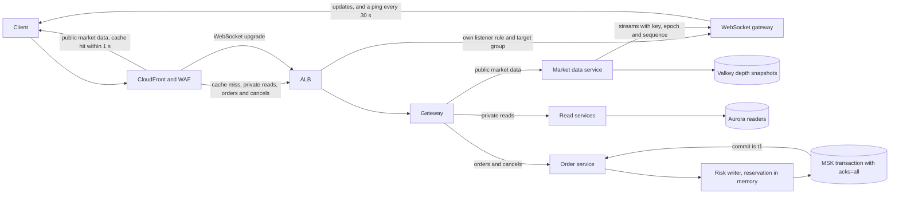
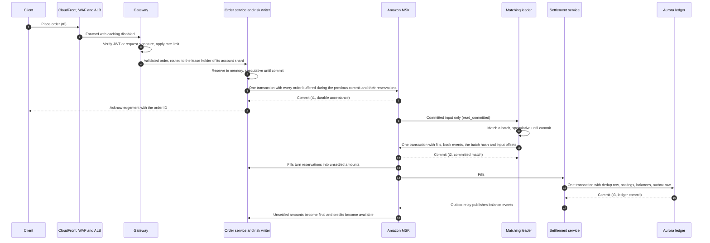

# Problem 1: a trading platform on AWS

This design runs a spot exchange on AWS for 500 requests per second with a p99 response time under 100 ms. Decisions carry the IDs AD-P1-01 to AD-P1-21 of the traceability section, each linked to its record in [`docs/adr/`](docs/adr/README.md). Prices come from the AWS price list for ap-southeast-1, read on 2026-11-04 and 2026-11-05, and the arithmetic is in [`evidence/`](evidence/README.md).

## The answer in brief

The platform offers spot trading with a double-entry ledger and Bitcoin and Ethereum custody (section 2.1). Every trading tier runs over 3 AZs with static capacity for an AZ loss, and every single writer has a fenced hot standby. An order is acknowledged once 2 of 3 AZs hold it, and a warm standby region targets an RPO of 1 min and trading back within 1 h after a region loss (sections 6 and 9). The order path makes no database call, and its hops take 60 ms of the 100 ms (section 7). Reads scale out, writes scale by adding shards, and each stage opens on a measured trigger (section 10). The design costs 17,931.23 USD per month on demand and 16,700.91 USD with eligible discounts, against 14,604.23 USD for a smaller baseline (section 8.3).

## 1. Requirements

The task gives REQ-P1-1 to REQ-P1-11, listed in [`docs/requirements.md`](../../docs/requirements.md). It leaves availability, recovery, correctness and the point where latency is measured open, so section 2.2 fixes them. The traceability section maps each requirement to the sections that answer it.

## 2. Scope and assumptions

### 2.1 Features in scope

In scope: signup and login with MFA, spot trading on a few pairs with limit and market orders and cancel, order book and trades over REST and WebSocket, a double-entry ledger, and Bitcoin and Ethereum deposits and withdrawals. Out of scope: futures and margin, P2P, earn and staking, fiat rails, launchpad, KYC vendor internals and mobile apps. The subset keeps the hard properties of an exchange: one order sequence per symbol, balances that never go negative, and custody of customer funds ([ADR-P1-0001](docs/adr/0001-spot-trading-scope.md)).

### 2.2 Derived requirements and their basis

| ID | Requirement |
|---|---|
| REQ-P1-12A | 99.95 % availability objective for the trading API in one region over 3 AZs. An integrity halt of the affected shards counts against it |
| REQ-P1-13A | AZ loss: no acknowledged data lost, trading back within 1 min. Region loss: RPO 1 min of acknowledged orders and trades, trading back within 1 h of the start of the outage, promotion decided by a person |
| REQ-P1-14A | Spendable balances never go negative, no trade settles twice, matching is deterministic per symbol |
| REQ-P1-15A | REQ-P1-8 applies per request class, measured from a load generator inside the region through the public hostname, with CloudFront and WAF in the path. It holds at a fixed 500 rps and at a 3x plateau (1500 rps) reached by a 5 min ramp, once autoscaling has converged. During convergence up to 1 % of requests may be shed with 429, for at most 5 min |
| REQ-P1-16A | Order-to-match p99 under 50 ms from durable acceptance to the committed match, and trade-to-settlement p99 under 1 s from the committed match to the ledger commit |

A higher availability target would need matching in two regions at once, which breaks the single order sequence per symbol. Correct balances come before availability on an exchange. Latency is measured inside the region because last-mile latency is outside the platform's control, while the edge controls are part of what users feel. Matching and settlement get their own bounds because they happen after the acknowledgement: t1 is the order's Kafka commit, t2 the matching commit and t3 the ledger commit.

### 2.3 Assumptions

Each assumption is replaced by the load test, the first month of production data or its owner's answer. Every quantity in the cost estimate names the assumption behind it.

| ID | Assumption |
|---|---|
| AS-01 | 60 % public market data, 25 % private reads, 15 % orders and cancels, about 75 per second |
| AS-02 | 10,000 WebSocket connections beside the 500 rps, and bursts of 3x |
| AS-03 | Users in Southeast Asia. Legal picks `<DR_REGION>`, which must offer every replicated service used |
| AS-04 | The 500 rps runs around the clock, an upper bound for request-based lines |
| AS-05 | 2 KB per REST response, 1 KB per forwarded request, half of market data cached, 1 KB/s per WebSocket |
| AS-06 | 1 MB/s of Kafka produce before replication |
| AS-07 | `m8g.xlarge` stateless, `c8g.2xlarge` pinned, `kafka.m7g.large`, `db.r8g.large`, `cache.m7g.large`, `m7g.large` wallet hosts |
| AS-08 | A 200 GB ledger, 300 million Aurora I/O per month, 5 GB of logs per day, 100,000 metric series |
| AS-09 | KYC behind an interface, and chain data from full nodes in the wallet account (Problem 5 FN-13) |
| AS-10 | 7 accounts, the member accounts of Problem 5 SC-06 plus management |
| AS-11 | 5 million CloudTrail management events, 5 GB of trail files per month |
| AS-12 | 200 GB of flow logs per month, also analysed by GuardDuty |
| AS-13 | GuardDuty Runtime Monitoring on the 84 vCPUs of the production nodes |
| AS-14 | 20,000 Security Hub CSPM checks per account per month |
| AS-15 | 30,000 AWS Config items per month |
| AS-16 | Seven customer managed keys with 3 million requests, and 100,000 withdrawal signatures per month |
| AS-17 | One Verified Access application for the admin tools (Problem 5 SC-05), 10 GB per month |
| AS-18 | The audit log adds 400 GB per month in the log archive account |
| AS-19 | Leases of 6 s renewed every 1 s, a 10 s transaction timeout, a loss witness every 1 s |
| AS-20 | Normal peak takes about 10.7 vCPU of stateless pods, under a 70 % CPU ceiling per node |
| AS-21 | 2 exclusive cores per risk or matching process, about 6 vCPU for pinning per `c8g.2xlarge` |
| AS-22 | 50 GB `gp3` per node, 50 GB of images in ECR |
| AS-23 | A WebSocket pod holds 2,500 connections and opens 100 per second, 6 pods |
| AS-24 | 350 GB of point-in-time backup above the free allocation, and 150 million replicated writes of 2.75 KB |
| AS-25 | 47 full ledger copies in the vault, and 200 GB of engine snapshots |
| AS-26 | 20 lease writes and 20 reads per second, and 4 witness writes per second in `<DR_REGION>` |
| AS-27 | 8 web ACL rules, with Bot Control on 5 % of requests |
| AS-28 | Monthly 200 GB of egress and 300 GB of telemetry through NAT, 100 GB through endpoints, 6,000 GB across AZs each way |
| AS-29 | 30 s scrapes, 50 billion query samples, 5 Grafana editors and 20 viewers |
| AS-30 | 4 KMS keys for the hot wallets |
| AS-31 | `<DR_REGION>` at ap-southeast-1 prices, 0.09 USD per GB between regions |
| AS-32 | Business Support+ on production reaches the Shield Response Team, Basic support elsewhere |
| AS-33 | Shared security lines count in full against production, an upper bound on the support fee |
| AS-34 | Trail files and the audit log kept 5 years, flow logs 1 year, Glacier Deep Archive after 90 days |
| AS-35 | Monthly active users are open, so Cognito rows carry `<MAU>` outside the totals |
| AS-36 | Users with TOTP as their only factor, which a Cognito replica lacks, stay below `<TOTP_ONLY_SHARE>` |

## 3. Architecture

### 3.1 Overview

The diagram shows every service and the main flows. Section 5 gives the role of each one and why it won.

```mermaid
flowchart LR
  subgraph clients[Clients]
    spa[Web SPA]
    apic[API clients]
  end
  r53[Route 53]
  subgraph edge[Edge]
    cf[CloudFront]
    waf[AWS WAF and Shield Advanced]
  end
  spab[(S3 bucket for the SPA)]
  alb[ALB reachable from CloudFront only]
  subgraph eks[EKS over 3 AZs]
    gw[Gateway]
    rd[Read services]
    os[Order service]
    risk[Risk engine, one writer per account shard]
    me[Matching engines, one leader per symbol shard]
    st[Settlement and ledger service]
    md[Market data service]
    wsg[WebSocket gateway]
    wr[Withdrawal relay]
    nt[Notification workers]
  end
  cog[Cognito user pools]
  msk[(Amazon MSK)]
  aur[(Aurora PostgreSQL ledger writer)]
  aurr[(Aurora readers)]
  vk[(ElastiCache for Valkey)]
  ddb[(DynamoDB leases and routing maps)]
  snap[(S3 snapshots with Object Lock)]
  async[SQS and SNS]
  lake[MSK Connect or Firehose, S3, Athena]
  egress[NAT gateways behind Network Firewall]
  subgraph wallet[Wallet account]
    wsvc[Wallet service and signer]
    kms[KMS keys]
  end
  obs[OpenTelemetry collector, AMP, AMG, CloudWatch Logs, X-Ray]
  bak[AWS Backup with a locked vault in the backup account]
  subgraph dr[DR region]
    dreks[Warm standby EKS with quiescent writers]
    drmsk[(MSK target cluster)]
    draur[(Aurora secondary)]
    drctl[(DR control table)]
    drcog[Cognito replica]
    drkms[KMS replicas and DR keys]
  end

  spa --> r53
  apic --> r53
  r53 --> cf
  cf --- waf
  cf --> spab
  cf --> alb
  alb --> gw
  alb -- WebSocket --> wsg
  gw -. JWKS cached .-> cog
  gw --> vk
  gw --> md
  gw --> rd --> aurr
  gw --> os --> risk --> msk
  risk --> ddb
  msk --> me --> msk
  me --> ddb
  me --> snap
  risk --> snap
  msk --> st --> aur
  st --> msk
  aur --> aurr
  msk --> md --> vk
  md --> wsg
  msk --> nt --> async
  msk --> lake
  msk --> wr
  wr -- mTLS over PrivateLink --> wsvc
  wr --> msk
  wsvc --> kms
  aur --> bak
  eks -.-> obs
  eks -- telemetry and internet egress --> egress
  cf -. read failover .-> dreks
  aur -. Global Database .-> draur
  msk -. MSK Replicator .-> drmsk
  risk -. loss witness .-> drctl
  cog -. replication .-> drcog
  kms -. key replicas .-> drkms
```

### 3.2 Request paths

Each request class has its own path, so a slow class never sits on another's path. Public market data is cached at the edge for 1 s. Private reads and orders bypass the cache, and the order path makes no database call (AD-P1-02). WebSocket upgrades take their own ALB target group.

### 3.3 Order lifecycle

The client gets its acknowledgement at durable acceptance (t1), when the order and its reservation commit to Kafka. Matching (t2) and the ledger commit (t3) come after the response.

### 3.4 Placement

Aurora runs a writer and two readers in different AZs, and MSK one broker per AZ. Every risk writer and matching leader has a hot standby in another AZ on a pinned on-demand pool that Karpenter keeps out of consolidation. The wallet account runs 2 hosts in 2 AZs, and one host carries every withdrawal while the other is replaced.

## 4. Protocols

These rules keep balances and matching correct through failures. The decision records hold the alternatives and the full test lists.

### 4.1 Risk engine

[ADR-P1-0004](docs/adr/0004-risk-engine-single-writer.md) records this protocol.

- Each account shard has one writer and a hot standby in another AZ. The writer holds a DynamoDB lease with a fencing token. A takeover takes the lease with the next token, calls `initTransactions` on the shard's stable `transactional.id` to fence the old producer, reads the shard to its `read_committed` end, and only then accepts orders.
- The writer keeps available, reserved and unsettled amounts per account and asset. A credit becomes available only after the ledger commits it.
- Orders that arrive during a commit share the next Kafka transaction, and each is acknowledged once its transaction commits (t1). An ambiguous commit answers "outcome unknown, retry with the same client order ID", never a rejection.
- A dead writer's open transaction stalls its symbol partitions until the successor fences it, within 10 s, or 20 s through the transaction timeout.
- Settlement lag rule: above 5 s the accounts involved cannot add exposure, and above 90 s new orders halt platform-wide.
- Each writer writes a loss witness every second to `<DR_REGION>`, which measures what a region loss lost (section 6.1).

### 4.2 Matching engine

[ADR-P1-0005](docs/adr/0005-single-threaded-matching.md) records this protocol. Each matching shard has one single-threaded leader and a hot standby, under the lease rules of section 4.1. The leader commits each batch of outputs, input offsets and a state hash in one Kafka transaction. Output event IDs derive from input IDs, so a replay yields identical events. The standby compares its own output with the leader's and promotes only on a match. If a rebuild cannot reproduce the committed output, the symbol halts and pages.

### 4.3 Ledger

[ADR-P1-0007](docs/adr/0007-aurora-ledger-outbox.md) records this protocol. One database transaction per trade holds a dedup row, balanced postings, the balance updates under `CHECK (available >= 0)` and an outbox row. A trade that fails an invariant is parked and halts its counterparties' shards, while other accounts keep settling. A checkpoint every 60 s gives reconciliation and region recovery their start point. DR replay ignores transaction markers and counts only the outputs of the highest fencing token.

### 4.4 Topics and shards

Stage 0 runs 4 account shards and 4 matching shards. Every topic has replication factor 3 and `min.insync.replicas=2`. Shards change only through move protocols, never through autoscaling.

### 4.5 Market data and WebSocket streams

Streams come from committed matching output, with depth snapshots in Valkey. Each message carries the recovery epoch and a sequence, so a reconnecting client resumes or takes a snapshot.

### 4.6 Overload and shedding

[ADR-P1-0011](docs/adr/0011-valkey-rate-limits.md) records this policy (AD-P1-11). Shedding answers 429 in this order: new WebSocket connections, market data misses, private reads, new orders, and cancels last. A shard rejects new orders while its in-flight commit has been open past 68 ms minus its commit p99. Cancels have their own lane and are never shed by that rule.

## 5. Service choices

Vendor limits cited here are sourced in [`evidence/README.md`](evidence/README.md).

| Service and role | Why, against the alternative |
|---|---|
| Route 53 for DNS | An outside provider has no alias records for CloudFront |
| CloudFront with WAF and Shield Advanced: the SPA, market data cached 1 s, filtering and DDoS response ([ADR-P1-0009](docs/adr/0009-front-door.md)) | Origin-only serving puts every read on the ALB. Shield Standard has no cost protection or response team |
| ALB, reachable from CloudFront only | API Gateway caps WebSockets at 2 h and bills per message. An NLB cannot route upgrades separately |
| EKS with Karpenter for all services ([ADR-P1-0008](docs/adr/0008-eks-karpenter.md)) | ECS on Fargate has no CPU pinning, Lambda has cold starts. ECS on EC2 is the smaller baseline |
| In-house Go gateway: tokens, signatures, rate limits, routing | Envoy Gateway would add an external call for signatures |
| MSK provisioned as sequencer and event log ([ADR-P1-0006](docs/adr/0006-msk-sequencer.md)) | Kinesis lacks cross-shard transactions and producer fencing. SQS FIFO has no replay |
| DynamoDB for leases and shard maps | An Aurora lease ties matching to the ledger's failover |
| Aurora PostgreSQL for the ledger | DynamoDB caps a transaction at 100 items |
| ElastiCache for Valkey: rate limits, depth snapshots ([ADR-P1-0011](docs/adr/0011-valkey-rate-limits.md)) | MemoryDB adds durability that derived data does not need |
| Cognito with multi-Region replication ([ADR-P1-0010](docs/adr/0010-cognito-identity.md)) | Keycloak is a system to run. Without replication users re-enroll after a region loss |
| KMS keys in a wallet account behind a signer | CloudHSM adds operations work |
| S3 with Object Lock for snapshots, AWS Backup with a locked vault ([ADR-P1-0012](docs/adr/0012-backups-and-recovery.md)) | EBS snapshots need a volume per engine. Backups inside production fall with it |
| SQS, SNS, Firehose, S3 and Athena for notifications and analytics | Sending from trading consumers ties provider outages to trading, and queries on Aurora load the ledger |
| VPC endpoints for AWS APIs ([ADR-P1-0014](docs/adr/0014-capacity-cost-sustainability.md)) | Network Firewall bills 0.065 USD per GB, an endpoint 0.01 |
| NAT behind Network Firewall for egress | NAT instances need self-managed failover |
| Withdrawal relay over mTLS and PrivateLink | Cross-account Kafka access makes wallet principals Kafka clients |
| OpenTelemetry, Managed Prometheus and Grafana, CloudWatch, X-Ray ([ADR-P1-0013](docs/adr/0013-slo-observability.md)) | Self-run tools add storage and failover to operate |
| Argo CD and Argo Rollouts ([ADR-P1-0016](docs/adr/0016-gitops-operating-model.md)) | Pushing from CI needs production credentials |
| Warm standby region ([ADR-P1-0017](docs/adr/0017-warm-standby-region.md)) | A pilot light puts launches inside the 1 h. Active-active needs two sequences per symbol |

## 6. Failure modes and recovery

| Failure | Response and customer impact |
|---|---|
| One AZ | Two AZs carry 1.5x peak without new nodes, and standbys take over within 10 s. Affected orders fail fast and clients retry with the same client order ID. The AZ game day checks that trading is back within 1 min |
| Matching or risk process | The standby fences the old producer within 10 s. That shard pauses while orders queue in Kafka |
| Aurora writer | A reader is promoted, typically in under 60 s. Trading continues under the settlement lag rule |
| MSK quorum | Writes below 2 in-sync replicas fail, so those partitions stop trading. No acknowledged order is lost |
| MSK patching | Spikes of up to about 2 s for 2 min per broker. The slow-commit rule sheds new orders |
| Integrity breach | The affected shards halt and rebuild from the next checkpoint, a halt that counts against REQ-P1-12A |
| Ledger corruption | Point-in-time restore and ordered replay. Withdrawals stop until verified |
| Region | A person promotes the standby (section 6.1). Reads continue from the DR origin |
| CloudFront | Accepted, since a bypass would skip WAF and Shield (section 12) |
| Volatility spike | Rate limits, then shedding. Up to 1 % of requests get 429 for at most 5 min |
| Bad deploy | Canaries roll back on SLO burn, and single-writer shards release one at a time |

### 6.1 Region recovery procedure

[ADR-P1-0017](docs/adr/0017-warm-standby-region.md) records this tier. The standby in `<DR_REGION>` runs every service at reduced size with quiescent writers. MSK Replicator and an Aurora Global Database secondary feed it, alarmed at 30 s of lag. No step needs an answer from ap-southeast-1.

1. The incident commander and the head of risk declare the region lost.
2. Switch CloudFront to the DR origin through its control plane in us-east-1.
3. Deny the primary signer on the signer lease in `<DR_REGION>`.
4. Stop MSK Replicator and fail Aurora over with `--allow-data-loss`.
5. Raise the recovery epoch, rebuild from the newest common checkpoint and cancel open orders.
6. Report the loss per shard from the loss witnesses.
7. Resume trading after a zero diff, and withdrawals after the chain check of Problem 5 section 7.8.

### 6.2 Backups and replay horizons

Aurora point-in-time recovery, Kafka tiered storage and the locked backup vault (Problem 5 SC-16) all hold 35 days, so a restore can replay to the present. Engine snapshots every 60 s stay 7 days.

## 7. Latency

### 7.1 Allocation for order placement

Percentiles do not add up, so each hop gets a budget and the load test checks the p99 end to end.

| Hop | Allocation |
|---|---|
| CloudFront and WAF | 10 ms |
| ALB | 5 ms |
| Gateway | 5 ms |
| Order service and risk reservation | 5 ms |
| MSK: the in-flight commit, then the order's own, 2 x 15 ms | 30 ms |
| Response path | 5 ms |
| Allocated against the 100 ms | 60 ms |

Problem 5 SC-04 adds 2 ms at the gateway, so 62 ms are allocated and 38 ms remain for pauses and later overhead.

### 7.2 Measurement

k6 runs inside the region against the public hostname with every Problem 5 control on: 500 rps, a ramp to 1500 rps, a 30 min soak, and a step to 2,500 rps during a WebSocket reconnect wave. A run passes with at most 0.005 % errors, a 429 counted as one.

### 7.3 Allocation for order-to-match

Between t1 and t2 an order can wait behind three commits of 15 ms: another risk shard's open transaction, the leader's in-flight batch and its own commit. With a 2 ms fetch and a 1 ms match, that allocates 48 ms of the 50 ms of REQ-P1-16A. At 3x a risk shard takes about 56 orders per second. Even at one transaction per order and a 15 ms mean commit, its commit loop stays busy only 0.84 of the time.

### 7.4 Benchmark of AD-P1-20

Before ADR-P1-0006 and ADR-P1-0005 are final, a benchmark runs MSK provisioned against Express brokers, and a pinned matching core against an unpinned one. The sequencer passes with a commit p99 within 15 ms and a t1 to t2 p99 under 50 ms, and matching when the busiest symbol stays under half a core. If the sequencer fails, the stage 2 sequencer comes forward.

## 8. Capacity and cost

### 8.1 Design point

Normal peak takes about 10.7 vCPU. At 1.5x on two AZs that is 66.9 % of 6 `m8g.xlarge`, so the stateless pool runs 9 nodes at 29.7 % and carries 2.4x before Karpenter acts. That idle share is a recorded trade-off against SUS-DP3 (AD-P1-01). The pinned pool gives 18 slots for 16 processes, 12 after an AZ loss.

### 8.2 Sizing and expected load

MSK runs 3 brokers with 1,000 GB each. Aurora runs 1 writer and 2 readers, Valkey 1 primary and 2 replicas. Six WebSocket pods hold 10,000 connections, and the 4 left after an AZ loss still do.

### 8.3 Monthly estimate

[`evidence/cost_estimate.py`](evidence/cost_estimate.py) produces [`evidence/cost-estimate-2026-11-04.md`](evidence/cost-estimate-2026-11-04.md), with every line, quantity and dated price. Discounts use 1-year Compute Savings Plans for EC2 and reservations for Aurora and ElastiCache. MSK has neither. The smaller baseline uses ECS on EC2, two Valkey nodes and no Shield Advanced.

| USD per month | On demand | With discounts | Smaller baseline |
|---|---|---|---|
| Design | 17,931.23 | 16,700.91 | 14,604.23 |
| With the security column | 19,097.97 | 17,867.64 | 15,770.97 |
| With the security and DR columns | 24,337.62 | 23,107.30 | 21,010.62 |

The security column adds 1,166.74 USD and the DR column 5,239.65 USD. The totals leave out the Cognito rows at `<MAU>`. The edge takes 48.9 % of the on-demand total.

### 8.4 Reading the estimate

- Shield Advanced is the largest line at 3,722.70 USD, and 3,125.79 USD net of the WAF fees it removes, with its support share. It stays because exchanges draw DDoS attacks.
- WebSocket traffic drives CloudFront transfer. At 1.1 KB/s per connection the on-demand total rises by 373.99 USD.
- Commitments save only 1,230.32 USD, 6.9 %, since most spend is transfer, requests and fixed fees.
- Fixed lines behind recorded trade-offs, in USD: EKS control plane 73.00, MSK brokers 558.45, tiered storage 197.16, backup vault 216.20, engine snapshots 5.00, observability 674.02.

### 8.5 Not priced

The estimate leaves out telemetry in `<DR_REGION>`, the non-production account, chain full nodes and usage-based services such as Route 53 and SQS.

## 9. How the design stays available and scales

Availability rests on static capacity across 3 AZs, a replica in another AZ for every stateful part, and acknowledgements held by 2 of 3 AZs. Fencing keeps two writers from ever committing for one shard. Reads scale out, and writes scale by adding single-writer shards.

## 10. Scaling plan

| Stage | Trigger | Changes |
|---|---|---|
| 0, 500 rps | Launch | As designed |
| 1, about 10x | Gateway CPU above 60 %, a commit p99 above 12 ms, order-to-match above 40 ms, or Aurora writer CPU above 60 % | More pods, readers behind RDS Proxy, more Valkey and account shards, hot pairs on own matching shards, larger brokers |
| 2, about 100x | Order-to-match above 40 ms after stage 1, or one symbol above half a core | CQRS read models, cells, Aeron Cluster, a FIX gateway for market makers, cross-shard settlement |

Each trigger sits below the value it protects. [ADR-P1-0015](docs/adr/0015-scaling-stages.md) records why.

## 11. Operations

### 11.1 Service level objectives

The 99.95 % budget allows about 657,000 failed requests a month, 21.9 min of full outage, split across the serial dependencies with a reserve. CloudFront and MSK commit to 99.9 %, so a month at either floor misses it (section 12). Alerts page on burn rate, and a watchdog pages when alerting goes silent ([ADR-P1-0013](docs/adr/0013-slo-observability.md)).

### 11.2 Change and operating model

Terraform and Git define everything, and Argo CD deploys it with canaries. Single-writer shards release one at a time. Teams own bounded contexts with their own on-call ([ADR-P1-0016](docs/adr/0016-gitops-operating-model.md)).

### 11.3 Tests before launch

No AWS account is part of this submission. Before launch the plan runs the k6 runs of section 7.2, the benchmark of section 7.4, failure tests against MSK at each commit boundary, an AZ game day, a restore drill, the DR exercise and a direct-to-ALB bypass test. Ledger property tests and alert rule tests are reviewed here.

## 12. Trade-off register

| Decision | Works against | Reopen when |
|---|---|---|
| AD-P1-01 static capacity, wallet tier in 2 AZs | COST-DP2, SUS-DP3, REL-DP3 | Karpenter lead time under 60 s |
| AD-P1-03 single-threaded matching | PERF-DP3, COST-DP2 | One symbol passes half a core |
| AD-P1-09 Shield Advanced, no second CDN | COST-DP2, REL-DP3 | A cheaper plan covers DDoS response |
| AD-P1-10 one region, promotion by a person | PERF-DP2, REL-DP1 | A tighter RTO or RPO is required |
| AD-P1-13 commitments | COST-DP2 | Baseline load moves by more than 20 % |
| REQ-P1-12A above two 99.9 % SLAs | none, a risk accepted | Either falls below 99.95 % twice a quarter |

## 13. What is left out

Each out-of-scope product of section 2.1 would need its own risk model. Active-active regions conflict with one sequence per symbol. Cross-shard settlement, cells and a FIX gateway wait for stage 2. Problem 5 designs the security beyond the edge.

## 14. Open questions

Legal chooses `<DR_REGION>` and the log retention. The load test measures WebSocket traffic per connection. AWS confirms whether Business Support+ reaches the Shield Response Team.

## Traceability

### Decisions

| ID | Decision | ADR |
|---|---|---|
| AD-P1-01 | 3 AZs with static capacity, wallet tier in 2 AZs | [ADR-P1-0002](docs/adr/0002-one-region-three-azs.md) |
| AD-P1-02 | Acknowledgement at durable acceptance | [ADR-P1-0003](docs/adr/0003-ack-at-durable-acceptance.md) |
| AD-P1-03 | Single-threaded matching | [ADR-P1-0005](docs/adr/0005-single-threaded-matching.md) |
| AD-P1-04 | Single-writer risk shards | [ADR-P1-0004](docs/adr/0004-risk-engine-single-writer.md) |
| AD-P1-05 | Ledger with outbox and checkpoints | [ADR-P1-0007](docs/adr/0007-aurora-ledger-outbox.md) |
| AD-P1-06 | MSK sequencer | [ADR-P1-0006](docs/adr/0006-msk-sequencer.md) |
| AD-P1-07 | EKS with Karpenter and a pinned pool | [ADR-P1-0008](docs/adr/0008-eks-karpenter.md) |
| AD-P1-08 | Managed data, identity and keys | [ADR-P1-0010](docs/adr/0010-cognito-identity.md) |
| AD-P1-09 | Edge with 1 s market data cache | [ADR-P1-0009](docs/adr/0009-front-door.md) |
| AD-P1-10 | Warm standby region | [ADR-P1-0017](docs/adr/0017-warm-standby-region.md) |
| AD-P1-11 | Rate limits and shedding | [ADR-P1-0011](docs/adr/0011-valkey-rate-limits.md) |
| AD-P1-12 | Scaling stages | [ADR-P1-0015](docs/adr/0015-scaling-stages.md) |
| AD-P1-13 | Graviton, discounts, endpoints | [ADR-P1-0014](docs/adr/0014-capacity-cost-sustainability.md) |
| AD-P1-14 | Cost allocation tags | [ADR-P1-0014](docs/adr/0014-capacity-cost-sustainability.md) |
| AD-P1-15 | SLOs and burn-rate alerts | [ADR-P1-0013](docs/adr/0013-slo-observability.md) |
| AD-P1-16 | Load tests and game days | [ADR-P1-0016](docs/adr/0016-gitops-operating-model.md) |
| AD-P1-17 | GitOps with canaries | [ADR-P1-0016](docs/adr/0016-gitops-operating-model.md) |
| AD-P1-18 | Backups and restore drills | [ADR-P1-0012](docs/adr/0012-backups-and-recovery.md) |
| AD-P1-19 | Operating model and runbooks | [ADR-P1-0016](docs/adr/0016-gitops-operating-model.md) |
| AD-P1-20 | Sequencer and matching benchmark | [ADR-P1-0006](docs/adr/0006-msk-sequencer.md) |
| AD-P1-21 | Sustainability KPIs | [ADR-P1-0014](docs/adr/0014-capacity-cost-sustainability.md) |

### Requirements to sections

| Requirement | Answered in |
|---|---|
| REQ-P1-1 | 2.1, 6 |
| REQ-P1-2 | 6 |
| REQ-P1-3 | 9, 10 |
| REQ-P1-4 | 8 |
| REQ-P1-5 | 4, 9 |
| REQ-P1-6 | 5 |
| REQ-P1-7 | 7.2 |
| REQ-P1-8 | 7 |
| REQ-P1-9 | 3.1, 5 |
| REQ-P1-10 | 5 |
| REQ-P1-11 | 10 |
| REQ-P1-12A | 11.1 |
| REQ-P1-13A | 6.1 |
| REQ-P1-14A | 4 |
| REQ-P1-15A | 4.6, 7.2 |
| REQ-P1-16A | 7.3, 7.4 |
