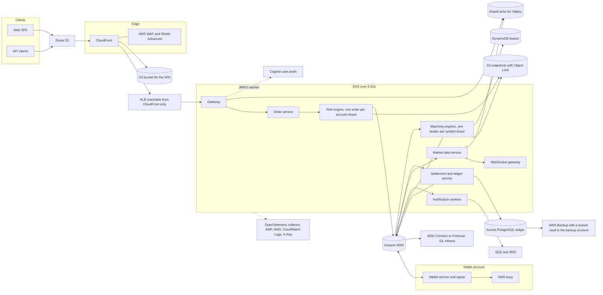
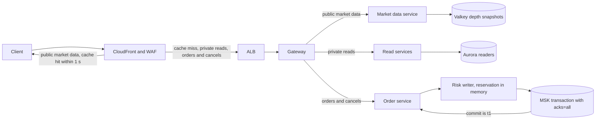
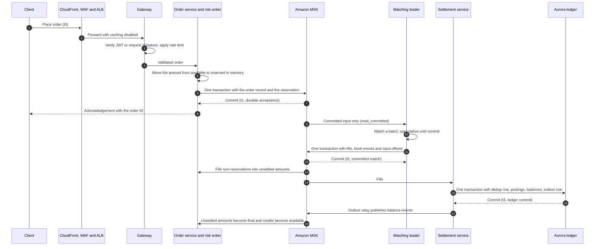

# Problem 1: a trading platform on AWS

This design runs a spot exchange on AWS for 500 requests per second with a p99 response time under 100 ms. Each decision has an ID from AD-P1-01 to AD-P1-21, names the requirements and Well-Architected principles it serves, and links to an architecture decision record in [`docs/adr/`](docs/adr/README.md). Prices come from the AWS price list for ap-southeast-1, read on 2026-11-04, and the arithmetic sits in [`evidence/`](evidence/README.md).

## 1. Requirements and principles

### 1.1 Requirements

A requirement taken from the challenge text has a plain number. A derived requirement rests on an assumption and ends in `A`.

| ID | Requirement | Source |
|---|---|---|
| REQ-P1-1 | A highly available trading system with features similar to Binance, using a chosen subset of features | Task |
| REQ-P1-2 | Resilient to failures | Task |
| REQ-P1-3 | Scalable | Task |
| REQ-P1-4 | Cost-effective | Task |
| REQ-P1-5 | The approach to high availability and scalability is explained | Task |
| REQ-P1-6 | AWS is the cloud provider | Specification |
| REQ-P1-7 | 500 requests per second | Specification |
| REQ-P1-8 | p99 response time under 100 ms | Specification |
| REQ-P1-9 | Overview diagram of the services and the role each plays | Deliverable |
| REQ-P1-10 | Why each cloud service is used and which alternatives were considered | Deliverable |
| REQ-P1-11 | Plans for scaling once the product outgrows the current setup | Deliverable |
| REQ-P1-12A | 99.95 % availability objective for the trading API in one region over 3 AZs. An integrity halt of the affected shards counts against it | Assumption, section 2.2 |
| REQ-P1-13A | AZ loss: no acknowledged data lost, trading back within 1 min. Region loss: objectives set after the first DR exercise, trading halted until a person decides | Assumption, section 2.2 |
| REQ-P1-14A | Spendable balances never go negative, no trade settles twice, matching is deterministic per symbol | Assumption, section 2.2 |
| REQ-P1-15A | REQ-P1-8 applies per request class, measured from a load generator inside the region through the public hostname, with CloudFront and WAF in the path. It holds at a fixed 500 rps and at a 3x plateau (1500 rps) reached by a 5 min ramp, once autoscaling has converged. During convergence up to 1 % of requests may be shed with 429, for at most 5 min | Assumption, section 2.2 |
| REQ-P1-16A | Order-to-match p99 under 20 ms from durable acceptance to the committed match, and trade-to-settlement p99 under 1 s from the committed match to the ledger commit | Assumption, section 2.2 |

### 1.2 Principles

The IDs are local to this submission and quote the design principles of the AWS Well-Architected Framework and of its Financial Services Industry Lens. The lens applies because the workload is an exchange. Every set applies to this problem, and the last column names the decisions from section 15 that serve each principle. SEC-DP3 to SEC-DP6, FSI-DP3 and FSI-DP4 are carried by the security design of Problem 5, whose change IDs start with `SC-`.

| ID | Principle | Served by |
|---|---|---|
| GEN-DP1 | "Stop guessing your capacity needs" | AD-P1-07, AD-P1-12 |
| GEN-DP2 | "Test systems at production scale" | AD-P1-16 |
| GEN-DP3 | "Automate with architectural experimentation in mind" | AD-P1-20 |
| GEN-DP4 | "Consider evolutionary architectures" | AD-P1-12 |
| GEN-DP5 | "Drive architectures using data" | AD-P1-02, AD-P1-12, AD-P1-15 |
| GEN-DP6 | "Improve through game days" | AD-P1-16 |
| OPS-DP1 | "Organize teams around business outcomes" | AD-P1-19 |
| OPS-DP2 | "Implement observability for actionable insights" | AD-P1-15 |
| OPS-DP3 | "Safely automate where possible" | AD-P1-17 |
| OPS-DP4 | "Make frequent, small, reversible changes" | AD-P1-17 |
| OPS-DP5 | "Refine operations procedures frequently" | AD-P1-19 |
| OPS-DP6 | "Anticipate failure" | AD-P1-16 |
| OPS-DP7 | "Learn from all operational events and metrics" | AD-P1-15 |
| OPS-DP8 | "Use managed services" | AD-P1-06, AD-P1-08. Traded off in AD-P1-07 |
| SEC-DP1 | "Implement a strong identity foundation" | AD-P1-08 for Cognito, SC-04, SC-07 and SC-22 in Problem 5 |
| SEC-DP2 | "Maintain traceability" | AD-P1-05 |
| SEC-DP3 | "Apply security at all layers" | SC-08, SC-10 and SC-13 in Problem 5 |
| SEC-DP4 | "Automate security best practices" | SC-06, SC-11 and SC-12 in Problem 5 |
| SEC-DP5 | "Protect data in transit and at rest" | SC-09 in Problem 5 |
| SEC-DP6 | "Keep people away from data" | SC-01 and SC-05 in Problem 5 |
| SEC-DP7 | "Prepare for security events" | AD-P1-18 |
| REL-DP1 | "Automatically recover from failure" | AD-P1-01, AD-P1-03, AD-P1-04, AD-P1-05, AD-P1-11 |
| REL-DP2 | "Test recovery procedures" | AD-P1-10, AD-P1-16, AD-P1-18 |
| REL-DP3 | "Scale horizontally to increase aggregate workload availability" | AD-P1-01, AD-P1-07 |
| REL-DP4 | "Stop guessing capacity" | AD-P1-07 |
| REL-DP5 | "Manage change through automation" | AD-P1-17 |
| PERF-DP1 | "Democratize advanced technologies" | AD-P1-06 |
| PERF-DP2 | "Go global in minutes" | AD-P1-09. Traded off in AD-P1-10 |
| PERF-DP3 | "Use serverless architectures" | Off the hot path only: DynamoDB leases, S3, SQS, SNS, Athena. Traded off in AD-P1-03 |
| PERF-DP4 | "Experiment more often" | AD-P1-20 |
| PERF-DP5 | "Consider mechanical sympathy" | AD-P1-02, AD-P1-03, AD-P1-04 |
| COST-DP1 | "Implement Cloud Financial Management" | AD-P1-13, AD-P1-14 |
| COST-DP2 | "Adopt a consumption model" | Karpenter for bursts in AD-P1-07. Traded off in AD-P1-01 and AD-P1-13 |
| COST-DP3 | "Measure overall efficiency" | AD-P1-09, AD-P1-13 |
| COST-DP4 | "Stop spending money on undifferentiated heavy lifting" | AD-P1-08 |
| COST-DP5 | "Analyze and attribute expenditure" | AD-P1-14 |
| SUS-DP1 | "Understand your impact" | AD-P1-21 |
| SUS-DP2 | "Establish sustainability goals" | AD-P1-21 |
| SUS-DP3 | "Maximize utilization" | AD-P1-07. Traded off in AD-P1-01 |
| SUS-DP4 | "Anticipate and adopt new, more efficient hardware and software offerings" | AD-P1-13 |
| SUS-DP5 | "Use managed services" | AD-P1-08 |
| SUS-DP6 | "Reduce the downstream impact of your cloud workloads" | AD-P1-09 |
| FSI-DP1 | "Documented operational planning" | AD-P1-19 |
| FSI-DP2 | "Automated infrastructure and application deployment" | AD-P1-17 |
| FSI-DP3 | "Security by design" | Problem 5 |
| FSI-DP4 | "Automated governance" | Problem 5 |

## 2. Scope and assumptions

### 2.1 Features in scope

In scope: signup and login with MFA, spot trading on a small set of pairs (limit and market orders, cancel), order book and trades over REST and WebSocket, balances backed by a double-entry ledger, and crypto deposits and withdrawals for Bitcoin and Ethereum through async workers.

Out of scope: futures and margin, P2P, earn and staking, fiat rails, launchpad, KYC vendor internals (stubbed behind an interface), and mobile apps. [ADR-P1-0001](docs/adr/0001-spot-trading-scope.md) records why this subset exercises every hard property of an exchange: matching, balances and custody.

### 2.2 Derived requirements and their basis

| ID | Value used | Basis |
|---|---|---|
| REQ-P1-12A | 99.95 % availability objective for the trading API in one region over 3 AZs. An integrity halt of the affected shards (section 6) counts against it | Higher targets need multi-region active-active matching, which conflicts with a single order sequence per symbol |
| REQ-P1-13A | AZ loss: no acknowledged data lost, trading back within 1 min. Region loss: objectives set after the first DR exercise, trading halted until a person decides | MSK with replication factor 3, `acks=all` and `min.insync.replicas=2`, Aurora storage across 3 AZs. Aurora and MSK replicate across regions asynchronously and independently, so the region case uses the recovery procedure in section 6.1 |
| REQ-P1-14A | Spendable balances never go negative, no trade settles twice, matching is deterministic per symbol | Correct balances come before availability on an exchange |
| REQ-P1-15A | Request classes: order placement (acknowledged at durable acceptance), cancel, private reads, public market data. p99 under 100 ms per class, measured from a load generator inside the region through the public hostname. ALB `TargetResponseTime` is a diagnostic only | The platform cannot control last-mile latency, and the security controls in front of the API are part of what users experience |
| REQ-P1-16A | Timestamps: t0 request sent, t1 durable acceptance (Kafka commit), t2 committed match, t3 ledger commit. Order-to-match is t1 to t2, settlement is t2 to t3 | Matching and settlement are different operations from the acknowledgement |

### 2.3 Assumptions

Each assumption names the fact that would confirm or replace it.

| ID | Assumption | Confirmed by |
|---|---|---|
| AS-01 | Traffic mix at 500 rps: about 60 % public market data, 25 % private reads, 15 % order placement and cancel, which is about 75 orders per second | Product forecast, then the first month of production traffic |
| AS-02 | 10,000 concurrent WebSocket connections on top of the 500 rps, and bursts of 3x | Product forecast and the load test |
| AS-03 | Users are in Southeast Asia, so ap-southeast-1 is the primary region. The DR region `<DR_REGION>` is chosen with legal for data residency | Legal review |
| AS-04 | The 500 rps load is priced around the clock, which makes the request-based lines an upper bound | The cost and usage report of the first month |
| AS-05 | Average REST response of 2 KB, 1 KB per forwarded request, half of the public market data requests served from the CloudFront cache, WebSocket traffic of about 1 KB/s per connection | The load test and CloudFront reports |
| AS-06 | Kafka produce volume of 1 MB/s across all topics before replication | The produce metrics of the load test |
| AS-07 | Instance types: `m8g.xlarge` for stateless pods, `c8g.2xlarge` with CPU pinning for matching and risk, `kafka.m7g.large` brokers, `db.r8g.large` for Aurora, `cache.m7g.large` for Valkey | The benchmark of AD-P1-20 and the load test of AD-P1-16 |
| AS-08 | A ledger of 200 GB with 300 million Aurora I/O per month, 5 GB of logs per day, 100,000 active metric series | The first month of the cost and usage report |
| AS-09 | The KYC vendor sits behind an interface. Chain data comes from full nodes run by the exchange in the wallet account, as FN-13 of Problem 5 assumes | Vendor selection, the custody design |
| AS-10 | The organization has 7 accounts: the management account and the six member accounts of SC-06 (production, wallet, log archive, backup, security tooling, non-production) | The account design of Problem 5 |
| AS-11 | 5 million CloudTrail management events per month across the organization, most of them KMS and STS calls, written as 5 GB of trail files | The first month of CloudTrail |
| AS-12 | 200 GB of VPC Flow Logs per month delivered to S3, and the same volume of flow and DNS logs analysed by GuardDuty | The first month of flow logs |
| AS-13 | GuardDuty Runtime Monitoring covers the 56 vCPUs of the production EKS nodes of AS-07 | The node count after the load test |
| AS-14 | 20,000 Security Hub CSPM checks per account per month, with finding ingestion inside the 10,000 free events per account | The first month of Security Hub CSPM |
| AS-15 | 30,000 AWS Config configuration items per month, most of them from Karpenter node churn. The Config rules behind Security Hub CSPM controls are paid as Security Hub checks | The first month of AWS Config |
| AS-16 | Six customer managed keys, one per data class: the Aurora ledger, MSK, Valkey, S3 snapshots and analytics, logs and audit records, and Secrets Manager. 3 million requests per month on them, and 100,000 withdrawal signatures per month | The key policy review of SC-09 and the first month of KMS |
| AS-17 | One Verified Access application for the admin tools of SC-05, carrying 10 GB per month | The admin plane design |
| AS-18 | The audit log of balance changes and admin actions adds 400 GB per month to S3 with Object Lock in the log archive account | The first month of the audit log |

## 3. Architecture

### 3.1 Overview

| Component | Role |
|---|---|
| Route 53, CloudFront, AWS WAF, Shield Advanced | DNS, the SPA from S3, public market data cached for 1 s, request filtering and DDoS response. The ALB accepts traffic from CloudFront only (SC-10 in Problem 5) |
| Gateway on EKS | JWT verification against cached JWKS with no network call per request, signed-request verification for API keys (SC-04 in Problem 5), per-key rate limits in Valkey with a local in-memory fallback, routing |
| Cognito user pools | Signup, login and MFA. Feature plan, factors, revocation and step-up follow SC-22 in Problem 5 |
| Order service and risk engine | Validation and the in-memory reservation, protocol in section 4.1 |
| Matching engines | One single-threaded leader per symbol shard with a hot standby, protocol in section 4.2 |
| Settlement and ledger service | Double-entry postings on Aurora PostgreSQL, protocol in section 4.3 |
| Market data service and WebSocket gateway | Depth snapshots in Valkey, fan-out to stateless WebSocket pods, sequence numbers so clients detect gaps |
| Wallet service and signer | Deposits and withdrawals in their own AWS account, custody protocol in Problem 5 |
| SQS, SNS, MSK Connect or Firehose, S3, Athena | Notifications and analytics off the trading path |
| EKS platform | Karpenter, Argo CD, ECR, Secrets Manager, KMS, and VPC endpoints for S3, ECR, STS, KMS and Secrets Manager so that AWS API traffic stays off NAT |
| Observability | An OpenTelemetry collector feeding Amazon Managed Service for Prometheus, Amazon Managed Grafana, CloudWatch Logs and X-Ray, with SLO dashboards |
| Backups and replay | Section 6.2 sets the horizons: 35 days of point-in-time recovery and replay, 60 s engine snapshots kept 7 days, monthly archival copies kept 12 months |

### 3.2 Request paths

Each request class has its own path, so the slow parts of one class never sit on the path of another.

| Class | Share at 500 rps | Path | Caching |
|---|---|---|---|
| Public market data | about 60 % | CloudFront, then the market data service and Valkey on a miss | Cache key of path, symbol and depth with a 1 s TTL |
| Private reads | about 25 % | Gateway, read services, Aurora readers | Caching disabled, authorization forwarded |
| Order placement and cancel | about 15 % | Gateway, order service, risk writer, MSK | Caching disabled. No database call on the path (AD-P1-02) |
| WebSocket streams | 10,000 connections outside the 500 rps | CloudFront, ALB, WebSocket gateway, fed by the market data service | Sequence numbers per stream |

### 3.3 Order lifecycle

The client receives its acknowledgement at durable acceptance (t1), when the reservation and the order are committed to Kafka. Matching (t2) and the ledger commit (t3) happen after the response, and REQ-P1-16A bounds both.

### 3.4 Placement

Aurora runs a writer plus two readers in different AZs. MSK runs three brokers, one per AZ. Each matching standby sits in a different AZ from its leader, and every service has topology spread constraints and a disruption budget.

## 4. Protocols

### 4.1 Risk engine

[ADR-P1-0004](docs/adr/0004-risk-engine-single-writer.md) records this protocol.

- One authoritative writer per account shard holds a lease. Its Kafka `transactional.id` is stable per shard, so a new writer fences the old one.
- Per account and asset the writer keeps three amounts: available, reserved, and unsettled (debits and credits from fills that the ledger has not committed yet).
- Transitions: a ledger-confirmed deposit adds to available. An accepted order moves its amount from available to reserved. A fill consumes the matching part of the reservation into an unsettled debit, and adds an unsettled credit for the received asset net of fees. A ledger commit turns unsettled amounts final, and only then does a credit become available. Cancel, expiry and rejection move the unfilled rest of a reservation back to available. A withdrawal request reserves funds in the same way, and the signer's final state either debits or releases them.
- A market buy reserves its quote amount up to a protection price, 5 % above the best ask at acceptance. Partial fills consume the reservation proportionally, and the terminal state releases the rest.
- The writer consumes matching output and ledger events and produces its transitions in one Kafka transaction that also commits the consumed offsets, so a replay applies each input exactly once. Every transition carries the ID of the event that caused it.
- A new order is validated, its reservation is computed in memory, and the reservation and the order record are written in one Kafka transaction to the shard partition and the symbol partition. The client gets its acknowledgement after the commit (t1).
- The idempotency key is the account plus the client order ID, kept until the order reaches a terminal state and for 24 h after. A retry with the same payload returns the original result. A retry with a different payload under the same key is rejected.
- Settlement lag rule: above 5 s the writer rejects new orders that increase exposure for the accounts involved. Above 30 s it halts new orders platform-wide and pages.

### 4.2 Matching engine

[ADR-P1-0005](docs/adr/0005-single-threaded-matching.md) records this protocol.

- Leader election uses a DynamoDB lease with a fencing token that grows with every new leader. The leader consumes its symbol partition with `read_committed` and processes input in batches, each inside one Kafka transaction that commits the outputs and the input offsets together.
- Book changes inside a batch are speculative until the transaction commits. On an abortable error the engine aborts, restores the state it had at the last committed batch, and retries. On a fatal error such as a fenced producer it stops and gives up the lease. On an ambiguous commit, where the call times out without a result, it stops consuming, re-initializes its producer, which completes or aborts the pending transaction, reads back its committed input offset, and rebuilds the book up to that offset before resuming.
- Every input command carries a globally unique ID assigned at durable acceptance: the risk shard ID plus its own sequence number. Output event IDs are that input ID plus a sequence within the input, so reprocessing yields identical events, consumers deduplicate on them, and a symbol moved to another partition with overlapping offsets never reuses an ID. Partition offsets serve only as consumer positions.
- Every 10,000 input offsets the leader emits a state hash record for that offset. Snapshots store the epoch, the committed input offset and the state hash.
- The standby runs in a different AZ, applies only committed input, and compares its own hash at each hash record's offset. A mismatch pages and makes the standby rebuild from a snapshot.
- Promotion: the standby takes the lease with the next fencing token, initializes the shard's stable `transactional.id`, which fences the old leader's producer, catches up to the last committed input offset, checks the latest hash record, and resumes.
- Symbol routing is an explicit map from symbol to topic and partition, never a hash. Moving a symbol pauses it, drains, snapshots, moves and resumes under a new fencing token.
- Tests: process kill before producing, after producing and before committing, and after committing. Network partition between the leader and the brokers through Toxiproxy, and a lost commit response. A symbol migration onto a partition whose offsets overlap the old one, followed by a replay. Each test checks that no trade is lost or repeated and that a replayed input keeps its event IDs.

### 4.3 Ledger

[ADR-P1-0007](docs/adr/0007-aurora-ledger-outbox.md) records this protocol.

- One database transaction per trade holds the deduplication row (unique trade ID), the balanced postings, the balance row updates and an outbox row.
- Balanced postings are checked inside the posting function, with a deferred constraint trigger as a backstop. Each balance row carries `CHECK (available >= 0)`.
- Rows are locked in account ID order to avoid deadlocks, under `READ COMMITTED` with row locks.
- An outbox relay publishes balance events to Kafka at least once. Consumers deduplicate by event ID.
- Every 60 s the ledger writes a checkpoint row with a checkpoint ID, the input event IDs and trade partition offsets it has consumed, and its commit timestamp, and publishes the same record through the outbox to a `ledger-checkpoints` topic. The topic travels with MSK Replicator and the row with the Aurora Global Database, so the DR region can find the newest checkpoint present in both. Checkpoints are the watermarks for reconciliation (SC-03 in Problem 5) and the recovery points for region loss (section 6.1).
- Property-based tests generate random trade sequences and check the invariants after each one.

## 5. Service choices

The rows marked with an ADR carry the decisions with real trade-offs. Vendor limits cited here are listed with their pages in [`evidence/README.md`](evidence/README.md).

| Need | Chosen | Alternatives and why they lost | ADR |
|---|---|---|---|
| DNS | Route 53 | A DNS provider outside AWS has no alias records for CloudFront and adds a second vendor to the failover path | none |
| Edge, SPA and cached market data | CloudFront with an S3 origin | Serving everything from the ALB puts every market data read on the origin, and a cache in Valkey alone still needs an origin round trip per request | [ADR-P1-0009](docs/adr/0009-front-door.md) |
| Request filtering and DDoS response | AWS WAF with Shield Advanced | Shield Standard alone has no DDoS cost protection and no response team. Its saving appears in the cost comparison of section 8 | [ADR-P1-0009](docs/adr/0009-front-door.md) |
| API front door | ALB behind CloudFront | API Gateway caps a WebSocket connection at 2 hours and charges per request, which enters the cost comparison in section 8. An NLB has no HTTP routing | [ADR-P1-0009](docs/adr/0009-front-door.md) |
| Compute | EKS with Karpenter | ECS on Fargate is simpler but offers no CPU pinning for the matching engine and no shared tooling such as Argo CD, Kyverno and KEDA. ECS on EC2 is the cost comparison column in section 8. Lambda has cold starts on the latency path | [ADR-P1-0008](docs/adr/0008-eks-karpenter.md) |
| Sequencer and event log | Amazon MSK | Rejected provisionally: Kinesis documents a typical 70 ms average propagation with dedicated-throughput consumers, against a 20 ms order-to-match objective. That is a documented average, not a measured p99, so AD-P1-20 benchmarks both at the t1 to t2 boundary before the choice is final. SQS FIFO has no replay. Aeron Cluster or an in-memory Raft log is faster and is the stage 2 path | [ADR-P1-0006](docs/adr/0006-msk-sequencer.md) |
| Matching leases | DynamoDB | A lease row in Aurora ties matching availability to the ledger database. A self-run etcd or ZooKeeper adds a consensus system to operate | [ADR-P1-0005](docs/adr/0005-single-threaded-matching.md) |
| Ledger | Aurora PostgreSQL | DynamoDB caps a transaction at 100 items and makes reconciliation queries harder. Self-managed PostgreSQL adds failover work | [ADR-P1-0007](docs/adr/0007-aurora-ledger-outbox.md) |
| Cache and rate limits | ElastiCache for Valkey | MemoryDB is durable but has higher write latency and cost, which derived data does not need | [ADR-P1-0011](docs/adr/0011-valkey-rate-limits.md) |
| Identity | Cognito | Keycloak on EKS on Aurora Global Database would follow the DR region, at the cost of operating an identity system | [ADR-P1-0010](docs/adr/0010-cognito-identity.md) |
| Key custody | KMS secp256k1 keys in a separate account behind a signer service | CloudHSM gives single-tenant HSMs with more operations work. A third-party custodian is a business decision listed in Problem 5 | Problem 5 |
| Engine snapshots | S3 with Object Lock | EBS snapshots of an engine volume belong to the AZ of that volume and cannot be locked against deletion in the same way | [ADR-P1-0012](docs/adr/0012-backups-and-recovery.md) |
| Backups | AWS Backup with a locked vault in the backup account | Snapshots kept only in the production account can be deleted by whoever compromises that account | [ADR-P1-0012](docs/adr/0012-backups-and-recovery.md) |
| Notifications | SQS and SNS | Sending email and push messages from Kafka consumers on the trading path ties a provider outage to trading consumers | none |
| Analytics | MSK Connect or Firehose into S3, queried with Athena | Queries on the Aurora readers put analytics load on the ledger | none |
| Images, secrets, keys | ECR, Secrets Manager, KMS | Public registries pull through NAT and the internet. Kubernetes secrets alone have no rotation | none |
| Private access to AWS APIs | Interface endpoints for ECR, STS, KMS and Secrets Manager, a gateway endpoint for S3 | NAT costs 0.059 USD per GB processed against 0.01 USD for an interface endpoint, and section 8 shows where the hourly endpoint fee pays off | [ADR-P1-0014](docs/adr/0014-capacity-cost-sustainability.md) |
| Egress | NAT gateways behind Network Firewall endpoints | NAT instances need self-managed failover and patching | Problem 5 |
| Metrics, dashboards, logs, traces | OpenTelemetry collector, AMP, AMG, CloudWatch Logs, X-Ray | Self-managed Prometheus, Grafana and a tracing backend on EKS have no per-sample fee but add storage and high availability to operate | [ADR-P1-0013](docs/adr/0013-slo-observability.md) |
| Delivery | Argo CD and Argo Rollouts | Pushing from CI with cluster credentials gives CI write access to production and no drift correction | [ADR-P1-0016](docs/adr/0016-gitops-operating-model.md) |
| Region recovery | Aurora Global Database, MSK Replicator, KMS multi-Region keys | Restoring backups in another region takes hours and still needs a consistent boundary between the ledger and the log | [ADR-P1-0012](docs/adr/0012-backups-and-recovery.md) |

## 6. Failure modes and recovery

| Failure | Automatic response | Customer impact |
|---|---|---|
| One AZ down | ALB and EKS drop the AZ. Static capacity covers 1.5x normal peak on two AZs without waiting for Karpenter (section 8.1). MSK leaders move. Aurora promotes a reader in another AZ. Matching standbys in other AZs take over | Seconds of failed or slow requests on the affected shards, settlement lag up to the Aurora failover time, no acknowledged order lost |
| Matching engine leader crash or partition | Promotion as in section 4.2 | Matching pauses for seconds on that shard while orders queue in Kafka |
| Risk engine shard crash | A new writer replays the shard partition and fences the old one | Orders for that shard fail fast, clients retry with the same client order ID |
| Aurora writer failover | Settlement retries idempotently. The risk engine keeps trading on its own state until the settlement lag rule of section 4.1 applies | Settled balances and withdrawals lag for the failover time |
| Valkey primary loss | Replica promoted. Rate limits fall back to per-pod local buckets. The nonce store follows SC-04 in Problem 5 | Market data clients resync by sequence number |
| Integrity breach: ledger, risk engine and chain disagree at the same checkpoint | Orders and withdrawals halt for the affected account shards. They resume only after the shard state is rebuilt from the ledger and the diff at the checkpoint is zero. Lag without a diff is not a breach | Affected accounts cannot trade or withdraw until verified. This counts against REQ-P1-12A |
| Ledger corruption or a bad write | Integrity halt as above, restore from point-in-time recovery into a new cluster, replay trades after the restore point from Kafka | Withdrawals stop until the restore is verified |
| Region down | Trading and withdrawals halt. A person runs the procedure in section 6.1 | No trading until recovery. Objectives come from the first DR exercise |
| Volatility spike above static capacity | Per-key rate limits, load shedding at the gateway, Karpenter adds nodes | Some requests get 429 during the scale-up lead time |
| Bad deploy | Canary with Argo Rollouts and automatic rollback on SLO burn | Limited to the canary share |

### 6.1 Region recovery procedure

1. Trading and withdrawals halt. Detaching the Aurora secondary makes it a writable standalone cluster, and fencing tokens created in the DR region do not reach producers on the source MSK cluster, so neither counts as fencing.
2. Promotion needs evidence that nothing in the old region can still act. Either no client path reaches it (Route 53 and CloudFront moved, old workloads at zero replicas, confirmed from outside the region), or every old writer is stopped by an explicit action whose result is read back (Aurora writer stopped, producer deployments scaled to zero). Without that evidence the DR region stays halted.
3. MSK Replicator stops before promotion, so no source write arrives afterwards.
4. Old signed but unconfirmed transactions are treated as broadcastable. The DR signer never reuses their inputs or nonces, and their funds stay reserved until they confirm or a replacement that spends the same inputs back to the hot wallet confirms.
5. The runbook takes the newest checkpoint ID present in both the replicated Aurora cluster and the replicated `ledger-checkpoints` topic. It finds the replay start in the target topics by the event IDs the checkpoint records, since replicated offsets can differ from source offsets, replays trades after it and cancels open orders.
6. Trading resumes after a zero diff and the approval of the incident commander and the head of risk. Signer keys exist as KMS multi-Region replicas. Cognito user pools are regional, so the runbook uses the cross-region option current at the time of the exercise, or re-enrolment.

### 6.2 Backups and replay horizons

The operational horizon is 35 days: Aurora point-in-time recovery for 35 days, AWS Backup daily copies kept 35 days in a vault locked in compliance mode in the backup account (SC-16 in Problem 5), and Kafka retention of 7 days on brokers plus tiered storage up to 35 days. Every operational restore point can therefore replay to the present. Risk and matching snapshots every 60 s are kept 7 days in S3 with Object Lock, and older states rebuild from the ledger plus the 35-day log.

Monthly copies kept 12 months are archival. They serve audit and forensics and restore to their own point in time, never with replay to the present. Tiered topics keep `cleanup.policy=delete`, which MSK tiered storage requires, so no event topic is compacted.

## 7. Latency

### 7.1 Allocation for order placement

Percentiles do not add up, so the table allocates a budget per hop and the requirement is checked end to end.

| Hop | Allocation |
|---|---|
| CloudFront and WAF, edge to in-region origin | 10 ms |
| ALB | 5 ms |
| Gateway: JWT, request signature, rate limit | 5 ms |
| Order service: validation and risk reservation in memory | 5 ms |
| MSK transactional produce and commit with `acks=all` across 3 AZs | 30 ms |
| Response path | 5 ms |
| Allocated in total, against the 100 ms requirement | 60 ms |

No database call sits on the order path. The unallocated 40 ms shrinks to 38 ms after SC-04 in Problem 5, which adds 2 ms at the gateway, and that remainder covers garbage collection pauses and any later security overhead.

### 7.2 Measurement

A k6 test runs from inside the region against the public hostname with every Problem 5 control on, first at a constant 500 rps, then with a 5 min ramp to a 1500 rps plateau. It reports p99 per request class and per route together with error rates and traces.

At 500 rps and on the plateau after autoscaling has converged, a run passes only with 0 dropped iterations and at most 0.1 % errors, and a 429 counts as an error. During the ramp, shedding is reported separately and passes at up to 1 % of requests for at most 5 min, as REQ-P1-15A allows. Order-to-match (t1 to t2) and settlement (t2 to t3) are measured from the timestamps carried in the events.

## 8. Capacity and cost

### 8.1 Design point

After losing one AZ, the two remaining AZs carry 1.5x the normal peak without new capacity. Each AZ therefore holds 0.75x of the normal peak, three AZs hold 2.25x, and normal CPU load sits at about 44 % of capacity. Bursts beyond 2.25x wait for Karpenter, with load shedding during the lead time, which is the convergence window REQ-P1-15A allows.

The matching engines are the exception and stay sized for 3x bursts at all times. The sustainability objective follows from this design point: an average `node_cpu_utilization` (Container Insights) of about 40 % on the stateless node pools. That is a recorded trade-off against SUS-DP3 (AD-P1-01).

### 8.2 Sizing and expected load

| Component | Expected load at normal peak | Stage 0 capacity |
|---|---|---|
| Gateway, read services, settlement, market data, WebSocket and notification pods | 500 rps, of which about 300 rps public market data before caching, 125 rps private reads, 75 orders and cancels per second, plus 10,000 WebSocket connections | Stateless pool of 6 `m8g.xlarge` nodes, 2 per AZ, about 44 % CPU at normal peak |
| Risk writers and matching engines | About 75 input commands per second, sized for 3x bursts | 4 dedicated `c8g.2xlarge` nodes with CPU pinning, spread 2, 1 and 1 over the AZs, a leader and its standby never in the same AZ |
| Amazon MSK | 1 MB/s produced across all topics, replication factor 3 | 3 `kafka.m7g.large` brokers, 1,000 GB each, 7 days on brokers and 35 days with tiered storage |
| Aurora PostgreSQL | The trades of about 75 orders per second, private reads on the readers | 1 writer and 2 readers on `db.r8g.large`, a Global Database secondary in `<DR_REGION>` |
| ElastiCache for Valkey | Rate limit counters for every request, depth snapshots | 1 primary and 2 replicas on `cache.m7g.large` across 3 AZs |
| Edge | 1.314 billion requests per month, 2,628 GB of REST and 26,280 GB of WebSocket data out | CloudFront, WAF, Shield Advanced, one ALB at about 40 LCU |
| Network | 500 GB of internet egress and telemetry, 6,000 GB of cross-AZ traffic in each direction | 3 NAT gateways, 3 Network Firewall endpoints, 5 interface endpoints in 3 AZs |
| Wallet account | Withdrawals and chain watching, off the trading path | 2 `m7g.large` hosts, KMS keys |

### 8.3 Monthly estimate

The table comes from [`evidence/cost_estimate.py`](evidence/cost_estimate.py) and its output [`evidence/cost-estimate-2026-11-04.md`](evidence/cost-estimate-2026-11-04.md), which also lists every price with its offer file version. Quantities follow the assumptions of section 2.3. The discount column uses Compute Savings Plans for EC2 and reserved instances or nodes for Aurora and ElastiCache, all for 1 year without upfront payment, because the Savings Plans eligible-services page lists only EC2, Fargate and Lambda for Compute Savings Plans and MSK offers no reservation. The smaller baseline uses ECS on EC2, two Valkey nodes and no Shield Advanced, with everything else unchanged.

The security column holds what the controls of Problem 5 add to the base design, row by row with their SC IDs. Shield Advanced, AWS WAF, Network Firewall, the interface endpoints and the backup vault are Problem 1 elements that SC-08, SC-10 and SC-16 change, so their cost stays in the base columns. No Savings Plan or reservation covers the security services, so the column has one value, which the last row adds to each base total.

| Area | Item | Quantity (assumption) | Unit prices, USD (price list date) | On demand USD per month | With eligible discounts | Smaller baseline | Security column |
|---|---|---|---|---|---|---|---|
| Compute | EKS control plane | 1 cluster | 0.1 per hour (2026-10-27) | 73.00 | 73.00 | 0.00 | 0.00 |
| Compute | Stateless pool | 6 x m8g.xlarge (4 vCPU, 16 GiB), 2 per AZ | 0.2244 per hour (2026-11-03), 0.1671 per hour (2026-11-04) | 982.87 | 731.90 | 982.87 | 0.00 |
| Compute | Matching and risk pool | 4 x c8g.2xlarge (8 vCPU, 16 GiB), CPU pinning, spread 2, 1, 1 | 0.36656 per hour (2026-11-03), 0.27824 per hour (2026-11-04) | 1,070.36 | 812.46 | 1,070.36 | 0.00 |
| Compute | Node root volumes | 10 x 50 GB gp3 | 0.096 per GB-month (2026-11-03) | 48.00 | 48.00 | 48.00 | 0.00 |
| Compute | Image registry | 50 GB in ECR | 0.1 per GB-month (2026-09-11) | 5.00 | 5.00 | 5.00 | 0.00 |
| Event log | MSK brokers | 3 x kafka.m7g.large, one per AZ | 0.255 per broker-hour (2026-11-03) | 558.45 | 558.45 | 558.45 | 0.00 |
| Event log | MSK broker storage | 3 x 1,000 GB for 7 days of 1 MB/s at replication factor 3 | 0.12 per GB-month (2026-11-03) | 360.00 | 360.00 | 360.00 | 0.00 |
| Event log | MSK tiered storage | 35 days of 1 MB/s, 3,024 GB | 0.0652 per GB-month (2026-11-03) | 197.16 | 197.16 | 197.16 | 0.00 |
| Ledger | Aurora PostgreSQL instances | 1 writer and 2 readers, db.r8g.large, Aurora Standard | 0.333 per hour (2026-10-29), 0.2231 per hour (2026-10-29) | 729.27 | 488.59 | 729.27 | 0.00 |
| Ledger | Aurora storage and I/O | 200 GB, 300 million I/O per month | 0.11 per GB-month (2026-10-29), 0.22 per million I/O (2026-10-29) | 88.00 | 88.00 | 88.00 | 0.00 |
| Ledger | Aurora backup above the free allocation | 350 GB for 35 days of point-in-time recovery | 0.023 per GB-month (2026-10-29) | 8.05 | 8.05 | 8.05 | 0.00 |
| Cache | ElastiCache for Valkey | 1 primary and 2 replicas, cache.m7g.large | 0.1576 per node-hour (2026-10-28), 0.1072 per node-hour (2026-10-28) | 345.14 | 234.77 | 230.10 | 0.00 |
| Leases | DynamoDB on demand | 20 lease writes and 20 reads per second | 0.71 per million write units (2026-11-04), 0.1425 per million read units (2026-11-04) | 44.81 | 44.81 | 44.81 | 0.00 |
| Identity | Cognito user pools, Essentials plan | `<MAU>` monthly active users | 0.015 per monthly active user (2026-10-20) | `<MAU>` x 0.015 | `<MAU>` x 0.015 | `<MAU>` x 0.015 | 0.00 |
| Edge | CloudFront requests | 1.314 billion HTTPS requests | 0.012 per 10,000 requests (2026-10-19) | 1,576.80 | 1,576.80 | 1,576.80 | 0.00 |
| Edge | CloudFront data transfer out | 2,628 GB REST and 26,280 GB WebSocket | 0.12 per GB (2026-10-19), 0.1 per GB (2026-10-19) | 3,095.60 | 3,095.60 | 3,095.60 | 0.00 |
| Edge | CloudFront to origin | 920 GB of forwarded requests | 0.06 per GB (2026-10-19) | 55.19 | 55.19 | 55.19 | 0.00 |
| Edge | AWS WAF with Shield Advanced | web ACL, rules and requests at the Shield-protected rates, Bot Control on 5 % of requests | 0 per million requests (2026-09-14), 10 per rule group-month (2026-09-14), 1 per million requests above 10 million (2026-09-14), 5 per web ACL-month (2026-09-14), 1 per rule-month (2026-09-14), 0.6 per million requests (2026-09-14) | 65.70 | 65.70 | 867.10 | 0.00 |
| Edge | Shield Advanced | subscription and data transfer out of CloudFront | 3000 per month (2026-09-16), 0.025 per GB (2026-09-16) | 3,722.70 | 3,722.70 | 0.00 | 0.00 |
| Edge | Application Load Balancer | 1 ALB, 39.8 LCU from processed bytes | 0.0252 per hour (2026-11-02), 0.008 per LCU-hour (2026-11-02) | 250.71 | 250.71 | 250.71 | 0.00 |
| Network | NAT gateways | 3, one per AZ, 500 GB processed | 0.059 per hour (2026-11-03), 0.059 per GB (2026-11-03) | 158.71 | 158.71 | 158.71 | 0.00 |
| Network | Network Firewall | 3 endpoints, 500 GB inspected | 0.395 per endpoint-hour (2026-09-11), 0.065 per GB (2026-09-11) | 897.55 | 897.55 | 897.55 | 0.00 |
| Network | Interface endpoints | ECR API, ECR Docker, STS, KMS, Secrets Manager in 3 AZs, 100 GB | 0.013 per endpoint-hour (2026-11-03), 0.01 per GB (2026-11-03) | 143.35 | 143.35 | 143.35 | 0.00 |
| Network | Cross-AZ traffic | 6,000 GB in each direction | 0.01 per GB in each direction (2026-11-03) | 120.00 | 120.00 | 120.00 | 0.00 |
| Observability | CloudWatch Logs | 5 GB per day ingested, 30 days kept | 0.7 per GB (2026-10-07), 0.03 per GB-month (2026-10-07) | 111.02 | 111.02 | 111.02 | 0.00 |
| Observability | Managed Prometheus | 100,000 active series every 30 s, 8.76 billion samples, 50 billion query samples | 0.9 per 10 million samples, 40 million to 2 billion (2026-10-14), 0.35 per 10 million samples, next 250 billion (2026-10-14), 0.1 per billion query samples (2026-10-14) | 418.00 | 418.00 | 418.00 | 0.00 |
| Observability | Managed Grafana | 5 editors, 20 viewers | 9 per editor-month (2026-09-11), 5 per viewer-month (2026-09-11) | 145.00 | 145.00 | 145.00 | 0.00 |
| Backup | Vault locked in compliance mode in the backup account | 540 GB of Aurora copies over 35 days | 0.023 per GB-month (2026-10-29) | 12.42 | 12.42 | 12.42 | 0.00 |
| Backup | Engine snapshots in S3 with Object Lock | 200 GB for 7 days of 60 s snapshots | 0.025 per GB-month (2026-10-15) | 5.00 | 5.00 | 5.00 | 0.00 |
| Wallet | Signer and watcher hosts | 2 x m7g.large in the wallet account | 0.102 per hour (2026-11-03), 0.076 per hour (2026-11-04) | 148.92 | 110.96 | 148.92 | 0.00 |
| Wallet | KMS keys | 4 hot wallet keys | 1 per key-month (2026-10-26) | 4.00 | 4.00 | 4.00 | 0.00 |
| SC-01 custody | KMS endpoint in the wallet account | 1 interface endpoint in 2 AZs | 0.013 per endpoint-hour (2026-11-03) | 0.00 | 0.00 | 0.00 | 18.98 |
| SC-01 custody | KMS signing requests | 100,000 withdrawal signatures | 0.15 per 10,000 requests (2026-10-26) | 0.00 | 0.00 | 0.00 | 1.50 |
| SC-05 admin plane | Verified Access | 1 application, 10 GB | 0.35 per application-hour (2026-11-03), 0.02 per GB (2026-11-03) | 0.00 | 0.00 | 0.00 | 255.70 |
| SC-09 encryption | Customer managed KMS keys | 6 keys, one per data class | 1 per key-month (2026-10-26) | 0.00 | 0.00 | 0.00 | 6.00 |
| SC-09 encryption | KMS requests on customer managed keys | 3 million requests | 0.03 per 10,000 requests (2026-10-26) | 0.00 | 0.00 | 0.00 | 9.00 |
| SC-11 detection | Organization CloudTrail | first copy of management events in every account | 0 per event, first copy of management events (2026-11-02) | 0.00 | 0.00 | 0.00 | 0.00 |
| SC-11 detection | GuardDuty CloudTrail analysis | 5 million management events | 4.6 per million CloudTrail events (2026-10-30) | 0.00 | 0.00 | 0.00 | 23.00 |
| SC-11 detection | GuardDuty flow and DNS log analysis | 200 GB | 1.15 per GB, first 500 GB (2026-10-30) | 0.00 | 0.00 | 0.00 | 230.00 |
| SC-11 detection | GuardDuty Runtime Monitoring for EKS | 56 vCPUs of production EKS nodes | 1.85 per vCPU-month, first 500 vCPU (2026-10-30) | 0.00 | 0.00 | 0.00 | 103.60 |
| SC-11 detection | Security Hub CSPM | 20,000 checks in each of 7 accounts | 0.001 per check, first 100,000 per account (2026-10-29) | 0.00 | 0.00 | 0.00 | 140.00 |
| SC-11 detection | AWS Config | 30,000 configuration items | 0.003 per configuration item (2026-09-11) | 0.00 | 0.00 | 0.00 | 90.00 |
| SC-11 detection | VPC Flow Logs delivered to S3 | 200 GB | 0.35 per GB, first 10 TB (2026-10-07) | 0.00 | 0.00 | 0.00 | 70.00 |
| SC-11 detection | Log storage in S3 with Object Lock | 605 GB added per month: trail files, flow logs, audit log | 0.025 per GB-month (2026-10-15) | 0.00 | 0.00 | 0.00 | 15.12 |
| SC-22 identity | Cognito Plus over Essentials | `<MAU>` monthly active users | 0.02 per monthly active user (2026-10-20), 0.015 per monthly active user (2026-10-20) | 0.00 | 0.00 | 0.00 | `<MAU>` x 0.005 |
| Total | | | | 15,440.78 | 14,542.90 | 12,331.44 | 962.90 |
| Total with the security column | | | | 16,403.69 | 15,505.80 | 13,294.34 | |

### 8.4 Reading the estimate

| Derived figure | Value |
|---|---|
| Requests per month at 500 requests/s | 1,314,000,000 |
| GB through the ALB per month | 29,039 |
| Aurora I/O per month above which I/O-Optimized costs less, in millions | 1,121 |
| One interface endpoint in 3 AZs, USD per month | 28.47 |
| Traffic per month above which that endpoint costs less than NAT, GB | 581 |
| CloudFront and Shield data transfer change per 0.1 KB/s of WebSocket traffic per connection, USD per month | 328.50 |
| Share of the on-demand total, Edge | 56.8 % |
| Saving from eligible discounts, USD per month | 897.89 (5.8 %) |
| Shield Advanced net of the WAF fees it removes, USD per month | 2,921.30 |
| Smaller baseline below the design, USD per month | 3,109.35 |
| Observability lines, USD per month | 674.02 (4.4 %) |
| Security column against the on-demand total | 6.2 % |
| SC-11 detection lines, USD per month | 671.73 |

- The edge is 56.8 % of the on-demand total. CloudFront data transfer is the largest line, and 26,280 of its 28,908 GB are WebSocket traffic, so every 0.1 KB/s of average traffic per connection moves the bill by 328.50 USD per month. The load test measures this value before any commitment.
- Commitments save 897.89 USD per month, 5.8 % of the total, because most of the spend is data transfer, requests, MSK and fixed fees that no commitment covers.
- Shield Advanced costs 2,921.30 USD per month net of the WAF fees it removes. It stays, because exchanges are frequent DDoS targets and an outage during volatility costs both revenue and customer trust. The smaller baseline is 3,109.35 USD per month cheaper, and that difference is Shield Advanced, the EKS control plane and the third Valkey node.
- The security column adds 962.90 USD per month, 6.2 % of the on-demand total, before the Cognito Plus premium of 0.005 USD per monthly active user. Detection under SC-11 is 671.73 USD of it, and the one Verified Access application of SC-05 is 255.70 USD.
- One interface endpoint in 3 AZs costs 28.47 USD per month and pays off above 581 GB per month of traffic that would otherwise cross NAT. Logs and metrics stay on NAT at the assumed 300 GB per month, and the first monthly report decides whether `logs` and `aps-workspaces` endpoints are added.
- Aurora I/O-Optimized costs less than Aurora Standard above about 1,121 million I/O per month, against the 300 million assumed here.
- The CloudFront flat-rate Premium plan (1,000 USD per month per distribution, 500 million requests and 50 TB included) is below this load of 1.314 billion requests. A quote for a larger allowance is an open question in section 16.

### 8.5 Not priced

| Item | Why it is not in the table |
|---|---|
| The DR region: Aurora Global Database secondary, MSK Replicator, KMS key replicas, inter-region transfer of 0.08 to 0.09 USD per GB from ap-southeast-1 | `<DR_REGION>` is not chosen, so its prices are `<DR_REGION_PRICE>` |
| Cognito user pools on the Essentials plan, and the Plus premium of SC-22 | The number of monthly active users is unknown, so both rows carry `<MAU>` |
| The certificate authority for mTLS on the wallet path (SC-09) | Problem 5 names no certificate authority, so its price is `<WALLET_CA_PRICE>` |
| AML onboarding, transaction monitoring and Travel Rule controls (SC-14) | A vendor outside the AWS price list, `<AML_VENDOR_PRICE>` |
| Prelaunch exercises and the external penetration test (SC-15) | One-off costs, not monthly ones |
| Security services in the non-production account and in `<DR_REGION>` | Neither environment is sized in this design |
| Deferred controls SC-17 to SC-21 | They add cost only once their reopen triggers fire |
| Route 53, Secrets Manager, SQS, SNS, X-Ray, the analytics pipeline | Usage-based, replaced by the first month of the cost and usage report |
| Full nodes for Bitcoin and Ethereum in the wallet account | Node sizes are open (AS-09), so their price is `<CHAIN_NODE_PRICE>` |

## 9. How the design stays available and scales

Availability comes from three mechanisms. Every tier spans 3 AZs with enough static capacity that an AZ loss needs no new instance (AD-P1-01). Every stateful component has a replica in another AZ that takes over without a person: MSK leaders, the Aurora reader, the Valkey replica and the matching standby. And every write that a client was told about is durable in 3 AZs before the acknowledgement, so a failover loses no acknowledged order (AD-P1-02).

Correctness under failover comes from fencing and idempotency. A matching leader or risk writer that comes back after a partition finds its producer fenced by the stable `transactional.id`, so two writers never commit for one shard. Clients retry with the same client order ID, and consumers deduplicate on event IDs, so a retry or a replay never applies an input twice (sections 4.1 to 4.3).

Scaling separates reads from writes. Reads and stateless work scale horizontally: CloudFront absorbs public market data, HPA and KEDA add pods, Karpenter adds nodes, and Aurora readers and Valkey shards grow. Writes scale by partitioning: accounts into risk shards and symbols into matching shards, each with one writer, so adding a shard never needs a distributed lock. The ledger keeps one settlement writer until a tested cross-shard protocol exists (section 10).

## 10. Scaling plan

| Stage | Trigger, measured | Changes |
|---|---|---|
| 0, 500 rps | Launch | As designed |
| 1, about 10x | Gateway CPU above 60 % sustained, MSK produce p99 above 30 ms, Aurora writer CPU above 60 % | Reads: HPA and KEDA on CPU and Kafka lag, Aurora readers behind RDS Proxy, more Valkey shards. Writes: hot pairs moved to dedicated matching shards with the migration protocol of section 4.2, more account shards for the risk engine, a larger Aurora writer |
| 2, about 100x | Order path p99 above budget after stage 1, or one symbol above the measured single-core matching throughput | CQRS read models (DynamoDB for per-user order history, ClickHouse or Redshift for analytics), cells that partition users, Aeron Cluster for sequencing, a FIX gateway for market makers, market data edges in more regions. The ledger keeps one authoritative settlement writer until a cross-shard protocol with pending and final postings and durable transfer IDs is designed and tested, and a cross-shard credit becomes spendable only when final |

[ADR-P1-0015](docs/adr/0015-scaling-stages.md) records why each stage waits for its measured trigger.

## 11. Operations

### 11.1 Service level objectives

| Objective | Target | Measured by |
|---|---|---|
| Trading API availability | 99.95 % per month (REQ-P1-12A) | Successful responses at the load balancer and synthetic probes through the public hostname |
| Latency per request class | p99 under 100 ms (REQ-P1-8, REQ-P1-15A) | Traces and the k6 runs of section 7.2 |
| Order-to-match | p99 under 20 ms from t1 to t2 (REQ-P1-16A) | Event timestamps |
| Trade-to-settlement | p99 under 1 s from t2 to t3 (REQ-P1-16A) | Event timestamps |
| Settlement lag | Under 5 s, with the rule of section 4.1 above 5 s and 30 s | Lag of the settlement consumer |

Alerts page on the burn rate of each objective's error budget over a short and a long window, so a fast burn pages within minutes and a slow burn opens a ticket. Every alert links its runbook, and the alert rules have unit tests ([ADR-P1-0013](docs/adr/0013-slo-observability.md)).

### 11.2 Change and operating model

Infrastructure lives in Terraform and workloads in Git, deployed by Argo CD, with Argo Rollouts canaries that roll back automatically on SLO burn. Teams own bounded contexts: trading core (order, risk, matching, settlement), wallet, identity and edge, and the platform. Each team runs its own on-call rotation and keeps runbooks for its alerts ([ADR-P1-0016](docs/adr/0016-gitops-operating-model.md)).

### 11.3 Tests before launch

| Test | What it proves | Kind |
|---|---|---|
| k6 at 500 rps and on the 1500 rps plateau (section 7.2) | REQ-P1-7, REQ-P1-8 and REQ-P1-15A per request class | cloud run |
| Benchmark of MSK and Kinesis at the t1 to t2 boundary (AD-P1-20) | Whether MSK stays the sequencer | cloud run |
| Crash and partition tests at each commit boundary (section 4.2) | No lost or repeated trade, stable event IDs | cloud run |
| Double-spend, crash between reservation and commit, partial fills (section 4.1) | Balances never go negative | review |
| Property-based ledger invariant tests (section 4.3) | Postings balance, no trade settles twice | review |
| AZ game day | Static capacity and failover of section 6 | review |
| Restore drill and DR exercise (sections 6.1 and 6.2) | Restore to a verified state, region-loss objectives | cloud run |

## 12. Well-Architected review

| Pillar | Principles | Design answer |
|---|---|---|
| Operational excellence | OPS-DP1 to OPS-DP8 | AD-P1-08, AD-P1-15, AD-P1-16, AD-P1-17, AD-P1-19. Teams own bounded contexts |
| Security | SEC-DP1 to SEC-DP7 | AD-P1-05, AD-P1-08, AD-P1-18 here. The full treatment is in Problem 5 |
| Reliability | REL-DP1 to REL-DP5 | AD-P1-01, AD-P1-03, AD-P1-04, AD-P1-10, AD-P1-11, AD-P1-16, AD-P1-17, AD-P1-18 |
| Performance efficiency | PERF-DP1 to PERF-DP5 | AD-P1-02, AD-P1-03, AD-P1-06, AD-P1-09, AD-P1-20. PERF-DP3 is traded off on the hot path (AD-P1-03) |
| Cost optimization | COST-DP1 to COST-DP5 | AD-P1-08, AD-P1-09, AD-P1-13, AD-P1-14. COST-DP2 is traded off for the baseline (AD-P1-01, AD-P1-13) |
| Sustainability | SUS-DP1 to SUS-DP6 | AD-P1-07, AD-P1-08, AD-P1-09, AD-P1-13, AD-P1-21. SUS-DP3 is traded off for AZ-loss capacity (AD-P1-01) |
| General and FSI lens | GEN-DP1 to GEN-DP6, FSI-DP1 to FSI-DP4 | AD-P1-12, AD-P1-16, AD-P1-17, AD-P1-19, AD-P1-20. FSI-DP3 and FSI-DP4 are carried by Problem 5 |

## 13. Trade-off register

Each row names the principle the decision works against, the requirement that forced it, the consequence accepted and the measurable signal that reopens it.

| Decision | Opposed principle | Forcing requirement | Consequence accepted | Reopen when |
|---|---|---|---|---|
| AD-P1-01 static capacity for an AZ loss | COST-DP2, SUS-DP3 | REQ-P1-13A, REQ-P1-12A | About 44 % normal CPU load, paid around the clock | Measured Karpenter lead time drops under 60 s |
| AD-P1-03 single-threaded matching | PERF-DP3, COST-DP2 | REQ-P1-14A, REQ-P1-16A | Fixed matching capacity sized for 3x | The AD-P1-20 benchmark shows a managed option under 20 ms p99 for t1 to t2 |
| AD-P1-06 provisioned MSK | COST-DP2 | REQ-P1-8, REQ-P1-16A | Brokers paid by the hour, 558.45 USD per month | The benchmark shows a serverless or Express option within the 30 ms produce allocation |
| AD-P1-07 EKS with Karpenter | OPS-DP8 | REQ-P1-16A through CPU pinning, REQ-P1-3 | More to operate than ECS on Fargate | The benchmark shows CPU pinning is not needed, or the cluster causes more than 2 pages per week over a quarter |
| AD-P1-08 managed services | none, vendor lock-in accepted | REQ-P1-6, REQ-P1-4 | Exit from Aurora, MSK or Cognito needs a migration | A regulator asks for a tested exit plan for a managed service |
| AD-P1-09 1 s cache on public market data | none | REQ-P1-4, REQ-P1-7 | REST market data can be up to 1 s old, WebSocket streams carry every update | A product requirement asks for REST market data fresher than 1 s |
| AD-P1-10 one active region | PERF-DP2 | REQ-P1-14A, REQ-P1-4 | Trading halts on a region loss until a person decides | The regulator or the business sets a region-loss RTO under 1 h |
| AD-P1-11 load shedding | none | REQ-P1-15A | Up to 1 % of requests get 429 during the ramp to 3x | Shedding above 1 % or longer than 5 min in a load test or in production |
| AD-P1-13 commitments for the baseline | COST-DP2 | REQ-P1-4 | 1-year commitments on EC2, Aurora and Valkey | At each quarterly cost review, baseline load changed by more than 20 % |
| Shield Advanced kept | COST-DP2 | REQ-P1-2 | 2,921.30 USD per month net of the WAF fees it removes | A CloudFront plan or a Shield price change covers DDoS cost protection and response for less |
| One settlement writer | REL-DP3 | REQ-P1-14A | Settlement throughput is capped by one Aurora writer | Aurora writer CPU above 60 % sustained after the stage 1 larger writer, or settlement p99 above 1 s |
| Regional Cognito user pools | REL-DP1 | REQ-P1-6, REQ-P1-4 | A region loss needs the cross-region option of the day or re-enrolment | The first DR exercise misses its objective because of identity |
| Telemetry and test environments | none, cost accepted | REQ-P1-2, REQ-P1-8 | 674.02 USD per month for logs, metrics and dashboards, plus the load test environment | Observability lines exceed 10 % of the monthly bill |

## 14. What is left out

| Item | Reason | Where it would go |
|---|---|---|
| Futures, margin, P2P, earn and staking, fiat rails, launchpad, mobile apps | Outside the chosen subset (section 2.1) | A new risk model per product |
| KYC vendor internals | Behind an interface, vendor-neutral | Vendor selection, launch gate SC-14 in Problem 5 |
| Active-active regions | Conflicts with one order sequence per symbol | Reopen trigger of AD-P1-10 |
| Cross-shard settlement | Needs pending and final postings with durable transfer IDs | Stage 2 of section 10 |
| FIX gateway, cells, Aeron Cluster | Not needed at 500 rps | Stage 2 of section 10 |
| Security controls beyond the edge and egress | Designed together in Problem 5 | Problem 5 `SOLUTION.md` |

## 15. Traceability

### 15.1 Decisions

| ID | Decision | Requirements | Principles served | ADR | Verified by | Kind |
|---|---|---|---|---|---|---|
| AD-P1-01 | Every tier over 3 AZs, static capacity for 1.5x peak on two AZs | REQ-P1-1, REQ-P1-2, REQ-P1-12A, REQ-P1-13A | REL-DP1, REL-DP3 | [ADR-P1-0002](docs/adr/0002-one-region-three-azs.md) | AZ game day | review |
| AD-P1-02 | No database call on the order path, acknowledgement at durable acceptance | REQ-P1-7, REQ-P1-8, REQ-P1-14A | PERF-DP5, GEN-DP5 | [ADR-P1-0003](docs/adr/0003-ack-at-durable-acceptance.md) | k6 at 500 and 1500 rps | cloud run |
| AD-P1-03 | Single-threaded matching per symbol shard with the protocol of section 4.2 | REQ-P1-2, REQ-P1-14A, REQ-P1-16A | PERF-DP5, REL-DP1 | [ADR-P1-0005](docs/adr/0005-single-threaded-matching.md) | Crash and partition tests at each commit boundary | cloud run |
| AD-P1-04 | Risk engine with available, reserved and unsettled amounts per account shard (section 4.1) | REQ-P1-14A, REQ-P1-2 | REL-DP1, PERF-DP5 | [ADR-P1-0004](docs/adr/0004-risk-engine-single-writer.md) | Double-spend, crash-between-reserve-and-commit and partial-fill tests | review |
| AD-P1-05 | Ledger transaction with dedup, postings, outbox and checkpoints (section 4.3) | REQ-P1-14A, REQ-P1-13A | REL-DP1, SEC-DP2 | [ADR-P1-0007](docs/adr/0007-aurora-ledger-outbox.md) | Property-based invariant tests | review |
| AD-P1-06 | Amazon MSK as sequencer and event log | REQ-P1-2, REQ-P1-8, REQ-P1-16A | OPS-DP8, PERF-DP1 | [ADR-P1-0006](docs/adr/0006-msk-sequencer.md) | Produce p99 in the load test | cloud run |
| AD-P1-07 | EKS with Karpenter for stateless services | REQ-P1-3, REQ-P1-4 | REL-DP3, REL-DP4, GEN-DP1, SUS-DP3 | [ADR-P1-0008](docs/adr/0008-eks-karpenter.md) | Cost comparison column in section 8 | review |
| AD-P1-08 | Managed data, identity and key services | REQ-P1-2, REQ-P1-4 | OPS-DP8, COST-DP4, SUS-DP5 | [ADR-P1-0007](docs/adr/0007-aurora-ledger-outbox.md), [ADR-P1-0010](docs/adr/0010-cognito-identity.md), [ADR-P1-0011](docs/adr/0011-valkey-rate-limits.md) | Service table in section 5 | review |
| AD-P1-09 | CloudFront for the SPA and 1 s caching of public market data | REQ-P1-4, REQ-P1-7, REQ-P1-8 | PERF-DP2, COST-DP3, SUS-DP6 | [ADR-P1-0009](docs/adr/0009-front-door.md) | Cache hit ratio in the load test | cloud run |
| AD-P1-10 | One active region, recovery procedure for region loss | REQ-P1-2, REQ-P1-4, REQ-P1-13A | REL-DP2 | [ADR-P1-0002](docs/adr/0002-one-region-three-azs.md), [ADR-P1-0012](docs/adr/0012-backups-and-recovery.md) | DR exercise | cloud run |
| AD-P1-11 | Rate limits with a local fallback and load shedding at the gateway | REQ-P1-2, REQ-P1-8, REQ-P1-15A | REL-DP1 | [ADR-P1-0011](docs/adr/0011-valkey-rate-limits.md) | Load test with the 3x ramp and plateau | cloud run |
| AD-P1-12 | Scaling stages with measured triggers, separate read and write scaling | REQ-P1-3, REQ-P1-11 | GEN-DP1, GEN-DP4, GEN-DP5 | [ADR-P1-0015](docs/adr/0015-scaling-stages.md) | Trigger metrics on dashboards | review |
| AD-P1-13 | Graviton, eligible discounts for the baseline, Spot outside the trading path, VPC endpoints | REQ-P1-4 | COST-DP1, COST-DP3, SUS-DP4 | [ADR-P1-0014](docs/adr/0014-capacity-cost-sustainability.md) | Cost table in section 8.3 | review |
| AD-P1-14 | Cost allocation tags per service and environment | REQ-P1-4 | COST-DP1, COST-DP5 | [ADR-P1-0014](docs/adr/0014-capacity-cost-sustainability.md) | Cost Explorer by tag | review |
| AD-P1-15 | SLOs, OpenTelemetry, burn-rate alerts | REQ-P1-2, REQ-P1-8 | OPS-DP2, OPS-DP7, GEN-DP5 | [ADR-P1-0013](docs/adr/0013-slo-observability.md) | Alert rule tests | offline test |
| AD-P1-16 | Load tests at production scale and game days before launch | REQ-P1-2, REQ-P1-7, REQ-P1-8 | GEN-DP2, GEN-DP6, REL-DP2, OPS-DP6 | [ADR-P1-0016](docs/adr/0016-gitops-operating-model.md) | Test plan in section 11.3 | review |
| AD-P1-17 | Everything in IaC, deployed through GitOps with canaries | REQ-P1-2 | OPS-DP3, OPS-DP4, REL-DP5, FSI-DP2 | [ADR-P1-0016](docs/adr/0016-gitops-operating-model.md) | Section 11.2 | review |
| AD-P1-18 | Point-in-time recovery, locked backup vault, replay horizons, restore drills | REQ-P1-2, REQ-P1-13A, REQ-P1-14A | REL-DP2, SEC-DP7 | [ADR-P1-0012](docs/adr/0012-backups-and-recovery.md) | Restore drill before launch | cloud run |
| AD-P1-19 | Documented operating model, on-call and runbooks | REQ-P1-2, REQ-P1-5 | OPS-DP1, OPS-DP5, FSI-DP1 | [ADR-P1-0016](docs/adr/0016-gitops-operating-model.md) | Runbook review | review |
| AD-P1-20 | Benchmark harness for the sequencer and matching options at the t1 to t2 boundary | REQ-P1-8, REQ-P1-16A | PERF-DP4, GEN-DP3 | [ADR-P1-0006](docs/adr/0006-msk-sequencer.md) | Benchmark report | cloud run |
| AD-P1-21 | Sustainability KPIs: vCPU-hours per 1,000 orders and GB stored per active user, from the cost and usage report and the Customer Carbon Footprint Tool | REQ-P1-4 | SUS-DP1, SUS-DP2 | [ADR-P1-0014](docs/adr/0014-capacity-cost-sustainability.md) | Monthly KPI review | review |

The feature scope of section 2.1 is recorded in [ADR-P1-0001](docs/adr/0001-spot-trading-scope.md) and serves REQ-P1-1 with GEN-DP4.

### 15.2 Requirements

| Requirement | Decisions | Verification |
|---|---|---|
| REQ-P1-1 | Scope in section 2.1, AD-P1-01 | Failure table in section 6 |
| REQ-P1-2 | AD-P1-01, AD-P1-03 to AD-P1-06, AD-P1-10, AD-P1-11, AD-P1-15, AD-P1-16, AD-P1-18 | Game days, failure table |
| REQ-P1-3 | AD-P1-07, AD-P1-12 | Scaling triggers in section 10 |
| REQ-P1-4 | AD-P1-07 to AD-P1-09, AD-P1-13, AD-P1-14, AD-P1-21 | Cost table with the smaller baseline in section 8.3 |
| REQ-P1-5 | Sections 4 to 6 and 9, AD-P1-19 | Review |
| REQ-P1-6 | Every service in section 3.1 is an AWS service | Service table in section 5 |
| REQ-P1-7 | AD-P1-02, AD-P1-07, AD-P1-09 | k6 plan in section 7.2 |
| REQ-P1-8 | AD-P1-02, AD-P1-06, AD-P1-11, AD-P1-20 | k6 plan per request class in section 7.2 |
| REQ-P1-9 | Overview diagram in section 3.1 | Review |
| REQ-P1-10 | Service table in section 5 | Review |
| REQ-P1-11 | AD-P1-12 | Review |
| REQ-P1-12A | AD-P1-01, AD-P1-11 | Failure table, AZ game day |
| REQ-P1-13A | AD-P1-01, AD-P1-05, AD-P1-10, AD-P1-18 | DR exercise, restore drill |
| REQ-P1-14A | AD-P1-02 to AD-P1-05, AD-P1-18 | Crash tests, invariant tests |
| REQ-P1-15A | AD-P1-11 | k6 plan through the public hostname |
| REQ-P1-16A | AD-P1-03, AD-P1-06, AD-P1-20 | Benchmark report |

## 16. Open questions

| Question | Owner | Assumed meanwhile |
|---|---|---|
| Which region is allowed for DR | Legal | `<DR_REGION>`, priced as `<DR_REGION_PRICE>` |
| The average WebSocket traffic per connection, the largest driver of the edge cost | Product, then the load test | About 1 KB/s (AS-05) |
| The price of a CloudFront flat-rate allowance above 500 million requests per month, and whether it covers the WebSocket path and replaces any Shield Advanced function | AWS account team | Pay-as-you-go prices of section 8.3 |
| Whether a CloudFront VPC origin carries the WebSocket path | Platform, through the prelaunch test of FN-11 in Problem 5 | An internal ALB behind a VPC origin, as SC-10 in Problem 5 designs it, with the CloudFront prefix list and a rotated secret header as the fallback |
| The Cognito cross-region option at the time of the first DR exercise. The price list carries a multi-Region replication add-on for user pools at 0.006 USD per monthly active user on the Plus plan | Identity team | Re-enrolment until the DR exercise tests the add-on |
| Sizes of the full nodes that the watchers read in the wallet account (FN-13 in Problem 5) | Wallet team | Not priced, `<CHAIN_NODE_PRICE>` (AS-09) |
| Monthly active users | Product | `<MAU>` in the Cognito rows of section 8.3 |
| Broker and instance sizes | Benchmark of AD-P1-20 | The sizes of AS-07 |
