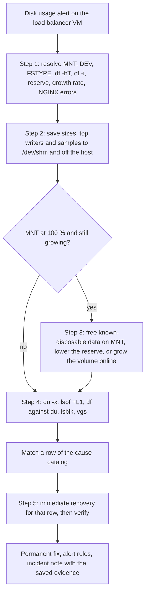

# Problem 2: disk at 99 % on the NGINX load balancer VM

A cloud VM runs Ubuntu 24.04 with 64 GB of storage, and its only service is NGINX acting as a load balancer in front of upstream services. Monitoring reports the VM consistently at 99 % storage usage. The challenge asks how to troubleshoot it, which causes to expect, and the impact and recovery steps of each root cause. It asks for two production issues but describes only this one, so this answer covers this scenario in full.

## Requirements and principles applied

| Requirement | Where it is answered |
|---|---|
| REQ-P2-1 Steps to troubleshoot the production issue on the VM | [Triage flow](#triage-flow), [Runbook](#runbook), [Monitoring and alerts](#monitoring-and-alerts) |
| REQ-P2-2 The causes and scenarios expected | [Cause catalog](#cause-catalog), [Cases that mislead](#cases-that-mislead) |
| REQ-P2-3 The impact of each possible root cause | [What clients see as the disk fills](#what-clients-see-as-the-disk-fills), the impact column of the catalog, [Removing the single point of failure](#removing-the-single-point-of-failure) |
| REQ-P2-4 Recovery steps for each possible root cause | The recovery and prevention columns of the catalog, [Prevention](#prevention) |
| REQ-P2-5 Ubuntu 24.04, 64 GB, 99 % usage, NGINX as the only service | [Assumptions](#assumptions), and every command carries `MNT`, `DEV` and `FSTYPE` |

| Principle | How this answer applies it |
|---|---|
| OPS-DP2 "Implement observability for actionable insights" | Threshold, trend, inode and 5xx alerts that each name a runbook |
| OPS-DP3 "Safely automate where possible" | Rotation, journald limits and cache limits configured as code. The runbook itself stays manual (ADR-P2-0001) |
| OPS-DP5 "Refine operations procedures frequently" | A runbook whose commands the lab executes |
| OPS-DP6 "Anticipate failure" | Evidence before cleanup, and a recovery order that never needs space it does not have |
| OPS-DP7 "Learn from all operational events and metrics" | Each catalog row ends in a permanent fix and an alert |
| OPS-DP8 "Use managed services" | A managed load balancer as one way to remove the single VM |
| REL-DP2 "Test recovery procedures" | The full-disk lab |
| REL-DP3 "Scale horizontally to increase aggregate workload availability" | Two instances or a managed load balancer instead of one VM |
| SEC-DP1 "Implement a strong identity foundation" and SEC-DP6 "Keep people away from data" | SSH closed, operator access through SSM Session Manager |
| GEN-DP5 "Drive architectures using data" | A page on the measured growth rate, not only on a level |

## Assumptions

| ID | Assumption | Why | If wrong |
|---|---|---|---|
| A1 | Only the disk scenario is answered | It is the only scenario the page describes | A second issue gets its own runbook in the same format |
| A2 | The VM is an EC2 instance with an EBS root volume, and operators reach it through SSM Session Manager | The other problems of this submission run on AWS | Other clouds offer an online disk resize and a provider shell under other names |
| A3 | NGINX comes from the Ubuntu package (1.24.0 in `noble-updates`) with the package paths: logs in `/var/log/nginx`, temp files in `/var/lib/nginx`, workers as `www-data`, rotation by `/etc/logrotate.d/nginx` | The scenario names Ubuntu 24.04 and one NGINX service | `nginx -V` and `nginx -T` show the real paths, and the runbook reads them before acting |
| A4 | The filesystem layout is unknown: a partition from the cloud image or LVM from the server installer, ext4 or XFS | Both are common on Ubuntu 24.04 | The runbook reads the layout with `findmnt`, `lsblk -f` and `vgs` instead of assuming one |
| A5 | "Consistently at 99 %" means the usage has stayed near full for days | The word suggests a level, not a climb | Step 1 measures the growth rate, and a climbing disk sends the runbook to stabilization first |
| A6 | Prometheus scrapes node_exporter and prometheus-nginxlog-exporter (namespace `nginx`) on the VM | The alert rules need named metrics | The metric names change, the logic of the rules stays |

## What clients see as the disk fills

The impact on clients depends on how full the filesystem is, because NGINX workers run as `www-data` and cannot use the ext4 root reserve. Cells with a lab ID were measured on a real NGINX in the [lab](#lab).

| State of the filesystem | What fails | What clients see | Lab check |
|---|---|---|---|
| Space left for non-root writers | Nothing yet, but a large proxied response to a slow client already sits in a deleted temp file | Normal service | L0 |
| No space left for non-root writers, root reserve intact | Access log writes, proxy temp files, request body temp files | Small responses still return 200, but most of them never reach the access log. Large proxied responses start with 200 and end before `Content-Length`. Uploads above the client body buffer fail with 500 | L1, L2, L3 |
| Root reserve used up too | Every new block, also for root: journald stops writing and `apt` cannot download packages | Same as above, and operators lose the tools they need to recover | review |
| Inodes exhausted while blocks are free | Every new file, including temp files and the new log after a rotation | The same failures as a full disk while `df -h` still shows space | L8 |

The 5xx ratio of the load balancer understates the damage in the second state, because truncated responses start with status 200 (L2) and the access log loses lines (L1). In the lab only 84 of 200 requests reached the access log once the filesystem was full, and NGINX logged a single alert. NGINX reports a failed or incomplete access log write at most once every 60 s per log, and after `ENOSPC` it skips that log for the rest of the second (`src/http/modules/ngx_http_log_module.c`), so the error log stays quiet while lines are lost.

## Triage flow



## Runbook

All commands run as an operator in an SSM session. Steps 0 to 2 only read. Cleanup and growth commands name `MNT` or `DEV`, never `/` by default.

### Step 0: resolve the mount

`P` is the path, or the `mountpoint` label, from the alert.

```bash
P=/
read -r MNT FSTYPE MAJMIN < <(findmnt -n -o TARGET,FSTYPE,MAJ:MIN -T "$P")
DEV="/dev/$(basename "$(readlink -f "/sys/dev/block/$MAJMIN")")"
printf 'MNT=%s DEV=%s FSTYPE=%s\n' "$MNT" "$DEV" "$FSTYPE"
```

The device comes from its major and minor numbers, which works the same for a partition, an LVM volume, a loop device and the `/dev/root` alias that `df` can print on cloud images. The lab runs these lines as `lab/mount-vars.sh` (E0).

### Step 1: confirm and scope

```bash
df -hT "$MNT"
df -i "$MNT"
[ "$FSTYPE" != ext4 ] || sudo tune2fs -l "$DEV" | grep -E '^(Block count|Reserved block count|Block size)'
for i in 1 2 3 4 5 6; do printf '%s ' "$(date -u +%T)"; df -B1 --output=used "$MNT" | tail -n 1; sleep 30; done
sudo grep -c 'No space left on device' /var/log/nginx/error.log
sudo tail -n 5000 /var/log/nginx/access.log | awk '$9 ~ /^5/ { n++ } END { print n + 0, "5xx in the last 5000 requests" }'
```

The six samples over three minutes give the growth rate. Blocks and inodes are separate limits, so both `df` calls matter. On ext4, the reserved block count explains why root can still write after `df` shows 100 %.

### Step 2: preserve evidence

The full filesystem is the wrong place for evidence, so it goes to `/dev/shm` and then off the host.

```bash
E="/dev/shm/disk-incident-$(date -u +%Y%m%dT%H%M%SZ)"
mkdir -p "$E"
sudo du -xh --max-depth=3 "$MNT" 2> /dev/null | sort -h | tail -n 40 > "$E/du.txt"
sudo lsof -nP +L1 > "$E/deleted-open.txt" 2>&1
sudo ls -lah /var/log/nginx /var/lib/nginx > "$E/nginx-files.txt" 2>&1
sudo journalctl --disk-usage > "$E/journal.txt" 2>&1
sudo nginx -T > "$E/nginx-config.txt" 2>&1
sudo tail -c 10M /var/log/nginx/access.log > "$E/access-sample.log"
aws s3 cp --recursive "$E" "s3://<INCIDENT_BUCKET>/$(hostname)/$(basename "$E")/"
```

### Step 3: stabilize, only when `MNT` is at 100 % and still growing

Free a measured amount of data that is known to be disposable, in this order, and check `df` after each step. Compression needs free space, so it waits until this step has created headroom.

```bash
sudo apt-get clean
sudo journalctl --rotate
sudo journalctl --vacuum-size=500M
for f in /var/log/nginx/*.gz; do [ -e "$f" ] || continue; aws s3 cp "$f" "s3://<LOG_ARCHIVE_BUCKET>/$(hostname)/" && sudo rm "$f"; done
```

On ext4, lowering the root reserve returns space to `www-data` at once without touching any file (L10). It removes the margin that root daemons rely on, so it is undone after the fix.

```bash
sudo tune2fs -m 1 "$DEV"
sudo tune2fs -m 5 "$DEV"
```

Growing the volume online buys time when nothing disposable is left. EBS lets the file system grow as soon as the modification reaches the `optimizing` state, allows up to four modifications per volume in a rolling 24 hours, and never shrinks a volume.

```bash
aws ec2 modify-volume --volume-id <VOLUME_ID> --size <NEW_SIZE_GIB>
aws ec2 describe-volumes-modifications --volume-ids <VOLUME_ID> --query 'VolumesModifications[0].ModificationState' --output text
DISK="/dev/$(lsblk -no PKNAME "$DEV")"
PARTNUM="$(cat "/sys/class/block/$(basename "$DEV")/partition")"
sudo growpart "$DISK" "$PARTNUM"
if [ "$FSTYPE" = xfs ]; then sudo xfs_growfs -d "$MNT"; else sudo resize2fs "$DEV"; fi
```

With LVM and free extents in the volume group, `sudo lvextend -r -l +100%FREE <LV_PATH>` grows the volume and its filesystem without an EBS change.

### Step 4: locate the consumer

```bash
sudo du -xh --max-depth=1 "$MNT" 2> /dev/null | sort -h | tail -n 15
sudo du -xh --max-depth=2 /var 2> /dev/null | sort -h | tail -n 15
sudo lsof -nP +L1
echo "df used $(df -B1 --output=used "$MNT" | tail -n 1) bytes, du total $(sudo du -sxB1 "$MNT" | cut -f1) bytes"
lsblk -f
sudo vgs
sudo lvs
```

A large gap between `df` used and the `du` total means deleted files that are still open, or files hidden under a mount point (see [Cases that mislead](#cases-that-mislead)). A `df` size well below 64 GB, or free extents in `vgs`, means the filesystem is smaller than the disk.

### Step 5: fix, verify, prevent

Apply the immediate recovery of the matching catalog row, then confirm that space is back and NGINX serves normally.

```bash
df -hT "$MNT"
df -i "$MNT"
curl -s -o /dev/null -w '%{http_code}\n' http://127.0.0.1/<HEALTH_PATH>
sudo tail -n 20 /var/log/nginx/error.log
```

Then apply the permanent fix of the row, restore the reserve if step 3 lowered it, check that the alert rules of this answer are in place, and write the incident note from the saved evidence.

## Cause catalog

| Cause | First signal | Confirm with | Impact on the load balancer | Immediate recovery | Prevention |
|---|---|---|---|---|---|
| NGINX logs not rotated, or inflated by bot traffic | `/var/log/nginx` leads `du`, one log in GB | `ls -lah /var/log/nginx`, `logrotate -d /etc/logrotate.d/nginx`, `systemctl list-timers logrotate.timer`, top client IPs from the access log | Logging stops, then large responses and uploads fail once temp files cannot be written (L1 to L3) | Rename the log, `nginx -s reopen`, then move or compress the renamed file once there is headroom | `maxsize` rotation on an hourly timer, `postrotate` reopen, logs shipped off the host, rate limits for abusive clients |
| Deleted log still held open by NGINX | `df` used far above the `du` total | `lsof -nP +L1` | The space never comes back while NGINX runs (L4) | `nginx -s reopen` (L5) | Rotate with logrotate, never `rm` an active log |
| Verbose `error_log` level such as `debug` | `error.log` grows faster than `access.log` | `nginx -T \| grep error_log` | Same as unrotated logs | Set the level to `warn`, `nginx -t`, reload | The level set in configuration management |
| `proxy_cache` without `max_size`, or large temp files | The cache directory leads `du`, or `lsof +L1` lists many deleted files under `/var/lib/nginx` | `nginx -T \| grep -E 'proxy_cache_path\|proxy_temp_path\|proxy_max_temp_file_size'`, `nginx -V` for the temp paths, `du -sh` on the cache | The cache fills the disk, and temp files that cannot be written cut responses short (L2) | Set `max_size` and `min_free`, reload, and let the cache manager trim, or delete the oldest entries in batches. A full purge sends every request to the upstreams at once | `max_size`, `min_free`, `inactive`, `proxy_max_temp_file_size`, the cache on its own volume |
| Unbounded systemd journal | `/var/log/journal` leads `du` | `journalctl --disk-usage`, `systemd-analyze cat-config systemd/journald.conf` | Other services lose logs. NGINX only loses disk space | `journalctl --rotate`, then `journalctl --vacuum-size=500M`, since vacuum removes archived files only | `SystemMaxUse` in a drop-in under `/etc/systemd/journald.conf.d/` |
| Package caches, old snaps, old kernels | `/var/cache/apt`, `/var/lib/snapd` or `/boot` large | `du -sh /var/cache/apt /var/lib/snapd`, `snap list --all`, `dpkg -l 'linux-image*'` | Slow fill | `apt-get clean` first. Review the `apt autoremove --purge` candidates before running it, since apt itself needs space | `snap set system refresh.retain=2`, unattended-upgrades removes unused kernels by default |
| Core dumps from a crashing process | `/var/crash` or `/var/lib/systemd/coredump` large | `coredumpctl list`, `ls -lah /var/crash` | Fills in bursts | Keep one sample off the host, delete the rest | Fix the crash, cap the dump storage |
| Filesystem smaller than the 64 GB disk | `df` size well below 64 GB | `lsblk -f`, `findmnt -T "$MNT"`, `vgs` | The disk looks full early | Partition: `growpart "$DISK" "$PARTNUM"`, then `resize2fs "$DEV"` on ext4 or `xfs_growfs -d "$MNT"` on XFS. LVM: `lvextend -r -l +100%FREE <LV_PATH>` | Fix the image build |
| Another writer: backups, a log shipper spooling while its destination is down, stray Docker images | A directory outside `/var/log/nginx` grows | `du` twice a few minutes apart, `fatrace` | Depends on the writer | Stop or move the writer | Move it off the load balancer |
| Inode exhaustion from many small files | `No space left on device` while `df -h` shows space | `df -i "$MNT"`, then files per directory (below) | New files fail: temp files, new logs, cache entries (L8) | Remove the small files | Cache limits, more inodes at `mkfs` time |
| SSH brute force filling `btmp` and `auth.log` | `/var/log/btmp` and `/var/log/auth.log` large | `lastb \| wc -l`, `du -sh /var/log/btmp /var/log/auth.log` | Slow fill, and a security incident | Rotate, block the sources | Close SSH and use SSM Session Manager |

## Cases that mislead

### Deleted files that are still open

`df` counts the blocks of a deleted file until the last process closes it, while `du` walks names and no longer sees it. `lsof -nP +L1` lists such files with the process that holds them. For NGINX logs the fix is `nginx -s reopen`, which makes the master reopen every log and the workers close the old descriptors (L5). For a process that cannot reopen its log, `sudo truncate -s 0 /proc/<PID>/fd/<FD>` frees the space at once and loses the content, so it is the last resort.

### Inode exhaustion

On ext4 the number of inodes is fixed when the filesystem is created, so millions of small files can exhaust them while `df -h` still shows free space (L8). `df -i "$MNT"` confirms it, and this command finds the directories that hold the files:

```bash
sudo find "$MNT" -xdev -type f -printf '%h\n' | sort | uniq -c | sort -n | tail -n 10
```

### Reserved blocks

mke2fs reserves 5 % of an ext4 filesystem for the super-user by default, 3.2 GB of a 64 GB disk. `df` computes `Avail` and `Use%` for non-root users, so it shows 100 % while root can still write into the reserve (L9). NGINX workers run as `www-data` and stop at the reserve, so the load balancer degrades before root daemons do. `tune2fs -l "$DEV"` shows the `Reserved block count`. Step 3 uses `tune2fs -m 1 "$DEV"` as a temporary lever that returns 4 % of the blocks to non-root writers (L10).

### Log rotation without a reopen

Renaming a log keeps its inode, so NGINX keeps appending to the renamed file until it reopens its logs (L7). The Ubuntu package rotates daily, keeps 14 files, compresses with `delaycompress`, and sends the reopen through `invoke-rc.d nginx rotate` in `postrotate`. A hand-made rotation that renames without that signal leaves the old file growing. `copytruncate` avoids the signal but drops the lines written between the copy and the truncate, and it needs room for a second copy, which a nearly full disk does not have. `maxsize` only acts when logrotate runs, and Ubuntu's `logrotate.timer` fires daily, so size-based rotation also needs a more frequent timer.

### NGINX proxy cache and temp files

NGINX writes part of a proxied response to a temp file once the response no longer fits the `proxy_buffer_size` and `proxy_buffers` memory, up to `proxy_max_temp_file_size` (1024m by default). A request body larger than `client_body_buffer_size` goes to a temp file the same way. The Ubuntu package compiles these paths in as `/var/lib/nginx/proxy` and `/var/lib/nginx/body`, which `nginx -V` shows. The lab expects these temp files to be deleted as soon as they are opened, so they show up in `lsof +L1` and in `df` but not in `ls` or `du` (L0).

`proxy_cache_path` without `max_size` lets the cache grow until the disk is full. The cache manager removes the least recently used entries once the cache exceeds `max_size` or the free space drops below `min_free` (available since NGINX 1.19.1), and entries unused for longer than `inactive` (10 minutes by default) go regardless of freshness. Purging the whole cache at once sends every request to the upstreams together, so trimming through `max_size` or deleting the oldest entries in batches is the safer recovery.

### The systemd journal

journald limits itself by default: `SystemMaxUse` defaults to 10 % and `SystemKeepFree` to 15 % of the filesystem, each capped at 4G. When something else fills the disk, journald stops using more space but keeps its existing files. On a 99 % disk the journal is therefore rarely the writer, yet it can hold up to 4 GB that `journalctl --vacuum-size` returns. Vacuum removes archived files only, so `journalctl --rotate` comes first.

### Files hidden under a mount point

Files written to a directory before another filesystem was mounted on it stay on the lower filesystem, count in its `df`, and are invisible to `du`. This matters after a separate log volume is added, as the prevention section recommends. A bind mount of the lower filesystem shows them:

```bash
sudo mkdir -p /mnt/lower
sudo mount --bind "$MNT" /mnt/lower
sudo du -xh --max-depth=2 /mnt/lower 2> /dev/null | sort -h | tail -n 15
sudo umount /mnt/lower
```

## Monitoring and alerts

The rules live in [`alerts/disk-rules.yml`](alerts/disk-rules.yml) and their unit tests in [`alerts/disk-rules.test.yml`](alerts/disk-rules.test.yml). `bash alerts/test.sh` runs `promtool check rules` and `promtool test rules` in the pinned Prometheus image.

| Alert | Expression, simplified | Severity | Why |
|---|---|---|---|
| `DiskSpaceLow` | `node_filesystem_avail_bytes / node_filesystem_size_bytes < 0.15` for 15 min | warning | Time to act before any client impact |
| `DiskSpaceCritical` | the same ratio `< 0.05` for 5 min | page | A stable 99 % disk, the scenario itself |
| `DiskWillFillIn4Hours` | `predict_linear(node_filesystem_avail_bytes[6h], 4 * 3600) < 0` for 15 min | page | A fast fill, hours before any threshold |
| `InodesLow` | `node_filesystem_files_free / node_filesystem_files < 0.10` for 15 min | warning | Inode exhaustion with free blocks |
| `NginxServerErrorRatioHigh` | 5xx share of `nginx_http_response_count_total` `> 0.01` for 5 min | page | Client impact as seen by NGINX |

The disk rules read `avail`, which node_exporter documents as the space available to non-root users, because that is the space NGINX workers can use. `free` includes the root reserve and would page 3.2 GB later on a 64 GB ext4 disk. The rules select ext4 and XFS only, since Ubuntu mounts each snap as a squashfs image that always reports 100 % usage. The tests cover a stable 99 % with a snap mount, a steady fill from 50 % that pages on the trend while the thresholds stay quiet, inode exhaustion, and 5xx ratios of 2 % and 0.5 %. The `for` durations and the 1 % 5xx threshold are starting values, the same 1 % that the Problem 4 rollback alarm uses, to be tuned once the upstream services have objectives.

The 5xx ratio comes from the access log, so it goes blind exactly when the disk is full and NGINX drops most of that log (L1). A probe of the load balancer from outside the VM, such as a blackbox exporter request to its health path, measures client impact without depending on the disk.

## Prevention

- Rotation sized from the measured growth rate and tested on fixtures. `maxsize` in `/etc/logrotate.d/nginx` only acts when logrotate runs, so a drop-in at `/etc/systemd/system/logrotate.timer.d/hourly.conf` makes the timer hourly:

  ```ini
  [Timer]
  OnCalendar=
  OnCalendar=hourly
  ```

- A journald size limit in `/etc/systemd/journald.conf.d/size.conf`:

  ```ini
  [Journal]
  SystemMaxUse=1G
  ```

- `proxy_cache_path` with `max_size`, `min_free` and `inactive`, and `use_temp_path=off` so cache files are written into the cache directory, which then sits on its own volume.
- Logs shipped off the host with the CloudWatch agent or a log shipper, and a short local retention.
- A separate EBS volume for `/var/log/nginx` and the cache, so a log or cache fill no longer starves the operating system. Old files under the mount point move to the new volume first.
- `error_log` at `warn`, set in configuration management, never edited by hand.
- SSH closed in the security group. SSM Session Manager needs no inbound port, no bastion and no SSH keys, can log each session to S3 or CloudWatch Logs, and ends the brute-force traffic that fills `btmp`.
- The whole VM built from an image and configuration kept in code, so a fix reaches every instance and survives a rebuild.
- Core dumps capped, and the crashing process fixed.

## Removing the single point of failure

Every upstream service sits behind this one VM, so every root cause in the catalog has the same worst-case impact: all upstreams unreachable. The runbook shortens that outage. It does not remove it. Where the upstreams need only HTTP routing and health checks, a managed AWS load balancer replaces the VM and has no disk to fill. Where they need NGINX features, two NGINX instances in an Auto Scaling group across two Availability Zones sit behind a Network Load Balancer, built from one image and one configuration in code. Either way one instance can fill its disk, or be replaced, while traffic keeps flowing. ADR-P2-0005 compares these options with keepalived and DNS round robin.

## Lab

[`lab/run.sh`](lab/run.sh) reproduces the load balancer on a 16 MiB loop-backed ext4 filesystem inside a privileged container, as described in [`lab/README.md`](lab/README.md). Run it with `bash src/problem2/lab/run.sh --yes`. It writes `evidence/lab-<UTC time>.md` with the expected and observed result of each check. The table below comes from `evidence/lab-20261104T172029Z.md`, where all eleven checks matched.

| ID | Check | Expected | Observed |
|---|---|---|---|
| E0 | Mount derivation, `df`, `df -i`, reserve, temp paths | `MNT`, `DEV` and `FSTYPE` resolve on the loop device | `MNT=/var/log/nginx DEV=/dev/loop0 FSTYPE=ext4` |
| L0 | Large response, slow client, free space | The response spills to a deleted temp file under the proxy temp path | 1 deleted temp file(s) open, used +1544 KiB during the transfer, 1 warn line(s), client got 200 with 4194304 of 4194304 bytes |
| L1 | Small responses, full filesystem | Every request returns 200, some requests never reach the access log, and NGINX logs an alert about it | 200 of 200 returned 200, 84 of 200 reached the access log (7820 bytes), 1 alert line(s) |
| L2 | Large response, full filesystem | The status line says 200, then the connection closes before `Content-Length` is reached | status 200, 3271928 of 4194304 bytes, curl exit 18 |
| L3 | Request body above the buffer, full filesystem | The request fails with 500 | 200 with free space after 1 spill warning(s), 500 on the full filesystem |
| L4 | `rm` on an open log | Nothing is freed while NGINX holds the file | used 2120 KiB before the rm, 2120 KiB after |
| L5 | `nginx -s reopen` after the `rm` | The space of the deleted log comes back | used 64 KiB after the reopen, 2056 KiB freed |
| L6 | `logrotate -f` on fixture logs | The log is renamed and new lines go to the new file | access.log.1 holds 4 line(s) and did not grow, the new access.log got 3 of 3 lines |
| L7 | Rename without reopen | NGINX keeps writing to the renamed file until a reopen | renamed file got 5 of 5 lines, a new access.log existed before the reopen: no, after the reopen it got 3 of 3 lines |
| L8 | Inode exhaustion | `No space left on device` while blocks are still free | 52 empty files created, inodes 100 % used, 3468 KiB of blocks still available |
| L9 | Root reserve | Non-root writers stop at the reserve while root still writes | 4 KiB left for non-root after the fill, root wrote 131072 bytes, dd exit 0 |
| L10 | `tune2fs -m 1` while mounted and full | Non-root writers get space back at once, without a remount | 0 KiB available before, 656 KiB after, a 256 KiB write as www-data exited 0 |

LVM growth and journald need a VM with systemd, so their rows rest on the vendor pages listed under [Sources](#sources).

## Decisions

| ADR | Decision |
|---|---|
| [ADR-P2-0001](docs/adr/0001-evidence-first-stabilize-first.md) | Evidence first, stabilize before root cause |
| [ADR-P2-0002](docs/adr/0002-cause-catalog-safe-recovery-order.md) | Cause catalog with a safe recovery order per cause |
| [ADR-P2-0003](docs/adr/0003-full-disk-lab-loop-ext4.md) | Full-disk lab on loop-backed ext4 in a privileged container |
| [ADR-P2-0004](docs/adr/0004-growth-rate-alerts.md) | Alerts on growth rate as well as thresholds |
| [ADR-P2-0005](docs/adr/0005-remove-single-load-balancer.md) | Remove the single load balancer VM as a single point of failure |

## Traceability

| Decision | Requirements | Principles | ADR | Verified by | Kind |
|---|---|---|---|---|---|
| Troubleshooting flow with evidence first and the mount carried through | REQ-P2-1, REQ-P2-5 | OPS-DP5, OPS-DP6 | ADR-P2-0001 | Lab checks E0, L4 and L5 | local run |
| Cause catalog with a safe recovery order | REQ-P2-2, REQ-P2-3, REQ-P2-4 | OPS-DP6, OPS-DP7 | ADR-P2-0002 | Lab checks L0 to L10 for the NGINX rows (local run), vendor pages for the rest (review) | local run, review |
| Full-disk lab on loop-backed ext4 | REQ-P2-3 | REL-DP2 | ADR-P2-0003 | Lab output in `evidence/lab-*.md` | local run |
| Growth-rate alerts next to thresholds | REQ-P2-1, REQ-P2-4 | OPS-DP2, GEN-DP5 | ADR-P2-0004 | `alerts/test.sh` with `promtool test rules` | offline test |
| Rotation, journald limits, logs off the host | REQ-P2-4 | OPS-DP3, OPS-DP6 | ADR-P2-0002 | Lab checks L6 and L7 | local run |
| SSH closed, SSM Session Manager | REQ-P2-4 | SEC-DP1, SEC-DP6 | ADR-P2-0002 | This answer | review |
| Two instances or a managed load balancer | REQ-P2-3 | REL-DP3, OPS-DP8 | ADR-P2-0005 | This answer | review |

## Sources

Read on 2026-11-04.

- NGINX `ngx_http_proxy_module` (proxy buffering, `proxy_max_temp_file_size`, `proxy_cache_path` with `max_size`, `min_free` and `inactive`): https://nginx.org/en/docs/http/ngx_http_proxy_module.html
- NGINX `ngx_http_core_module` (`client_body_buffer_size`, `client_body_temp_path`): https://nginx.org/en/docs/http/ngx_http_core_module.html
- NGINX log rotation with `USR1` and the reopen sequence: https://nginx.org/en/docs/control.html
- Ubuntu `nginx` package 1.24.0 in `noble-updates`, its logrotate rules, `postinst` and compiled paths: https://packages.ubuntu.com/noble-updates/nginx and https://git.launchpad.net/ubuntu/+source/nginx
- Ubuntu `logrotate.timer` with `OnCalendar=daily`: https://git.launchpad.net/ubuntu/+source/logrotate
- logrotate `maxsize` and `copytruncate`: https://man7.org/linux/man-pages/man5/logrotate.conf.5.html
- mke2fs default reserve of 5 %: https://man7.org/linux/man-pages/man8/mke2fs.8.html
- journald `SystemMaxUse` and `SystemKeepFree` defaults: https://www.freedesktop.org/software/systemd/man/latest/journald.conf.html
- node_exporter filesystem metrics and their help texts: https://github.com/prometheus/node_exporter/blob/master/collector/filesystem_common.go
- prometheus-nginxlog-exporter metric names and labels: https://github.com/martin-helmich/prometheus-nginxlog-exporter
- unattended-upgrades default for `Remove-Unused-Kernel-Packages`: https://git.launchpad.net/ubuntu/+source/unattended-upgrades
- Amazon EBS volume modification limits: https://docs.aws.amazon.com/ebs/latest/userguide/ebs-modify-volume.html
- Extending a Linux file system after an EBS resize: https://docs.aws.amazon.com/ebs/latest/userguide/recognize-expanded-volume-linux.html
- AWS Systems Manager Session Manager: https://docs.aws.amazon.com/systems-manager/latest/userguide/session-manager.html
