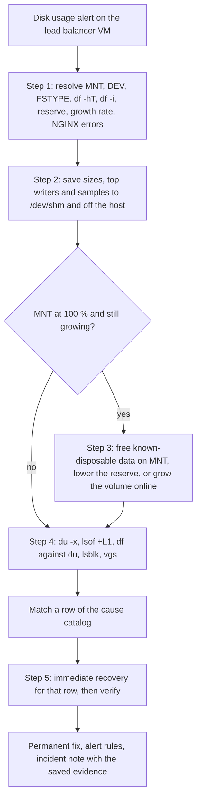

# Problem 2: disk at 99 % on the NGINX load balancer VM

A cloud VM runs Ubuntu 24.04 with 64 GB of storage, and its only service is NGINX load balancing in front of upstream services. Monitoring shows the disk consistently at 99 %. This answer gives the troubleshooting steps, the expected causes, and the impact and recovery of each. The challenge mentions two production issues but describes only this one, so only this one is answered.

## Assumptions

| Assumption | If wrong |
|---|---|
| The VM is EC2 with an EBS root volume, reached through SSM Session Manager | Other clouds have an online disk resize and a provider shell under other names |
| NGINX is the Ubuntu 1.24.0 package: logs in `/var/log/nginx`, temp files in `/var/lib/nginx`, workers as `www-data`, rotation by `/etc/logrotate.d/nginx` | The runbook reads the real paths with `nginx -V` and `nginx -T` before acting |
| The layout is unknown: cloud image partition or installer LVM, ext4 or XFS | The runbook reads it with `findmnt`, `lsblk -f` and `vgs` |
| "Consistently" means a stable level, not a climb | Step 1 measures the growth rate, and a climbing disk goes to stabilization first |
| Prometheus scrapes node_exporter and prometheus-nginxlog-exporter (namespace `nginx`) | Metric names change, the rule logic does not |

## What clients see as the disk fills

NGINX workers run as `www-data` and cannot use the ext4 root reserve, so the load balancer degrades before root daemons do. The lab IDs point to the [checks below](#lab).

| State of the filesystem | What fails | What clients see | Lab |
|---|---|---|---|
| Space left for non-root writers | Nothing yet | Normal service | L0 |
| No space for non-root, root reserve intact | Access log writes, proxy temp files, request body temp files | Small responses return 200 but most miss the access log. Large proxied responses start with 200 and end before `Content-Length`. Uploads above the body buffer get 500 | L1, L2, L3 |
| Root reserve used up | Every new block, also for root | Same as above, and journald and `apt` stop working for the operator | review |
| Inodes exhausted, blocks free | Every new file | The same failures while `df -h` still shows space | L8 |

The 5xx ratio understates this damage. Truncated responses carry status 200, and in the lab only 84 of 200 requests reached the access log while NGINX wrote one alert line. NGINX reports a failed access log write at most once a minute per log (`src/http/modules/ngx_http_log_module.c`), so its error log stays quiet while lines are lost.

## Triage flow



## Runbook

Run as an operator in an SSM session. Steps 0 to 2 only read, and every write names `MNT` or `DEV`, never `/` by default.

### Step 0: resolve the mount

`P` is the path or `mountpoint` label from the alert. Resolving the device by major and minor number works for a partition, LVM, a loop device and the `/dev/root` alias alike. The lab runs these lines as [`lab/mount-vars.sh`](lab/mount-vars.sh) (E0).

```bash
P=/
read -r MNT FSTYPE MAJMIN < <(findmnt -n -o TARGET,FSTYPE,MAJ:MIN -T "$P")
DEV="/dev/$(basename "$(readlink -f "/sys/dev/block/$MAJMIN")")"
printf 'MNT=%s DEV=%s FSTYPE=%s\n' "$MNT" "$DEV" "$FSTYPE"
```

### Step 1: confirm and scope

Blocks and inodes are separate limits. The loop takes six samples over three minutes to give the growth rate.

```bash
df -hT "$MNT"
df -i "$MNT"
[ "$FSTYPE" != ext4 ] || sudo tune2fs -l "$DEV" | grep -E '^(Block count|Reserved block count|Block size)'
for i in 1 2 3 4 5 6; do printf '%s ' "$(date -u +%T)"; df -B1 --output=used "$MNT" | tail -n 1; sleep 30; done
sudo grep -c 'No space left on device' /var/log/nginx/error.log
sudo tail -n 5000 /var/log/nginx/access.log | awk '$9 ~ /^5/ { n++ } END { print n + 0, "5xx in the last 5000 requests" }'
```

### Step 2: preserve evidence

Evidence goes to memory, then off the host, never onto the full disk.

```bash
E="/dev/shm/disk-incident-$(date -u +%Y%m%dT%H%M%SZ)"
mkdir -p "$E"
sudo du -xh --max-depth=3 "$MNT" 2> /dev/null | sort -h | tail -n 40 > "$E/du.txt"
sudo lsof -nP +L1 > "$E/deleted-open.txt" 2>&1
sudo ls -lah /var/log/nginx /var/lib/nginx > "$E/nginx-files.txt" 2>&1
sudo journalctl --disk-usage > "$E/journal.txt" 2>&1
sudo nginx -T > "$E/nginx-config.txt" 2>&1
sudo tail -c 10M /var/log/nginx/access.log > "$E/access-sample.log"
aws s3 cp --recursive "$E" "s3://<INCIDENT_BUCKET>/$(hostname)/$(basename "$E")/"
```

### Step 3: stabilize, only when `MNT` is at 100 % and still growing

Free known-disposable data in this order and check `df` after each line. Compression needs free space, so it waits until here.

```bash
sudo apt-get clean
sudo journalctl --rotate
sudo journalctl --vacuum-size=500M
for f in /var/log/nginx/*.gz; do [ -e "$f" ] || continue; aws s3 cp "$f" "s3://<LOG_ARCHIVE_BUCKET>/$(hostname)/" && sudo rm "$f"; done
```

On ext4, lowering the root reserve gives space back to `www-data` at once without a remount (L10). Root daemons lose their margin, so the second line runs after the fix.

```bash
sudo tune2fs -m 1 "$DEV"
sudo tune2fs -m 5 "$DEV"
```

When nothing disposable is left, grow the volume online. The filesystem can grow once the modification reaches `optimizing`. EBS allows four modifications per volume in 24 hours and never shrinks a volume.

```bash
aws ec2 modify-volume --volume-id <VOLUME_ID> --size <NEW_SIZE_GIB>
aws ec2 describe-volumes-modifications --volume-ids <VOLUME_ID> --query 'VolumesModifications[0].ModificationState' --output text
DISK="/dev/$(lsblk -no PKNAME "$DEV")"
PARTNUM="$(cat "/sys/class/block/$(basename "$DEV")/partition")"
sudo growpart "$DISK" "$PARTNUM"
if [ "$FSTYPE" = xfs ]; then sudo xfs_growfs -d "$MNT"; else sudo resize2fs "$DEV"; fi
```

With LVM and free extents, `sudo lvextend -r -l +100%FREE <LV_PATH>` grows the volume and filesystem without touching EBS.

### Step 4: locate the consumer

```bash
sudo du -xh --max-depth=1 "$MNT" 2> /dev/null | sort -h | tail -n 15
sudo du -xh --max-depth=2 /var 2> /dev/null | sort -h | tail -n 15
sudo lsof -nP +L1
echo "df used $(df -B1 --output=used "$MNT" | tail -n 1) bytes, du total $(sudo du -sxB1 "$MNT" | cut -f1) bytes"
lsblk -f
sudo vgs
sudo lvs
```

A large gap between `df` and `du` means open deleted files or files hidden under a mount point. A `df` size well below 64 GB, or free extents in `vgs`, means the filesystem is smaller than the disk.

### Step 5: fix, verify, prevent

Apply the matching catalog row, then check space and service.

```bash
df -hT "$MNT"
df -i "$MNT"
curl -s -o /dev/null -w '%{http_code}\n' http://127.0.0.1/<HEALTH_PATH>
sudo tail -n 20 /var/log/nginx/error.log
```

Then apply the permanent fix, restore the reserve if step 3 lowered it, confirm the alert rules are deployed, and write the incident note from the saved evidence.

## Cause catalog

Recoveries run from reversible to destructive, and no step needs space that is not there yet ([ADR-P2-0002](docs/adr/0002-cause-catalog-safe-recovery-order.md)).

| Cause | First signal | Confirm with | Impact | Immediate recovery | Prevention |
|---|---|---|---|---|---|
| NGINX logs not rotated, or inflated by bots | `/var/log/nginx` leads `du` | `logrotate -d /etc/logrotate.d/nginx`, `systemctl list-timers logrotate.timer`, top client IPs | Logging stops, then large responses and uploads fail (L1 to L3) | Rename the log, `nginx -s reopen`, compress or move it once there is headroom | `maxsize` on an hourly timer, logs shipped off the host, rate limits |
| Deleted log held open by NGINX | `df` far above `du` | `lsof -nP +L1` | The space never returns while NGINX runs (L4) | `nginx -s reopen` (L5) | Rotate with logrotate, never `rm` an active log |
| `error_log` at `debug` | `error.log` grows faster than `access.log` | `nginx -T \| grep error_log` | As unrotated logs | Set `warn`, `nginx -t`, reload | The level set in configuration management |
| `proxy_cache` without `max_size`, or large temp files | Cache directory leads `du`, or many deleted files under `/var/lib/nginx` | `nginx -T \| grep -E 'proxy_cache_path\|proxy_temp_path\|proxy_max_temp_file_size'` | Responses cut short once temp files fail (L2) | Set `max_size` and `min_free` and reload, or delete the oldest entries in batches. A full purge sends all traffic to the upstreams at once | `max_size`, `min_free`, `inactive`, `proxy_max_temp_file_size`, cache on its own volume |
| Unbounded systemd journal | `/var/log/journal` leads `du` | `journalctl --disk-usage` | Other services lose logs | `journalctl --rotate`, then `--vacuum-size=500M` | `SystemMaxUse` drop-in |
| Package caches, old snaps, old kernels | `/var/cache/apt`, `/var/lib/snapd` or `/boot` large | `snap list --all`, `dpkg -l 'linux-image*'` | Slow fill | `apt-get clean` first. Review `apt autoremove --purge` before running it, since apt needs space | `snap set system refresh.retain=2`, unattended-upgrades removes old kernels by default |
| Core dumps | `/var/crash` or `/var/lib/systemd/coredump` large | `coredumpctl list` | Fills in bursts | Keep one sample off the host, delete the rest | Fix the crash, cap dump storage |
| Filesystem smaller than the disk | `df` size well below 64 GB | `lsblk -f`, `vgs` | The disk looks full early | `growpart`, then `resize2fs` or `xfs_growfs`, or `lvextend -r` (step 3) | Fix the image build |
| Another writer: backups, a spooling log shipper, Docker images | A directory outside `/var/log/nginx` grows | `du` twice minutes apart, `fatrace` | Depends on the writer | Stop or move the writer | Move it off the load balancer |
| Inode exhaustion | `No space left on device` while `df -h` shows space | `df -i "$MNT"`, files per directory (below) | New files fail (L8) | Remove the small files | Cache limits, more inodes at `mkfs` |
| SSH brute force | `/var/log/btmp` and `auth.log` large | `lastb \| wc -l` | Slow fill and a security incident | Rotate, block the sources | Close SSH, use SSM Session Manager |

## Cases that mislead

`df` counts a deleted file until its last holder closes it, but `du` no longer sees it. For NGINX logs, `nginx -s reopen` makes the workers drop the old descriptors (L5). For a process that cannot reopen, `sudo truncate -s 0 /proc/<PID>/fd/<FD>` frees the space and loses the content, so it comes last.

ext4 fixes the inode count at `mkfs` time, so many small files can fill it with blocks to spare (L8). This finds the directories that hold them:

```bash
sudo find "$MNT" -xdev -type f -printf '%h\n' | sort | uniq -c | sort -n | tail -n 10
```

mke2fs reserves 5 % for root by default, 3.2 GB of 64 GB. `df` shows `Use%` for non-root users, so it reads 100 % while root still writes (L9).

Renaming a log keeps its inode, so NGINX writes into the renamed file until it reopens (L7). The Ubuntu package rotates daily and sends that reopen in `postrotate`. `copytruncate` drops lines and needs room for a copy, and `maxsize` only acts when the daily `logrotate.timer` fires.

NGINX spills a proxied response that overflows `proxy_buffers` to a temp file, up to `proxy_max_temp_file_size` (1024m by default). A body above `client_body_buffer_size` spills the same way. These files are deleted on open, so they appear in `lsof +L1` and `df` but not in `du` (L0).

journald caps itself at 10 % of the filesystem and keeps 15 % free, each capped at 4G. On a disk filled by something else it stops growing but keeps up to 4 GB that vacuum can return.

Files written under a directory before a filesystem was mounted on it count in `df` and hide from `du`. This matters once logs move to their own volume. A bind mount shows them:

```bash
sudo mkdir -p /mnt/lower
sudo mount --bind "$MNT" /mnt/lower
sudo du -xh --max-depth=2 /mnt/lower 2> /dev/null | sort -h | tail -n 15
sudo umount /mnt/lower
```

## Monitoring and alerts

Rules are in [`alerts/disk-rules.yml`](alerts/disk-rules.yml), tests in [`alerts/disk-rules.test.yml`](alerts/disk-rules.test.yml), and `bash alerts/test.sh` runs both through promtool. Each rule links back to this runbook. [ADR-P2-0004](docs/adr/0004-growth-rate-alerts.md) explains why a trend alert pages next to the thresholds.

| Alert | Fires when | Severity |
|---|---|---|
| `DiskSpaceLow` | Under 15 % available for 15 min | warning |
| `DiskSpaceCritical` | Under 5 % available for 5 min, the scenario itself | page |
| `DiskWillFillIn4Hours` | `predict_linear` over 6 h reaches zero within 4 h | page |
| `InodesLow` | Under 10 % inodes free for 15 min | warning |
| `NginxServerErrorRatioHigh` | 5xx above 1 % for 5 min | page |

The rules read `avail`, the space NGINX workers can use, and select ext4 and XFS only so that snap squashfs mounts at 100 % stay silent. The durations and the 1 % threshold are starting values. Because the 5xx ratio comes from the access log, it goes blind on a full disk (L1), so an external probe of the health path should back it up.

## Prevention

Size rotation from the measured growth rate, and make `logrotate.timer` hourly so `maxsize` takes effect, in `/etc/systemd/system/logrotate.timer.d/hourly.conf`:

```ini
[Timer]
OnCalendar=
OnCalendar=hourly
```

Cap the journal in `/etc/systemd/journald.conf.d/size.conf`:

```ini
[Journal]
SystemMaxUse=1G
```

Set `max_size`, `min_free`, `inactive` and `use_temp_path=off` on `proxy_cache_path`. Put `/var/log/nginx` and the cache on a separate EBS volume, so a log or cache fill cannot starve the OS, and move existing files across first. Ship logs off the host and keep a short local retention. Keep `error_log` at `warn` in configuration management. Close SSH in the security group, which also ends the brute force that fills `btmp`. Build the VM from an image and configuration in code, so a fix survives a rebuild.

## Removing the single point of failure

Every upstream sits behind this one VM, so every cause above ends the same way at worst: all upstreams unreachable. The runbook shortens that outage but cannot remove it. A managed AWS load balancer has no disk to fill and covers plain HTTP routing. If NGINX features are needed, two NGINX instances in an Auto Scaling group across two Availability Zones sit behind a Network Load Balancer. [ADR-P2-0005](docs/adr/0005-remove-single-load-balancer.md) compares these with keepalived and DNS round robin.

## Lab

`bash src/problem2/lab/run.sh --yes` reproduces the load balancer on a 16 MiB loop-backed ext4 filesystem in a privileged container ([`lab/README.md`](lab/README.md), [ADR-P2-0003](docs/adr/0003-full-disk-lab-loop-ext4.md)). All eleven checks matched their expected result in [`evidence/lab-20261104T172029Z.md`](evidence/lab-20261104T172029Z.md).

| ID | Check | Observed |
|---|---|---|
| E0 | Mount derivation | `MNT=/var/log/nginx DEV=/dev/loop0 FSTYPE=ext4` |
| L0 | Large response to a slow client, free space | One deleted temp file open, 200 with all 4194304 bytes |
| L1 | Small responses, full filesystem | 200 of 200 returned 200, 84 reached the access log, one alert line |
| L2 | Large response, full filesystem | Status 200, 3271928 of 4194304 bytes, curl exit 18 |
| L3 | Request body above the buffer, full filesystem | 200 with free space, 500 when full |
| L4 | `rm` on an open log | 2120 KiB used before and after |
| L5 | `nginx -s reopen` after the `rm` | 2056 KiB freed |
| L6 | `logrotate -f` on fixture logs | New lines went to the new `access.log` |
| L7 | Rename without reopen | The renamed file got all new lines until the reopen |
| L8 | Inode exhaustion | Inodes at 100 % with 3468 KiB of blocks free |
| L9 | Root reserve | 4 KiB left for non-root, root still wrote 131072 bytes |
| L10 | `tune2fs -m 1` while mounted and full | 0 KiB available before, 656 KiB after, a `www-data` write succeeded |

LVM growth and journald need a VM with systemd, so those rows rest on the [sources](#sources).

## Traceability

| Decision | Requirements | Principles | ADR | Verified by |
|---|---|---|---|---|
| Evidence first, stabilize before root cause, mount carried through | REQ-P2-1, REQ-P2-5 | OPS-DP5, OPS-DP6 | [ADR-P2-0001](docs/adr/0001-evidence-first-stabilize-first.md) | Lab E0, L4, L5 |
| Cause catalog with impact and a safe recovery order | REQ-P2-2, REQ-P2-3, REQ-P2-4 | OPS-DP6, OPS-DP7 | ADR-P2-0002 | Lab L0 to L10, vendor pages for the rest |
| Full-disk lab on loop-backed ext4 | REQ-P2-3 | REL-DP2 | ADR-P2-0003 | `evidence/lab-*.md` |
| Growth-rate alerts next to thresholds | REQ-P2-1, REQ-P2-4 | OPS-DP2, GEN-DP5 | ADR-P2-0004 | `alerts/test.sh` |
| Rotation, journald limits, logs off the host, SSH closed | REQ-P2-4 | OPS-DP3, SEC-DP1, SEC-DP6 | ADR-P2-0002 | Lab L6, L7, review |
| Two instances or a managed load balancer | REQ-P2-3 | REL-DP3, OPS-DP8 | ADR-P2-0005 | Review |

## Sources

Read on 2026-11-04.

- NGINX proxy, core and control docs: https://nginx.org/en/docs/http/ngx_http_proxy_module.html, https://nginx.org/en/docs/http/ngx_http_core_module.html, https://nginx.org/en/docs/control.html
- Ubuntu `nginx` 1.24.0 package and its logrotate rules: https://packages.ubuntu.com/noble-updates/nginx and https://git.launchpad.net/ubuntu/+source/nginx
- Ubuntu `logrotate.timer`: https://git.launchpad.net/ubuntu/+source/logrotate
- logrotate `maxsize` and `copytruncate`: https://man7.org/linux/man-pages/man5/logrotate.conf.5.html
- mke2fs reserve: https://man7.org/linux/man-pages/man8/mke2fs.8.html
- journald defaults: https://www.freedesktop.org/software/systemd/man/latest/journald.conf.html
- node_exporter filesystem metrics: https://github.com/prometheus/node_exporter/blob/master/collector/filesystem_common.go
- prometheus-nginxlog-exporter: https://github.com/martin-helmich/prometheus-nginxlog-exporter
- unattended-upgrades kernel removal: https://git.launchpad.net/ubuntu/+source/unattended-upgrades
- EBS volume modification and filesystem extension: https://docs.aws.amazon.com/ebs/latest/userguide/ebs-modify-volume.html, https://docs.aws.amazon.com/ebs/latest/userguide/recognize-expanded-volume-linux.html
- SSM Session Manager: https://docs.aws.amazon.com/systems-manager/latest/userguide/session-manager.html
