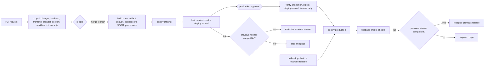

# Problem 4: CI/CD for a backend on EC2 and a frontend on S3

This folder is a small product: a Node.js API on EC2 behind an ALB, a single-page app on S3 behind CloudFront, and the GitHub Actions pipelines that test, build, deploy and roll back both. No AWS account is needed. Every deploy step runs the real scripts, in dry-run mode or against a recording fake of the AWS CLI.

| Path | Content |
|---|---|
| `.github/workflows/` | `ci.yml`, `backend-cd.yml`, `frontend-cd.yml`, the reusable `_deploy-backend.yml` and `_deploy-frontend.yml`, `rollback.yml` |
| `backend/`, `frontend/` | The two apps, the OpenAPI document, the CodeDeploy hooks and the SPA's per-environment config |
| `scripts/` | Build, deploy and check scripts, tests in `scripts/tests/` |
| `infra/policies/` | IAM, bucket and endpoint policies and the Content-Security-Policy as tested documents |
| [`infra/terraform/`](infra/terraform/README.md) | The prerequisites of section 8, planned offline and never applied |
| [`docs/adr/`](docs/adr/README.md) | ADR-P4-0001 to ADR-P4-0014, one per decision |
| [`evidence/`](evidence/README.md) | Captured output of the checks in section 10 |

## 1. Requirements and principles

Section 11 maps the six requirements REQ-P4-1 to REQ-P4-6 of [`docs/requirements.md`](../../docs/requirements.md) to the decisions. Most trade-offs are between these principles of [`docs/principles.md`](../../docs/principles.md): safe automation (OPS-DP3), small reversible changes (OPS-DP4), a strong identity foundation (SEC-DP1), traceability (SEC-DP2), security at all layers (SEC-DP3), automated security (SEC-DP4), automatic recovery (REL-DP1) and change through automation (REL-DP5).

## 2. Assumptions

| ID | Assumption | Why it matters |
|---|---|---|
| A1 | `src/problem4` is the product repo root. The challenge ships no app, so a Node.js 24 API and a Vite SPA are written here | Lint, test and build steps need real code to be verifiable |
| A2 | The API runs as a systemd service on an Auto Scaling group of Amazon Linux 2023 x86_64 instances in at least 2 AZs behind an ALB | A rolling deploy without downtime needs 2 instances. With one, the same pipeline causes a short outage per deploy |
| A3 | The SPA is a private S3 bucket behind CloudFront with Origin Access Control | S3 website endpoints are public and HTTP only |
| A4 | Staging and production are separate AWS accounts | A bad credential or deploy stays inside one account |
| A5 | No database | Migrations would run as their own expand-and-contract job before the deploy |
| A6 | GitHub-hosted runners | Self-hosted runners need hardening of their own |
| A7 | No AWS account, so AWS steps use `--dry-run` unless `DEPLOY_ENABLED` is `true` | The challenge accepts a faithful implementation |
| A8 | Every 600 s the SPA fetches the root `index.html` uncached and reloads when its release SHA changed | That one object is the activation switch, so open tabs follow activations and rollbacks |

## 3. What production ready means here

[ADR-P4-0001](docs/adr/0001-production-ready-properties.md) explains the choice of these eleven properties.

| ID | Property | How the pipelines meet it |
|---|---|---|
| G1 | Nothing reaches `main` unverified | A ruleset requires a PR, the `ci-gate` check and code owner review for `.github/`, `scripts/` and `infra/`, with no bypass |
| G2 | Build once, deploy the same bytes | One build job per app. Deploys verify the SHA-256 digest before any AWS change. Rebuilding a commit gives the same digest |
| G3 | Every running version is traceable | Provenance attestation and SPDX SBOM per artifact. `GET /version` and `releases/<sha>/version.json` return the commit SHA |
| G4 | Promotion is gated and its records cannot be forged | Append-only release records, one writer role per prefix. Production requires the attestation, the digest and a staging record for that digest |
| G5 | Rollout is safe and rolls back by itself | One instance at a time, then target, health, alarm and SHA checks. A failed check redeploys the previous release unless G9 vetoes it |
| G6 | Manual rollback is one action | `rollback.yml` redeploys a retained release without a rebuild |
| G7 | No long-lived credentials | GitHub OIDC, one role per app and environment, each trusting one reusable workflow on `main`. Jobs assert `aud` and `sub` before any AWS call |
| G8 | The pipeline itself is hardened | `permissions: {}` by default, actions pinned by SHA, `persist-credentials: false`, no `pull_request_target`, inputs through `env:`, timeouts, Dependabot |
| G9 | Deploys happen in order and stay compatible | One lock per environment that is never cancelled, forward-only promotion, and a frontend that needs a backend serving at least its `min_backend_api` |
| G10 | Dependencies are controlled | Lockfiles, `npm audit --audit-level=high`, dependency review, `trivy fs`, `gitleaks` |
| G11 | Failures are visible | Job summary with SHA, digest and status, and a failure webhook when its secret is set |

## 4. Pipeline flow



## 5. How the pipelines work

### 5.1 Pull requests

`ci.yml` picks jobs by path filter. Each app gets Biome lint, typecheck, unit tests, build and `npm audit`. The frontend tests include a contract test against `backend/openapi.yaml`: it fails when the SPA reads a field the schema lacks or needs a newer `x-api-version` than the backend declares. Other jobs run the Playwright tests, the script suites, the policy tests, the workflow linters, the offline Terraform check, the secret and dependency scans. `ci-gate`, the only required check, passes when each needed job succeeded or was skipped.

### 5.2 Build on `main`

`backend-cd.yml` builds inside a pinned `amazonlinux:2023` container with the Node.js tarball that `backend/node-sha256.txt` pins, and fails on a native addon ([ADR-P4-0013](docs/adr/0013-backend-build-container.md)). The archive has sorted entries, owner 0 and the commit time, so it is reproducible. `frontend-cd.yml` builds the SPA once with the SHA in `index.html` and packs the config of every environment with `release.json`, which holds `min_backend_api`. Both jobs attest the artifact, write an SBOM and, with `DEPLOY_ENABLED`, publish the artifact and its build record with conditional writes ([ADR-P4-0005](docs/adr/0005-build-once-manifest.md)). Staging, then production after approval, call the reusable deploy workflow.

### 5.3 Backend deploy

`_deploy-backend.yml` runs in environment `backend-<env>` under the concurrency group `deploy-<env>`. It verifies the attestation (`backend-cd.yml`, `refs/heads/main`, GitHub-hosted runner), checks the OIDC claims, assumes the role, and refuses a SHA that does not descend from the one deployed, except for a rollback.

`scripts/deploy-backend.sh` then checks the digest and S3 VersionId, requires a staging record in production, and refuses a release below the `min_backend_api` of a live frontend. It runs CodeDeploy with `CodeDeployDefault.OneAtATime` ([ADR-P4-0003](docs/adr/0003-codedeploy-rolling.md)). That configuration reports success even when the last instance fails. The script therefore checks every target, ALB health, the two alarms of section 8 and the SHA each instance serves, then runs a smoke test. Each instance's `ValidateService` hook also rejects a runtime older than the build's. On failure it redeploys the previous release unless the compatibility gate of [ADR-P4-0007](docs/adr/0007-deploy-lock-compatibility.md) vetoes it.

| Exit code | Meaning |
|---|---|
| 0 | Deployed and verified |
| 1 | Failed before the release went live |
| 2 | Wrong arguments |
| 3 | Failed after the change, previous release back and verified |
| 4 | Failed, and the return to the previous release failed too |
| 5 | Failed, and the rollback was vetoed (backend only) |

### 5.4 Frontend deploy

`_deploy-frontend.yml` has the same guards ([ADR-P4-0004](docs/adr/0004-frontend-release-layout.md)). `scripts/deploy-frontend.sh` uploads `assets/` as immutable for one year, never with `--delete`, then the release files under `releases/<sha>/`. Every upload is a conditional write. Activation is one copy of `releases/<sha>/index.html` to the root `index.html` with `no-cache`, followed by an invalidation and a smoke test. A failure after activation copies the previous `index.html` back and smoke-tests it.

CloudFront rewrites extension-less paths to `/index.html` for deep links and answers 404 for `/releases/<sha>/index.html`, so a retained release is never served as a page. Responses carry HSTS, `X-Frame-Options: DENY` and the CSP of `infra/policies/`. A tab that requests a removed chunk reloads once per release.

### 5.5 Rollback

`rollback.yml` takes the app, the environment and a SHA from the release manifest, and calls the same reusable workflow with `rollback: true`. Approvals, lock, role, compatibility gate and checks all apply. A release whose files are gone is refused.

## 6. Security model

### 6.1 OIDC roles

There is a build role per app and a deploy role per app and environment. Each trust policy matches `aud` and the full `sub`, with the immutable repository IDs, one environment (`main` for a build role) and the `job_workflow_ref` of one workflow on `main`. Two service roles, `backend-instance` and `backend-codedeploy`, complete the set. [ADR-P4-0006](docs/adr/0006-oidc-roles.md) has the details, and the documents live in `infra/policies/` ([ADR-P4-0012](docs/adr/0012-tested-policy-documents.md)).

### 6.2 Manifest authority

The manifest bucket has the prefixes `builds/`, `staging/` and `production/`, each with one writer. Its policy requires `If-None-Match` on every write and denies deletes. A forged staging record would need the staging deploy role.

### 6.3 Pinning and permissions

Actions are pinned by SHA, images by digest, Node.js by checksum, npm by lockfile ([ADR-P4-0011](docs/adr/0011-supply-chain.md)). Each workflow starts with `permissions: {}`. The environment sits on the called deploy job, so a role trusts exactly that job.

### 6.4 GitHub settings

| Setting | Value |
|---|---|
| Ruleset on `main` | PR, required check `ci-gate`, code owner review for `.github/`, `scripts/`, `infra/`, no force push, no deletion, no bypass |
| `backend-staging`, `frontend-staging` | Deployment branch `main` only |
| `backend-production`, `frontend-production` | Branch `main` only, required reviewers, no self-review, no admin bypass |
| Actions | Only pinned actions from GitHub and verified creators, read-only default token |
| OIDC subject template | Adds `job_workflow_ref` |

Required reviewers on private repositories need a paid plan, and attestations there need Enterprise Cloud. The demo repo is therefore public.

## 7. Rollback and retention

Instances keep the last 5 releases on disk. No pipeline role can delete objects. Cleanup belongs to a separate job with its own role, left out (section 13), which would follow these rules:

| Object | Kept |
|---|---|
| Backend artifacts | Current and last 3 production releases, last 3 staging releases |
| Frontend assets | 30 days after their release was last active, plus the longest CloudFront TTL |
| Frontend releases that are rollback targets | Always, with their assets |
| Release records | Always |

## 8. Prerequisites

[`infra/terraform/README.md`](infra/terraform/README.md) defines these in two roots, `roots/delivery` and `roots/environment`, with the apply order and what Terraform does not cover ([ADR-P4-0014](docs/adr/0014-minimal-terraform.md)). Every planned policy equals its document in `infra/policies/`. Nothing has been applied.

| Prerequisite | Root |
|---|---|
| VPC with private subnets and endpoints for S3, CodeDeploy, SSM and CloudWatch Logs | environment |
| Auto Scaling group of 2 or more instances with Node.js, the CodeDeploy agent and a `backend` user | environment |
| ALB over HTTPS, health check on `/healthz`, only the ALB reaching port 8080 | environment |
| CodeDeploy application, deployment group, service role and the two alarms | environment |
| Frontend bucket, CloudFront with OAC, cache behaviors, security headers and rewrite function | environment |
| Deploy, instance and CodeDeploy roles with their OIDC provider | environment |
| Artifact and manifest buckets with versioning, checksums and the G4 policy | delivery |
| Build roles with their OIDC provider | delivery |
| ACM certificates, DNS zone, state backends, the GitHub settings of section 6.4 | outside Terraform |

The alarms are `HTTPCode_Target_5XX_Count` above 1 % of requests in 2 of 3 minutes, and `UnHealthyHostCount` above 0 for 3 minutes. The deploy script reads them instead of the deployment group, for the reasons in ADR-P4-0003.

## 9. Configuration

| Name | Kind | Used by |
|---|---|---|
| `DEPLOY_ENABLED` | Variable | Every AWS step. Anything but `true` means dry run |
| `AWS_REGION`, `ARTIFACT_BUCKET`, `MANIFEST_BUCKET` | Variable | Build and deploy jobs |
| `BACKEND_BUILD_ROLE_ARN`, `FRONTEND_BUILD_ROLE_ARN`, `BACKEND_BUILD_OIDC_SUB`, `FRONTEND_BUILD_OIDC_SUB` | Variable | Build jobs |
| `DEPLOY_ROLE_ARN`, `OIDC_EXPECTED_SUB` | Environment variable | Deploy jobs |
| `CODEDEPLOY_APPLICATION`, `CODEDEPLOY_GROUP`, `TARGET_GROUP_ARN`, `BASE_URL` | Environment variable | Backend deploy |
| `FRONTEND_BUCKET`, `DISTRIBUTION_ID`, `BASE_URL`, `BACKEND_URL` | Environment variable | Frontend deploy |
| `NOTIFY_WEBHOOK_URL` | Secret | Failure notification, off when unset |

Terraform outputs give the AWS values. The OIDC subject variables become required once `DEPLOY_ENABLED` is `true`.

## 10. Verification

Static checks and offline tests have run, and [`evidence/README.md`](evidence/README.md) names the command behind each output. The GitHub demonstration and the AWS acceptance plan have not run ([ADR-P4-0008](docs/adr/0008-verification-without-aws.md)).

| Check | What it proves |
|---|---|
| `scripts/lint-workflows.sh` | actionlint, zizmor at medium and above, shellcheck: no finding |
| `infra/policies/test_policies.py` | No shared subject, no wildcard trust, no deletes or unconditional writes, no role writing outside its prefix |
| `scripts/terraform-check.sh` | Offline plans of both roots, every planned policy equals its document, all 125 ARNs in 30 documents name planned resources |
| `scripts/scan.sh` | gitleaks over the history and trivy at HIGH and CRITICAL find nothing |
| Unit tests of both apps | Routes, `/version`, config parsing, the reload guard, the API contract |
| Nine suites in `scripts/tests/` | Each deploy path against the fake AWS CLI, including failed last instance, alarm during deploy, vetoed rollback, wrong checksum and forward-only refusal. The hooks run in `amazonlinux:2023` |
| Playwright tests | Two real releases in a fake bucket behind a CloudFront-like server: deep links, an open tab through activation and rollback, a missing chunk reloading once |
| Build determinism | Two builds of one commit give identical digests for both apps |

The GitHub demonstration publishes this folder as its own repo (section 12). It shows a green `ci-gate`, both CD workflows in dry run, production awaiting approval, and the claims check failing on a wrong `aud` or `sub`.

With AWS, the acceptance plan runs in staging only:

1. Deploy the backend and check every instance's SHA, ALB health, and that `backend-codedeploy` needed nothing beyond its document.
2. Fail `ValidateService` on the last instance and watch the automatic return.
3. Deploy two frontend releases with a tab open and run the browser test against the distribution.
4. Assume each role from the wrong environment, workflow, audience and branch, and expect STS to deny.
5. Try to overwrite and delete a manifest record with each role, and expect S3 to deny.
6. Run `rollback.yml` for both apps.

## 11. Traceability

| Decision | Requirements | Principles | Verified by | ADR |
|---|---|---|---|---|
| G1 ruleset, PR checks, contract test, one gate | REQ-P4-3, REQ-P4-4 | OPS-DP3, SEC-DP4, REL-DP5 | `test-ci-gate.sh`, contract test, GitHub demo | ADR-P4-0001 |
| G2 build once, dry run without AWS | REQ-P4-1, REQ-P4-2, REQ-P4-4, REQ-P4-5 | OPS-DP4, REL-DP5, FSI-DP2 | Dry-run and checksum tests, build determinism | ADR-P4-0005, ADR-P4-0008, ADR-P4-0013 |
| G3 provenance, SBOM, version endpoints | REQ-P4-4 | SEC-DP2, OPS-DP2 | `test-verify-provenance.sh` | ADR-P4-0011 |
| G4 manifest authority, gated promotion | REQ-P4-4 | OPS-DP3, SEC-DP1, SEC-DP2, FSI-DP4 | Policy tests, plan policy check, staging record tests | ADR-P4-0005, ADR-P4-0012 |
| G5 fleet checks, alarms, automatic rollback | REQ-P4-1, REQ-P4-2, REQ-P4-4 | OPS-DP4, OPS-DP6, REL-DP1 | Deploy failure tests, hook tests | ADR-P4-0003 |
| G6 one-action rollback with retention | REQ-P4-4 | OPS-DP4, REL-DP2 | Rollback tests | ADR-P4-0003, ADR-P4-0004 |
| G7 one OIDC role per app and environment | REQ-P4-4, REQ-P4-5 | SEC-DP1, SEC-DP6 | Policy tests, `test-oidc-claims.sh`, GitHub demo, AWS plan step 4 | ADR-P4-0006 |
| G8 pipeline hardening | REQ-P4-3, REQ-P4-4 | SEC-DP3, SEC-DP4 | actionlint, zizmor | ADR-P4-0011 |
| G9 ordering, lock, compatibility | REQ-P4-1, REQ-P4-2, REQ-P4-4 | OPS-DP4, REL-DP5 | `test-check-forward.sh`, compatibility tests | ADR-P4-0007 |
| G10 dependency control | REQ-P4-4 | SEC-DP4 | Audit, dependency review, scan | ADR-P4-0011 |
| G11 visible failures | REQ-P4-4 | OPS-DP2, OPS-DP7 | `test-summary.sh` | ADR-P4-0001 |
| Release-scoped frontend, one-object activation | REQ-P4-2 | OPS-DP4, REL-DP2 | Deploy and browser tests | ADR-P4-0004 |
| Workflows here, live runs from a split | REQ-P4-3, REQ-P4-6 | OPS-DP3 | Review | ADR-P4-0002 |
| Backend and frontend stacks | REQ-P4-1, REQ-P4-2, REQ-P4-4 | SEC-DP3, OPS-DP4 | Unit tests | ADR-P4-0009, ADR-P4-0010 |
| Minimal Terraform, planned offline | REQ-P4-1, REQ-P4-2, REQ-P4-5 | OPS-DP3, REL-DP5, SEC-DP3, SEC-DP4 | `terraform-check.sh`, AWS acceptance plan | ADR-P4-0014 |

## 12. Live runs from this monorepo

GitHub runs workflows only from `.github/workflows` at a repository root. Every path in the workflows is relative to this folder, so it can be published as its own repo ([ADR-P4-0002](docs/adr/0002-subtree-split.md)):

```bash
git subtree split --prefix src/problem4 -b problem4-split
```

Records hold the split SHA, so a table of source SHA and split SHA belongs next to each demonstration run.

## 13. Left out deliberately

| Item | Why |
|---|---|
| Blue/green or canary for the backend | Doubles instances per deploy. Worth it once rollback speed matters more than cost |
| CloudFront continuous deployment for the frontend | One-object activation already rolls back instantly |
| A Terraform plan and apply pipeline | Applying needs the accounts of A4 |
| Old frontend releases' tests against a new backend | Listing live releases needs AWS. The version gate covers it offline |
| DAST, load tests, performance budgets | Outside the stated scope |
| The cleanup job of section 7 | Needs an account to test against, and deploy roles must never delete |
| Database migrations, self-hosted runners, multi-region | A5, A6 and A2 |
