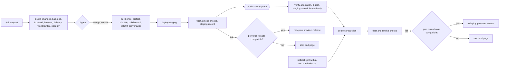

# Problem 4: CI/CD for a backend on EC2 and a frontend on S3

This folder is the root of a small product: a Node.js HTTP API that runs on EC2 behind an ALB, a single-page app served from S3 through CloudFront, and the GitHub Actions pipelines that test, build, deploy and roll back both. Nothing here needs an AWS account to run. Every deploy step runs the real scripts, and without AWS they run in dry-run mode or against a recording fake of the AWS CLI.

| Path | Content |
|---|---|
| `.github/workflows/` | `ci.yml`, `backend-cd.yml`, `frontend-cd.yml`, the reusable `_deploy-backend.yml` and `_deploy-frontend.yml`, and `rollback.yml` |
| `backend/` | The API (`node:http`, no runtime dependencies), its OpenAPI document, the CodeDeploy `appspec.yml`, hooks and systemd unit |
| `frontend/` | The Vite SPA, its configuration per environment and its API contract (`contract.json`) |
| `scripts/` | Build, publish, deploy, smoke, gate, summary and check scripts, with their tests in `scripts/tests/` |
| `infra/policies/` | IAM trust, role and bucket policies as JSON documents, with static tests |
| `docs/adr/` | One decision record per design decision (ADR-P4-0001 to ADR-P4-0013) |
| `evidence/` | Output of the static checks and test suites quoted in section 10 |

## 1. Requirements and principles

| Requirement | Where it is met |
|---|---|
| REQ-P4-1 CI/CD for the backend on EC2 | `backend-cd.yml` builds once and deploys through `_deploy-backend.yml` with CodeDeploy (sections 5.2 and 5.4) |
| REQ-P4-2 CI/CD for the frontend on S3 | `frontend-cd.yml` builds once and deploys through `_deploy-frontend.yml` (sections 5.3 and 5.5) |
| REQ-P4-3 GitHub Actions | All six workflows, with the hardening in section 6 |
| REQ-P4-4 A definition of production ready that the pipelines meet | Properties G1 to G11 in section 3 |
| REQ-P4-5 No real AWS account | Dry-run mode on every AWS step, a fake AWS CLI for the tests, and the acceptance plan in section 10.4 |
| REQ-P4-6 Workflows, supporting files and this document | This folder |

These AWS Well-Architected design principles drive most decisions here. Section 11 maps each decision to its requirements and principles, and each ADR names the principles it trades against.

| ID | Principle | Where it shows |
|---|---|---|
| OPS-DP3 | "Safely automate where possible" | Every deploy, rollback and check is a script that the workflows call |
| OPS-DP4 | "Make frequent, small, reversible changes" | One-object frontend activation, rolling backend deploys, one-action rollback |
| SEC-DP1 | "Implement a strong identity foundation" | One OIDC role per app and environment, no stored credentials |
| SEC-DP2 | "Maintain traceability" | Attestations, SBOMs, append-only release records |
| SEC-DP3 | "Apply security at all layers" | Bucket policies, environment rules, hardened systemd unit |
| SEC-DP4 | "Automate security best practices" | Pinning, linters, scanners and policy tests in CI |
| REL-DP1 | "Automatically recover from failure" | Automatic return to the previous release after a failed check |
| REL-DP5 | "Manage change through automation" | One lock per environment, forward-only promotion, compatibility gate |

## 2. Assumptions

| ID | Assumption | Reason | If wrong |
|---|---|---|---|
| A1 | `src/problem4` is the root of the product repo, with a backend (Node.js 24, no native modules) and a frontend (Vite SPA). The challenge ships no code for either | Pipelines need real lint, test and build steps to be verifiable | Only the build commands change |
| A2 | The backend runs as a systemd service on an Auto Scaling group of Amazon Linux 2023 x86_64 instances across at least 2 AZs behind an ALB | Deploys without downtime need at least 2 instances behind a load balancer | A single instance works with the same pipeline and a short outage per deploy |
| A3 | The frontend is a private S3 bucket behind CloudFront with Origin Access Control | S3 website endpoints are public and HTTP only | Deploy steps stay, cache headers and invalidation change |
| A4 | Staging and production live in separate AWS accounts | A bad credential or a bad deploy stays inside one account | Role ARNs collapse into one account |
| A5 | No database migrations | The challenge describes no database | Expand and contract migrations run as their own job before the deploy |
| A6 | GitHub-hosted runners | The challenge describes no runner fleet | Self-hosted runners need their own hardening |
| A7 | No AWS account. AWS steps run with `--dry-run` unless the environment variable `DEPLOY_ENABLED` is `true` | The challenge accepts a faithful implementation without AWS | The prerequisites in section 8 must exist first |
| A8 | Every `versionCheckSeconds` (600 in staging and production) the SPA fetches the root `index.html` without cache and reloads when the release SHA in it differs from its own | That object is the single activation switch, so the check sees activations and rollbacks alike | The asset retention window grows |

## 3. What production ready means here

| ID | Property | How the pipelines meet it |
|---|---|---|
| G1 | Nothing reaches `main` unverified | A ruleset on `main` requires a PR, the `ci-gate` check and code owner review for `.github/`, `scripts/` and `infra/`, with no bypass. `ci.yml` runs lint, typecheck, unit tests, build, `npm audit --audit-level=high`, the contract test, browser tests, deploy logic tests, policy tests, workflow linters, a secret scan and dependency review. `ci-gate` fails when a needed job failed or was cancelled |
| G2 | Build once, deploy the same bytes everywhere | Only the build job builds. The artifact gets a SHA-256 digest and a build record. Both deploys verify the digest before any AWS change. The backend packer writes files in a fixed order with fixed owners and the commit time, so a re-run of the build produces the same digest |
| G3 | Every running version is traceable | Build provenance attestation and an SPDX SBOM per artifact. `GET /version` on the backend and `releases/<sha>/version.json` on the frontend return the commit SHA |
| G4 | Promotion is gated and its evidence cannot be forged | Release records live in a manifest bucket under `builds/`, `staging/` and `production/`, each writable by one role only, with conditional writes and no deletes. Production verifies the attestation, the digest and a staging record for the same digest |
| G5 | Rollout is safe and rolls back by itself | CodeDeploy deploys one instance at a time. The job then checks every deployment target, the ALB target health and the SHA each instance serves. Any failed check redeploys the previous release, unless G9 vetoes it. The frontend activates one object and returns to the previous release when a check fails |
| G6 | Manual rollback is one action | `rollback.yml` redeploys a recorded release without a rebuild and refuses one that is no longer retained |
| G7 | No long-lived credentials, and no role reachable from the wrong job | GitHub OIDC with `aud` set to `sts.amazonaws.com`. Each role trusts one environment and one reusable workflow on `main`. A job asserts the actual `aud` and `sub` before any AWS call |
| G8 | The pipeline itself is hardened | `permissions: {}` at workflow level, grants per job, actions pinned by SHA, `persist-credentials: false`, no `pull_request_target`, inputs passed through `env:`, `timeout-minutes` on every job, Dependabot |
| G9 | Deploys happen in order and stay compatible | One concurrency group per environment for both apps, never cancelled. A stale promotion is refused inside the locked job. Frontend activation requires the deployed backend to serve at least the release's `min_backend_api`, and a backend rollback below what a live frontend needs is vetoed |
| G10 | Dependencies are controlled | `npm ci` with lockfiles, the audit gate, dependency review, `trivy fs` and `gitleaks` |
| G11 | Failures are visible | A job summary with SHA, digest and status for every deploy, and a failure notification that stays off without a webhook secret |

## 4. Pipeline flow



## 5. Workflows

### 5.1 `ci.yml`

`changes` decides which jobs a PR needs through path filters. `backend` and `frontend` run lint (Biome), typecheck, unit tests, build and `npm audit` for their app. The frontend unit tests include the contract test, which reads `backend/openapi.yaml` and fails when the frontend's `min_backend_api` exceeds the backend's `x-api-version` or when a field the client reads is missing from the schema. `browser` runs the Playwright tests in section 10.2. `delivery` runs every script test suite and the policy tests. `workflow-lint` runs actionlint, zizmor and shellcheck. `security` runs gitleaks over the git history and `trivy fs`. `dependency-review` blocks PRs that add a dependency with a known high severity advisory. `ci-gate` is the only required check: it passes when every needed job succeeded or was skipped by the path filters.

### 5.2 `backend-cd.yml`

On a push to `main` that touches the backend, the build job runs `scripts/build-backend.sh`. It downloads the Node.js tarball named in `backend/.node-version`, checks it against `backend/node-sha256.txt`, and runs `npm ci --ignore-scripts`, the TypeScript build and a production install inside a pinned `amazonlinux:2023` container. The build fails when a production dependency contains a native addon. `scripts/pack-tgz.py` packs the bundle with sorted entries, owner 0 and the commit time as every timestamp. The job attests the artifact, writes an SBOM, uploads both as a GitHub artifact and, with `DEPLOY_ENABLED`, publishes the artifact, `version.json` and the build record with conditional writes. The staging and production jobs call `_deploy-backend.yml`.

### 5.3 `frontend-cd.yml`

The build job runs `scripts/build-frontend.sh`, which builds the SPA once with the commit SHA embedded in `index.html` and packs `dist/`, the configuration of every environment, `version.json` and `release.json` (with `min_backend_api`). Attestation, SBOM and publishing follow the backend job. The staging and production jobs call `_deploy-frontend.yml`.

### 5.4 `_deploy-backend.yml`

The job runs in the GitHub environment `backend-staging` or `backend-production` and holds the concurrency group `deploy-<env>` for the whole job. Its steps run in this order:

1. Check out the full history and download the build's GitHub artifact.
2. `scripts/verify-provenance.sh` requires an attestation signed by `backend-cd.yml` on `refs/heads/main` from a GitHub-hosted runner.
3. `scripts/oidc-claims.sh` requests the OIDC token, masks it, and fails unless `aud` and `sub` match the values pinned for the environment.
4. With `DEPLOY_ENABLED`, `configure-aws-credentials` assumes the environment's role.
5. `scripts/check-forward.sh` refuses a SHA that does not descend from the release already deployed in the environment, unless the run is a rollback.
6. `scripts/deploy-backend.sh` verifies the object's SHA-256 checksum and VersionId, requires a staging record for production, and refuses a release whose `api_version` is below the `min_backend_api` of the live frontend releases. It creates a CodeDeploy deployment pinned to the S3 VersionId with `CodeDeployDefault.OneAtATime`, waits for it, then reads every deployment target and the ALB target health. CodeDeploy reports success even when the last instance fails with that configuration, so the script does not trust the deployment status alone. Each instance's `ValidateService` hook compares the SHA from `/version` with the bundle. A smoke test follows. On any failure the script redeploys the previous release, unless the compatibility check vetoes that release, in which case it stops with exit code 5 for a person to decide.
7. `scripts/summary.sh` writes the job summary and, with a webhook secret, the failure notification.

| Exit code of a deploy script | Meaning |
|---|---|
| 0 | Deployed and verified |
| 1 | Failed before the new release went live, so the environment still serves the previous one |
| 2 | Wrong arguments |
| 3 | Failed after the change, and the previous release is back and verified |
| 4 | Failed, and the return to the previous release failed too |
| 5 | Failed, and the rollback was vetoed by the compatibility check (backend only) |

### 5.5 `_deploy-frontend.yml`

The structure matches the backend job, with `scripts/deploy-frontend.sh` as the deploy step:

1. Upload `assets/` with `Cache-Control: public, max-age=31536000, immutable`, never with `--delete`.
2. Upload `releases/<sha>/config.json` for the target environment, then `version.json`, `release.json`, the Vite manifest and `releases/<sha>/index.html`. Every upload is a conditional write. A redeploy of identical bytes is a no-op, and different bytes under the same key fail the job.
3. Activate by copying `releases/<sha>/index.html` to the root `index.html` with `no-cache`. That one object is the only switch, so no visitor sees new configuration with old HTML.
4. Invalidate `/` and `/index.html` and wait for completion.
5. Smoke test: `/` carries the SHA, the entry script returns 200 as JavaScript, the deep link `/details` returns the SPA, and the release configuration parses.
6. On a failed step after activation, copy the previous release's `index.html` back, invalidate and repeat the smoke test against it.

CloudFront selects a cache behavior before a function rewrites the path. The default behavior therefore uses the same short-TTL policy as `/index.html`, and its viewer-request function rewrites extension-less paths to `/index.html` for deep links. `/assets/*` has its own long-TTL behavior. The origin access principal gets `s3:ListBucket`, so a missing object returns 404 and never an HTML page with status 200.

A tab that loads a chunk that no longer exists gets the event `vite:preloadError`. The SPA reloads once per release and per tab, remembered in `sessionStorage`, so a chunk that stays missing cannot cause a reload loop.

### 5.6 `rollback.yml`

A person picks the app, the environment and a SHA from the release manifest. The workflow calls the same reusable deploy workflow with `rollback: true`, so the same environment rules, approvals, lock, OIDC role and checks apply. The deploy script refuses a SHA whose artifact or release files are no longer retained, and the compatibility check runs as for any deploy.

## 6. Security model

### 6.1 OIDC roles

| Role | Trusted subject | Can do |
|---|---|---|
| `backend-build`, `frontend-build` | The build job on `main` of the CD workflow of that app | Write `backend/` or `frontend/` in the artifact bucket and `builds/<app>/` in the manifest bucket, conditional writes only |
| `backend-staging-deploy`, `backend-production-deploy` | Environment `backend-<env>` and `job_workflow_ref` of `_deploy-backend.yml` on `main` | Read the artifact, create CodeDeploy deployments for its own deployment group, read target health, write `<env>/backend/` records |
| `frontend-staging-deploy`, `frontend-production-deploy` | Environment `frontend-<env>` and `job_workflow_ref` of `_deploy-frontend.yml` on `main` | Write its own frontend bucket, create invalidations on its own distribution, write `<env>/frontend/` records |

Each trust policy uses `StringEquals` on `aud` and the full `sub`, never a wildcard. Repos created after 2026-07-15 get the immutable subject format `repo:OWNER@OWNER-ID/REPO@REPO-ID:...`, and the repo's OIDC subject template adds `job_workflow_ref`. The exact expected `sub` per environment is pinned from a claims dump of the demo repo, stored in the environment variable `OIDC_EXPECTED_SUB`, and asserted by `scripts/oidc-claims.sh` before any AWS call.

### 6.2 Manifest authority

The manifest bucket has three prefixes and one writer each. The bucket policy requires `If-None-Match` on every `PutObject`, so a record is never overwritten, and it denies deletes. A forged staging record would need the staging deploy role, which only the staging environment's deploy job can assume. Production reads `builds/` for the digest and `staging/` for proof that the same digest passed staging.

### 6.3 Pinning and permissions

Actions are pinned by commit SHA with the version in a comment. Container images in scripts are pinned by digest. The Node.js tarball is pinned by checksum. npm installs use lockfiles against the public registry, set in each `.npmrc`. Every workflow starts with `permissions: {}`, and each job asks for what it needs. The caller of a reusable deploy workflow grants `id-token: write` and `attestations: read`, and the environment sits on the called job, so a role trusts exactly that job.

### 6.4 GitHub settings

| Setting | Value |
|---|---|
| Ruleset on `main` | PR required, required check `ci-gate`, code owner review for `.github/`, `scripts/` and `infra/`, no force push, no deletion, no bypass |
| Environments `backend-staging`, `frontend-staging` | Deployment branches limited to `main` |
| Environments `backend-production`, `frontend-production` | Deployment branches limited to `main`, required reviewers, self-review forbidden, admin bypass off |
| Actions settings | Allow only pinned actions from GitHub and verified creators, workflow permissions read-only by default |
| OIDC subject template | Adds `job_workflow_ref` to the default claims |

Required reviewers on environments are available on public repositories for every plan, and on private repositories only on paid plans. Artifact attestations on private repositories need GitHub Enterprise Cloud. The demo repo is therefore public.

## 7. Rollback and retention

A rollback is one run of `rollback.yml`, and it works for every release whose files are still in S3. Both deploy scripts refuse a release whose files are gone instead of activating a broken one. Instances keep the last 5 releases on disk, pruned by the `AfterInstall` hook.

Nothing in this submission deletes artifacts, release files or records. The bucket policies deny deletes to every pipeline role, so cleanup belongs to a separate job with its own role, which section 13 leaves out. That job follows these rules:

| Object | Kept |
|---|---|
| Backend artifacts | The current and the last 3 production releases whatever their age, and the last 3 staging releases |
| Frontend assets | 30 days after the last moment their release was active, plus the longest CloudFront TTL. The deactivation time is the next record in the manifest |
| Frontend releases that are rollback targets | Whatever their age, with their assets |
| Release records | Always |

## 8. Prerequisites outside the repo

| Prerequisite | Where it is defined |
|---|---|
| Auto Scaling group (minimum 2, across 2 AZs), launch template with the pinned Node.js tarball at `/opt/node`, the CodeDeploy agent and the `backend` service user | Infrastructure code, not in this submission |
| ALB with an HTTPS listener, target group health check on `/healthz`, 30 s deregistration delay | Infrastructure code |
| Security groups that let only the ALB reach port 8080, private subnets with VPC endpoints for S3, CodeDeploy, SSM and CloudWatch Logs | Infrastructure code |
| Instance profile that reads the artifact prefix only | `infra/policies/` |
| CodeDeploy application, deployment groups, service role, the alarms of G5 | Infrastructure code |
| Artifact and manifest buckets with versioning, SHA-256 checksums, the G4 bucket policy and retention tags | `infra/policies/buckets/` |
| Frontend buckets, CloudFront distributions with OAC, cache behaviors and the viewer-request function | Infrastructure code |
| OIDC provider and the six roles | `infra/policies/trust/`, `infra/policies/permissions/` |
| GitHub ruleset, environments, reviewers, variables and the OIDC subject template | Section 6.4 |

Alarms for G5: `HTTPCode_Target_5XX_Count` above 1 % of `RequestCount` in 2 of 3 one-minute periods, and `UnHealthyHostCount` above 0 for 3 consecutive minutes.

## 9. Configuration

| Name | Kind | Used by |
|---|---|---|
| `DEPLOY_ENABLED` | Variable, repo or environment | Every AWS step. Anything but `true` keeps the run in dry-run mode |
| `AWS_REGION` | Variable | `configure-aws-credentials` |
| `BACKEND_BUILD_ROLE_ARN`, `FRONTEND_BUILD_ROLE_ARN` | Variable | Build jobs |
| `DEPLOY_ROLE_ARN` | Environment variable | Deploy jobs |
| `OIDC_EXPECTED_SUB` | Environment variable | `scripts/oidc-claims.sh` in deploy jobs. Required once `DEPLOY_ENABLED` is `true` |
| `BACKEND_BUILD_OIDC_SUB`, `FRONTEND_BUILD_OIDC_SUB` | Variable | `scripts/oidc-claims.sh` in build jobs. Required once `DEPLOY_ENABLED` is `true` |
| `ARTIFACT_BUCKET`, `MANIFEST_BUCKET` | Variable | Build and deploy jobs |
| `CODEDEPLOY_APPLICATION`, `CODEDEPLOY_GROUP`, `TARGET_GROUP_ARN`, `BASE_URL` | Environment variable | Backend deploy |
| `FRONTEND_BUCKET`, `DISTRIBUTION_ID`, `BASE_URL`, `BACKEND_URL` | Environment variable | Frontend deploy |
| `NOTIFY_WEBHOOK_URL` | Secret | Failure notification, off when unset |

## 10. Verification

Each check below is one of four kinds: a static check, an offline test, the GitHub-only demonstration, or the AWS acceptance plan. Only the first two have run for this submission. Their output is in `evidence/`, and `evidence/README.md` names the commit and command behind each file.

### 10.1 Static checks

| Check | Command | Result |
|---|---|---|
| Workflow lint | `bash scripts/lint-workflows.sh` (actionlint 1.7.12, zizmor 1.31.1 at medium and above, shellcheck) | No finding. Six help-level `self-repository` suggestions from zizmor remain below the threshold. Both linters flag a deliberately broken workflow |
| Policy tests | `python3 -I infra/policies/test_policies.py` | 13 of 13 pass |
| Secret and dependency scan | `bash scripts/scan.sh` (gitleaks 8.30.1 over the history, trivy 0.76.1 fs at HIGH and CRITICAL, dev dependencies included) | No leak in 406.77 KB of history. No HIGH or CRITICAL vulnerability in the three lockfiles |

The policy tests fail when two roles share a subject, when a trust condition uses a wildcard or misses `aud`, when a deploy role can write the artifact prefix, when a role writes outside its manifest prefix, or when a bucket policy allows deletes, unconditional writes or plain HTTP.

### 10.2 Offline tests

| Suite | What it proves | Result |
|---|---|---|
| `backend` unit tests | Routes, validation, CORS, `/version` | 9 of 9 pass |
| `frontend` unit tests | Configuration parsing, release detection, the chunk-reload guard, the contract against `backend/openapi.yaml` | 14 of 14 pass |
| `test-deploy-frontend.sh` | Upload order, activation last, no `--delete`, conditional writes, wrong checksum, incompatible backend, failed smoke test and invalidation, rollback, staging record, dry run | 31 of 31 pass |
| `test-deploy-backend.sh` | Fleet checks, a failed last instance, a failed smoke test, a vetoed rollback, a release below the frontend's needs, retention, staging record, dry run | 29 of 29 pass |
| `test-check-forward.sh` | Forward-only promotion, rollback exception, diverged history | 9 of 9 pass |
| `test-verify-provenance.sh` | Attestation from an unapproved workflow, another branch or a self-hosted runner | 6 of 6 pass |
| `test-oidc-claims.sh` | Wrong `aud`, wrong `sub`, token never printed | 8 of 8 pass |
| `test-ci-gate.sh`, `test-summary.sh` | Gate results, summary and notification | 5 and 5 pass |
| `test-hooks.sh` | Every CodeDeploy hook in `amazonlinux:2023` with a stub `systemctl`: first deployment, redeployment, failed validation, release pruning | 13 of 13 pass |
| Browser tests | Two real builds deployed by `deploy-frontend.sh` into a fake bucket, served by a local server that rewrites like CloudFront: the app renders with its own configuration, a deep link renders, an open tab follows an activation and a rollback without errors, a missing chunk reloads once, and a chunk that stays missing does not loop | 5 of 5 pass |
| `test-publish-artifact.sh` | The build record names the S3 object version, a rerun with the same bytes is a no-op, other bytes fail, dry run | 7 of 7 pass |
| Build determinism | Two runs of `build-backend.sh` and of `build-frontend.sh` for the same commit | Identical digests for both apps |

### 10.3 GitHub-only demonstration

This part needs the folder published as its own repository (section 12) and no AWS account. It shows a PR with a green `ci-gate`, a push to `main` that runs both CD workflows with the deploy steps in dry-run mode, the production jobs waiting for approval, and the OIDC claims step printing the sanitized claims and failing on an unexpected `aud` or `sub`.

### 10.4 AWS acceptance plan

With the prerequisites in place and `DEPLOY_ENABLED=true` on the staging environments only:

1. Deploy a backend release and check that every instance serves its SHA and that the ALB never reported fewer than 2 healthy targets.
2. Deploy a release whose `ValidateService` fails on the last instance and check the automatic redeploy of the previous release.
3. Deploy two frontend releases while a browser tab stays open on the first, and run the browser test against the staging distribution.
4. Assume each role from the wrong environment, the wrong workflow, the wrong audience and a branch other than `main`, and check that STS denies every attempt.
5. Try to overwrite and delete a manifest record with each role and check that S3 denies it.
6. Run `rollback.yml` for both apps and check the recorded state.

## 11. Traceability

| Decision | Requirements | Principles | Verified by | ADR |
|---|---|---|---|---|
| G1 ruleset, PR checks, contract test, one required gate | REQ-P4-3, REQ-P4-4 | OPS-DP3, SEC-DP4, REL-DP5 | `test-ci-gate.sh`, contract test, GitHub demo | ADR-P4-0001 |
| G2 build once, dry-run path without AWS | REQ-P4-1, REQ-P4-2, REQ-P4-4, REQ-P4-5 | OPS-DP4, REL-DP5, FSI-DP2 | Dry-run and wrong-checksum tests, build determinism | ADR-P4-0005, ADR-P4-0008, ADR-P4-0013 |
| G3 provenance, SBOM, version endpoints | REQ-P4-4 | SEC-DP2, OPS-DP2 | `test-verify-provenance.sh` | ADR-P4-0011 |
| G4 manifest authority and gated promotion | REQ-P4-4 | OPS-DP3, SEC-DP1, SEC-DP2, FSI-DP4 | Policy tests, staging record tests | ADR-P4-0005, ADR-P4-0012 |
| G5 fleet checks, alarms, automatic rollback | REQ-P4-1, REQ-P4-2, REQ-P4-4 | OPS-DP4, OPS-DP6, REL-DP1 | Deploy failure-path tests, hook tests | ADR-P4-0003 |
| G6 one-action rollback with retention | REQ-P4-4 | OPS-DP4, REL-DP2 | Rollback tests | ADR-P4-0003, ADR-P4-0004 |
| G7 one OIDC role per app and environment | REQ-P4-4, REQ-P4-5 | SEC-DP1, SEC-DP6 | Policy tests, `test-oidc-claims.sh`, GitHub demo, AWS plan step 4 | ADR-P4-0006 |
| G8 pipeline hardening | REQ-P4-3, REQ-P4-4 | SEC-DP3, SEC-DP4 | actionlint, zizmor | ADR-P4-0011 |
| G9 ordering, environment lock, compatibility | REQ-P4-1, REQ-P4-2, REQ-P4-4 | OPS-DP4, REL-DP5 | `test-check-forward.sh`, compatibility tests | ADR-P4-0007 |
| G10 dependency control | REQ-P4-4 | SEC-DP4 | Audit, dependency review, scan | ADR-P4-0011 |
| G11 visible failures | REQ-P4-4 | OPS-DP2, OPS-DP7 | `test-summary.sh` | ADR-P4-0001 |
| Release-scoped frontend with one-object activation | REQ-P4-2 | OPS-DP4, REL-DP2 | Deploy tests, browser tests | ADR-P4-0004 |
| Workflows under this folder, live runs from a split | REQ-P4-3, REQ-P4-6 | OPS-DP3 | Review | ADR-P4-0002 |
| Backend and frontend stacks | REQ-P4-1, REQ-P4-2, REQ-P4-4 | SEC-DP3, OPS-DP4 | Unit tests | ADR-P4-0009, ADR-P4-0010 |

## 12. Live runs from this monorepo

GitHub runs workflows only from `.github/workflows` at a repository root, and the template keeps this problem under `src/problem4`. All paths in the workflows are relative to this folder, so the folder can be published as its own repository with its history:

```bash
git subtree split --prefix src/problem4 -b problem4-split
```

The split creates new commit SHAs. The release manifest and the build records hold the split SHA, because that is the commit the pipeline builds. A table of source SHA and split SHA belongs next to each demonstration run.

## 13. Left out deliberately

| Item | Why |
|---|---|
| Blue/green or canary traffic shifting for the backend | Doubles instances during each deploy. It is the upgrade path once rollback speed matters more than cost (ADR-P4-0003) |
| Canary releases of the frontend through CloudFront continuous deployment | One-object activation already gives instant rollback, and a staging distribution doubles the CDN setup |
| An infrastructure pipeline with Terraform plan and apply | Section 8 lists what must exist. The policy documents are tested here so the infrastructure code can reuse them |
| Running older frontend releases' client tests against a new backend | The release manifest that lists live releases needs AWS. The version gate in G9 covers the contract number offline |
| DAST, load tests and performance budgets in the pipeline | Outside the stated scope |
| The cleanup job and its role (section 7) | Needs an account to test against, and the deploy roles must never delete |
| Database migrations | A5 |
| Self-hosted runners and multi-region deploys | A6 and A2 |
