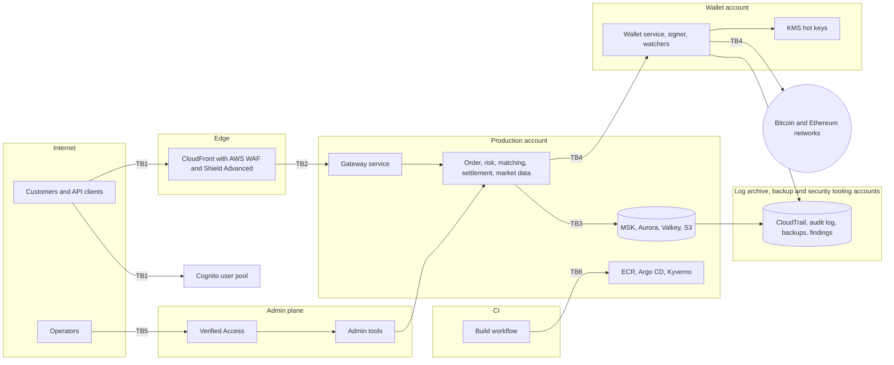
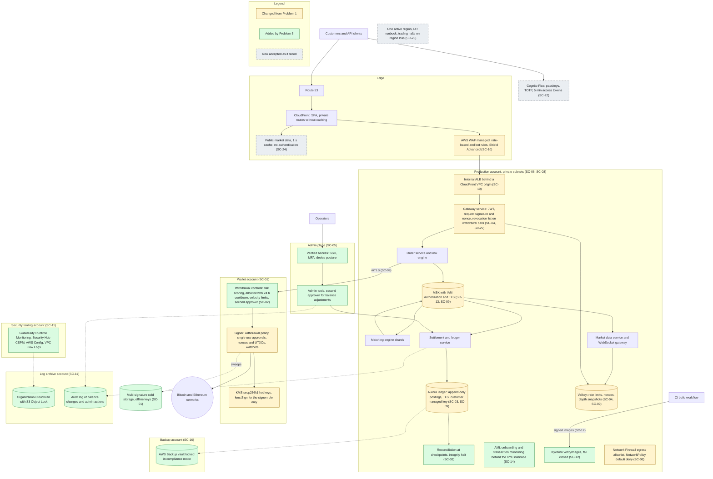
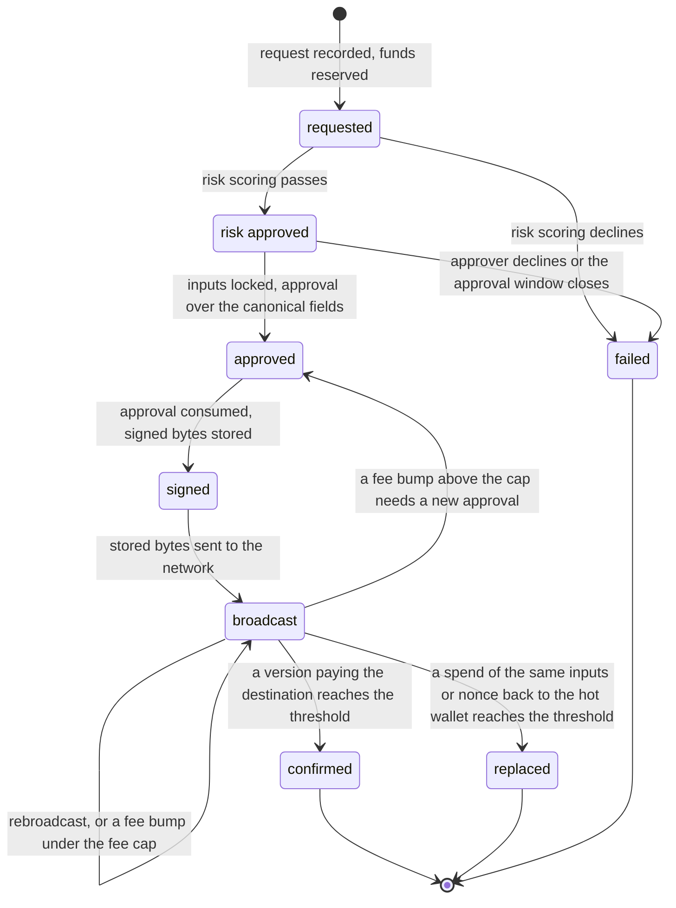

# Problem 5: Fortify The Castle, security inside the Problem 1 design

This answer takes the Problem 1 trading platform and builds security into its design. Every change has an ID from SC-01 to SC-24 and one of four types. A change marked changed alters a Problem 1 element, added brings a new element, deferred waits for later, and accepted keeps a risk as it stands. Priority 0 means the platform does not ship without the change, 1 means the first iterations after launch, and 2 means later than that. Threats carry IDs from TH-01 to TH-26 (section 4.5), and the reasoning behind each decision sits in the [decision records](docs/adr/README.md).

## 1. The answer in brief

Customer funds come first, then ledger integrity, account takeover, data exposure and availability. The work starts where one mistake moves customer money off the platform for good: the custody boundary (SC-01), the withdrawal controls (SC-02) and ledger integrity (SC-03).

| Question from the task | Answer | Changes |
|---|---|---|
| What is secured first | Custody, withdrawals and the ledger, built on the account and identity foundation they need, then accounts, network, encryption and the edge | SC-01 to SC-04 on top of SC-06 and SC-07, then the rest of SC-05 to SC-13 |
| What would block shipping | Every priority 0 change, including the AML launch gate and the prelaunch exercises | SC-01 to SC-16 |
| What is deferred | Service mesh mTLS, Macie, a bug bounty, Nitro Enclaves for the signer, SOAR automation | SC-17 to SC-21 |
| Where the risk is accepted | Cognito revocation limits, one active region, public market data without authentication | SC-22 to SC-24 |

Every Problem 1 requirement still holds after the changes (section 9). The allocated latency on the order path grows from 60 ms to 62 ms out of the 100 ms target. Cost grows by the security services, which get their own column in the Problem 1 cost comparison.

## 2. Requirements and principles applied

### 2.1 Requirements

| ID | Requirement | Answered in |
|---|---|---|
| REQ-P5-1 | The Problem 1 architecture is made secure, with security integrated into the design | Sections 4 to 7 |
| REQ-P5-2 | Show where the design changed, where something was added and where the risk was accepted as it stood | Sections 5 and 6 |
| REQ-P5-3 | State what is secured first, what is deferred and what would block shipping | Sections 1, 6.2 and 10 |
| REQ-P5-4 | For each missing fact: what is needed, how to get it and what was assumed meanwhile | Section 8 |
| REQ-P5-5 | `SOLUTION.md` with the updated architecture and the changes marked, why each change exists and what it protects against, and what was left out with the trade-offs | Sections 5, 6 and 10 |
| REQ-P5-6 | Every Problem 1 requirement still holds after the security changes | Section 9 |

The sixteen Problem 1 requirements, REQ-P1-1 to REQ-P1-16A, are inherited. Section 9 re-checks each one.

### 2.2 Principles

The security pillar of the AWS Well-Architected Framework and the Financial Services Industry Lens are the main sets. Reliability, performance and cost principles act as the check that the changes keep REQ-P5-6.

| ID | Principle | Changes that apply it |
|---|---|---|
| SEC-DP1 | "Implement a strong identity foundation" | SC-01, SC-02, SC-04, SC-05, SC-07, SC-13, SC-22 |
| SEC-DP2 | "Maintain traceability" | SC-03, SC-11 |
| SEC-DP3 | "Apply security at all layers" | SC-01, SC-08, SC-10, SC-13 |
| SEC-DP4 | "Automate security best practices" | SC-06, SC-11, SC-12 |
| SEC-DP5 | "Protect data in transit and at rest" | SC-09, with SC-17 and SC-18 as its deferred parts |
| SEC-DP6 | "Keep people away from data" | SC-01, SC-02, SC-05, with SC-18 and SC-20 as its deferred parts |
| SEC-DP7 | "Prepare for security events" | SC-03, SC-11, SC-15, SC-16, with SC-19 and SC-21 as its deferred parts |
| FSI-DP1 | "Documented operational planning" | SC-05 break-glass procedure, SC-15 exercises, the owners in section 8 |
| FSI-DP2 | "Automated infrastructure and application deployment" | Problem 1 GitOps (AD-P1-17), and SC-12 admits only images from the build workflow |
| FSI-DP3 | "Security by design" | The method in section 4.1, SC-01, SC-12, SC-14 |
| FSI-DP4 | "Automated governance" | SC-06, SC-11, SC-14 |
| REL-DP1 | "Automatically recover from failure" | SC-10, SC-24 |
| REL-DP2 | "Test recovery procedures" | SC-15, SC-16, SC-23 |
| GEN-DP6 | "Improve through game days" | SC-15, SC-19 |
| OPS-DP8 | "Use managed services" | SC-22 |

Performance and cost principles enter through REQ-P1-8 and REQ-P1-4 in section 9. No change adds a network call to the order path, and every added cost appears in the security column of the Problem 1 cost comparison.

## 3. Assumptions

The Problem 1 assumptions carry over: one active region in ap-southeast-1 over three AZs, spot trading on a small set of pairs, and deposits and withdrawals of bitcoin and ether through async workers.

| ID | Assumption | Basis | If wrong |
|---|---|---|---|
| AS-01 | Launch transaction types are Bitcoin P2WPKH and Ethereum EIP-1559 | Problem 1 scope covers bitcoin and ether only | Each new type needs its own signing preimage, tests and review |
| AS-02 | Customers sign in through the SPA and API clients use API keys | Problem 1 gateway design | A FIX gateway for market makers (Problem 1 stage 2) adds a boundary to section 4 |
| AS-03 | Every number in this answer is an allocation or a target until the Problem 1 load test measures it | No AWS account is part of this submission | The allocation table in section 9 changes and REQ-P1-8 is re-checked |

Assumptions that stand in for a missing fact sit in section 8, next to the owner who can confirm each one.

## 4. Threat model

### 4.1 Method

Six trust boundaries are marked on the Problem 1 design. STRIDE runs on every data flow that crosses one of them, and each threat gets an ID in the table of section 4.5. Assets rank by impact with customer funds first, and the work follows that order. A change enters the design only after its effect on the Problem 1 requirements is checked (section 9). ADR-P5-0001 records why this method won over a control checklist.

### 4.2 Assets

| ID | Asset | Where it lives | Why it ranks here |
|---|---|---|---|
| A1 | Customer funds | Hot keys in KMS in the wallet account, the withdrawal flow, multi-signature cold storage | A confirmed transaction cannot be recalled |
| A2 | Ledger integrity | Postings and balances in Aurora, checkpoints, backups, the event log in MSK | Wrong balances turn into wrong withdrawals and wrong trades |
| A3 | Customer accounts | Cognito identities and sessions, API keys | A takeover reaches A1 through a withdrawal |
| A4 | Order flow integrity | Order and trade topics in MSK, book state in the matching engine | Reading order flow enables front-running, and forging it breaks REQ-P1-14A |
| A5 | PII and KYC data | Cognito profiles, KYC records behind the vendor interface, analytics copies in S3 | Exposure harms customers directly and creates regulatory liability |
| A6 | Availability during volatility | Edge, gateway, matching engine | Load peaks during volatility, and an outage then costs both revenue and customer trust |

### 4.3 Trust boundaries

| ID | Boundary | Flows that cross it |
|---|---|---|
| TB1 | Internet to edge | REST and WebSocket requests, sign-in to Cognito, downloads of the SPA and public market data |
| TB2 | Edge to services | CloudFront to the ALB and the gateway service |
| TB3 | Services to data | Services to MSK, Aurora, Valkey, S3 and Secrets Manager, and pod egress to the internet |
| TB4 | Services to the wallet account, and the wallet account to the chains | Withdrawal requests and results, deposit events, signer calls to KMS, broadcasts and chain reads |
| TB5 | Operators to the admin plane | Admin tools, the AWS console and CLI through SSO, the break-glass path |
| TB6 | CI to AWS | Image pushes to ECR, role assumption through OIDC, deployment through Argo CD and Kyverno admission |

### 4.4 Attacker profiles

| ID | Attacker | Capability | Main targets |
|---|---|---|---|
| AP1 | Account attacker | Phished or reused passwords, malware on a customer device, a SIM swap | A3, then A1 through withdrawals |
| AP2 | Platform attacker | API abuse, request replay, origin discovery, DDoS during volatility | A6, A3 |
| AP3 | Insider | An operator, support agent or developer with legitimate access, alone or colluding | A1, A2, A4 |
| AP4 | Supply chain attacker | A compromised dependency, base image, build workflow or registry | Code that runs in production, then any asset |
| AP5 | Workload intruder | Code execution in a pod, its workload credentials, lateral movement | A1 through the signer path, A2, A5 |
| AP6 | Chain-level adversary | Reorgs, double-spend attempts on deposits, fee pressure that strands transactions | A1, A2 |
| AP7 | Destructive actor | Stolen AWS administrator access used to delete data or demand a ransom | A2, A6 |

### 4.5 Threat table

STRIDE letters: S spoofing, T tampering, R repudiation, I information disclosure, D denial of service, E elevation of privilege. C marks a compliance threat outside STRIDE.

| ID | Threat | STRIDE | Boundary | Asset | Attacker | Controls | Detection | Response |
|---|---|---|---|---|---|---|---|---|
| TH-01 | A compromised production service sends KMS the digest of its own transaction and drains the hot wallet | E, T | TB4 | A1 | AP5, AP3 | SC-01, SC-06, SC-07, SC-08, SC-09 | CloudTrail alert on any `kms:Sign` or key policy change outside the signer role (SC-11). Hot wallet spends that the broadcast log lacks | Disable the key, halt withdrawals, run the signer compromise procedure rehearsed in SC-15 |
| TH-02 | An account takeover ends in a withdrawal to the attacker's address | S | TB1 | A3, A1 | AP1 | SC-02, SC-22 | Withdrawal risk scoring, Cognito sign-in risk logs | Hold the withdrawal, revoke the refresh token, put its `origin_jti` on the revocation list, support review |
| TH-03 | An approval is replayed, or the destination, amount or fee changes between approval and signing | T | TB4 | A1 | AP5, AP3 | SC-01 with the single-use approval of section 7.3 | The signer rejects and logs any mismatch | Page, freeze the calling principal |
| TH-04 | An insider adjusts a balance, approves their own withdrawal or edits the withdrawal policy | E, R | TB5 | A1, A2 | AP3 | SC-02, SC-03, SC-05, SC-11 | Audit log of admin actions, checkpoint reconciliation | Revoke access, correct with a compensating posting under two approvals |
| TH-05 | A withdrawal request is replayed or duplicated, including after a Valkey failover drops the newest nonces | T, R | TB1, TB2 | A1 | AP2 | SC-04 | Rejected duplicate withdrawal IDs, counted per key | Page on a rise, revoke the key |
| TH-06 | The hot key or the signer account is lost or compromised | E, D | TB4 | A1 | AP5, AP3, AP7 | SC-01, SC-15, key loss rules in section 7.8 | Hot wallet outflows missing from the broadcast log, on-chain reconciliation (SC-03) | Disable the key, halt withdrawals, fund a new hot key from cold storage once the cause is closed |
| TH-07 | A deposit is credited from a transaction that a reorg removes or that never reaches the threshold | T | TB4 | A1, A2 | AP6 | SC-03, deposit rules in section 7.7 | Watchers see the reorg, reconciliation shows a diff | Reverse the pending credit, integrity halt if a diff remains |
| TH-08 | A compromised settlement service rewrites or deletes ledger history | T | TB3 | A2 | AP5 | SC-03, SC-09, SC-11, SC-16 | Diff at the next checkpoint | Integrity halt of the affected shards, point-in-time restore into a new cluster, replay from MSK |
| TH-09 | Stolen administrator access deletes or encrypts databases, snapshots and backups | T, D | TB3, TB5 | A2, A6 | AP7 | SC-06, SC-11, SC-15, SC-16 | CloudTrail delete events, GuardDuty findings | Restore from the locked vault in the backup account |
| TH-10 | A compromised service forges events on the order, trade or ledger topics, or reads topics it does not need | T, I | TB3 | A2, A4 | AP5 | SC-07, SC-09, SC-13 | MSK access events, checkpoint reconciliation | Revoke the service role, rebuild the affected shards from the ledger |
| TH-11 | An attacker or insider removes or edits logs to hide their actions | R | TB5 | A2 | AP3, AP7 | SC-06, SC-11 | Trail and detector changes are denied by SCP and logged | Investigate the principal, read the archive copy |
| TH-12 | Credential stuffing, phishing or a SIM swap takes over a customer account | S | TB1 | A3 | AP1 | SC-10, SC-22 | Cognito risk logs, WAF metrics | Block the sign-in, force a reset, revoke tokens |
| TH-13 | A stolen access token is used after logout, a password change or revocation | S | TB1 | A3, A1 | AP1 | SC-15, SC-22 | Revocation list hits at the gateway | Revoke the refresh token. Trading calls accept the token until it expires, which is the accepted part of SC-22 |
| TH-14 | A stolen API key or a captured request is replayed, or a trade-scoped key tries to withdraw | S, T | TB1 | A3, A1 | AP1, AP2 | SC-04 | Nonce collisions and signature failures per key | Revoke the key |
| TH-15 | An insider reads open orders or book state to trade ahead of customers | I | TB5, TB3 | A4 | AP3 | SC-05, SC-06, SC-07, SC-13 | Admin plane and role assumption records (SC-11) | Revoke access, investigate the trades |
| TH-16 | A malicious image, dependency or build step reaches production EKS | T, E | TB6 | All | AP4 | SC-07, SC-12 | Kyverno admission denials, GuardDuty Runtime Monitoring | Roll back through GitOps, revoke the workflow's trust |
| TH-17 | A CI job from another repository, branch or workflow assumes a production role | E | TB6 | All | AP4 | SC-06, SC-07 | Role assumptions with an unexpected subject (SC-11) | Tighten the trust policy, revoke the sessions |
| TH-18 | A compromised pod sends PII, KYC data or secrets to the internet | I | TB3 | A5 | AP5 | SC-07, SC-08, SC-09 | Denied destinations at Network Firewall, VPC Flow Logs, GuardDuty | Isolate the pod, rotate its secrets |
| TH-19 | A compromised pod moves laterally to other services in the cluster | E | TB3 | All | AP5 | SC-07, SC-08, SC-09 on the wallet path | GuardDuty Runtime Monitoring, VPC Flow Logs | Isolate the node, rotate credentials. Mutual TLS between the other services is deferred (SC-17) |
| TH-20 | Data at rest leaks through a shared snapshot, a public bucket or a broad decrypt grant | I | TB3 | A5, A2 | AP5, AP3 | SC-06, SC-09, SC-11 | AWS Config and Security Hub CSPM findings | Revoke the share, review the key policy |
| TH-21 | The management account or a root user is taken over | E | TB5 | All | AP7, AP3 | SC-05, SC-06 | Root sign-in events in CloudTrail | Break-glass procedure (SC-05) |
| TH-22 | A DDoS or bot flood arrives during a volatility spike | D | TB1 | A6 | AP2 | SC-10, SC-24, Problem 1 rate limits and load shedding (AD-P1-11) | Shield Advanced and WAF metrics, the gateway 429 rate | Tighten the rate-based rules |
| TH-23 | Requests reach the ALB directly and skip CloudFront and WAF | S, D | TB2 | A6 | AP2 | SC-10 | The prelaunch bypass test | Close the path that the test found |
| TH-24 | Unauthenticated public market data is scraped at high volume | D | TB1 | A6 | AP2 | SC-24 | Cache hit ratio, origin request rate | Tighten the rate limits |
| TH-25 | The only active region is lost | D | All | A6 | None, a regional failure | SC-23 | Regional health signals | The Problem 1 regional recovery procedure |
| TH-26 | The platform moves funds for laundering or for sanctioned parties, or misses Travel Rule data | C | TB1, TB4 | A1 | AP1, AP3 | SC-14 | Transaction monitoring | Report and freeze under the compliance procedure |

## 5. Updated architecture

Yellow nodes are Problem 1 elements that changed, green nodes are new, and grey dashed nodes carry a risk accepted as it stood. Unmarked nodes are unchanged from Problem 1. Account boundaries come from SC-06.

## 6. Security changes

### 6.1 Change table

| ID | Change | Type | Priority | Protects against | Effect on Problem 1 requirements | Record |
|---|---|---|---|---|---|---|
| SC-01 | A signer service in the wallet account enforces the withdrawal policy and is the only principal with `kms:Sign`. The key policy also limits signing to the signing algorithm and the wallet account's VPC endpoint. The hot wallet has a cap, with sweeps to multi-signature cold storage. Protocol in section 7 | changed | 0 | TH-01, TH-03, TH-06 | Off the order path. KMS cost per signature | ADR-P5-0002 |
| SC-02 | Withdrawal controls: risk scoring, an address allowlist with a 24 h cooldown, velocity limits, step-up MFA, a second approver above a threshold | added | 0 | TH-02, TH-04 | Withdrawals slower by design, trading unchanged | ADR-P5-0003 |
| SC-03 | Posting tables are append-only, with no UPDATE or DELETE grant for the application role. Reconciliation compares ledger, risk engine and on-chain balances at the same checkpoint, so lag never looks like a breach. A breach halts trading and withdrawals for the affected account shards | changed | 0 | TH-04, TH-07, TH-08, TH-10 | A halt counts against REQ-P1-12A, recorded as the price of REQ-P1-14A | ADR-P5-0003 |
| SC-04 | Signatures cover method, path, query, body hash, timestamp and nonce. A request is valid when its timestamp lies between 30 s in the past and 5 s in the future. Nonces are scoped per API key and inserted with `SET NX` and a TTL of 35 s in a replicated Valkey cluster. A failover can lose the newest nonces, so orders also rely on the durable client order ID and withdrawals on a durable withdrawal ID. Without the nonce store, orders continue on those IDs and page, and withdrawals fail closed. API keys have separate trade and withdraw scopes, rotation, revocation and an IP allowlist for the withdraw scope | changed | 0 | TH-05, TH-14 | Gateway allocation grows from 5 to 7 ms, and nonce store availability enters the load and failover tests | ADR-P5-0004 |
| SC-05 | The admin plane sits behind AWS Verified Access with SSO, MFA and device posture. Balance adjustments need a second approver, and a break-glass procedure exists | added | 0 | TH-04, TH-15, TH-21 | Not on customer paths | ADR-P5-0005 |
| SC-06 | AWS Organizations with SCPs and separate accounts for production, wallet, log archive, backup, security tooling and non-production. The SCPs keep CloudTrail, GuardDuty and AWS Config on in member accounts and stop accounts from leaving the organization. SCPs do not affect the management account, so it runs no workloads, its root user has hardware MFA and no access keys, and member accounts lose their root credentials through centralized root access | added | 0 | TH-01, TH-09, TH-11, TH-15, TH-17, TH-20, TH-21 | None on requests | ADR-P5-0006 |
| SC-07 | EKS Pod Identity per service, OIDC for CI, SSO with short sessions for people, no IAM users | changed | 0 | TH-01, TH-10, TH-15 to TH-19 | None on requests | ADR-P5-0006 |
| SC-08 | Private subnets, a security group per service, NetworkPolicy with default deny, VPC endpoints, and a Network Firewall egress allowlist | changed | 0 | TH-01, TH-18, TH-19 | Network Firewall sits on egress only. Cost per GB processed | ADR-P5-0007 |
| SC-09 | TLS to Aurora, Valkey and MSK, KMS customer managed keys per data class, mTLS on the wallet path | changed | 0 | TH-01, TH-08, TH-10, TH-18, TH-20 | MSK TLS sits inside the 30 ms produce allocation and stays on in the load test | ADR-P5-0008 |
| SC-10 | AWS WAF with managed, rate-based and bot rules, and Shield Advanced. The ALB is internal behind a CloudFront VPC origin and admits only the CloudFront service-managed security group. Private and order routes use a caching-disabled policy that forwards authorization. Public market data uses a cache key of path, symbol and depth with a 1 s TTL. Tests try to reach the ALB directly | changed | 0 | TH-12, TH-22, TH-23 | CloudFront and WAF sit inside the measured path and its 10 ms edge allocation. Shield Advanced has a fixed fee | ADR-P5-0009 |
| SC-11 | Organization CloudTrail into the log archive account with S3 Object Lock, GuardDuty with Runtime Monitoring for EKS, Security Hub CSPM, AWS Config, VPC Flow Logs, and an immutable audit log of balance changes and admin actions | added | 0 | TH-01, TH-04, TH-08 to TH-11, TH-15 to TH-21 | Log and findings cost | ADR-P5-0010 |
| SC-12 | CI builds images and signs them keyless with Sigstore under the build workflow's identity. Kyverno `verifyImages` admits only digest references signed by that identity. Production namespaces fail closed, and an emergency exception is a time-limited policy exception approved by two people | added | 0 | TH-16 | Admission adds seconds to deploys, nothing to requests | ADR-P5-0011 |
| SC-13 | MSK authorization through IAM access control. IAM policies per service role scope cluster, topic, consumer group and transactional ID resources, because Kafka ACLs have no effect on IAM identities. Tests try forbidden produce and consume calls | changed | 0 | TH-10, TH-15 | None on requests | ADR-P5-0012 |
| SC-14 | AML onboarding, transaction monitoring, reporting and Travel Rule controls, confirmed by legal and compliance as a launch gate. Until then only a sandbox with test assets runs | added | 0 | TH-26 | Launch date | ADR-P5-0013 |
| SC-15 | Prelaunch exercises: restore from ledger corruption, signer compromise with key revocation and fund migration, credential revocation, an incident response tabletop, and an external penetration test | added | 0 | TH-06, TH-08, TH-09, TH-13 | Launch date | ADR-P5-0013 |
| SC-16 | An AWS Backup vault in the backup account, locked in compliance mode, so a compromised production account cannot delete backups | added | 0 | TH-08, TH-09 | Backup storage cost | ADR-P5-0010 |
| SC-17 | mTLS between all services through a service mesh. Today only the wallet path has mTLS inside the cluster | deferred | 1 | TH-19 | A proxy hop on the order path must fit inside the 38 ms left after SC-04 | ADR-P5-0014 |
| SC-18 | Macie on PII buckets and data classification enforced by policy. PII buckets rely on IAM and encryption meanwhile | deferred | 1 | TH-18, TH-20 | Cost per GB scanned | ADR-P5-0014 |
| SC-19 | Bug bounty and recurring security game days | deferred | 1 | TH-12 to TH-14, TH-22, TH-23 | None on requests | ADR-P5-0014 |
| SC-20 | Nitro Enclaves for the signer's policy check and signing. The policy check runs in an isolated account meanwhile | deferred | 2 | TH-01, TH-06 | Off the order path | ADR-P5-0014 |
| SC-21 | SOAR automation beyond GuardDuty findings routed through EventBridge into tickets. Response steps stay manual meanwhile | deferred | 2 | TH-09, TH-16 | None on requests | ADR-P5-0014 |
| SC-22 | Cognito on the Plus feature plan for threat protection, passkeys with user verification and TOTP as factors, no SMS for step-up, recovery through verified email with a cooldown and support review. Access tokens live 5 min, and the gateway checks a revocation list keyed by `origin_jti` on withdrawal and key-management calls. A withdrawal needs an `auth_time` within the last 5 min from a passkey or TOTP sign-in | accepted | n/a | TH-02, TH-12, TH-13 | Login stays outside the order path, and the revocation check sits only on withdrawal and key calls | ADR-P5-0005 |
| SC-23 | One active region, covered by the DR runbook. Trading halts during a region loss | accepted | n/a | TH-25 | Keeps REQ-P1-12A and REQ-P1-13A as defined | ADR-P5-0014 |
| SC-24 | Public market data without authentication, protected by caching and rate limits | accepted | n/a | TH-24 | Keeps the Problem 1 edge caching decision (AD-P1-09) | ADR-P5-0014 |

SC-22 is an accepted risk with a required configuration. The configuration ships at launch. The accepted part is the revocation gap that section 10 describes.

SC-10 has a documented fallback. The CloudFront page on VPC origins lists gRPC, Lambda@Edge origin triggers and inbound network ACLs as unsupported and does not list WebSocket, and the WebSocket page says WebSocket works with any distribution. Neither page states WebSocket over a VPC origin in so many words, so the prelaunch test opens a WebSocket through the VPC origin. If it fails, the ALB becomes public, admits only the CloudFront managed prefix list, and a listener rule checks a rotated secret header.

### 6.2 Order of work

1. SC-06 and SC-07 are built first. They rank below custody in impact, but the wallet, log archive and backup accounts exist only inside the organization, and every later control assumes workload identities instead of IAM users.
2. Customer funds: SC-01 with the custody protocol of section 7, SC-02, and the withdraw scope of SC-04.
3. Ledger integrity: SC-03, SC-16 and the audit log of SC-11.
4. Customer accounts: the SC-22 configuration and the request signatures of SC-04.
5. Data exposure and lateral movement: SC-08, SC-09, SC-12 and SC-13, with the detection stack of SC-11.
6. Availability: SC-10.
7. Launch gates: SC-14 before real assets, and SC-15 before launch.

## 7. Custody protocol

KMS signs whatever digest it receives, so the signer service is the enforcement point. With the message type DIGEST, KMS skips the hashing step and signs the 32 bytes it is given. The signer therefore never accepts a digest from a caller. It builds every transaction and its digest from approved fields.

### 7.1 Boundary and key policy

The hot keys use the KMS key spec `ECC_SECG_P256K1`, which KMS documents for Bitcoin and other cryptocurrencies. The key policy names the signer role as the only principal with `kms:Sign`, and its conditions require the signing algorithm (`kms:SigningAlgorithm`) and the wallet account's KMS VPC endpoint (`aws:sourceVpce`). The production account reaches the wallet service over mTLS, and only through the wallet service.

### 7.2 Withdrawal states

Each state is a durable record keyed by the withdrawal ID. A state changes only through a conditional write on the record's current state, so two signer workers cannot move one withdrawal twice.

The three end states mean different things. A withdrawal is confirmed when a transaction that pays its destination reaches the confirmation threshold. It is replaced when a transaction that spends the same inputs or nonce back to the hot wallet reaches the threshold, so no payment can happen any more. It failed when it ended before any transaction was signed.

### 7.3 Approvals and the signing preimage

An approval covers the canonical transaction fields: chain, asset, destination, amount, fee cap, and the nonce or UTXO set. It is single-use, and signing consumes it in the same conditional write that stores the signed bytes. A fee bump that stays under the approved fee cap is signed under the same withdrawal ID and spends the same inputs or nonce, so only one version can confirm. A bump above the cap needs a new approval.

| Chain | Digest the signer computes | Signature handling |
|---|---|---|
| Bitcoin, P2WPKH | One BIP-143 signature hash per input with `SIGHASH_ALL`, the double SHA-256 over version, previous outputs, sequences, the outpoint, script code, amount, the input sequence, outputs, locktime and sighash type. Inputs signal replaceability under BIP-125 | KMS returns a DER-encoded ECDSA signature. The signer converts `s` to its low form, re-encodes it and appends the sighash byte |
| Ethereum, EIP-1559 | `keccak256(0x02 \|\| rlp([chain_id, nonce, max_priority_fee_per_gas, max_fee_per_gas, gas_limit, destination, amount, data, access_list]))`, so the chain ID binds the signature to one network | The signer converts `s` to its low form and finds the y parity by recovering the public key for both values and matching the KMS public key |

Bitcoin nodes treat a high `s` as non-standard (the LOW_S rule of BIP-146), and Ethereum treats it as invalid since EIP-2, which is why the conversion is part of the signer.

### 7.4 Nonce and UTXO ownership

The signer is the only allocator of Ethereum nonces for each hot account. It allocates through a conditional write on that account's next-nonce counter, so no two withdrawals share a nonce. A nonce whose withdrawal fails before signing goes to the next withdrawal, because a gap would block every later transaction from that account. A nonce whose transaction was signed stays with its withdrawal until a transaction with that nonce reaches finality.

For Bitcoin the signer locks a UTXO set to one withdrawal ID with a conditional write. It spends only outputs that reached the confirmation threshold, change included. That rule keeps every withdrawal independent of unconfirmed parents, so a replacement never has to chase a chain of dependent transactions.

### 7.5 Crashes and retries

| Crash point | State found on restart | Recovery | Customer funds |
|---|---|---|---|
| After the request is recorded, before scoring | `requested`, with the reservation under the withdrawal ID | The scoring worker picks up every `requested` record. Scoring is idempotent by withdrawal ID | Reserved |
| After scoring, before inputs are locked | `risk approved` without a lock, or `failed` | The approval worker locks inputs for every `risk approved` record that has none | Reserved, or released on `failed` |
| After inputs are locked, before the approval is written | A nonce or UTXO lock held by a withdrawal still in `risk approved` | The approval proceeds with the same lock. If the approval window closes first, the lock returns to the pool, since nothing was signed with it | Reserved |
| After approval, before signing | `approved`, approval unconsumed | The signer consumes the approval once | Reserved |
| After KMS returned a signature, before the signed record is written | `approved`, approval still unconsumed | The signer signs the same preimage again. The lost signature never left the signer, because broadcasts read only stored bytes | Reserved |
| After the signed record, before or during broadcast | `signed` or `broadcast` | The signer rebroadcasts the same stored bytes, which the network accepts only once | Reserved |
| After the threshold is reached, before the end state is written | `broadcast` | Watchers derive the end state from the chain by transaction ID | Debited on `confirmed`, released on `replaced` |

A reorg that removes a confirmation below the threshold returns the withdrawal to `broadcast`, and the signer rebroadcasts the same bytes. The signer also reconciles its broadcast log with the chains by transaction ID, and any hot wallet spend that the log lacks pages as TH-01.

### 7.6 Reservations

The risk engine reserves the amount when the request is accepted. The signer's end state either debits or releases it: `confirmed` debits, while `failed` and `replaced` release. A signed transaction keeps its reservation until a version confirms or a replacement back to the hot wallet confirms, because a stuck transaction can still confirm later and a released reservation would let the customer spend the same funds twice.

### 7.7 Deposits and confirmations

Confirmation thresholds live in the risk policy, assumed at 3 blocks on Bitcoin and finality on Ethereum (FN-06). A deposit credits only after its threshold, and a reorg before the threshold reverses the pending credit. Checkpoint reconciliation (SC-03) compares the ledger with on-chain balances at the same checkpoint.

### 7.8 Key loss and region loss

The cold wallet is multi-signature with offline keys and does not depend on KMS. The hot keys are KMS multi-Region keys with a replica in `<DR_REGION>` (FN-04). A replica is a fully functional key with its own key policy, which names the DR signer role only. The wider key footprint is an accepted trade-off.

In a region loss the DR signer never reuses the inputs or nonces of old signed but unconfirmed transactions, and their funds stay reserved until they confirm or a replacement back to the hot wallet confirms. The rule needs the signer's records in the DR region, so the record store replicates there. Withdrawals stay halted until the chains show no hot wallet transaction that the replicated records lack, and the Problem 1 regional runbook then applies.

## 8. Facts needed

| ID | Missing fact | Owner | How to get it | Assumed meanwhile | Decision it moves |
|---|---|---|---|---|---|
| FN-01 | Jurisdiction and licence | Legal, compliance | Ask | Singapore under the MAS Payment Services Act, which makes SC-14 a launch gate | SC-14 |
| FN-02 | Custody model | Product, executives | Decision meeting | The exchange holds customer assets itself, with keys in KMS, rather than through a third-party custodian | SC-01, section 7 |
| FN-03 | KYC and AML vendor | Compliance | Vendor selection | Behind a vendor-neutral interface | SC-14, SC-18 |
| FN-04 | Data residency and the allowed DR region | Legal | Ask | Primary ap-southeast-1, `<DR_REGION>` pending | Key replicas, backup copies, SC-23 |
| FN-05 | Hot wallet risk appetite | Risk, finance | Ask | The hot wallet holds under 5 % of customer assets | The SC-01 cap and the loss bound in section 11 |
| FN-06 | Confirmation thresholds | Risk | Ask | 3 blocks on Bitcoin, finality on Ethereum | Section 7.7 |
| FN-07 | Existing SOC | Security | Ask | No SOC. GuardDuty and Security Hub CSPM findings go to on-call | SC-11 routing, SC-21 |
| FN-08 | Second approver threshold and velocity limits | Risk, finance | Ask | `<SECOND_APPROVER_THRESHOLD>` and `<VELOCITY_LIMITS>` stay placeholders, and the withdrawal policy tests run with several values | SC-02 |
| FN-09 | Device trust provider for Verified Access | IT, security | Compare the endpoint tools in use with the three device trust providers that Verified Access supports | One supported provider is in use | SC-05 device posture |
| FN-10 | Whether a managed login session cookie sets a new `auth_time` | Identity owner | Test in a sandbox user pool | Step-up runs through an API sign-in with a passkey or TOTP challenge, so `auth_time` marks a fresh credential check | SC-22 step-up contract |
| FN-11 | WebSocket support through a CloudFront VPC origin | Platform | WebSocket test through the VPC origin before launch | Supported, since the restriction list on the VPC origin page omits WebSocket | SC-10 origin design |
| FN-12 | MSK metadata mode | Platform | Cluster build decision | ZooKeeper nodes, if the cluster has any, accept connections only from the brokers, because IAM access control does not apply to them | SC-13 |
| FN-13 | Source of chain data for the watchers and the signer | Custody, platform | Design decision with the risk owner | The watchers read full nodes run by the exchange in the wallet account | Section 7.7, TH-07 |

## 9. Problem 1 requirements after the changes

| Requirement | After Problem 5 | Reason |
|---|---|---|
| REQ-P1-1 | Unchanged | Same features, with SC-14 gating real assets |
| REQ-P1-2 | Unchanged | SC-15 and SC-16 add rehearsed recovery from compromise |
| REQ-P1-3 | Unchanged | No change adds a single-writer bottleneck outside the existing shards |
| REQ-P1-4 | Higher cost, judged against the smaller baseline in the Problem 1 cost comparison | SC-06, SC-08, SC-10, SC-11 and SC-16 add fixed and per-GB costs, shown in a security column |
| REQ-P1-5 | Unchanged | The Problem 1 protocols still explain the approach, and section 7 adds custody |
| REQ-P1-6 | Unchanged | Every control is an AWS service or runs on one |
| REQ-P1-7 | Unchanged | SC-10 rate-based rules sit well above normal per-client traffic, and a 429 counts as an error in the load test |
| REQ-P1-8 | 62 ms allocated out of 100 ms | SC-04 adds 2 ms at the gateway. SC-09 stays inside the MSK allocation, SC-10 inside the edge allocation, and SC-17 stays deferred until measured |
| REQ-P1-9 | Unchanged | The marked diagram in section 5 extends the Problem 1 diagram |
| REQ-P1-10 | Unchanged | Each added service has its alternatives in its decision record |
| REQ-P1-11 | Unchanged | The scaling stages keep the security controls per cell |
| REQ-P1-12A | Unchanged objective, with integrity halts counted against it | SC-03 can halt the affected shards |
| REQ-P1-13A | Unchanged | SC-16 locks the backups, SC-15 rehearses the restore, and section 7.8 covers keys in the DR region |
| REQ-P1-14A | Stronger | SC-03 adds append-only tables and checkpoint reconciliation |
| REQ-P1-15A | Unchanged | Measured with every control on |
| REQ-P1-16A | Unchanged | No change sits between durable acceptance and the ledger commit |

Every value below is an allocation until the load test measures it (AS-03).

| Order path hop | Problem 1 allocation | After Problem 5 | What changed |
|---|---|---|---|
| CloudFront and WAF, edge to the in-region origin | 10 ms | 10 ms | SC-10 rules sit inside the allocation |
| ALB | 5 ms | 5 ms | Internal ALB behind the VPC origin |
| Gateway: JWT, request signature, rate limit | 5 ms | 7 ms | SC-04 nonce insert in Valkey |
| Order service: validation and risk reservation in memory | 5 ms | 5 ms | None |
| MSK transactional produce and commit | 30 ms | 30 ms | SC-09 TLS stays inside the allocation |
| Response path | 5 ms | 5 ms | None |
| Total against the 100 ms requirement | 60 ms | 62 ms | 38 ms left for garbage collection pauses and later controls |

## 10. What was left out and the trade-offs accepted

### 10.1 Trade-off register

| Change | Type | Opposed principle | Forcing requirement | Consequence accepted | Reopen when |
|---|---|---|---|---|---|
| SC-17 | deferred | SEC-DP5 | REQ-P1-8: a mesh proxy adds a hop to the order path, and the 38 ms left after SC-04 cover garbage collection pauses | Only the wallet path has mTLS inside the cluster. Other service traffic relies on NetworkPolicy, security groups and TLS to the data stores | A measured mesh overhead under 2 ms p99 on the order path, or a lateral-movement finding |
| SC-18 | deferred | SEC-DP6, SEC-DP5 | REQ-P1-4, with KYC records held by the vendor (FN-03) | PII buckets rely on IAM and encryption, without automated discovery | PII stored outside the KYC vendor |
| SC-19 | deferred | SEC-DP7, GEN-DP6 | REQ-P5-3: the external penetration test of SC-15 runs first, and its findings close before a bounty opens | Until the bounty opens, external findings come from the penetration test and the detection stack | Penetration test findings closed after launch |
| SC-20 | deferred | SEC-DP6 | REQ-P5-3 and REQ-P1-4: the account boundary and the key policy already confine `kms:Sign` to the signer, and enclave attestation adds build and operations work before launch | Whoever controls the signer runtime inside the wallet account could bypass the policy check, up to the hot wallet cap | A penetration test shows the signer policy can be bypassed inside its account |
| SC-21 | deferred | SEC-DP7 | REQ-P1-4 and FN-07: without a SOC, findings go to on-call tickets first | Response steps stay manual | More than 20 actionable findings per week |
| SC-22 | accepted | SEC-DP1 | REQ-P1-8: the gateway verifies JWTs locally against cached JWKS, with no network call per request | A revoked access token keeps working on trading and read calls for up to 5 min. Withdrawal and key calls check the revocation list | The regulator requires instant revocation of every session |
| SC-23 | accepted | REL-DP1, PERF-DP2 | REQ-P1-14A and REQ-P1-12A: one order sequence per symbol rules out an active second region | Trading and withdrawals halt during a region loss until a person decides | A region-loss RTO under 1 h becomes a requirement |
| SC-24 | accepted | SEC-DP3 | REQ-P1-7, REQ-P1-8 and REQ-P1-4: the 1 s edge cache of AD-P1-09 answers the largest request class without reaching the origin | Anyone can read public market data, and scraping lands on the cache and the rate limits | Scraping load above the rate-limit design |

### 10.2 Outside this answer

- The Problem 1 features left out of scope: futures and margin, P2P, earn and staking, fiat rails, launchpad and mobile apps. Each would bring new boundaries, fiat rails above all, and would go through section 4 again.
- The internal controls of the KYC vendor. The interface boundary is in scope, and the vendor's own controls come from due diligence during selection (FN-03).
- The ceremony and physical storage for the offline cold storage keys. Section 7 fixes that the cold wallet is multi-signature and independent of KMS, and the custody procedure that would cover key holders, storage sites and recovery is not written here.
- Security of customer devices beyond what passkeys and Cognito threat protection give.
- Token transfers. The `asset` field in the approval leaves room for them, but each token type needs its own preimage and tests (AS-01).

## 11. Residual risks

| Risk | Why it remains | Signal that it grows | Linked change |
|---|---|---|---|
| Two colluding approvers release a fraudulent withdrawal | The second approver stops one insider, not two | Reconciliation diffs, approver pairs that repeat in the audit log | SC-02, SC-05, SC-11 |
| A signer bug or a full compromise of the wallet account signs a theft | The policy check runs in an isolated account, not an enclave. The loss is bounded by the hot wallet cap (FN-05) | Hot wallet spends missing from the broadcast log | SC-01, SC-20 |
| A revoked access token still trades for up to 5 min | Local JWT verification keeps the order path free of network calls | Revocation list hits on withdrawal calls from tokens that also traded | SC-22 |
| Lateral movement between services without mutual TLS | The mesh is deferred until its latency is measured | GuardDuty Runtime Monitoring findings, denied flows | SC-17 |
| PII in S3 without automated discovery | Macie is deferred while KYC records stay with the vendor | PII found outside the vendor | SC-18 |
| A region loss stops trading | One active region keeps one order sequence per symbol | A region-loss RTO requirement appears | SC-23 |
| Keyless signing publishes the signing identity | Sigstore's certificate authority embeds the OIDC identity in each certificate and publishes every certificate to its transparency log, so repository and workflow names become public | The repository or workflow names are judged sensitive | SC-12 |
| A lying chain data source fakes a deposit confirmation | The source of chain data is not decided yet | Reconciliation diffs against a second source once one exists | FN-13 |
| Nonces lost in a Valkey failover | Replicas receive writes asynchronously, so a failover can lose the newest entries | Duplicate client order IDs or withdrawal IDs rejected after a failover | SC-04 |
| Slow manual response | No SOC and no automation at launch | Actionable findings per week | SC-21 |
| Hot keys exist in two regions | The KMS replica serves the DR region | Any `kms:Sign` call in the DR region outside an exercise | Section 7.8 |

## 12. Verification

No AWS account is part of this submission, so each verification below is either a review of the design or a cloud run in the acceptance plan of an AWS account.

| Change | Verification | Kind |
|---|---|---|
| SC-01 and section 7 | State machine review, plus approval-reuse and wrong-field tests in the signer design | review |
| SC-02 | Withdrawal policy test cases, including the step-up contract of SC-22 | review |
| SC-03 | Checkpoint reconciliation test with injected lag and with an injected diff | review |
| SC-04 | Replay, clock skew and nonce store failover cases in the load test plan | cloud run |
| SC-05 to SC-09, SC-13 | Policy review with denial tests per role, including a `kms:Sign` call from any role other than the signer | review |
| SC-10 | Direct-to-ALB bypass test, a WebSocket through the VPC origin, the load test through the public hostname | cloud run |
| SC-11 | Event coverage review against the threat table | review |
| SC-11 | Test events delivered to the locked log archive, a denied delete of a locked object from a workload account, a GuardDuty sample finding that reaches the on-call destination | cloud run |
| SC-12 | Admission denial test for an unsigned image and for an image signed by another workflow | cloud run |
| SC-14, SC-15 | Launch gate checklist | review |
| SC-16 | Backup deletion attempt from the production account | cloud run |
| SC-17 to SC-21 | Reopen triggers in section 10.1 | review |
| SC-22 to SC-24 | Accepted-risk rows with their reasons in section 10.1 | review |
| Section 8 | Owner and assumption per row | review |
| Section 9 | All sixteen REQ-P1 rows present | offline test |

## 13. Traceability

### 13.1 Changes

| Change | Threats | Requirements | Principles | Record |
|---|---|---|---|---|
| SC-01 | TH-01, TH-03, TH-06 | REQ-P5-1, REQ-P5-3, REQ-P1-14A | SEC-DP1, SEC-DP3, SEC-DP6, FSI-DP3 | ADR-P5-0002 |
| SC-02 | TH-02, TH-04 | REQ-P5-1, REQ-P5-3 | SEC-DP1, SEC-DP6 | ADR-P5-0003 |
| SC-03 | TH-04, TH-07, TH-08, TH-10 | REQ-P5-1, REQ-P5-2, REQ-P1-14A | SEC-DP2, SEC-DP7 | ADR-P5-0003 |
| SC-04 | TH-05, TH-14 | REQ-P5-1, REQ-P1-8 | SEC-DP1 | ADR-P5-0004 |
| SC-05 | TH-04, TH-15, TH-21 | REQ-P5-1, REQ-P5-2 | SEC-DP1, SEC-DP6, FSI-DP1 | ADR-P5-0005 |
| SC-06 | TH-01, TH-09, TH-11, TH-15, TH-17, TH-20, TH-21 | REQ-P5-1, REQ-P5-2 | SEC-DP4, FSI-DP4 | ADR-P5-0006 |
| SC-07 | TH-01, TH-10, TH-15 to TH-19 | REQ-P5-1, REQ-P5-2 | SEC-DP1 | ADR-P5-0006 |
| SC-08 | TH-01, TH-18, TH-19 | REQ-P5-1, REQ-P5-2 | SEC-DP3 | ADR-P5-0007 |
| SC-09 | TH-01, TH-08, TH-10, TH-18, TH-20 | REQ-P5-1, REQ-P5-2 | SEC-DP5 | ADR-P5-0008 |
| SC-10 | TH-12, TH-22, TH-23 | REQ-P5-1, REQ-P1-8, REQ-P1-15A | SEC-DP3, REL-DP1 | ADR-P5-0009 |
| SC-11 | TH-01, TH-04, TH-08 to TH-11, TH-15 to TH-21 | REQ-P5-1, REQ-P5-2 | SEC-DP2, SEC-DP4, SEC-DP7, FSI-DP4 | ADR-P5-0010 |
| SC-12 | TH-16 | REQ-P5-1 | SEC-DP4, FSI-DP2, FSI-DP3 | ADR-P5-0011 |
| SC-13 | TH-10, TH-15 | REQ-P5-1, REQ-P5-2 | SEC-DP1, SEC-DP3 | ADR-P5-0012 |
| SC-14 | TH-26 | REQ-P5-3, REQ-P5-4 | FSI-DP3, FSI-DP4 | ADR-P5-0013 |
| SC-15 | TH-06, TH-08, TH-09, TH-13 | REQ-P5-3, REQ-P5-4 | SEC-DP7, REL-DP2, GEN-DP6 | ADR-P5-0013 |
| SC-16 | TH-08, TH-09 | REQ-P5-1, REQ-P1-13A | SEC-DP7, REL-DP2 | ADR-P5-0010 |
| SC-17 | TH-19 | REQ-P5-3, REQ-P5-5 | SEC-DP5 | ADR-P5-0014 |
| SC-18 | TH-18, TH-20 | REQ-P5-3, REQ-P5-5 | SEC-DP5, SEC-DP6 | ADR-P5-0014 |
| SC-19 | TH-12 to TH-14, TH-22, TH-23 | REQ-P5-3, REQ-P5-5 | SEC-DP7, GEN-DP6 | ADR-P5-0014 |
| SC-20 | TH-01, TH-06 | REQ-P5-3, REQ-P5-5 | SEC-DP6 | ADR-P5-0014 |
| SC-21 | TH-09, TH-16 | REQ-P5-3, REQ-P5-5 | SEC-DP7 | ADR-P5-0014 |
| SC-22 | TH-02, TH-12, TH-13 | REQ-P5-2, REQ-P5-5 | OPS-DP8, SEC-DP1 | ADR-P5-0005 |
| SC-23 | TH-25 | REQ-P5-2, REQ-P5-5 | REL-DP2 | ADR-P5-0014 |
| SC-24 | TH-24 | REQ-P5-2, REQ-P5-5 | REL-DP1 | ADR-P5-0014 |

### 13.2 Requirements

| Requirement | Decisions | Verification |
|---|---|---|
| REQ-P5-1 | SC-01 to SC-13, SC-16, the method of ADR-P5-0001 | Section 12 |
| REQ-P5-2 | Types in section 6.1, the marked diagram in section 5 | Review of the change table against the diagram |
| REQ-P5-3 | Priorities in section 6.1, the order in section 6.2, SC-14, SC-15, SC-17 to SC-21 | Launch gate checklist, reopen triggers |
| REQ-P5-4 | Section 8 | Owner and assumption per row |
| REQ-P5-5 | Sections 5, 6 and 10 | Review |
| REQ-P5-6 | Section 9 | All sixteen REQ-P1 rows present |

## 14. Decision records

| Record | Decision |
|---|---|
| [ADR-P5-0001](docs/adr/0001-stride-over-trust-boundaries.md) | STRIDE over trust boundaries, ranked by impact on funds |
| [ADR-P5-0002](docs/adr/0002-custody-boundary-signer.md) | Custody boundary: signer service with KMS keys in a wallet account |
| [ADR-P5-0003](docs/adr/0003-withdrawal-controls-integrity-halts.md) | Withdrawal controls and integrity halts |
| [ADR-P5-0004](docs/adr/0004-signed-api-requests.md) | Signed API requests with nonce, window and durable idempotency |
| [ADR-P5-0005](docs/adr/0005-cognito-and-admin-plane.md) | Cognito configuration and an admin plane behind Verified Access |
| [ADR-P5-0006](docs/adr/0006-multi-account-organization.md) | Multi-account organization with SCPs |
| [ADR-P5-0007](docs/adr/0007-network-segmentation-egress.md) | Network segmentation and egress allowlist |
| [ADR-P5-0008](docs/adr/0008-encryption-customer-managed-keys.md) | Encryption in transit and at rest with customer managed keys |
| [ADR-P5-0009](docs/adr/0009-edge-origin-only-cloudfront.md) | Edge protection and an origin only CloudFront can reach |
| [ADR-P5-0010](docs/adr/0010-detection-audit-locked-backups.md) | Detection, immutable audit and locked backups |
| [ADR-P5-0011](docs/adr/0011-signed-images-kyverno.md) | Signed images admitted by Kyverno |
| [ADR-P5-0012](docs/adr/0012-msk-iam-authorization.md) | MSK authorization through IAM policies |
| [ADR-P5-0013](docs/adr/0013-launch-gates.md) | Compliance and prelaunch exercises as launch gates |
| [ADR-P5-0014](docs/adr/0014-deferred-and-accepted-risks.md) | Deferred controls and accepted risks with reopen triggers |

## Sources

Vendor pages and specifications read on 2026-11-04:

- CloudFront VPC origins: https://docs.aws.amazon.com/AmazonCloudFront/latest/DeveloperGuide/private-content-vpc-origins.html
- CloudFront and WebSocket: https://docs.aws.amazon.com/AmazonCloudFront/latest/DeveloperGuide/distribution-working-with.websockets.html
- Cognito feature plans: https://docs.aws.amazon.com/cognito/latest/developerguide/cognito-sign-in-feature-plans.html
- Cognito token revocation: https://docs.aws.amazon.com/cognito/latest/developerguide/token-revocation.html
- Cognito access tokens: https://docs.aws.amazon.com/cognito/latest/developerguide/amazon-cognito-user-pools-using-the-access-token.html
- Service control policies: https://docs.aws.amazon.com/organizations/latest/userguide/orgs_manage_policies_scps.html
- Centralized root access: https://docs.aws.amazon.com/IAM/latest/UserGuide/id_root-user.html
- MSK IAM access control: https://docs.aws.amazon.com/msk/latest/developerguide/iam-access-control.html
- KMS Sign: https://docs.aws.amazon.com/kms/latest/APIReference/API_Sign.html
- KMS key specs: https://docs.aws.amazon.com/kms/latest/developerguide/symm-asymm-choose-key-spec.html
- KMS multi-Region keys: https://docs.aws.amazon.com/kms/latest/developerguide/multi-region-keys-overview.html
- KMS condition keys: https://docs.aws.amazon.com/kms/latest/developerguide/conditions-kms.html
- KMS VPC endpoint conditions: https://docs.aws.amazon.com/kms/latest/developerguide/vpce-policy-condition.html
- AWS Backup Vault Lock: https://docs.aws.amazon.com/aws-backup/latest/devguide/vault-lock.html
- GuardDuty Runtime Monitoring: https://docs.aws.amazon.com/guardduty/latest/ug/runtime-monitoring.html
- Verified Access device trust providers: https://docs.aws.amazon.com/verified-access/latest/ug/device-trust.html
- Security Hub CSPM: https://docs.aws.amazon.com/securityhub/latest/userguide/what-is-securityhub.html
- Kyverno image verification with Sigstore, version 1.19: https://kyverno.io/docs/policy-types/cluster-policy/verify-images/sigstore/
- Sigstore security model: https://docs.sigstore.dev/about/security/
- ElastiCache replication groups: https://docs.aws.amazon.com/AmazonElastiCache/latest/dg/Replication.html
- BIP-125, BIP-143 and BIP-146: https://github.com/bitcoin/bips
- EIP-2 and EIP-1559: https://eips.ethereum.org/
