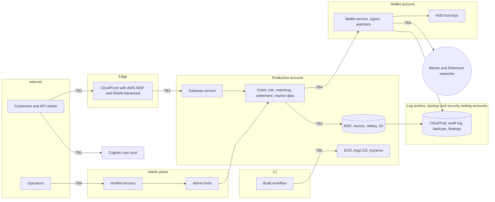
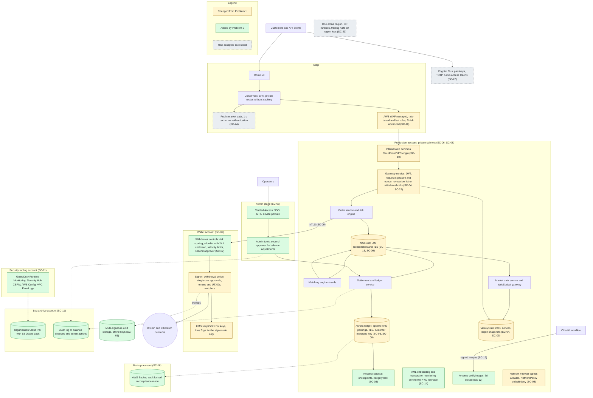
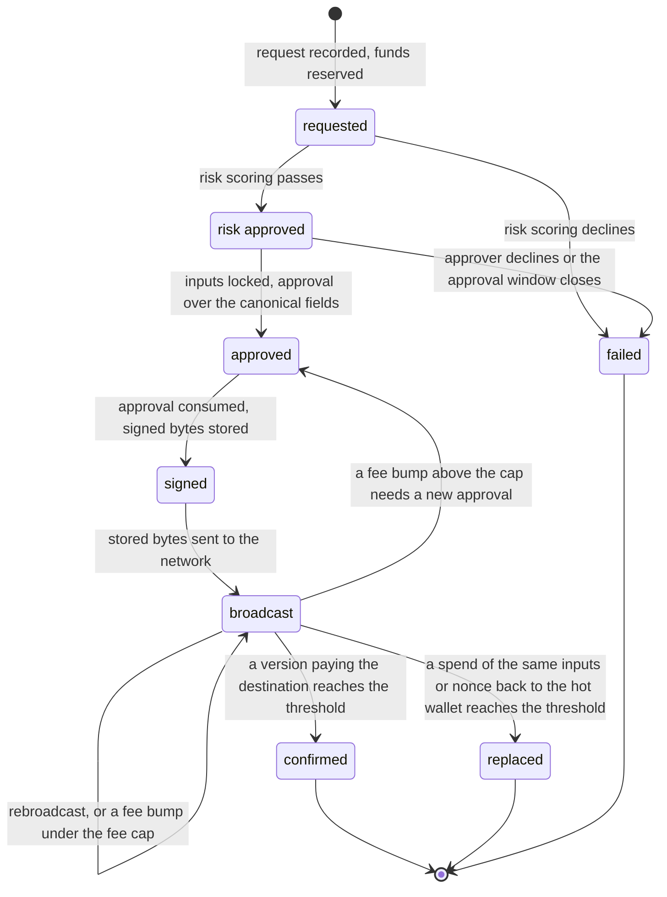

# Problem 5: Fortify The Castle, security inside the Problem 1 design

This answer builds security into the Problem 1 trading platform. Each change has an ID from SC-01 to SC-24 and a type: changed, added, deferred or accepted. Priority 0 blocks launch, 1 follows soon after, and 2 later. The [decision records](docs/adr/README.md) hold the reasoning.

## 1. The answer in brief

Customer funds rank first, because a confirmed chain transaction cannot be recalled. Ledger integrity, accounts, order flow, PII and availability follow.

| Question | Answer | Changes |
|---|---|---|
| Secured first | Accounts and identities, then custody, withdrawals and the ledger | SC-06, SC-07, then SC-01 to SC-04 |
| Refuse to ship without | Every priority 0 change | SC-01 to SC-16 |
| Deferred | Mesh mTLS, Macie, bug bounty, Nitro Enclaves, SOAR | SC-17 to SC-21 |
| Risk accepted | Revocation gap on trading calls, one region, public market data | SC-22 to SC-24 |

Every Problem 1 requirement still holds (section 9).

## 2. Scope and assumptions

Launch transactions are assumed to be Bitcoin P2WPKH and Ethereum EIP-1559, so each new type needs its own preimage and tests. Every number is an allocation until the Problem 1 load test measures it. Assumptions tied to a missing fact sit in section 8.

## 3. Threat model

### 3.1 Method

STRIDE runs on every data flow that crosses one of six trust boundaries in the Problem 1 design. Each threat gets at least one control, and the work follows the asset ranking ([ADR-P5-0001](docs/adr/0001-stride-over-trust-boundaries.md)). Attackers include account thieves, insiders, a poisoned build, a pod intruder, chain reorgs and stolen administrator access.

### 3.2 Trust boundaries

| ID | Boundary |
|---|---|
| TB1 | Internet to the edge and Cognito |
| TB2 | Edge to services |
| TB3 | Services to data stores, and pod egress |
| TB4 | Services to the wallet account, and on to the chains |
| TB5 | Operators to the admin plane |
| TB6 | CI to AWS |

### 3.3 Threats

C marks a compliance threat outside STRIDE.

| ID | Threat | STRIDE | Controls |
|---|---|---|---|
| TH-01 | A compromised service has KMS sign its own digest | E, T | SC-01, SC-06 to SC-09 |
| TH-02 | A takeover ends in a withdrawal to the attacker | S | SC-02, SC-22 |
| TH-03 | An approval is replayed, or its fields change before signing | T | SC-01 |
| TH-04 | An insider edits a balance or approves their own withdrawal | E, R | SC-02, SC-03, SC-05, SC-11 |
| TH-05 | A withdrawal request is replayed, also after a Valkey failover | T, R | SC-04 |
| TH-06 | The hot key or signer account is lost or compromised | E, D | SC-01, SC-15 |
| TH-07 | A deposit credits from a transaction that a reorg removes | T | SC-03 |
| TH-08 | A compromised settlement service rewrites ledger history | T | SC-03, SC-09, SC-11, SC-16 |
| TH-09 | Stolen administrator access deletes databases and backups | T, D | SC-06, SC-11, SC-15, SC-16 |
| TH-10 | A service forges or reads topics beyond its role | T, I | SC-07, SC-09, SC-13 |
| TH-11 | Logs are removed or edited to hide actions | R | SC-06, SC-11 |
| TH-12 | Phishing or a SIM swap takes over an account | S | SC-10, SC-22 |
| TH-13 | A stolen access token outlives logout or revocation | S | SC-15, SC-22 |
| TH-14 | A captured request is replayed, or a trade-scoped key withdraws | S, T | SC-04 |
| TH-15 | An insider front-runs customers from order flow | I | SC-05, SC-06, SC-07, SC-13 |
| TH-16 | A malicious image or build step reaches production | T, E | SC-07, SC-12 |
| TH-17 | A foreign CI job assumes a production role | E | SC-06, SC-07 |
| TH-18 | A compromised pod sends PII or secrets out | I | SC-07, SC-08, SC-09 |
| TH-19 | A compromised pod moves laterally | E | SC-07, SC-08, SC-09, later SC-17 |
| TH-20 | Data leaks through a shared snapshot or a broad grant | I | SC-06, SC-09, SC-11 |
| TH-21 | The management account or a root user is taken over | E | SC-05, SC-06 |
| TH-22 | DDoS or bots during a volatility spike | D | SC-10, SC-24, AD-P1-11 |
| TH-23 | Requests skip CloudFront and WAF and hit the ALB | S, D | SC-10 |
| TH-24 | Public market data is scraped at volume | D | SC-24 |
| TH-25 | The only active region is lost | D | SC-23 |
| TH-26 | Funds move for laundering or sanctioned parties | C | SC-14 |

## 4. Updated architecture

## 5. Security changes

| ID | Change | Type, priority | Protects against | Record |
|---|---|---|---|---|
| SC-01 | A signer in the wallet account enforces the withdrawal policy and alone may call `kms:Sign`. Capped hot wallet, multi-signature cold storage | changed, 0 | TH-01, TH-03, TH-06 | [ADR-P5-0002](docs/adr/0002-custody-boundary-signer.md) |
| SC-02 | Risk scoring, an allowlist with a 24 h cooldown, velocity limits, step-up MFA, a second approver | added, 0 | TH-02, TH-04 | [ADR-P5-0003](docs/adr/0003-withdrawal-controls-integrity-halts.md) |
| SC-03 | Append-only postings, and a checkpoint reconciliation that halts the affected shards on a breach | changed, 0 | TH-04, TH-07, TH-08, TH-10 | ADR-P5-0003 |
| SC-04 | Signed requests with a timestamp window and nonce, durable idempotency IDs, separate trade and withdraw scopes | changed, 0 | TH-05, TH-14 | [ADR-P5-0004](docs/adr/0004-signed-api-requests.md) |
| SC-05 | Admin plane behind Verified Access with MFA and device posture, dual approval of balance adjustments | added, 0 | TH-04, TH-15, TH-21 | [ADR-P5-0005](docs/adr/0005-cognito-and-admin-plane.md) |
| SC-06 | AWS Organizations with SCPs, and production, wallet, log archive, backup, security tooling and non-production accounts | added, 0 | TH-01, TH-09, TH-11, TH-15, TH-17, TH-20, TH-21 | [ADR-P5-0006](docs/adr/0006-multi-account-organization.md) |
| SC-07 | EKS Pod Identity, OIDC for CI, SSO for people, no IAM users | changed, 0 | TH-01, TH-10, TH-15 to TH-19 | ADR-P5-0006 |
| SC-08 | Private subnets, default-deny NetworkPolicy, a Network Firewall egress allowlist | changed, 0 | TH-01, TH-18, TH-19 | [ADR-P5-0007](docs/adr/0007-network-segmentation-egress.md) |
| SC-09 | TLS to data stores, customer managed keys, mTLS on the wallet path | changed, 0 | TH-01, TH-08, TH-10, TH-18, TH-20 | [ADR-P5-0008](docs/adr/0008-encryption-customer-managed-keys.md) |
| SC-10 | WAF, Shield Advanced, an internal ALB reachable only from CloudFront | changed, 0 | TH-12, TH-22, TH-23 | [ADR-P5-0009](docs/adr/0009-edge-origin-only-cloudfront.md) |
| SC-11 | Locked CloudTrail, GuardDuty, Security Hub CSPM, Config, an immutable audit log | added, 0 | TH-01, TH-04, TH-08 to TH-11, TH-15 to TH-21 | [ADR-P5-0010](docs/adr/0010-detection-audit-locked-backups.md) |
| SC-12 | Keyless Sigstore signing in CI. Kyverno admits only images the build workflow signed | added, 0 | TH-16 | [ADR-P5-0011](docs/adr/0011-signed-images-kyverno.md) |
| SC-13 | MSK authorization through IAM policies per service role | changed, 0 | TH-10, TH-15 | [ADR-P5-0012](docs/adr/0012-msk-iam-authorization.md) |
| SC-14 | AML and Travel Rule controls signed off by compliance | added, 0 | TH-26 | [ADR-P5-0013](docs/adr/0013-launch-gates.md) |
| SC-15 | Prelaunch recovery exercises and an external penetration test | added, 0 | TH-06, TH-08, TH-09, TH-13 | ADR-P5-0013 |
| SC-16 | A backup vault in its own account, locked in compliance mode | added, 0 | TH-08, TH-09 | ADR-P5-0010 |
| SC-17 | mTLS between all services through a mesh | deferred, 1 | TH-19 | [ADR-P5-0014](docs/adr/0014-deferred-and-accepted-risks.md) |
| SC-18 | Macie and enforced data classification | deferred, 1 | TH-18, TH-20 | ADR-P5-0014 |
| SC-19 | Bug bounty and recurring game days | deferred, 1 | TH-12 to TH-14, TH-22, TH-23 | ADR-P5-0014 |
| SC-20 | Nitro Enclaves for the signer | deferred, 2 | TH-01, TH-06 | ADR-P5-0014 |
| SC-21 | SOAR beyond findings routed into tickets | deferred, 2 | TH-09, TH-16 | ADR-P5-0014 |
| SC-22 | Cognito passkeys and TOTP, 5 min tokens, revocation checked only on withdrawal and key calls | accepted | TH-02, TH-12, TH-13 | ADR-P5-0005 |
| SC-23 | One active region with the Problem 1 DR runbook | accepted | TH-25 | ADR-P5-0014 |
| SC-24 | Public market data without authentication, behind caching and rate limits | accepted | TH-24 | ADR-P5-0014 |

SC-10 assumes WebSocket works through a VPC origin (FN-11). If not, the ALB turns public behind the CloudFront prefix list and a secret header.

## 6. Order of work

1. SC-06 and SC-07, since every account and identity depends on them.
2. Funds: SC-01, SC-02 and the withdraw scope of SC-04.
3. Ledger: SC-03, SC-16 and the audit log.
4. Accounts: SC-22 and request signatures.
5. Exposure and lateral movement: SC-08, SC-09, SC-11 to SC-13.
6. Availability: SC-10.
7. Gates: SC-14 before real assets, SC-15 before launch.

## 7. Custody protocol

KMS signs any digest it receives under the message type DIGEST, so the signer never takes one from a caller. It builds each transaction from approved fields.

### 7.1 Boundary and key policy

The hot key policy grants `kms:Sign` to the signer role only, conditioned on `kms:SigningAlgorithm` and the wallet account's endpoint (`aws:sourceVpce`). Production reaches the wallet service only over mTLS.

### 7.2 Withdrawal states

Each state is a durable record changed only by a conditional write, so two workers cannot move one withdrawal twice.

Replaced means a spend of the same inputs or nonce back to the hot wallet confirmed instead.

### 7.3 Approvals and the signing preimage

An approval covers chain, asset, destination, amount, fee cap, and the nonce or UTXO set. Signing consumes it in the same conditional write that stores the signed bytes. A fee bump under the cap spends the same inputs or nonce, so only one version can confirm. Above the cap it needs a new approval.

| Chain | Digest | Signature handling |
|---|---|---|
| Bitcoin, P2WPKH | BIP-143 hash per input with `SIGHASH_ALL`, replaceable under BIP-125 | Lower `s` (BIP-146), re-encode, append the sighash byte |
| Ethereum, EIP-1559 | `keccak256(0x02 \|\| rlp([...]))` with the chain ID inside | Lower `s` (EIP-2), find the y parity against the KMS public key |

### 7.4 Nonce and UTXO ownership

The signer alone allocates Ethereum nonces. A nonce freed before signing goes to the next withdrawal, since a gap blocks every later transaction. For Bitcoin the signer locks a UTXO set to one withdrawal and spends only confirmed outputs, so a replacement never chases unconfirmed parents.

### 7.5 Crashes and retries

Each step is idempotent by withdrawal ID. A crash after KMS signed but before the record was stored leaves the approval unconsumed, so the signer signs again. Broadcasts read only stored bytes. Watchers derive end states from the chain, and a reorg below the threshold returns a withdrawal to `broadcast`. Any hot wallet spend missing from the broadcast log pages as TH-01.

### 7.6 Reservations

The risk engine reserves the amount on acceptance. `confirmed` debits it, while `failed` and `replaced` release it. A signed transaction keeps its reservation until something confirms, since a stuck transaction can still confirm later.

### 7.7 Deposits and confirmations

A deposit credits after 3 blocks on Bitcoin or finality on Ethereum (FN-06). A reorg before that reverses the pending credit.

### 7.8 Key loss and region loss

Cold storage uses offline multi-signature keys outside KMS. The hot keys are multi-Region keys with a replica in `<DR_REGION>` whose policy names only the DR signer role. The signer's records replicate there, so the DR signer never reuses inputs or nonces already signed. Withdrawals resume under Problem 1 section 6.1 once the chains show no hot wallet transaction those records lack.

## 8. Facts needed

| ID | Missing fact | Owner, how to get it | Assumed meanwhile |
|---|---|---|---|
| FN-01 | Jurisdiction and licence | Legal, ask | Singapore, MAS Payment Services Act |
| FN-02 | Custody model | Executives, decision meeting | Self-custody with KMS keys |
| FN-03 | KYC and AML vendor | Compliance, selection | A vendor-neutral interface |
| FN-04 | Data residency and DR region | Legal, ask | Primary ap-southeast-1, `<DR_REGION>` pending |
| FN-05 | Hot wallet risk appetite | Risk, ask | Under 5 % of customer assets, the SC-01 cap |
| FN-06 | Confirmation thresholds | Risk, ask | 3 blocks on Bitcoin, finality on Ethereum |
| FN-07 | An existing SOC | Security, ask | None, findings go to on-call |
| FN-08 | Approval threshold and velocity limits | Risk, ask | Placeholders, tested over several values |
| FN-09 | Device trust provider | IT, compare with supported providers | One supported provider |
| FN-10 | Whether a managed login cookie sets a new `auth_time` | Identity owner, sandbox test | Step-up through an API sign-in |
| FN-11 | WebSocket through a CloudFront VPC origin | Platform, prelaunch test | Supported |
| FN-12 | MSK metadata mode | Platform, cluster build | ZooKeeper, if any, admits only brokers |
| FN-13 | Chain data source | Custody and risk, design decision | Exchange-run full nodes in the wallet account |

## 9. Problem 1 requirements after the changes

All sixteen Problem 1 requirements hold. REQ-P1-1 to REQ-P1-3, REQ-P1-5, REQ-P1-6, REQ-P1-9 to REQ-P1-11, REQ-P1-15A and REQ-P1-16A are unchanged. Six shift:

- REQ-P1-4: the security column adds 1,166.74 USD a month on demand (Problem 1 section 8.3).
- REQ-P1-7: rate-based rules sit well above normal client traffic.
- REQ-P1-8: SC-04 adds 2 ms at the gateway, so 62 ms of 100 ms are allocated (Problem 1 section 7.1). TLS and WAF fit existing allocations.
- REQ-P1-13A: SC-16 locks backups, SC-15 rehearses restores, and section 7.8 covers DR keys.
- REQ-P1-12A and REQ-P1-14A: SC-03 halts count against availability and harden the ledger.

## 10. What was left out and the trade-offs

### 10.1 Trade-off register

| Change | Opposed principle | Forcing requirement | Consequence accepted | Reopen when |
|---|---|---|---|---|
| SC-17 | SEC-DP5 | REQ-P1-8, a proxy hop on the order path | No mTLS between other services | Mesh overhead under 2 ms p99, or a lateral-movement finding |
| SC-18 | SEC-DP5, SEC-DP6 | REQ-P1-4, KYC records stay with the vendor | No automated PII discovery | PII stored outside the vendor |
| SC-19 | SEC-DP7, GEN-DP6 | REQ-P5-3, penetration test findings close first | External findings come from the test | Those findings closed |
| SC-20 | SEC-DP6 | REQ-P1-4, the key policy confines signing | A signer runtime compromise can sign up to the cap | A penetration test bypasses it |
| SC-21 | SEC-DP7 | REQ-P1-4, no SOC (FN-07) | Manual response | Over 20 actionable findings a week |
| SC-22 | SEC-DP1 | REQ-P1-8, local JWT checks | A revoked token trades for up to 5 min | A regulator demands instant revocation |
| SC-23 | REL-DP1, PERF-DP2 | REQ-P1-14A, REQ-P1-12A, one sequence per symbol | Trading halts in a region loss | A region-loss RTO under 1 h |
| SC-24 | SEC-DP3 | REQ-P1-7, REQ-P1-8, the 1 s cache of AD-P1-09 | Anyone can read market data | Scraping above the rate-limit design |

### 10.2 Outside this answer and residual risk

Products Problem 1 left out, such as fiat rails, would need their own threat model. The KYC vendor's internal controls, the cold key ceremony, customer devices and token transfers are out of scope. Residual risks remain: two colluding approvers, a signer bug bounded by the hot wallet cap, a lying chain data source (FN-13), nonces lost in a Valkey failover, and repository names published in the Sigstore transparency log.

## 11. Verification

Design checks now cover the signer state machine, the withdrawal policy, reconciliation and per-role denials. Once an AWS account exists, tests add replay, a direct-to-ALB attempt, deletes against the locked vaults and unsigned images.

## 12. Traceability

| Requirement | Answered in |
|---|---|
| REQ-P5-1 | Sections 3 to 7 |
| REQ-P5-2 | Sections 4 and 5 |
| REQ-P5-3 | Sections 1, 5, 6 and 10 |
| REQ-P5-4 | Section 8 |
| REQ-P5-5 | Sections 4, 5 and 10 |
| REQ-P5-6 | Section 9 |

## Sources, read on 2026-11-04

- [CloudFront VPC origins](https://docs.aws.amazon.com/AmazonCloudFront/latest/DeveloperGuide/private-content-vpc-origins.html), [CloudFront WebSocket](https://docs.aws.amazon.com/AmazonCloudFront/latest/DeveloperGuide/distribution-working-with.websockets.html)
- [Cognito feature plans](https://docs.aws.amazon.com/cognito/latest/developerguide/cognito-sign-in-feature-plans.html), [token revocation](https://docs.aws.amazon.com/cognito/latest/developerguide/token-revocation.html), [access tokens](https://docs.aws.amazon.com/cognito/latest/developerguide/amazon-cognito-user-pools-using-the-access-token.html)
- [SCPs](https://docs.aws.amazon.com/organizations/latest/userguide/orgs_manage_policies_scps.html), [centralized root access](https://docs.aws.amazon.com/IAM/latest/UserGuide/id_root-user.html), [MSK IAM access control](https://docs.aws.amazon.com/msk/latest/developerguide/iam-access-control.html)
- KMS [Sign](https://docs.aws.amazon.com/kms/latest/APIReference/API_Sign.html), [key specs](https://docs.aws.amazon.com/kms/latest/developerguide/symm-asymm-choose-key-spec.html), [multi-Region keys](https://docs.aws.amazon.com/kms/latest/developerguide/multi-region-keys-overview.html), [condition keys](https://docs.aws.amazon.com/kms/latest/developerguide/conditions-kms.html), [VPC endpoint conditions](https://docs.aws.amazon.com/kms/latest/developerguide/vpce-policy-condition.html)
- [Backup Vault Lock](https://docs.aws.amazon.com/aws-backup/latest/devguide/vault-lock.html), [Verified Access device trust](https://docs.aws.amazon.com/verified-access/latest/ug/device-trust.html), [ElastiCache replication](https://docs.aws.amazon.com/AmazonElastiCache/latest/dg/Replication.html)
- [Kyverno 1.19 Sigstore verification](https://kyverno.io/docs/policy-types/cluster-policy/verify-images/sigstore/), [Sigstore security model](https://docs.sigstore.dev/about/security/)
- [BIP-125, BIP-143, BIP-146](https://github.com/bitcoin/bips), [EIP-2, EIP-1559](https://eips.ethereum.org/)
